<nav class=toc aria-label="On this page">

On this page

<ol>
<li><a href="#why">Why the Church honours him</a></li>
<li><a href="#patara">A boy of Patara and the rich young man</a></li>
<li><a href="#gold">Three bags of gold in the night</a></li>
<li><a href="#bishop">"The first to enter the church": Bishop of Myra</a></li>
<li><a href="#prison">Prison for Christ</a></li>
<li><a href="#nicaea">Nicaea and the famous slap</a></li>
<li><a href="#generals">Saving the innocent: the three generals</a></li>
<li><a href="#sea">Wonderworker of the sea: sailors and grain ships</a></li>
<li><a href="#boys">The three boys in the barrel</a></li>
<li><a href="#death">His death, and the manna of St Nicholas</a></li>
<li><a href="#bari">1087: the journey to Bari</a></li>
<li><a href="#venice">Venice, and a saint for East and West</a></li>
<li><a href="#santa">From Sinterklaas to Santa Claus</a></li>
<li><a href="#giving">The meaning of his gifts</a></li>
<li><a href="#places">His places and shrines</a></li>
<li><a href="#art">Nicholas in art</a></li>
</ol>
</nav>

## His story

Long before there were stockings by the chimney, there was a bishop who crept through the streets of his town at night with a bag of gold, so that a poor man's daughters would not be sold into shame. He threw the gold through the window, slipped away into the dark, and begged the family never to tell anyone who had done it. That bishop was St Nicholas of Myra, and the whole world has been keeping his secret, and telling it, ever since.

We know only a little for certain about his life. He was bishop of Myra, a port on the south coast of what is now Turkey, in the fourth century, in the age of the martyrs and of the first great Council of the Church. His tomb was already a place of pilgrimage within living memory, and churches were being built in his name within two centuries of his death. Around that small, solid core the Church has handed down a treasury of stories, some very early and some much later. In every one of them he is the same man: the friend of children, the poor, prisoners and sailors, the defender of the innocent, the shepherd who gave everything away for love of Christ.

The Greeks call him *Nikolaos o Thaumatourgos*, Nicholas the Wonderworker. Russians love him more than almost any other saint. Italians call him San Nicola di Bari, after the city that has kept his bones since 1087. And the Dutch call him Sinterklaas, the name that crossed the Atlantic and became, in New York, **Santa Claus**. Pope Francis, praying at his tomb in 2018, called him "the Oriental Bishop whose veneration crosses seas and bridges boundaries between Churches."

### c. 270 · Patara (tradition)
Nicholas is born to a wealthy Christian family in Patara, a harbour town of Lycia. Tradition gives his birthday as 15 March 270.

### Youth · Patara
Left an orphan, he gives his inheritance to the poor. By tradition he secretly provides dowries for three poor sisters.

### Youth · The Holy Land (tradition)
He makes a pilgrimage to Egypt and the Holy Land. On the voyage he calms a storm at sea.

### c. 300 · Myra
He is chosen bishop of Myra, the capital of Lycia.

### 303–311 · The Great Persecution
Under the Emperor Diocletian he is imprisoned for the faith, and freed when the persecution ends.

### 311–312 · Famine in Myra (tradition)
He persuades sailors on the emperor's grain ships to share their wheat with the starving city.

### 325 · Nicaea
By an early tradition he is one of the bishops at the First Council of Nicaea, which confesses that the Son is "of one substance with the Father."

### c. 330 · Myra (tradition)
He saves three innocent men from the executioner's sword and, appearing in a dream to Constantine, rescues three generals from death.

### 6 December c. 343 · Myra
He dies in Myra and is buried there. The sweet-smelling "manna" or "myrrh" from his tomb draws pilgrims for centuries.

### 5th–6th century · Myra and Constantinople
A great church rises over the place of his burial at Myra, and the Emperor Justinian rebuilds a church in his honour in Constantinople.

### 9 May 1087 · Bari
Sixty-two sailors of Bari carry the main part of his relics from Myra to Italy.

### 1 October 1089 · Bari
Pope Urban II lays the relics in the crypt of the new basilica of San Nicola.

### 1100 · Venice
By the Venetian account, sailors on their way to the First Crusade take the remaining fragments of his bones to San Nicolò on the Lido.

### 17th century · New Amsterdam
Dutch settlers bring their love of Sinterklaas to the New World.

### 1823 · New York
"A Visit from St. Nicholas" ("'Twas the night before Christmas") is published, and the American Santa Claus is on his way.

### 2018 · Bari
Pope Francis and the heads of the Churches of the Middle East pray together before his relics for peace.

<figure class=photo>
<picture><source srcset="/static/art/nicholas-icon-sinai-600.webp 600w,/static/art/nicholas-icon-sinai.webp 894w" sizes="(max-width:760px) 100vw,760px" type="image/webp">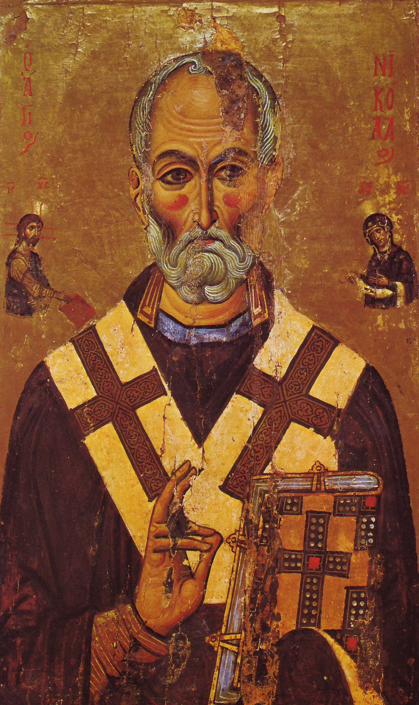</picture>
<figcaption><b>St Nicholas</b>, an icon from the first half of the thirteenth century at the Monastery of St Catherine, Sinai. This is the face the Christian East has always known: the high forehead, the white beard, the Gospel book and the bishop's stole with its crosses. Image: <a href="https://commons.wikimedia.org/wiki/File:St_Nicholas_Icon_Sinai_13th_century.jpg">St Nicholas Icon Sinai 13th century</a>, public domain, via Wikimedia Commons.</figcaption>
</figure>

<h2 id=why>Why the Church honours him</h2>

- **He loved the poor in secret.** He gave away his inheritance and, as the best-loved story tells, saved three young women by gifts given at night, asking for no thanks. He lived the words of Jesus: "When you give alms, do not let your left hand know what your right hand is doing" (Matthew 6:3).
- **He was a faithful shepherd in a time of persecution.** He suffered prison for Christ under Diocletian and came out still bishop, still preaching, still caring for his people.
- **He defended the innocent.** The earliest stories told about him show him stopping an unjust execution and freeing men falsely accused.
- **He is the Wonderworker.** For seventeen centuries Christians have asked his prayers in storms, in famine, in prison and in sickness, and found him a friend.
- **He belongs to East and West together.** Catholics and Orthodox share his feast and his relics. His tomb in Bari has become a place where the divided Churches pray side by side.
- **He gave the world the joy of giving.** The gift-giver of Christmas, Sinterklaas and Santa Claus, began with a bishop who gave because Christ had given everything to him.

<h2 id=patara>A boy of Patara and the rich young man</h2>

<figure class=map style="max-width:560px;margin:14px auto 18px"><a href="/static/maps/map-nicholas-lycia.svg">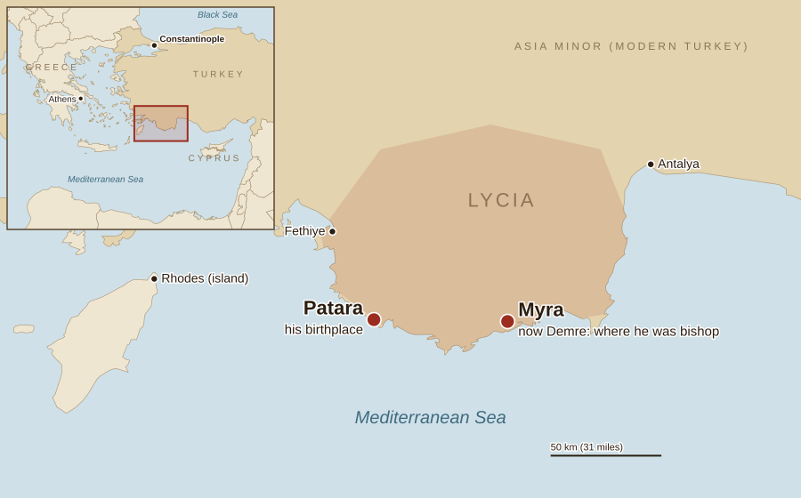</a><figcaption>Patara was a busy harbour town of Lycia, on what is now the southern coast of Turkey, about 37 miles (60 km) west of Myra as the crow flies, the city Nicholas would one day serve as bishop. Map by The Daily Word; coastlines and borders from Natural Earth (public domain); the extent of Lycia is approximate. Tap to enlarge.</figcaption></figure>

**Patara** was a busy harbour on the coast of Lycia, with a great lighthouse, a theatre and a famous old temple of Apollo. St Paul had changed ships there on his last voyage to Jerusalem (Acts 21:1–2). Here, by tradition, Nicholas was born in about 270, to Christian parents who were rich and devout. Different old accounts give their names as Epiphanius and Johanna, or as Theophanes and Nonna.

Many stories gathered around his childhood. Painters loved one in particular: that on the day he was born, the baby Nicholas stood up by himself in his first bath, as if he were already giving thanks to God. Another says that even as an infant he fasted on Wednesdays and Fridays, taking his mother's milk only once on those days. These are the kind of tender legends that grow up around a much-loved saint, and the Church has always told them with a smile.

<figure class=photo>
<picture><source srcset="/static/art/nicholas-gentile-birth-600.webp 600w,/static/art/nicholas-gentile-birth.webp 1280w" sizes="(max-width:760px) 100vw,760px" type="image/webp">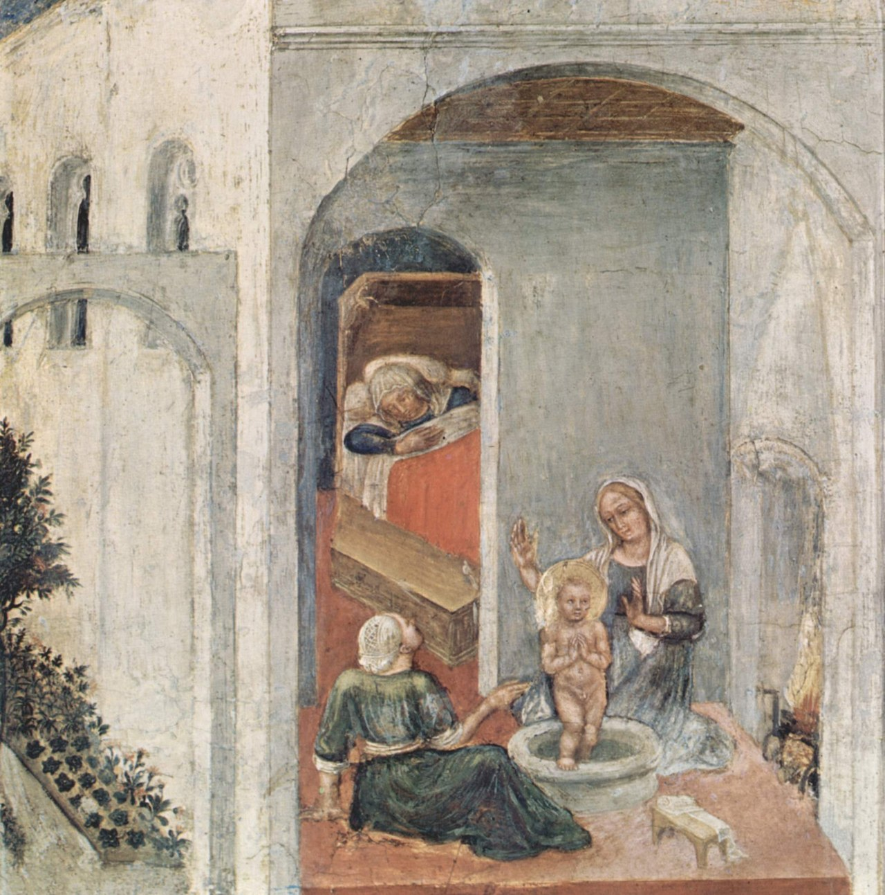</picture>
<figcaption><i>The Birth of St Nicholas</i>, by <b>Gentile da Fabriano</b>, 1425, a predella panel from the Quaratesi Polyptych. By legend, the newborn saint stood up in his first bath. Pinacoteca Vaticana. Image: <a href="https://commons.wikimedia.org/wiki/File:Gentile_da_Fabriano_061.jpg">Gentile da Fabriano 061</a>, public domain, via Wikimedia Commons.</figcaption>
</figure>

While he was still young, both his parents died, perhaps in an epidemic. Nicholas was left with a fortune. He remembered, says the account kept by Vatican News, "the rich young man in the Gospel," whom Jesus told: "Go, sell your possessions, and give the money to the poor, and you will have treasure in heaven; then come, follow me" (Matthew 19:21). The young man in the Gospel went away sad. Nicholas did what Jesus asked. He gave his inheritance to "the needy, the sick, and the poor," and gave his life to God.

<figure class=photo>
<picture><source srcset="/static/art/nicholas-patara-600.webp 600w,/static/art/nicholas-patara.webp 1280w" sizes="(max-width:760px) 100vw,760px" type="image/webp">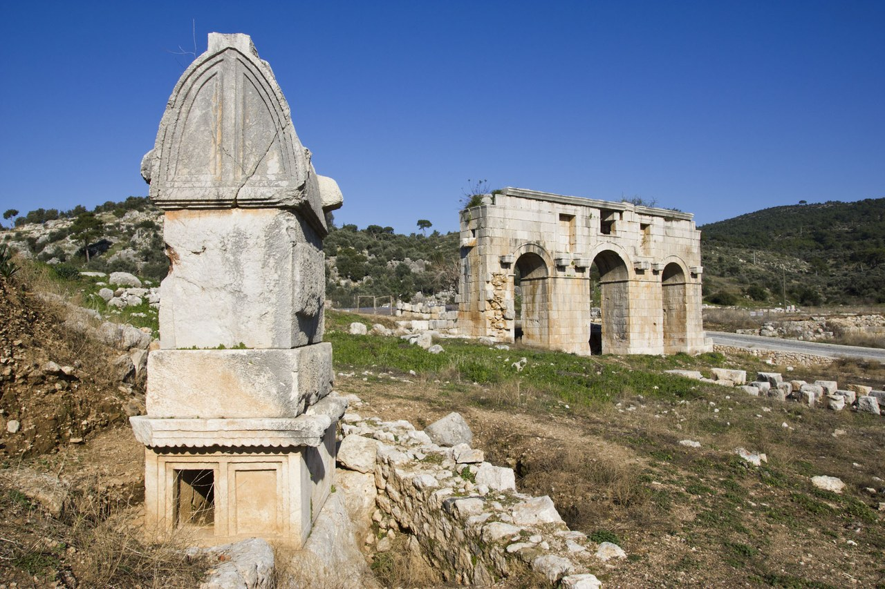</picture>
<figcaption>The ruins of <b>Patara</b>, his birthplace by tradition: a Lycian tomb and the northern city gate. Photo: <a href="https://commons.wikimedia.org/wiki/File:Patara_Ruins_(7023429755).jpg">Patara Ruins (7023429755)</a> by William Neuheisel, <a href="https://creativecommons.org/licenses/by/2.0">CC BY 2.0</a>, via Wikimedia Commons.</figcaption>
</figure>

<h2 id=gold>Three bags of gold in the night</h2>

This is the most famous story about St Nicholas, and one of the earliest. It is first written down in the Life of St Nicholas by Michael the Archimandrite in the ninth century, and the Church has told it, as a holy tradition, ever since.

In the town lived a man who had once been rich but had lost everything. He had three daughters, and no money for their dowries. In those days a girl without a dowry could not marry, and the father, in despair, was about to let his daughters be sold into a life of shame.

Nicholas heard of it. He did not want to humiliate the family by giving to them in public, and he did not want any praise for himself. So he waited until night, crept to the house, and threw a bag of gold through the open window. In the morning the father found it, wept for joy and arranged the marriage of his eldest daughter. Soon afterwards, another bag of gold came flying through the window in the night, and the second daughter was married.

The third time, the father stayed awake. When he heard the gold land on the floor, he ran out into the street and caught the giver. He threw himself at the bishop's feet. Nicholas raised him up and made him promise not to tell anyone what he had done.

<figure class=photo>
<picture><source srcset="/static/art/nicholas-gentile-dowry-600.webp 600w,/static/art/nicholas-gentile-dowry.webp 1280w" sizes="(max-width:760px) 100vw,760px" type="image/webp">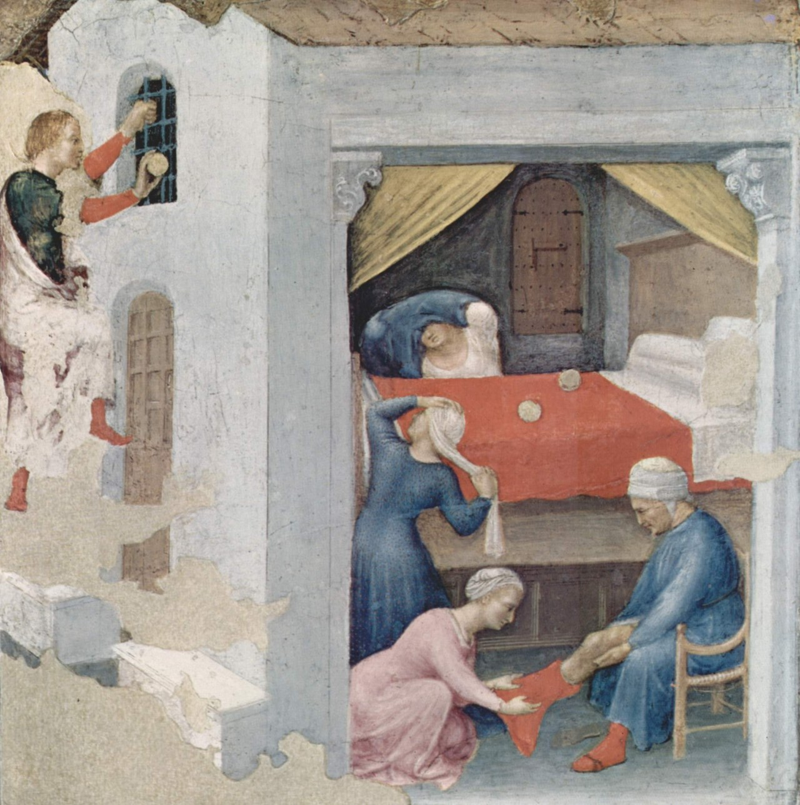</picture>
<figcaption><i>St Nicholas and the Three Poor Maidens</i>, by <b>Gentile da Fabriano</b>, 1425, from the Quaratesi predella. Nicholas reaches up to the window in the dark while the father and his daughters sleep. Pinacoteca Vaticana. Image: <a href="https://commons.wikimedia.org/wiki/File:Gentile_da_Fabriano_063.jpg">Gentile da Fabriano 063</a>, public domain, via Wikimedia Commons.</figcaption>
</figure>

This is why St Nicholas is so often painted holding three balls or three bags of gold. It is why children in so many countries find gifts in their shoes or stockings on his feast. And it is the reason the old sign of the pawnbroker, three golden balls, is often said to recall him. The real gift, though, was never the gold. It was a heart that gave in secret, so that only God would see.

<figure class=photo>
<picture><source srcset="/static/art/nicholas-lorenzetti-dowry-600.webp 600w,/static/art/nicholas-lorenzetti-dowry.webp 1057w" sizes="(max-width:760px) 100vw,760px" type="image/webp">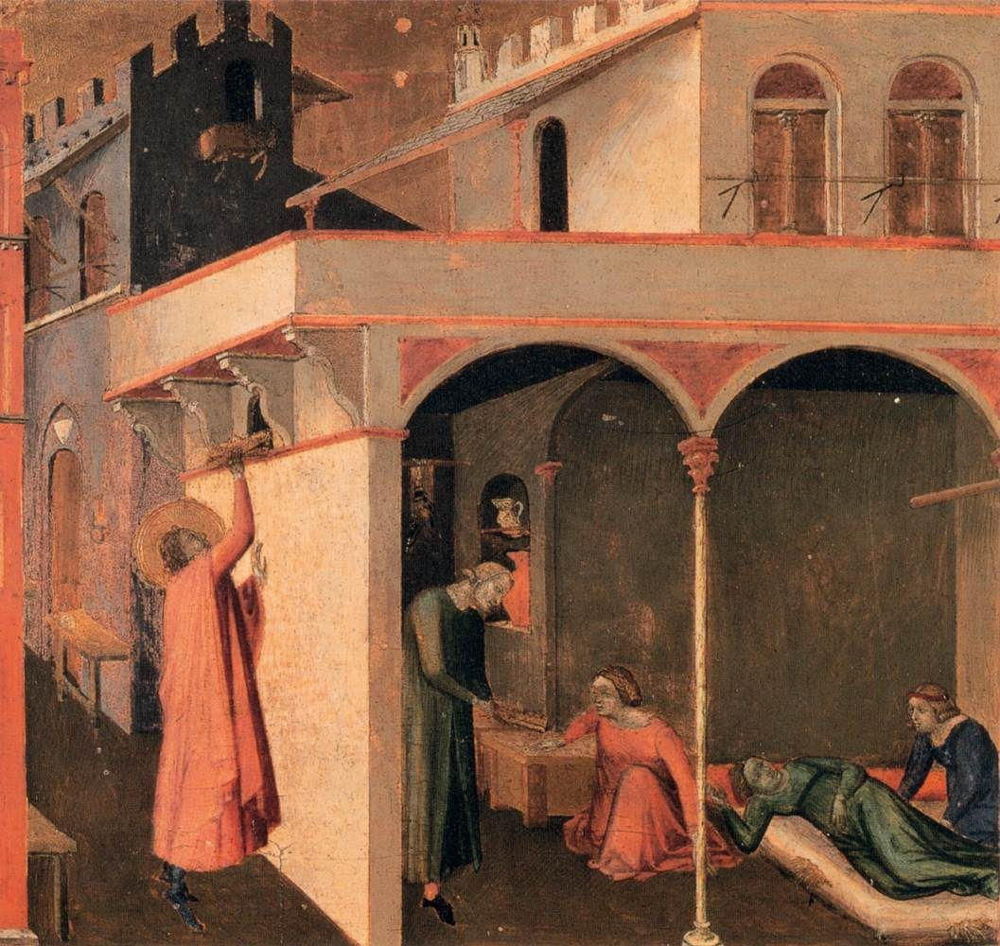</picture>
<figcaption><i>St Nicholas Gives Dowries to Three Poor Girls</i>, by <b>Ambrogio Lorenzetti</b>, about 1332, one of four scenes painted for the church of San Procolo in Florence. Uffizi Gallery, Florence. Image: <a href="https://commons.wikimedia.org/wiki/File:Ambrogio_lorenzetti,_scene_della_vita_di_san_nicola_03.jpg">Ambrogio lorenzetti, scene della vita di san nicola 03</a>, public domain, via Wikimedia Commons.</figcaption>
</figure>

<figure class=photo>
<picture><source srcset="/static/art/nicholas-bicci-dowries-600.webp 600w,/static/art/nicholas-bicci-dowries.webp 1280w" sizes="(max-width:760px) 100vw,760px" type="image/webp">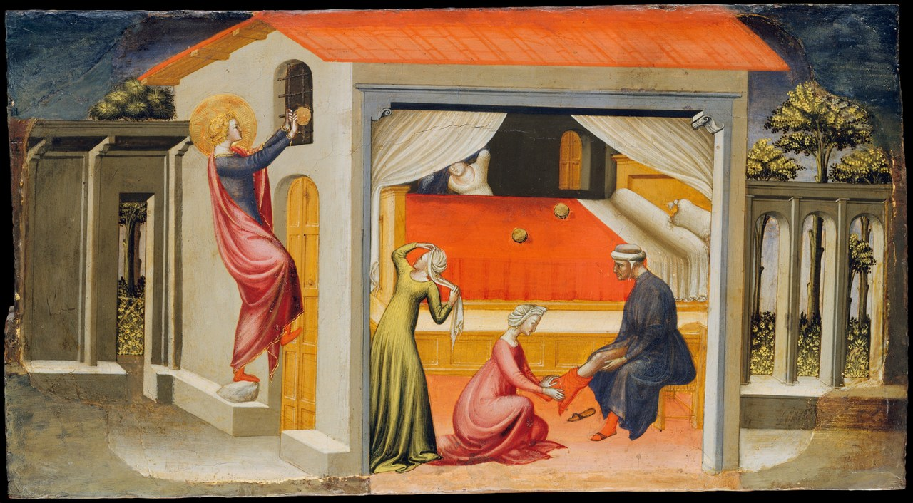</picture>
<figcaption><i>St Nicholas Providing Dowries</i>, by <b>Bicci di Lorenzo</b>, 1433–35. The Metropolitan Museum of Art, New York. Image: <a href="https://commons.wikimedia.org/wiki/File:Saint_Nicholas_Providing_Dowries_MET_DT273088.jpg">Saint Nicholas Providing Dowries MET DT273088</a>, <a href="https://creativecommons.org/publicdomain/zero/1.0/">CC0</a>, via Wikimedia Commons.</figcaption>
</figure>

<h2 id=bishop>"The first to enter the church": Bishop of Myra</h2>

As a young man, the early accounts say, Nicholas made a pilgrimage to Egypt and to the Holy Land, to walk where Jesus had walked. A later tradition says he stayed for a time near Bethlehem, in a cave at Beit Jala where a church of St Nicholas still stands.

On the way home his ship ran into a terrible storm. The sailors were sure they would be wrecked. Nicholas prayed calmly, and the wind dropped and the sea grew still. From that day sailors have called him their own saint.

He came back to **Myra**, the chief city of Lycia, a few miles inland from the port of Andriake. The bishop of Myra had just died, and the bishops gathered to choose a successor. A charming old story tells that one of them had a dream: the new bishop should be the first man to enter the church the next morning, and his name would be Nicholas. At dawn a young man came in to pray. "What is your name?" they asked. "Nicholas, the sinner, the servant of your holiness," he said. And they made him bishop.

<figure class=photo>
<picture><source srcset="/static/art/nicholas-lorenzetti-bishop-600.webp 600w,/static/art/nicholas-lorenzetti-bishop.webp 1048w" sizes="(max-width:760px) 100vw,760px" type="image/webp">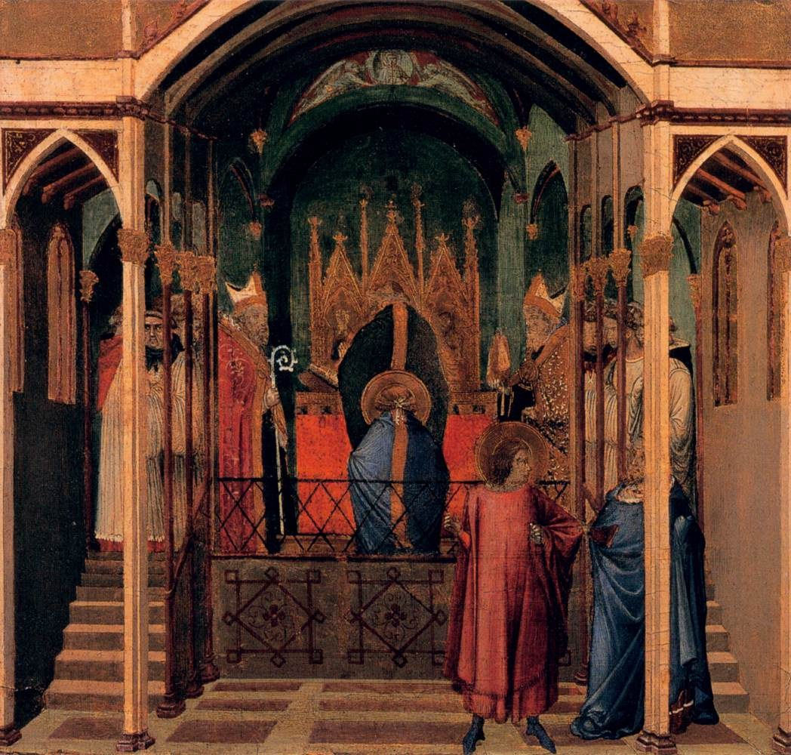</picture>
<figcaption><i>St Nicholas Is Elected Bishop of Myra</i>, by <b>Ambrogio Lorenzetti</b>, about 1332. Uffizi Gallery, Florence. Image: <a href="https://commons.wikimedia.org/wiki/File:Ambrogio_lorenzetti,_scene_della_vita_di_san_nicola_04.jpg">Ambrogio lorenzetti, scene della vita di san nicola 04</a>, public domain, via Wikimedia Commons.</figcaption>
</figure>

<figure class=photo>
<picture><source srcset="/static/art/nicholas-veronese-600.webp 600w,/static/art/nicholas-veronese.webp 1280w" sizes="(max-width:760px) 100vw,760px" type="image/webp">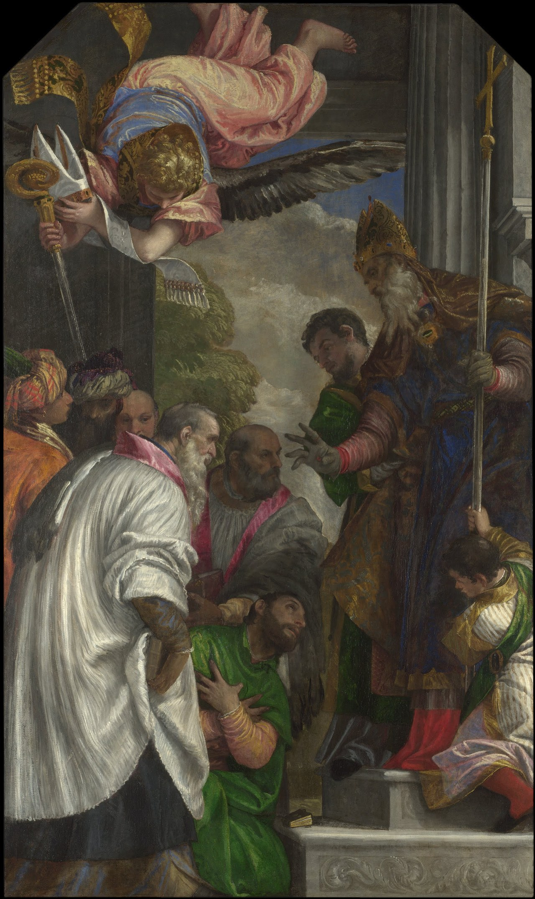</picture>
<figcaption><i>The Consecration of St Nicholas</i>, by <b>Paolo Veronese</b>, 1562. An angel brings the mitre and crozier from heaven for the new bishop. National Gallery, London. Image: <a href="https://commons.wikimedia.org/wiki/File:Paolo_Veronese_-_The_Consecration_of_Saint_Nicholas_-_Google_Art_Project.jpg">Paolo Veronese - The Consecration of Saint Nicholas - Google Art Project</a>, public domain, via Wikimedia Commons.</figcaption>
</figure>

<h2 id=prison>Prison for Christ</h2>

Nicholas was bishop in a dangerous time. In 303 the Emperor **Diocletian** began the last and fiercest of the Roman persecutions. Churches were pulled down, the Scriptures were burned, and bishops and priests were arrested and tortured to make them sacrifice to the gods.

Nicholas, the old accounts say, was among them. He was thrown into prison, perhaps sent into exile, and kept there for years. Vatican News sums it up simply: "under the emperor Diocletian [he] was exiled and imprisoned." When the persecution ended and **Constantine** came to power, the prisoners were set free, and Nicholas went home to his people.

Historians point out that the story is told only in later sources. But it fits the times, and there is a moving detail. When the bones in Bari were examined in the 1950s, and the saint's face was reconstructed from that study in 2004, scientists found that his nose had once been broken and had partly healed. It may be a scar from those years of suffering for Christ.

<h2 id=nicaea>Nicaea and the famous slap</h2>

In 325 Constantine called the bishops of the whole Church to **Nicaea**, near his new capital, to settle the teaching of a priest named **Arius**, who said that the Son of God was a creature and not truly God. The Council answered with the words we still pray in the Creed: the Son is "God from God, Light from Light, true God from true God, begotten, not made, consubstantial with the Father." The great champion of that faith was [St Athanasius](/saints/athanasius/).

An early list of the bishops at the Council, preserved by Theodore the Lector about 515, includes "Nicholas of Myra in Lycia," and the Church has long remembered him as one of the Fathers of Nicaea. Not every list has his name, so historians are not certain he was there.

Then there is the story everyone loves. It is a **late tradition**, first written down in the fourteenth century, a thousand years after the Council. It says that as Arius spoke against the divinity of Christ, Nicholas grew so angry that he walked across the hall and struck him across the face. The other bishops were shocked. They took away his bishop's stole and Gospel book and locked him in a cell. That night, Christ and the Virgin Mary appeared to him in prison. "Why are you here?" they asked. "For loving you," he answered. Christ gave him back the Gospel book and the Mother of God gave him back his stole, and in the morning the bishops found him free of his chains and restored him.

That is why, in many Orthodox icons, small figures of Christ and Mary appear at his shoulders, holding out the Book of the Gospels and the bishop's stole. The story does not teach us to slap anyone. It shows how fiercely Nicholas loved the Lord Jesus, and how gently the Lord gave him back his place.

<figure class=photo>
<picture><source srcset="/static/art/nicholas-icon-arius-600.webp 600w,/static/art/nicholas-icon-arius.webp 1280w" sizes="(max-width:760px) 100vw,760px" type="image/webp">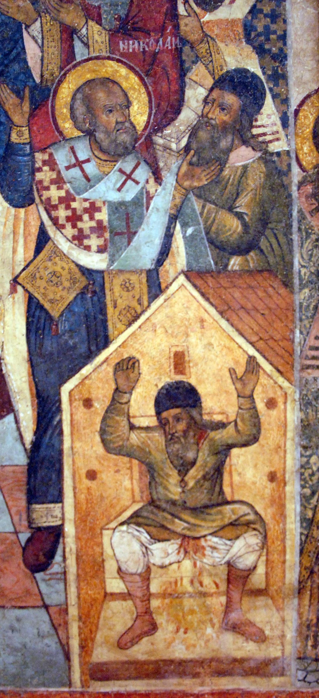</picture>
<figcaption><b>St Nicholas at Nicaea</b>, a late medieval Greek icon. Above, Nicholas strikes Arius; below, the bishop sits in prison, where by tradition Christ and Mary came to him. Image: <a href="https://commons.wikimedia.org/wiki/File:Arius_St_Nicolaus.jpg">Arius St Nicolaus</a>, public domain, via Wikimedia Commons.</figcaption>
</figure>

<figure class=photo>
<picture><source srcset="/static/art/nicholas-nicaea-600.webp 600w,/static/art/nicholas-nicaea.webp 1280w" sizes="(max-width:760px) 100vw,760px" type="image/webp">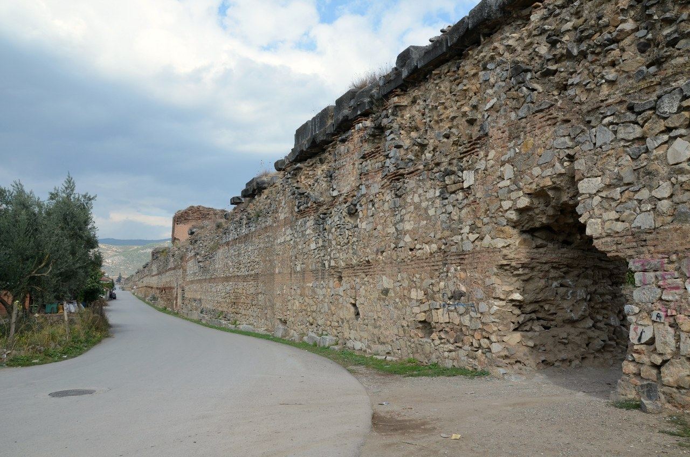</picture>
<figcaption>The Byzantine walls of <b>Nicaea</b>, today İznik in Turkey, where the Council of 325 met. Photo: <a href="https://commons.wikimedia.org/wiki/File:Nicaea%27s_Byzantine_fortifications,_Iznik,_Turkey_(37799849454).jpg">Nicaea's Byzantine fortifications, Iznik, Turkey (37799849454)</a> by Carole Raddato, <a href="https://creativecommons.org/licenses/by-sa/2.0">CC BY-SA 2.0</a>, via Wikimedia Commons.</figcaption>
</figure>

<h2 id=generals>Saving the innocent: the three generals</h2>

One of the oldest stories about Nicholas was already being retold in Constantinople by about 583, in a treatise by the theologian Eustratius. Like the others, it comes to us as tradition.

Three innocent men of Myra had been condemned to death by a corrupt governor who had taken a bribe. They were already kneeling at the place of execution, with the sword raised over them, when Nicholas came running. He seized the executioner's blade, threw it to the ground, untied the men, and then rebuked the governor so sternly that he repented.

Watching all this were three army officers, the *stratelates*, whom the later stories name Ursos, Nepotianos and Herpylion. Constantine had sent them on a campaign, and a storm had driven their ships into Myra. Later, back in the capital, jealous enemies slandered them and they too were condemned to die. In their prison they remembered the bishop of Myra and prayed, "God of Nicholas, save us." That night Nicholas appeared in dreams to the Emperor Constantine and to his prefect Ablabius, and told them the truth. In the morning the generals were set free. They went to Myra to thank him, and he told them to thank God.

Because of these stories, Nicholas became the patron of prisoners and of all who are falsely accused.

<figure class=photo>
<picture><source srcset="/static/art/nicholas-repin-600.webp 600w,/static/art/nicholas-repin.webp 1280w" sizes="(max-width:760px) 100vw,760px" type="image/webp">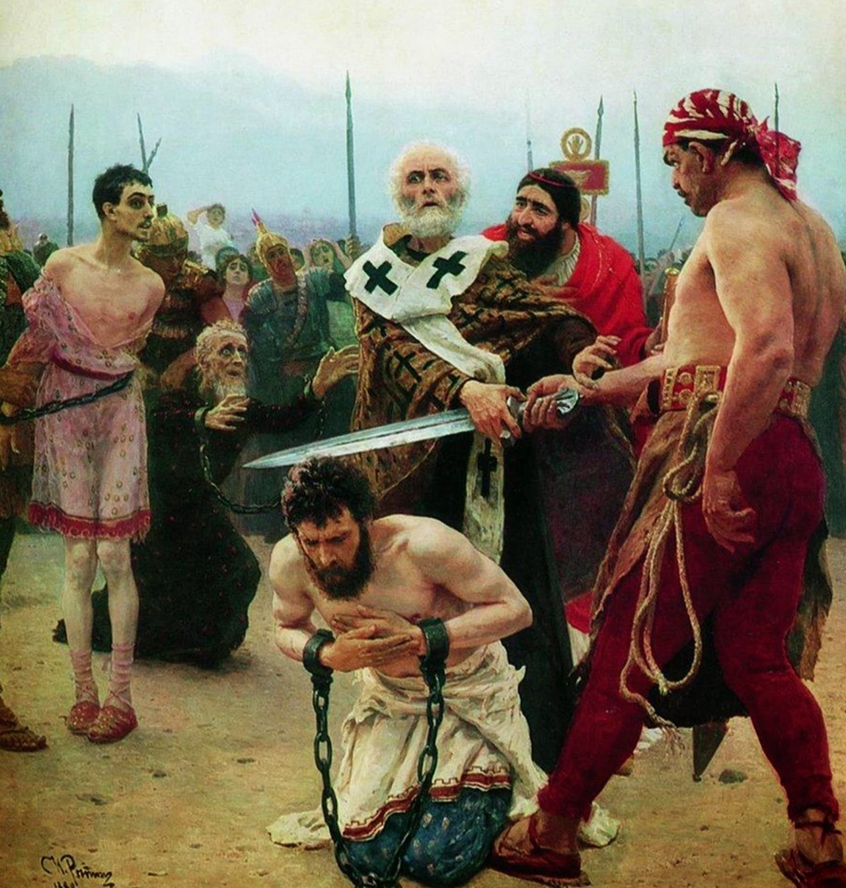</picture>
<figcaption><i>St Nicholas of Myra Saves Three Innocents from Death</i>, by <b>Ilya Repin</b>, 1888. The old bishop catches the sword in his bare hand. State Russian Museum, St Petersburg. Image: <a href="https://commons.wikimedia.org/wiki/File:Ilja_Jefimowitsch_Repin_-_Saint_Nicholas_of_Myra_saves_three_innocents_from_death.jpg">Ilja Jefimowitsch Repin - Saint Nicholas of Myra saves three innocents from death</a>, public domain, via Wikimedia Commons.</figcaption>
</figure>

<figure class=photo>
<picture><source srcset="/static/art/nicholas-angelico-innocent-600.webp 600w,/static/art/nicholas-angelico-innocent.webp 1280w" sizes="(max-width:760px) 100vw,760px" type="image/webp">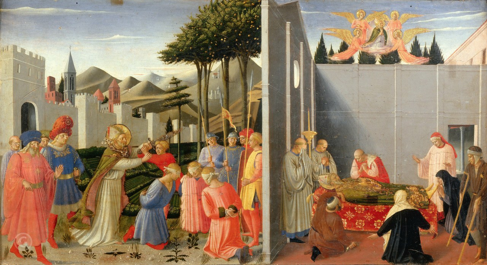</picture>
<figcaption><b>St Nicholas Saves an Innocent Man from Execution</b>, and <b>The Death of St Nicholas</b>, by <b>Fra Angelico</b>, from the predella of the Perugia Altarpiece, painted for the chapel of St Nicholas in San Domenico, Perugia, in the 1430s or 1440s. Image: <a href="https://commons.wikimedia.org/wiki/File:Perugia_Altarpiece,_predella_%E2%80%93_St_Nicholas_frees_an_innocent_man_condemned_to_death.jpg">Perugia Altarpiece, predella – St Nicholas frees an innocent man condemned to death</a>, public domain, via Wikimedia Commons.</figcaption>
</figure>

<h2 id=sea>Wonderworker of the sea: sailors and grain ships</h2>

Myra lived from the sea, and so did its bishop's fame. Sailors on the Mediterranean told how, when a ship was sinking in a storm, they called on St Nicholas, and a figure appeared on deck, took the ropes and the rudder, and brought them safely into harbour. When they reached Myra and went to the church to give thanks, they recognised the bishop as the man who had saved them.

<figure class=photo>
<picture><source srcset="/static/art/nicholas-gentile-ship-600.webp 600w,/static/art/nicholas-gentile-ship.webp 1280w" sizes="(max-width:760px) 100vw,760px" type="image/webp">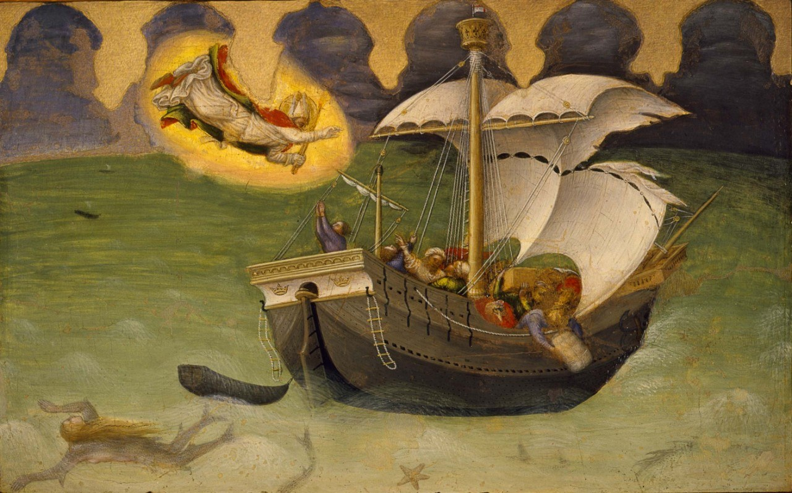</picture>
<figcaption><i>St Nicholas Saves a Storm-Tossed Ship</i>, by <b>Gentile da Fabriano</b>, 1425, from the Quaratesi predella. The saint swoops down from heaven to calm the wind. Pinacoteca Vaticana. Image: <a href="https://commons.wikimedia.org/wiki/File:Gentile_da_Fabriano_064.jpg">Gentile da Fabriano 064</a>, public domain, via Wikimedia Commons.</figcaption>
</figure>

In a time of terrible famine at Myra, tradition places it in 311–312, a fleet of ships loaded with wheat for the emperor put into the harbour. Nicholas begged the sailors to unload some grain for the starving people. They refused at first: every measure had been weighed, and they would have to answer for it in the capital. Nicholas promised that they would lose nothing. They gave him wheat, enough, the story says, to feed the city for two years and to sow the fields. When they reached Constantinople and the grain was weighed again, not a measure was missing.

<figure class=photo>
<picture><source srcset="/static/art/nicholas-lorenzetti-grain-600.webp 600w,/static/art/nicholas-lorenzetti-grain.webp 1053w" sizes="(max-width:760px) 100vw,760px" type="image/webp">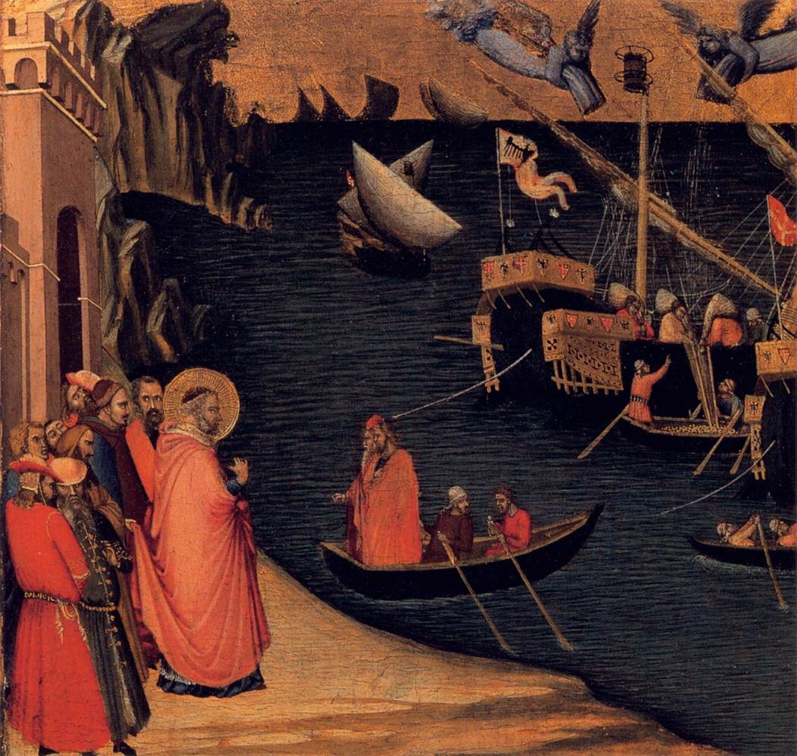</picture>
<figcaption><i>The Miracle of the Grain</i>, by <b>Ambrogio Lorenzetti</b>, about 1332. Angels fill the ships' holds again as the grain is given away. Uffizi Gallery, Florence. Image: <a href="https://commons.wikimedia.org/wiki/File:Ambrogio_lorenzetti,_scene_della_vita_di_san_nicola_02.jpg">Ambrogio lorenzetti, scene della vita di san nicola 02</a>, public domain, via Wikimedia Commons.</figcaption>
</figure>

<figure class=photo>
<picture><source srcset="/static/art/nicholas-angelico-ship-600.webp 600w,/static/art/nicholas-angelico-ship.webp 1280w" sizes="(max-width:760px) 100vw,760px" type="image/webp">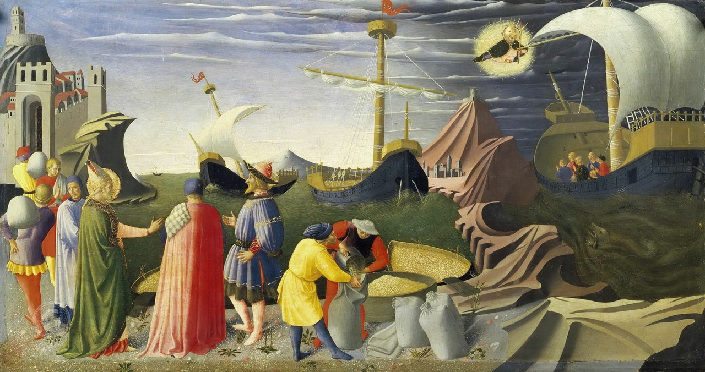</picture>
<figcaption><b>St Nicholas and the Grain Ships</b>, and <b>St Nicholas Saves a Ship</b>, by <b>Fra Angelico</b>, from the predella of the Perugia Altarpiece. Image: <a href="https://commons.wikimedia.org/wiki/File:Perugia_Altarpiece,_predella_%E2%80%93_St_Nicholas_saves_the_ship.jpg">Perugia Altarpiece, predella – St Nicholas saves the ship</a>, public domain, via Wikimedia Commons.</figcaption>
</figure>

<h2 id=boys>The three boys in the barrel</h2>

The strangest Nicholas story is a **legend of the Middle Ages**. It is not found in any of the early lives, but it was told and sung all over Europe, and it is the reason Nicholas became the patron of children.

During a famine, the legend says, three boys, or in some versions three young students on their way to their studies, stopped at an inn for the night. The wicked innkeeper, who was also a butcher, killed them in their sleep and hid their bodies in a barrel of brine, meaning to sell the meat. Soon afterwards Nicholas came to the same inn. He saw the evil in his host's heart, went to the barrel and made the sign of the cross over it, and the three boys climbed out alive. The innkeeper fell on his knees and begged for mercy.

It is a grim tale for children, but medieval children loved it, the way children love all stories in which good wins and the helpless are saved. So many artists painted Nicholas with three little boys and a barrel at his feet that, in time, people who had forgotten the story simply knew him as the saint of children.

<figure class=photo>
<picture><source srcset="/static/art/nicholas-gentile-boys-600.webp 600w,/static/art/nicholas-gentile-boys.webp 1280w" sizes="(max-width:760px) 100vw,760px" type="image/webp">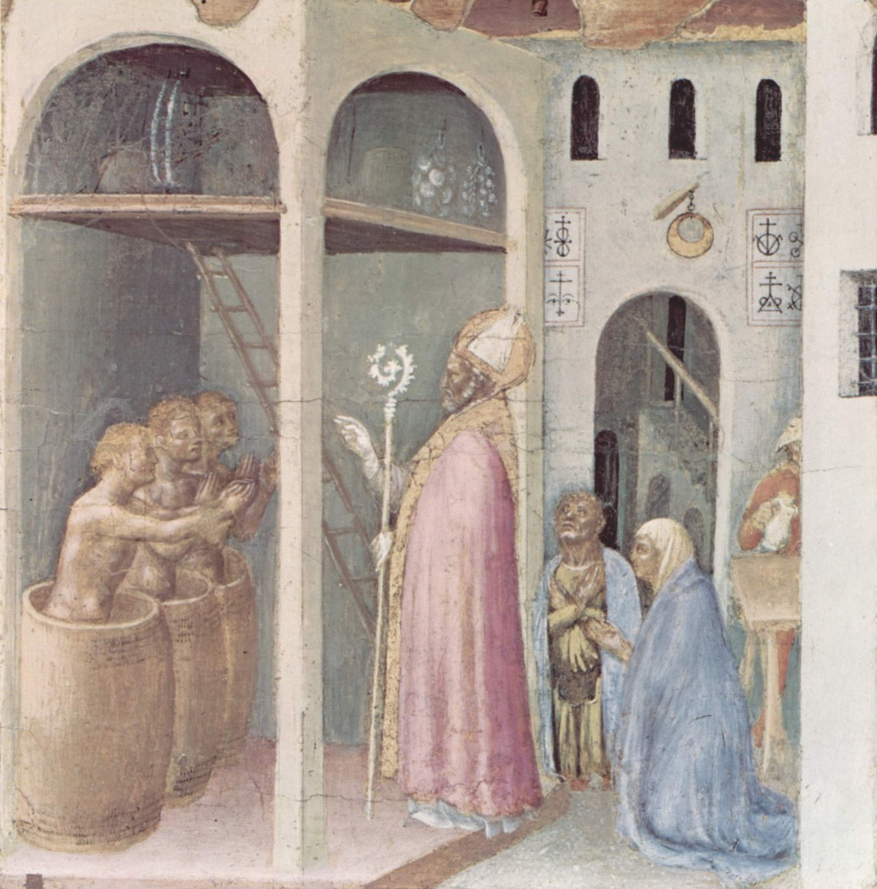</picture>
<figcaption><i>St Nicholas Resurrects Three Youths</i>, by <b>Gentile da Fabriano</b>, 1425, from the Quaratesi predella. The boys climb out of the barrel at the bishop's blessing. Pinacoteca Vaticana. Image: <a href="https://commons.wikimedia.org/wiki/File:Gentile_da_Fabriano_065.jpg">Gentile da Fabriano 065</a>, public domain, via Wikimedia Commons.</figcaption>
</figure>

<figure class=photo>
<picture><source srcset="/static/art/nicholas-bicci-youths-600.webp 600w,/static/art/nicholas-bicci-youths.webp 1280w" sizes="(max-width:760px) 100vw,760px" type="image/webp">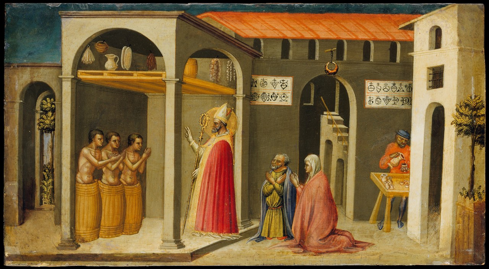</picture>
<figcaption><i>St Nicholas Resuscitating Three Youths</i>, by <b>Bicci di Lorenzo</b>, 1433–35. The Metropolitan Museum of Art, New York. Image: <a href="https://commons.wikimedia.org/wiki/File:Saint_Nicholas_Resuscitating_Three_Youths_MET_DT273089.jpg">Saint Nicholas Resuscitating Three Youths MET DT273089</a>, <a href="https://creativecommons.org/publicdomain/zero/1.0/">CC0</a>, via Wikimedia Commons.</figcaption>
</figure>

There are other stories of his care for the young. Vatican News tells of a boy named **Basil**, carried off from Myra by raiders to serve as cup-bearer to a foreign ruler. On the feast of St Nicholas his parents prayed for him, and the saint brought him home, still holding the king's golden cup in his hand.

<figure class=photo>
<picture><source srcset="/static/art/nicholas-lorenzetti-child-600.webp 600w,/static/art/nicholas-lorenzetti-child.webp 1052w" sizes="(max-width:760px) 100vw,760px" type="image/webp">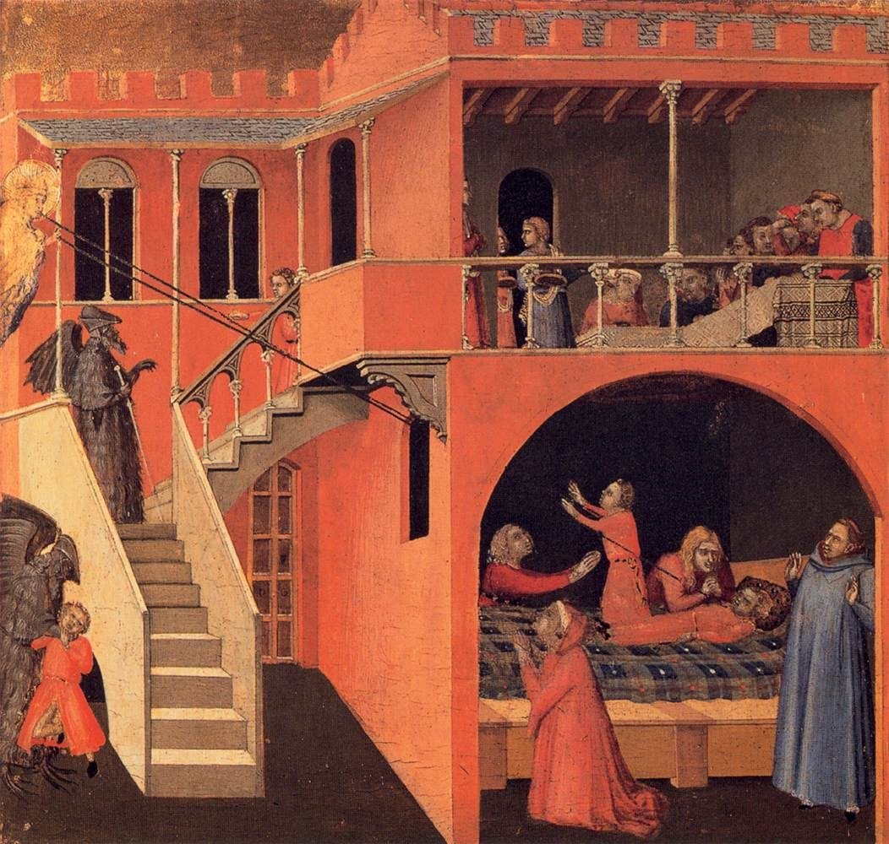</picture>
<figcaption><i>St Nicholas Raises a Child</i>, by <b>Ambrogio Lorenzetti</b>, about 1332. In the story, a child of a family devoted to the saint dies and is raised to life through his prayers. Uffizi Gallery, Florence. Image: <a href="https://commons.wikimedia.org/wiki/File:Ambrogio_lorenzetti,_scene_della_vita_di_san_nicola_01.jpg">Ambrogio lorenzetti, scene della vita di san nicola 01</a>, public domain, via Wikimedia Commons.</figcaption>
</figure>

<h2 id=death>His death, and the manna of St Nicholas</h2>

Nicholas died at Myra on **6 December**, by tradition in **343**, an old man, still bishop of his city. He was buried there, and within a short time his tomb was famous. Less than two hundred years after his death a church was built over the place where he had served as bishop, and his remains were laid in a sarcophagus there. Historians count this early church, and the early devotion around it, among the surest signs that the saint of so many stories was a real man.

From the tomb, the faithful said, came a clear, sweet-smelling liquid, like rose water, which they called **manna** or **myrrh**. They took it home in little flasks and prayed with it for the sick. The Orthodox call him one of the *myroblytes*, the saints whose relics give forth myrrh. In Bari, to this day, the manna is still gathered from his tomb and given to pilgrims, and the Catholic Encyclopedia noted in 1911 that it was "highly valued for its medicinal powers."

The Emperor **Theodosius II** ordered that church built, and in the sixth century the Emperor **Justinian** helped rebuild it and renovated churches in his honour in Constantinople. His name entered the Divine Liturgy of the Byzantine Church, and his fame spread from the Greek world to the Slavs and, through the German empress Theophano, to the West.

<figure class=photo>
<picture><source srcset="/static/art/nicholas-demre-tomb-600.webp 600w,/static/art/nicholas-demre-tomb.webp 1280w" sizes="(max-width:760px) 100vw,760px" type="image/webp">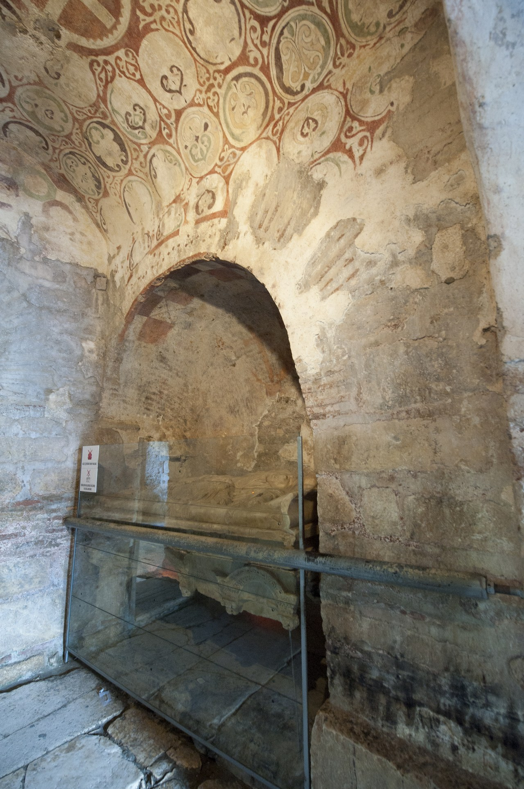</picture>
<figcaption>The niche at <b>Myra</b> (Demre) with the sarcophagus traditionally said to be that of St Nicholas, from which his relics were taken in 1087. Photo: <a href="https://commons.wikimedia.org/wiki/File:Myra_Saint_Nicolas_church_supposed_sarcophagus_of_saint_5884.jpg">Myra Saint Nicolas church supposed sarcophagus of saint 5884</a> by Dosseman, <a href="https://creativecommons.org/licenses/by-sa/4.0">CC BY-SA 4.0</a>, via Wikimedia Commons.</figcaption>
</figure>

<h2 id=bari>1087: the journey to Bari</h2>

For seven hundred years Nicholas rested at Myra. But in the eleventh century the world around his tomb fell apart. In 1071 the Seljuk Turks defeated the Byzantine army at Manzikert and swept over Asia Minor. Christians in the West feared that pilgrims would no longer be able to reach the tomb, and two Italian seaport cities, **Bari** and **Venice**, each dreamed of bringing the Wonderworker home.

The men of Bari got there first. In the spring of 1087 an expedition of sixty-two sailors landed at Myra, went to the church, broke open the marble tomb, and carried off the greater part of the saint's bones, while the few monks who kept the church protested. The Greeks of Myra and the Orthodox ever since have called it what it was, a theft. The people of Bari called it a rescue. Even Catholic historians have described it as "a holy robbery."

On **9 May 1087** the ships came into Bari, and the whole city came down to the harbour to welcome the saint. His relics were kept at first in the monastery of St Benedict, whose abbot, **Elia**, began at once to build a great new church to receive them. On **1 October 1089** Pope **Urban II** came to Bari and with his own hands placed the relics in the crypt, beneath the altar, where they rest today. Bari still keeps 9 May as the feast of his "translation," the carrying of his relics to Italy, and many Orthodox Churches, especially in Russia, keep it too.

<figure class=photo>
<picture><source srcset="/static/art/nicholas-bari-600.webp 600w,/static/art/nicholas-bari.webp 1280w" sizes="(max-width:760px) 100vw,760px" type="image/webp">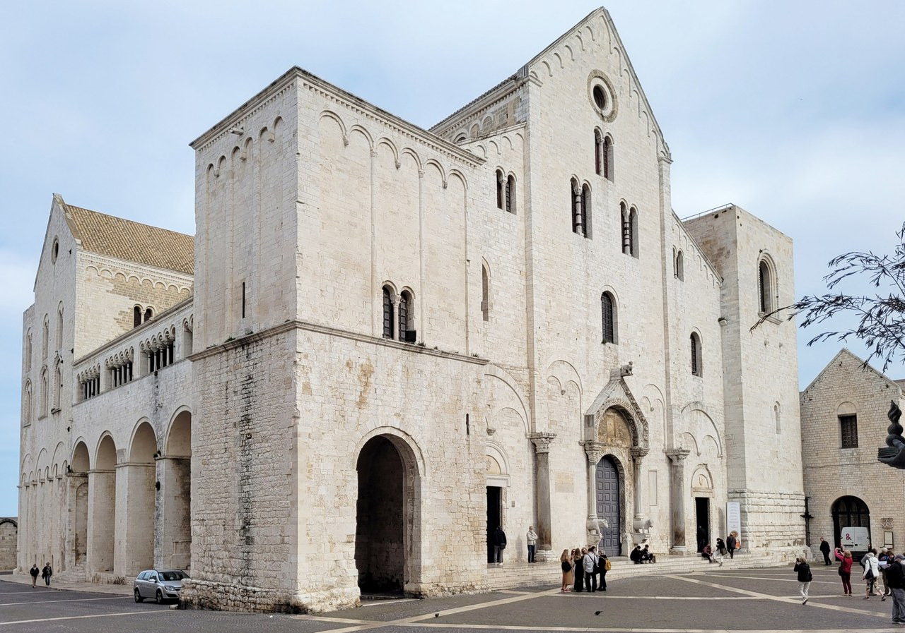</picture>
<figcaption>The <b>Basilica of San Nicola</b>, Bari, built from 1087 to receive his relics. Photo: <a href="https://commons.wikimedia.org/wiki/File:Basilica_di_San_Nicola_01.jpg">Basilica di San Nicola 01</a> by Bernard Gagnon, <a href="https://creativecommons.org/publicdomain/zero/1.0/">CC0</a>, via Wikimedia Commons.</figcaption>
</figure>

<figure class=photo>
<picture><source srcset="/static/art/nicholas-bari-woodcut-600.webp 600w,/static/art/nicholas-bari-woodcut.webp 1280w" sizes="(max-width:760px) 100vw,760px" type="image/webp">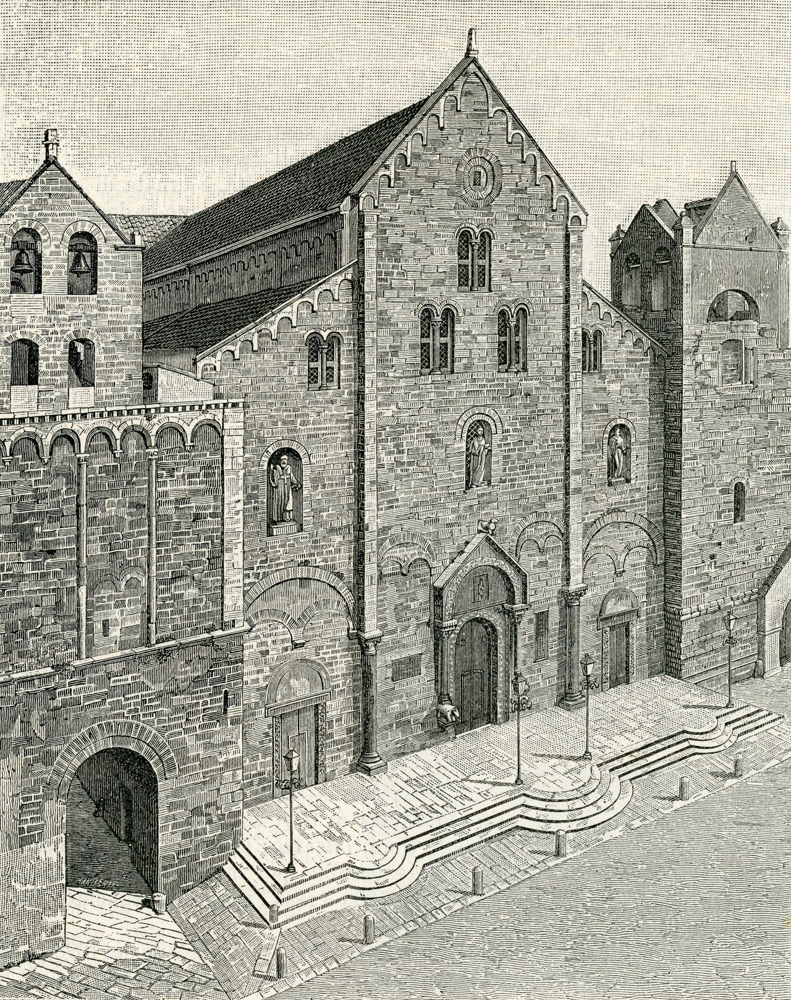</picture>
<figcaption>The basilica in a woodcut by <b>Giuseppe Barberis</b>, 1898. Image: <a href="https://commons.wikimedia.org/wiki/File:Bari_basilica_di_San_Nicola_xilografia_di_Barberis_1898.jpg">Bari basilica di San Nicola xilografia di Barberis 1898</a>, public domain, via Wikimedia Commons.</figcaption>
</figure>

In 1098 the new church, still not finished, was the meeting place of the Council of Bari, where Pope Urban and the Latin bishops met with Greek bishops of southern Italy to discuss the questions that divided East and West. It was a sign of things to come. In 1951 the basilica was entrusted to the **Dominican friars**, who care for it with a special love for unity, and in 1966 an **Orthodox chapel** was opened in the crypt, beside the tomb. Paul VI made the church a pontifical basilica in 1968, praising its "impulse to the ecumenical movement."

Pope Benedict XVI came to Bari in 2005 and spoke of "fortunate Bari, a city that preserves the bones of St Nicholas, a land of encounter and dialogue with our Christian brethren of the East." In 2017 a rib of the saint was lent to the Russian Orthodox Church, and more than a million people queued in Moscow to venerate it. And on 7 July 2018 Pope Francis and the heads of the Churches of the Middle East went down together into the crypt and lit a single-flamed lamp before his relics, a sign of the one Church, to pray for peace.

<figure class=photo>
<picture><source srcset="/static/art/nicholas-bari-tomb-600.webp 600w,/static/art/nicholas-bari-tomb.webp 1280w" sizes="(max-width:760px) 100vw,760px" type="image/webp">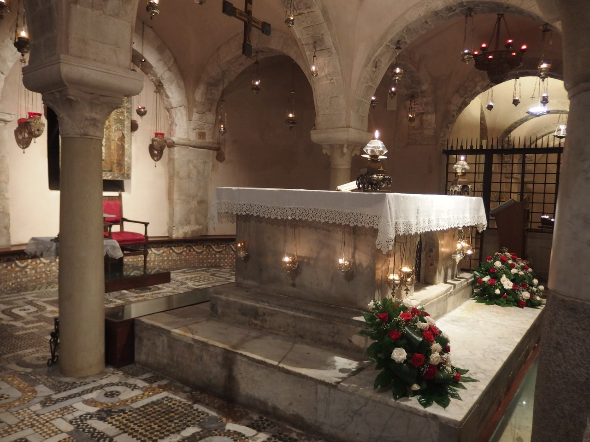</picture>
<figcaption>The altar in the <b>crypt</b> of San Nicola, above the relics of the saint. Photo: <a href="https://commons.wikimedia.org/wiki/File:Bari,_San_Nicola,_tomb_of_Saint_Nicolas.jpg">Bari, San Nicola, tomb of Saint Nicolas</a> by Palickap, <a href="https://creativecommons.org/licenses/by-sa/4.0">CC BY-SA 4.0</a>, via Wikimedia Commons.</figcaption>
</figure>

<h2 id=venice>Venice, and a saint for East and West</h2>

The sailors of Bari had taken the main bones but left the small fragments in the broken tomb. The Venetians had not forgotten. According to a chronicle written by a monk of the Lido, in 1100 a Venetian fleet on its way to the First Crusade, with Bishop Enrico Contarini aboard, put into Myra and gathered what was left. The fragments were brought to the monastery church of **San Nicolò al Lido**, at the mouth of the Venetian lagoon, and Nicholas became the protector of the Venetian fleet. When scientists studied the relics in Bari and in Venice in the twentieth century, they found that the two sets of bones are anatomically compatible and may well belong to the same man.

Pilgrims and crusaders carried his name across Europe. A finger bone brought from Bari to Lorraine in about 1101 made the little town of Port into a great shrine, **Saint-Nicolas-de-Port**. In Rome the church of **San Nicola in Carcere**, "St Nicholas in Prison," built where an ancient prison had stood, made him the friend of prisoners. By the late Middle Ages there were churches of St Nicholas in almost every country of Europe, and he was the patron of Greece and of Russia, of sailors and merchants, of bakers and travellers and children.

In the East, the love was just as deep. The Orthodox sing hymns to him every Thursday of the year in their liturgy. In Russia he is among the most loved of all the saints, and Moscow counted him as one of its patrons. His icons are in almost every Orthodox church, even those not named after him.

<figure class=photo>
<picture><source srcset="/static/art/nicholas-icon-zaraisk-600.webp 600w,/static/art/nicholas-icon-zaraisk.webp 1280w" sizes="(max-width:760px) 100vw,760px" type="image/webp">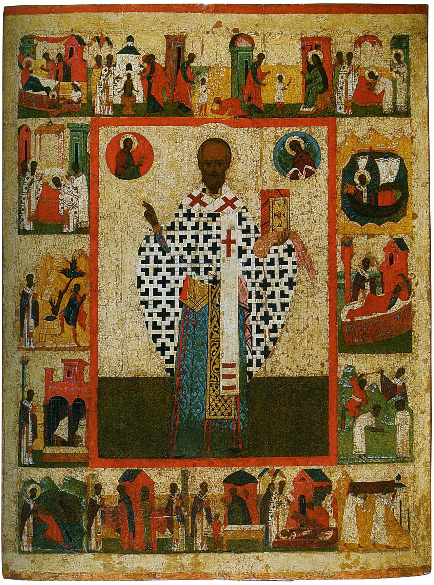</picture>
<figcaption><b>St Nicholas of Zaraisk with scenes from his life</b>, a Russian icon of 1513, from the cathedral of St Nicholas at Zaraisk. The little scenes around the edge tell his story, from his birth to his death and the miracles after it. Image: <a href="https://commons.wikimedia.org/wiki/File:%D0%9D%D0%B8%D0%BA%D0%BE%D0%BB%D0%B0_%D0%97%D0%B0%D1%80%D0%B0%D0%B9%D1%81%D0%BA%D0%B8%D0%B9_%D1%81_%D0%B6%D0%B8%D1%82%D0%B8%D0%B5%D0%BC_%D0%9D%D0%B8%D0%BA%D0%BE%D0%BB%D1%8C%D1%81%D0%BA%D0%B8%D0%B9_%D1%81%D0%BE%D0%B1%D0%BE%D1%80_%D0%97%D0%B0%D1%80%D0%B0%D0%B9%D1%81%D0%BA.jpg">Никола Зарайский с житием Никольский собор Зарайск</a>, public domain, via Wikimedia Commons.</figcaption>
</figure>

<h2 id=santa>From Sinterklaas to Santa Claus</h2>

How did a fourth-century Greek bishop become the jolly man in red who brings presents at Christmas? The road is long, and it passes through the Netherlands.

In the Middle Ages, all over northern Europe, children were given little gifts on the feast of St Nicholas, 6 December, in memory of his secret gifts to the three poor sisters. On the eve of the feast children set out their shoes or stockings by the fire, and in the morning they found them filled. In the Low Countries, a land of sailors who already loved him as their patron, he became **Sint Nikolaas**, later **Sinterklaas**. To this day Dutch children wait for him in a red bishop's cope and mitre, riding a white horse, and on the eve of his feast, 5 December, families exchange presents and poems.

<figure class=photo>
<picture><source srcset="/static/art/nicholas-steen-600.webp 600w,/static/art/nicholas-steen.webp 1280w" sizes="(max-width:760px) 100vw,760px" type="image/webp">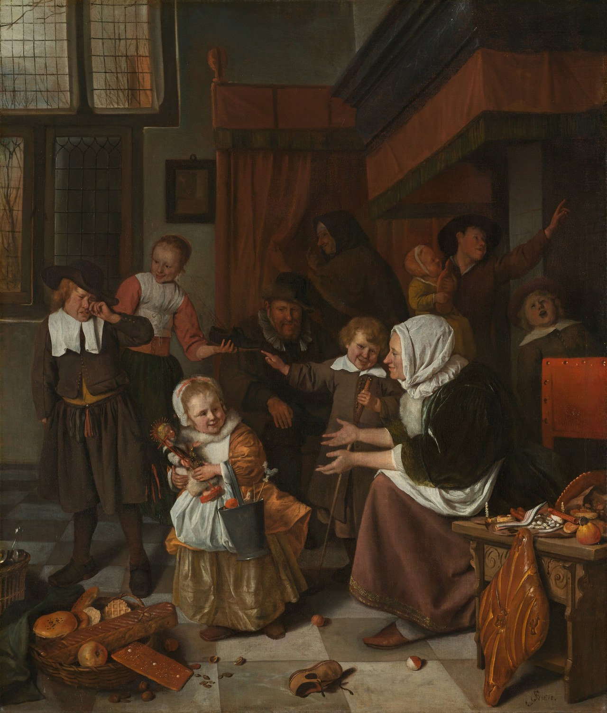</picture>
<figcaption><i>The Feast of St Nicholas</i>, by <b>Jan Steen</b>, about 1665–68. One child has been good and one has been naughty, and the whole family knows it. Rijksmuseum, Amsterdam. Image: <a href="https://commons.wikimedia.org/wiki/File:Jan_Havicksz._Steen_%E2%80%93_Het_Sint-Nicolaasfeest_%E2%80%93_Google_Art_Project.jpg">Jan Havicksz. Steen – Het Sint-Nicolaasfeest – Google Art Project</a>, public domain, via Wikimedia Commons.</figcaption>
</figure>

<figure class=photo>
<picture><source srcset="/static/art/nicholas-stoomboot-600.webp 600w,/static/art/nicholas-stoomboot.webp 1280w" sizes="(max-width:760px) 100vw,760px" type="image/webp">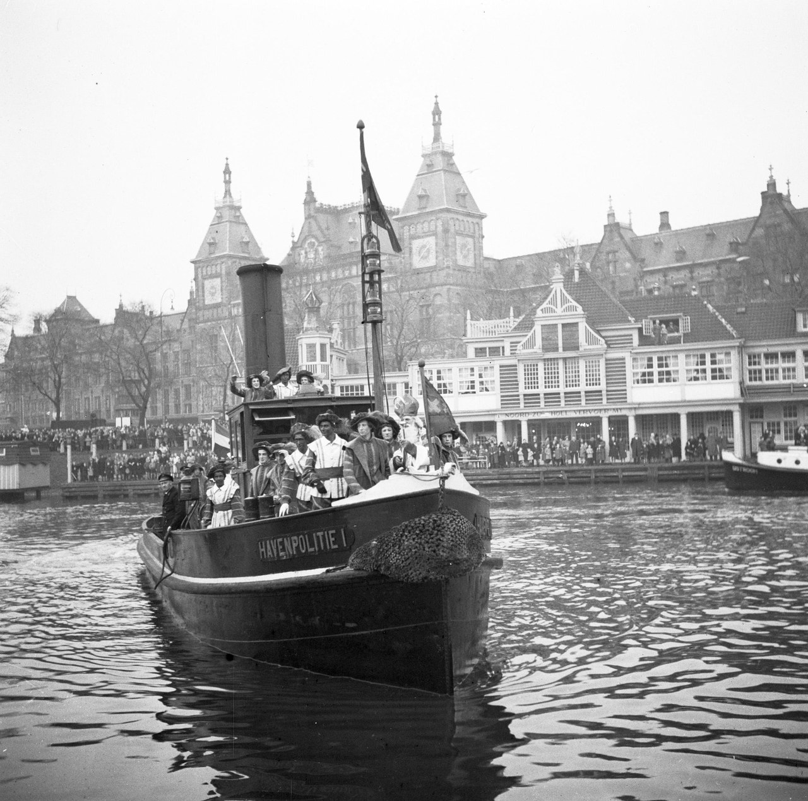</picture>
<figcaption>The steamboat of <b>Sinterklaas</b> arriving in front of Amsterdam's Central Station, 30 November 1946. By Dutch tradition he arrives each November by steamboat "from Spain." Photo: <a href="https://commons.wikimedia.org/wiki/File:De_stoomboot_van_Sinterklaas_voor_het_Centraal_Station,_Bestanddeelnr_254-3534.jpg">De stoomboot van Sinterklaas voor het Centraal Station, Bestanddeelnr 254-3534</a> by Willem van de Poll, <a href="https://creativecommons.org/publicdomain/zero/1.0/">CC0</a>, via Wikimedia Commons.</figcaption>
</figure>

At the Reformation, Martin Luther and other reformers, wanting children to think of Christ rather than of the saints, encouraged giving presents at Christmas instead, from the *Christkind*, the Christ Child. But in the Netherlands, Sinterklaas stayed. And in the seventeenth century Dutch settlers crossed the Atlantic and built **New Amsterdam** on the island of Manhattan.

<figure class=photo>
<picture><source srcset="/static/art/nicholas-castello-600.webp 600w,/static/art/nicholas-castello.webp 1280w" sizes="(max-width:760px) 100vw,760px" type="image/webp">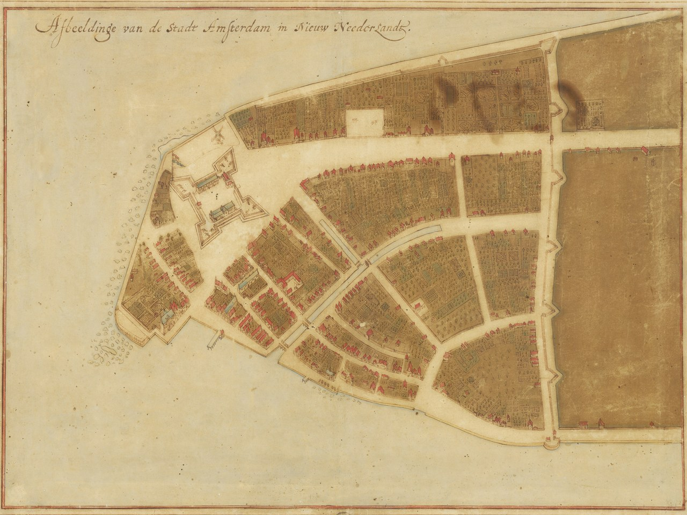</picture>
<figcaption><b>New Amsterdam</b> in 1660, the "Castello Plan," copied by the Dutch cartographer Johannes Vingboons from a survey by Jacques Cortelyou. In 1664 the town became English, and New York. Image: <a href="https://commons.wikimedia.org/wiki/File:Stad_Amsterdam_in_Nieuw_Nederland_(City_Amsterdam_in_New_Netherland)_Castello_Plan_1660.jpg">Stad Amsterdam in Nieuw Nederland (City Amsterdam in New Netherland) Castello Plan 1660</a>, public domain, via Wikimedia Commons.</figcaption>
</figure>

How much the Dutch settlers themselves kept the feast in the New World is still debated. Some historians, like Howard Hageman, believed that Sinterklaas was celebrated in the early Hudson Valley settlements; others find little evidence of it. What is certain is that, after American independence, the people of New York, proud of their Dutch beginnings, took up St Nicholas as a symbol of their city. The name "Santa Claus" first appeared in an American newspaper in 1773. In 1809 Washington Irving's humorous *History of New York* made St Nicholas the patron of the old Dutch city, and in its 1812 edition he pictured the saint riding over the treetops in a flying wagon, bringing presents to children. In 1821 a little New York book showed "Old Santeclaus" in a sleigh drawn by a reindeer.

Then, on 23 December 1823, a newspaper in Troy, New York, published an anonymous poem, "A Visit from St. Nicholas." Later claimed by Clement Clarke Moore (though some argue it was written by Henry Livingston), it gave the world the night before Christmas, the stockings hung by the chimney with care, the eight tiny reindeer and the "right jolly old elf" with "a little round belly."

<figure class=photo>
<picture><source srcset="/static/art/nicholas-troy-600.webp 600w,/static/art/nicholas-troy.webp 925w" sizes="(max-width:760px) 100vw,760px" type="image/webp">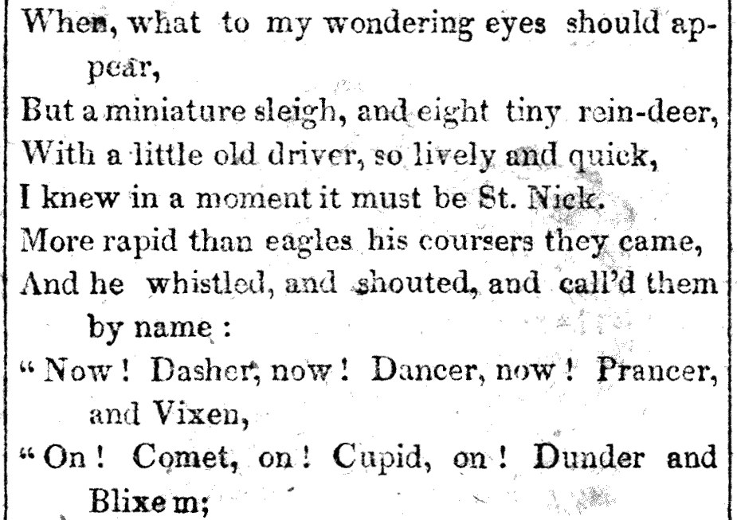</picture>
<figcaption>From the first printing of <b>"A Visit from St. Nicholas"</b>, in the <i>Troy Sentinel</i>, 23 December 1823, where the reindeer are named for the first time. Image: <a href="https://commons.wikimedia.org/wiki/File:A_Visit_From_St_Nicholas_-_Troy_Sentinel_(cropped).png">A Visit From St Nicholas - Troy Sentinel (cropped)</a>, public domain, via Wikimedia Commons.</figcaption>
</figure>

The great cartoonist **Thomas Nast**, a German immigrant who remembered the gift-bringers of his childhood, drew Santa Claus for *Harper's Weekly* for more than twenty years. His first Santa appeared in January 1863, in the middle of the Civil War, visiting the Union army's camp. In 1881 he drew the round, bearded, smiling Santa with his pipe and his armful of toys who still looks out from Christmas cards.

<figure class=photo>
<picture><source srcset="/static/art/nicholas-nast-camp-600.webp 600w,/static/art/nicholas-nast-camp.webp 1280w" sizes="(max-width:760px) 100vw,760px" type="image/webp">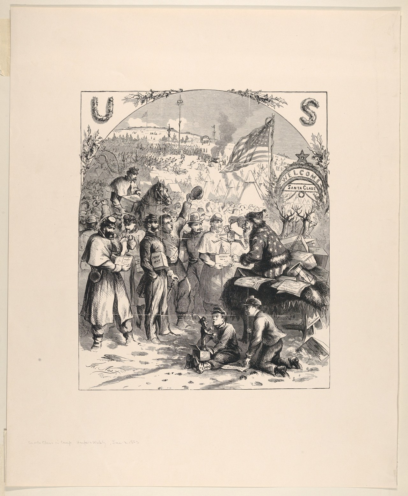</picture>
<figcaption><i>Santa Claus in Camp</i>, by <b>Thomas Nast</b>, published in <i>Harper's Weekly</i> on 3 January 1863. The Metropolitan Museum of Art, New York. Image: <a href="https://commons.wikimedia.org/wiki/File:Santa_Claus_in_Camp_(published_in_Harper%27s_Weekly,_January_3,_1863)_MET_DP831803.jpg">Santa Claus in Camp (published in Harper's Weekly, January 3, 1863) MET DP831803</a>, <a href="https://creativecommons.org/publicdomain/zero/1.0/">CC0</a>, via Wikimedia Commons.</figcaption>
</figure>

<figure class=photo>
<picture><source srcset="/static/art/nicholas-nast-1881-600.webp 600w,/static/art/nicholas-nast-1881.webp 1280w" sizes="(max-width:760px) 100vw,760px" type="image/webp">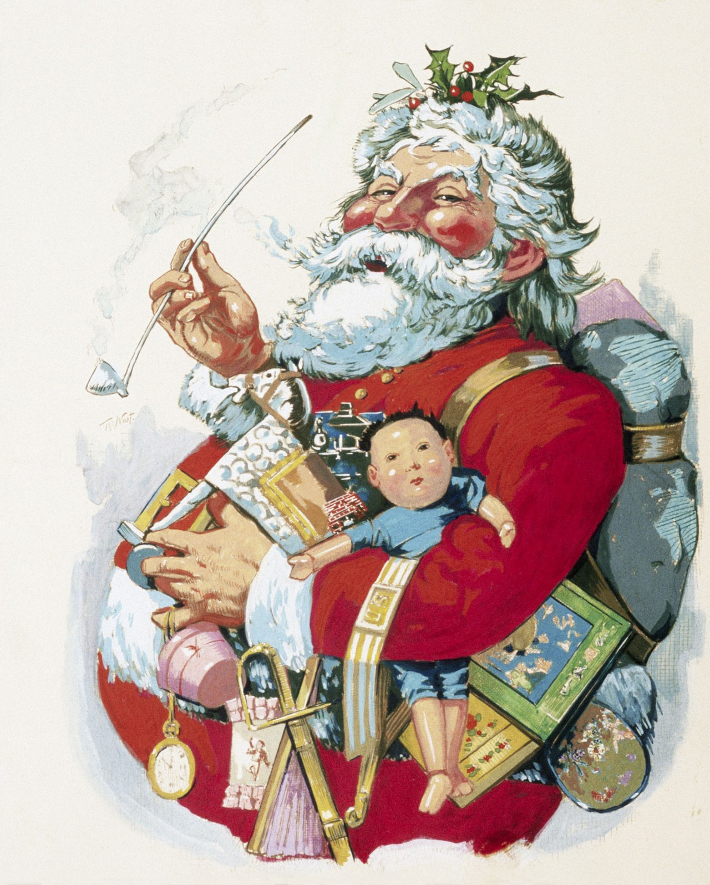</picture>
<figcaption><i>Merry Old Santa Claus</i>, by <b>Thomas Nast</b>, <i>Harper's Weekly</i>, 1881. The modern Santa Claus is almost complete. Image: <a href="https://commons.wikimedia.org/wiki/File:Merry_Old_Santa_Claus_by_Thomas_Nast.jpg">Merry Old Santa Claus by Thomas Nast</a>, public domain, via Wikimedia Commons.</figcaption>
</figure>

So the Greek bishop in his stole and the American Santa in his red suit are, in a real sense, the same story. But the Church has never forgotten whose story it is. St Nicholas did not give gifts to be famous, or to make Christmas busy. He gave because Christ had given himself.

<h2 id=giving>The meaning of his gifts</h2>

Why do we give presents at Christmas? Because God first gave us the greatest gift of all. "For God so loved the world that he gave his only Son" (John 3:16). St Nicholas understood that. His gold came through the window at night because he wanted the glory to go to God, not to himself. He gave to the poorest and the most helpless: three girls with no one to protect them, three innocent men facing the sword, children, prisoners, sailors far from home.

The Church still holds him up to us at the beginning of Advent, three weeks before Christmas, as a model of the giving that prepares the way for Christ. In the words of St Paul: "It is more blessed to give than to receive" (Acts 20:35). Every gift given in secret, every kindness to someone who cannot repay it, every coin slipped to a family in need without a name attached, is a little piece of the story of St Nicholas, and a little piece of the story of Christmas.

<figure class=photo>
<picture><source srcset="/static/art/nicholas-titian-600.webp 600w,/static/art/nicholas-titian.webp 869w" sizes="(max-width:760px) 100vw,760px" type="image/webp">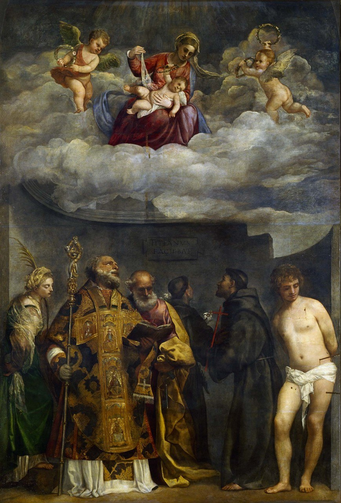</picture>
<figcaption><i>The Madonna of San Niccolò dei Frari</i>, by <b>Titian</b>, begun 1522 and finished in 1535, from the Venetian church of San Nicolò della Lattuga. St Nicholas, in a splendid gold cope, looks up towards the Mother of God and her Son, the true gift of Christmas. Pinacoteca Vaticana. Image: <a href="https://commons.wikimedia.org/wiki/File:Titian_madonna_of_frari_vatican.jpg">Titian madonna of frari vatican</a>, public domain, via Wikimedia Commons.</figcaption>
</figure>

<h2 id=places>His places and shrines</h2>

St Nicholas never travelled far in his lifetime, but his relics and his love have travelled the world. The first map follows his life in Lycia and the journeys of his relics to Bari and Venice; the second shows, in a simple way, how his story went from Myra to Amsterdam and across the Atlantic to New York.

<figure class=map><figcaption>St Nicholas's Mediterranean: his life in Lycia, the Council of Nicaea, and the journeys of his relics to Bari and Venice, with an inset of Lycia. Map by The Daily Word; coastlines from Natural Earth (public domain); routes are approximate. Tap to enlarge.</figcaption></figure>

<figure class=map><figcaption>From Myra to New York: how the story of St Nicholas travelled. A simplified picture, not actual routes. Map by The Daily Word; coastlines from Natural Earth (public domain). Tap to enlarge.</figcaption></figure>

### Patara and Gemiler Island

The ruins of **Patara**, his birthplace by tradition, lie among the sand dunes near the sea. Archaeologists there have uncovered its theatre, its streets and the remains of an ancient lighthouse. About twenty miles up the coast lies little **Gemiler Island**, known in antiquity as St Nicholas Island. Some recent archaeological evidence suggests that a rock-cut church at its highest point, where his name is painted on the ruined walls, may have been his first tomb. It is a possibility, not a certainty, but the island's ruined churches still keep his memory.

<figure class=photo>
<picture><source srcset="/static/art/nicholas-patara-lighthouse-600.webp 600w,/static/art/nicholas-patara-lighthouse.webp 1280w" sizes="(max-width:760px) 100vw,760px" type="image/webp">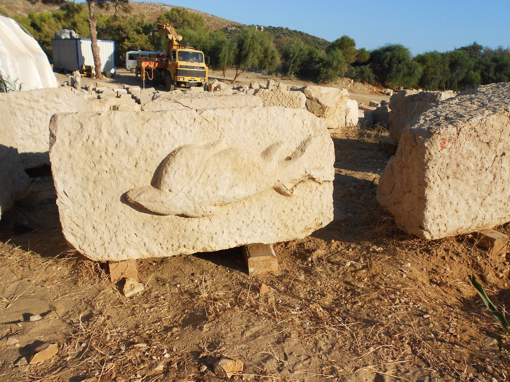</picture>
<figcaption>Carved stone blocks at the site of the ancient <b>lighthouse of Patara</b>, one of the oldest known lighthouses, uncovered by archaeologists. Photo: <a href="https://commons.wikimedia.org/wiki/File:Patara_-_the_lighthouse_-_panoramio.jpg">Patara - the lighthouse - panoramio</a> by Angela Stefanoni, <a href="https://creativecommons.org/licenses/by/3.0">CC BY 3.0</a>, via Wikimedia Commons.</figcaption>
</figure>

<figure class=photo>
<picture><source srcset="/static/art/nicholas-gemiler-600.webp 600w,/static/art/nicholas-gemiler.webp 1280w" sizes="(max-width:760px) 100vw,760px" type="image/webp">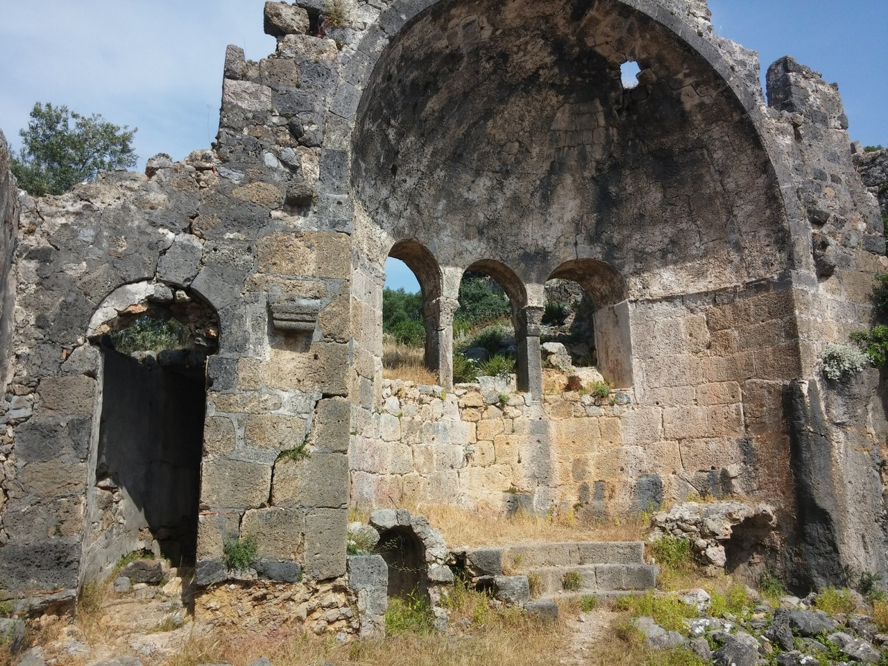</picture>
<figcaption>The ruins of a Byzantine church on <b>Gemiler Island</b>, once called St Nicholas Island. Photo: <a href="https://commons.wikimedia.org/wiki/File:Gemiler_Adas%C4%B1_2_numaral%C4%B1_kilise.jpg">Gemiler Adası 2 numaralı kilise</a> by Cobija, <a href="https://creativecommons.org/publicdomain/zero/1.0/">CC0</a>, via Wikimedia Commons.</figcaption>
</figure>

### The Church of St Nicholas, Myra (Demre)

At **Demre**, the modern town on the site of ancient Myra, stands the church built over the place where St Nicholas served as bishop and was buried. The building we see is mostly from the sixth century, with later Byzantine additions, and its floor lies several metres below the modern ground level, because over the centuries the river buried it in silt. It was restored with Russian help in the 1860s, when a bell tower was added, and used by the Greek Orthodox community until 1923, when the last Greeks of Demre had to leave in the population exchange. Inside are marble mosaic floors in *opus sectile* and faded frescoes, including the only cycle of the life of St Nicholas painted in Turkey, from the twelfth century. The Orthodox liturgy is still celebrated here on his feast. Outside, in the square, stands a bronze statue of the saint given by Russia in 2000.

Above the town, carved into the cliffs, are the famous rock tombs of ancient Myra, older than the saint by many centuries.

<figure class=photo>
<picture><source srcset="/static/art/nicholas-demre-600.webp 600w,/static/art/nicholas-demre.webp 1280w" sizes="(max-width:760px) 100vw,760px" type="image/webp">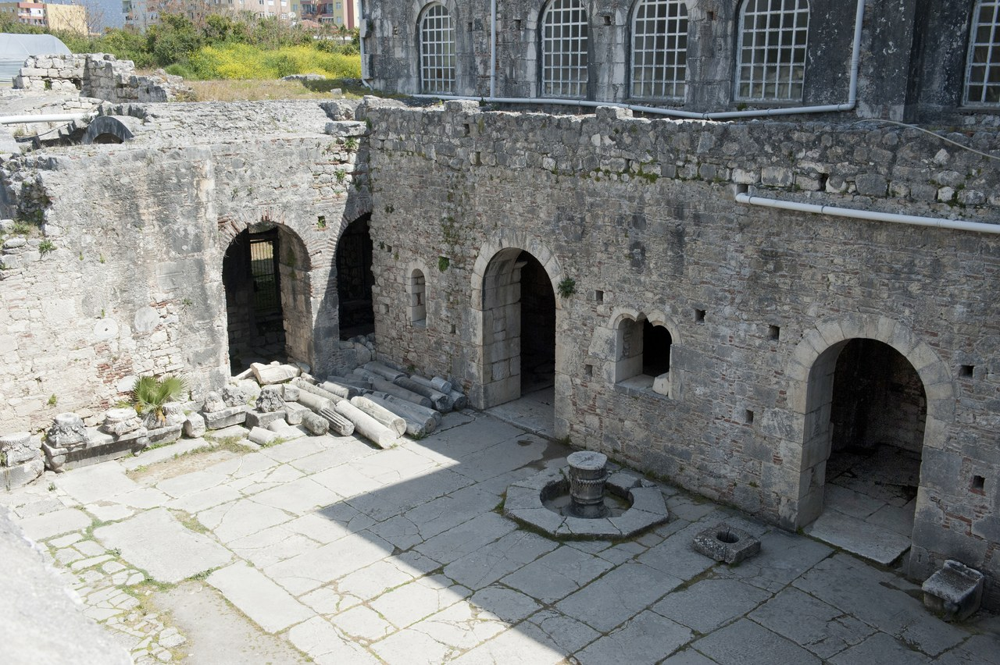</picture>
<figcaption>The <b>Church of St Nicholas</b> at Demre, ancient Myra, seen from above. The ground has risen by several metres since the saint's day. Photo: <a href="https://commons.wikimedia.org/wiki/File:St._Nicholas_Church,_Demre_5509.jpg">St. Nicholas Church, Demre 5509</a> by Dosseman, <a href="https://creativecommons.org/licenses/by-sa/4.0">CC BY-SA 4.0</a>, via Wikimedia Commons.</figcaption>
</figure>

<figure class=photo>
<picture><source srcset="/static/art/nicholas-demre-nave-600.webp 600w,/static/art/nicholas-demre-nave.webp 1280w" sizes="(max-width:760px) 100vw,760px" type="image/webp">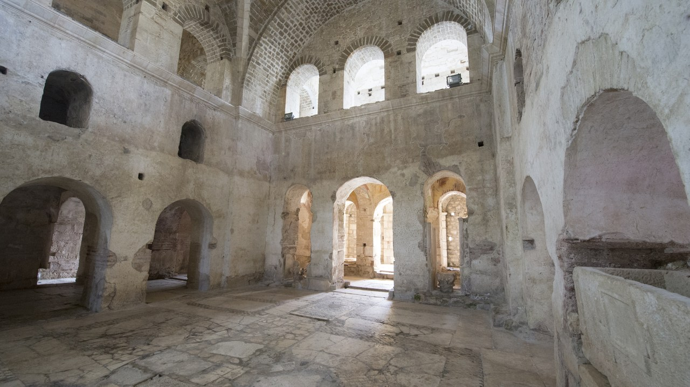</picture>
<figcaption>Inside the porches, the narthex and exonarthex, of the church at Myra. Photo: <a href="https://commons.wikimedia.org/wiki/File:St._Nicholas_Church,_Demre_7402.jpg">St. Nicholas Church, Demre 7402</a> by Dosseman, <a href="https://creativecommons.org/licenses/by-sa/4.0">CC BY-SA 4.0</a>, via Wikimedia Commons.</figcaption>
</figure>

<figure class=photo>
<picture><source srcset="/static/art/nicholas-demre-apse-600.webp 600w,/static/art/nicholas-demre-apse.webp 1280w" sizes="(max-width:760px) 100vw,760px" type="image/webp">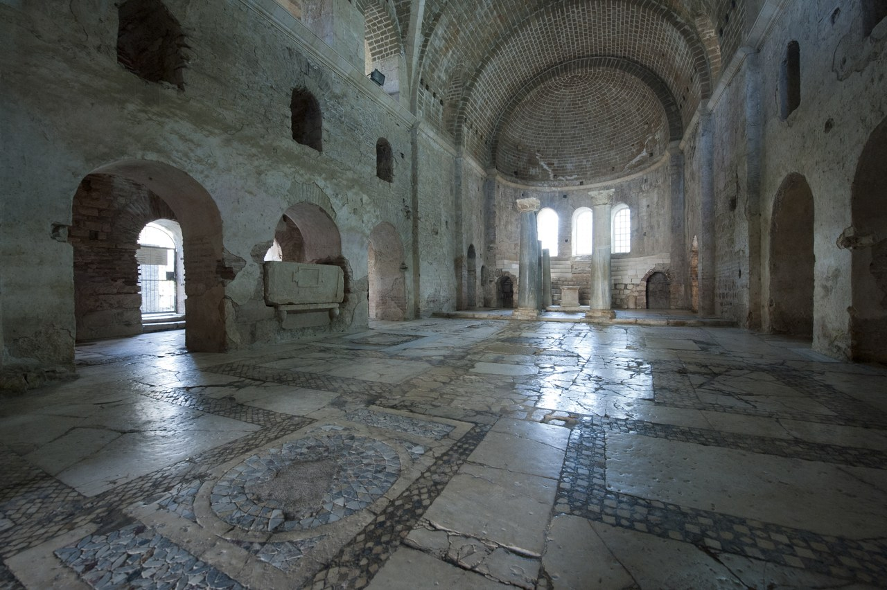</picture>
<figcaption>The nave and apse of the church at Myra. The curved stone benches in the apse, the <i>synthronon</i>, are where the bishop and his priests sat. Photo: <a href="https://commons.wikimedia.org/wiki/File:Myra_Saint_Nicolas_church_interior_nave_and_apse_5395.jpg">Myra Saint Nicolas church interior nave and apse 5395</a> by Dosseman, <a href="https://creativecommons.org/licenses/by-sa/4.0">CC BY-SA 4.0</a>, via Wikimedia Commons.</figcaption>
</figure>

<figure class=photo>
<picture><source srcset="/static/art/nicholas-demre-floor-600.webp 600w,/static/art/nicholas-demre-floor.webp 1280w" sizes="(max-width:760px) 100vw,760px" type="image/webp">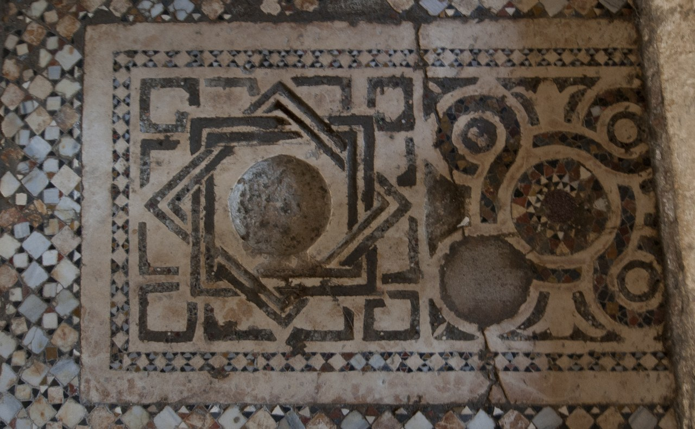</picture>
<figcaption>An eleventh-century <i>opus sectile</i> floor in the nave at Myra. Photo: <a href="https://commons.wikimedia.org/wiki/File:St._Nicholas_Church,_Demre_5819.jpg">St. Nicholas Church, Demre 5819</a> by Dosseman, <a href="https://creativecommons.org/licenses/by-sa/4.0">CC BY-SA 4.0</a>, via Wikimedia Commons.</figcaption>
</figure>

<figure class=photo>
<picture><source srcset="/static/art/nicholas-demre-dowry-600.webp 600w,/static/art/nicholas-demre-dowry.webp 1280w" sizes="(max-width:760px) 100vw,760px" type="image/webp">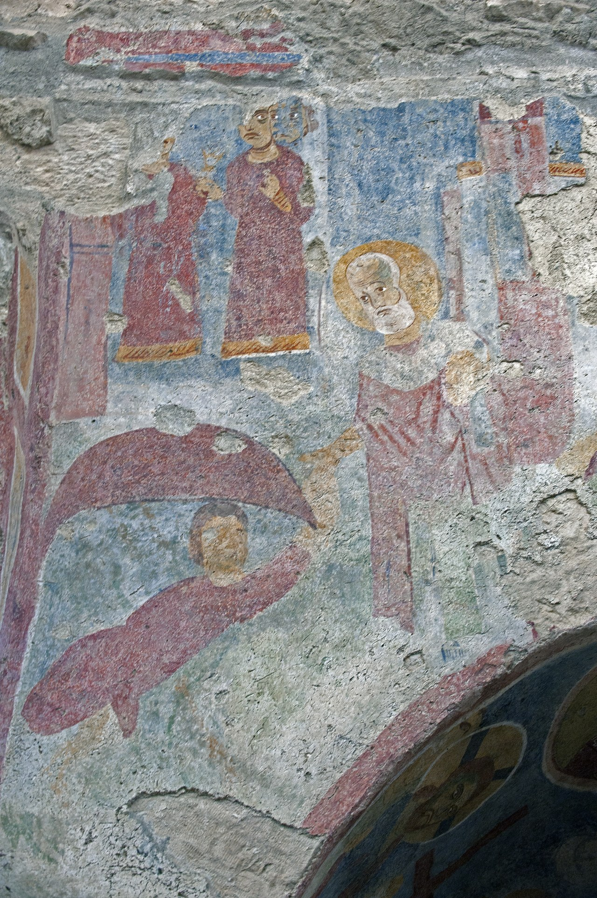</picture>
<figcaption>A twelfth-century fresco in the church at Myra showing, it is thought, St Nicholas's secret gift to the poor man's family. Photo: <a href="https://commons.wikimedia.org/wiki/File:St._Nicholas_Church,_Demre_5924.jpg">St. Nicholas Church, Demre 5924</a> by Dosseman, <a href="https://creativecommons.org/licenses/by-sa/4.0">CC BY-SA 4.0</a>, via Wikimedia Commons.</figcaption>
</figure>

<figure class=photo>
<picture><source srcset="/static/art/nicholas-demre-generals-600.webp 600w,/static/art/nicholas-demre-generals.webp 1280w" sizes="(max-width:760px) 100vw,760px" type="image/webp">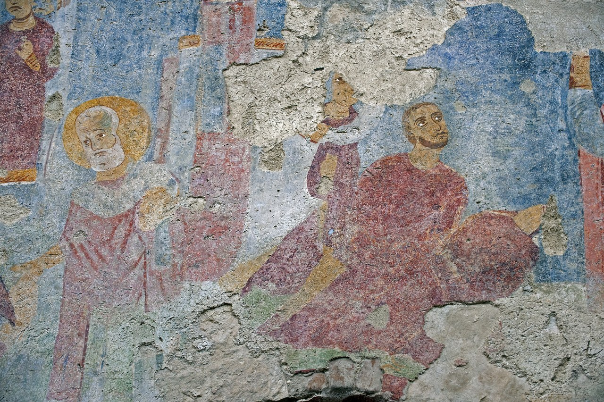</picture>
<figcaption>A fresco at Myra believed to show St Nicholas saving the three generals. Photo: <a href="https://commons.wikimedia.org/wiki/File:St._Nicholas_Church,_Demre_5925.jpg">St. Nicholas Church, Demre 5925</a> by Dosseman, <a href="https://creativecommons.org/licenses/by-sa/4.0">CC BY-SA 4.0</a>, via Wikimedia Commons.</figcaption>
</figure>

<figure class=photo>
<picture><source srcset="/static/art/nicholas-demre-boat-600.webp 600w,/static/art/nicholas-demre-boat.webp 1280w" sizes="(max-width:760px) 100vw,760px" type="image/webp">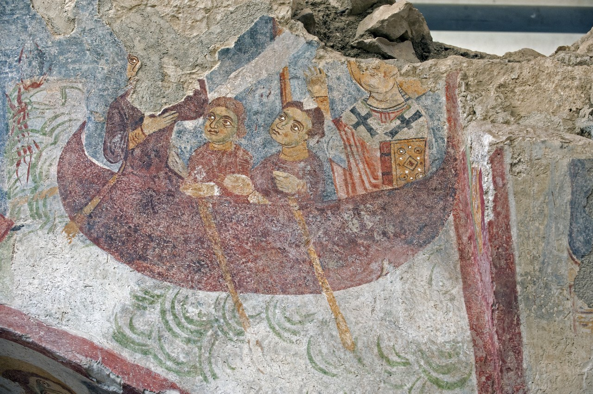</picture>
<figcaption>St Nicholas in a boat, patron of sailors, a fresco at Myra. Photo: <a href="https://commons.wikimedia.org/wiki/File:St._Nicholas_Church,_Demre_5919.jpg">St. Nicholas Church, Demre 5919</a> by Dosseman, <a href="https://creativecommons.org/licenses/by-sa/4.0">CC BY-SA 4.0</a>, via Wikimedia Commons.</figcaption>
</figure>

<figure class=photo>
<picture><source srcset="/static/art/nicholas-demre-fresco-600.webp 600w,/static/art/nicholas-demre-fresco.webp 1280w" sizes="(max-width:760px) 100vw,760px" type="image/webp">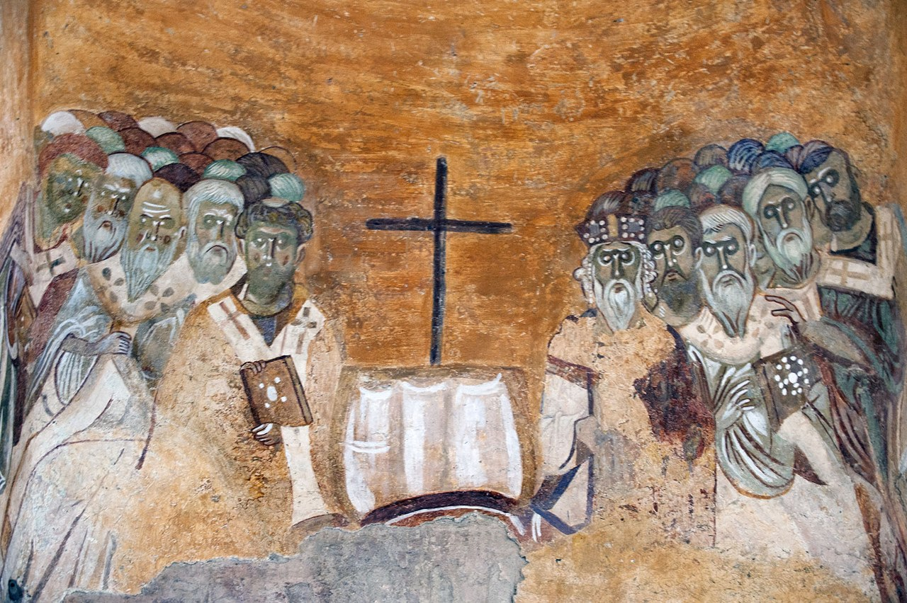</picture>
<figcaption>A fresco at Myra of an <b>ecumenical council</b>, probably the sixth: the bishops gathered around the Gospel enthroned in their midst. Photo: <a href="https://commons.wikimedia.org/wiki/File:St._Nicholas_Church,_Demre_5863.jpg">St. Nicholas Church, Demre 5863</a> by Dosseman, <a href="https://creativecommons.org/licenses/by-sa/4.0">CC BY-SA 4.0</a>, via Wikimedia Commons.</figcaption>
</figure>

<figure class=photo>
<picture><source srcset="/static/art/nicholas-demre-dome-600.webp 600w,/static/art/nicholas-demre-dome.webp 1280w" sizes="(max-width:760px) 100vw,760px" type="image/webp">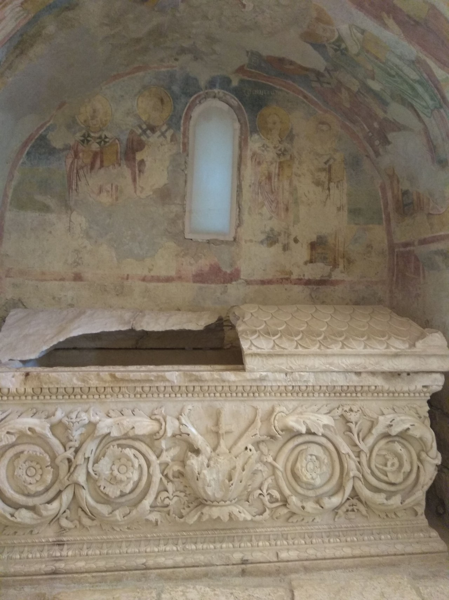</picture>
<figcaption>Frescoes over a sarcophagus in the church at Myra. Photo: <a href="https://commons.wikimedia.org/wiki/File:Church_of_Saint_Nicholas_fresco_in_dome_(Myra_Demre,Antalya,_Turkey)_13.jpg">Church of Saint Nicholas fresco in dome (Myra Demre,Antalya, Turkey) 13</a> by Eleroja, <a href="https://creativecommons.org/licenses/by-sa/4.0">CC BY-SA 4.0</a>, via Wikimedia Commons.</figcaption>
</figure>

<figure class=photo>
<picture><source srcset="/static/art/nicholas-myra-tombs-600.webp 600w,/static/art/nicholas-myra-tombs.webp 1280w" sizes="(max-width:760px) 100vw,760px" type="image/webp">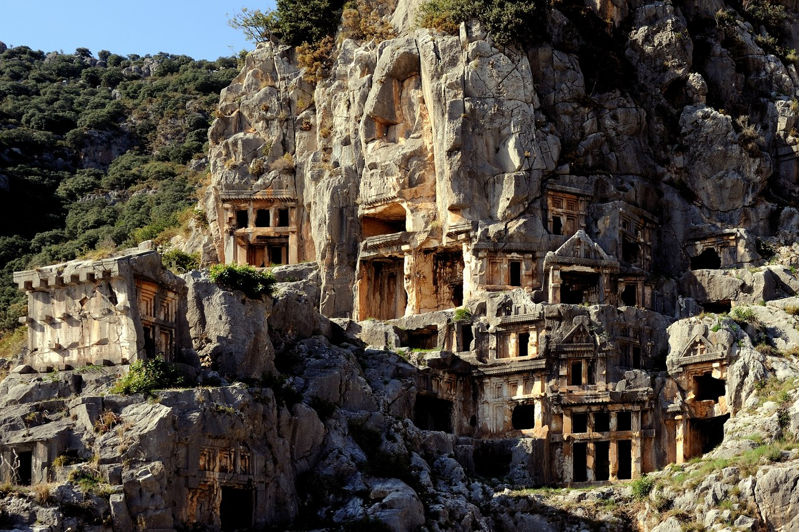</picture>
<figcaption>The <b>rock-cut tombs</b> of ancient Myra, carved by the Lycians centuries before St Nicholas. Photo: <a href="https://commons.wikimedia.org/wiki/File:Myra_Rock_Tombs.jpg">Myra Rock Tombs</a> by Saffron Blaze, <a href="https://creativecommons.org/licenses/by-sa/3.0">CC BY-SA 3.0</a>, via Wikimedia Commons.</figcaption>
</figure>

### The Basilica of San Nicola, Bari

The great Romanesque basilica in the old town of **Bari** was begun in 1087, as soon as the relics arrived, and completed by 1197. Its plain white front, flanked by two towers, became the model for many churches in Apulia. Inside are a gilded wooden ceiling with seventeenth-century paintings of the saint's life by Carlo Rosa, and the marble bishop's throne known as the **cathedra of Abbot Elia**, a masterpiece of Romanesque carving. In the crypt, under the altar, lies the saint. One apse of the crypt is set aside for Orthodox worship, with its own iconostasis, and Orthodox pilgrims, many from Russia, come in their thousands. On his feasts a richly vested statue of the saint, holding a Gospel book and three golden balls, is carried in procession.

<figure class=photo>
<picture><source srcset="/static/art/nicholas-bari-portal-600.webp 600w,/static/art/nicholas-bari-portal.webp 1280w" sizes="(max-width:760px) 100vw,760px" type="image/webp">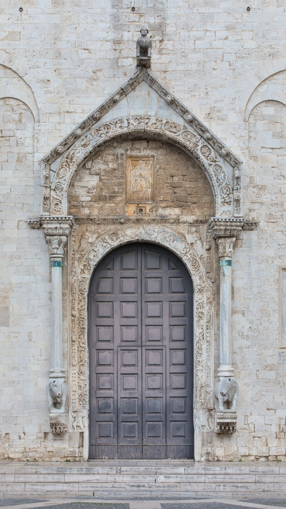</picture>
<figcaption>The <b>main portal</b> of San Nicola, Bari. Photo: <a href="https://commons.wikimedia.org/wiki/File:Bari_-_San_Nicola_-_01.jpg">Bari - San Nicola - 01</a> by Benjamin Smith, <a href="https://creativecommons.org/licenses/by-sa/4.0">CC BY-SA 4.0</a>, via Wikimedia Commons.</figcaption>
</figure>

<figure class=photo>
<picture><source srcset="/static/art/nicholas-bari-interior-600.webp 600w,/static/art/nicholas-bari-interior.webp 1280w" sizes="(max-width:760px) 100vw,760px" type="image/webp">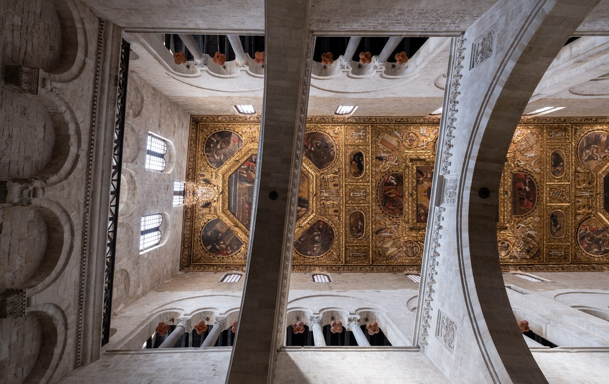</picture>
<figcaption>Looking up at the ceiling of the nave of <b>San Nicola</b>, Bari. Photo: <a href="https://commons.wikimedia.org/wiki/File:Basilica_San_Nicola_interior,_Bari,_Italy_(PPL1-Corrected)_julesvernex2.jpg">Basilica San Nicola interior, Bari, Italy (PPL1-Corrected) julesvernex2</a> by Jules Verne Times Two, <a href="https://creativecommons.org/licenses/by-sa/4.0">CC BY-SA 4.0</a>, via Wikimedia Commons.</figcaption>
</figure>

<figure class=photo>
<picture><source srcset="/static/art/nicholas-bari-ceiling-600.webp 600w,/static/art/nicholas-bari-ceiling.webp 1280w" sizes="(max-width:760px) 100vw,760px" type="image/webp">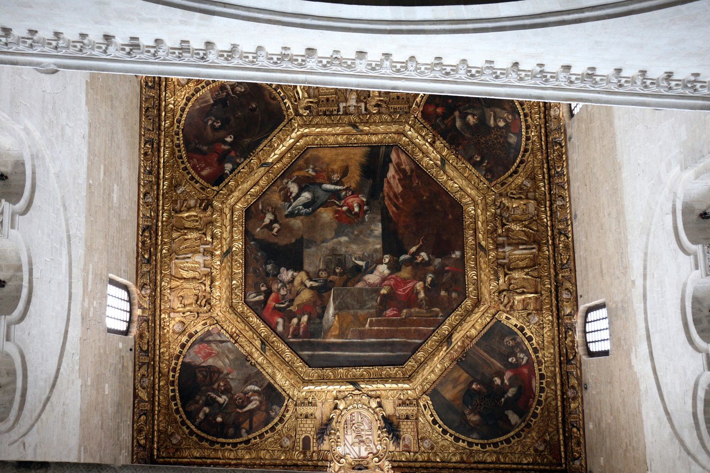</picture>
<figcaption>The gilded ceiling with <b>scenes from the life of St Nicholas</b> painted by Carlo Rosa in 1661–62. Photo: <a href="https://commons.wikimedia.org/wiki/File:Bari,_san_nicola,_interno,_soffitto_con_storie_di_san_nicola_e_paradiso_di_carlo_rosa,_1661-62,_01.jpg">Bari, san nicola, interno, soffitto con storie di san nicola e paradiso di carlo rosa, 1661-62, 01</a> by Sailko, <a href="https://creativecommons.org/licenses/by/3.0">CC BY 3.0</a>, via Wikimedia Commons.</figcaption>
</figure>

<figure class=photo>
<picture><source srcset="/static/art/nicholas-bari-cathedra-600.webp 600w,/static/art/nicholas-bari-cathedra.webp 1280w" sizes="(max-width:760px) 100vw,760px" type="image/webp">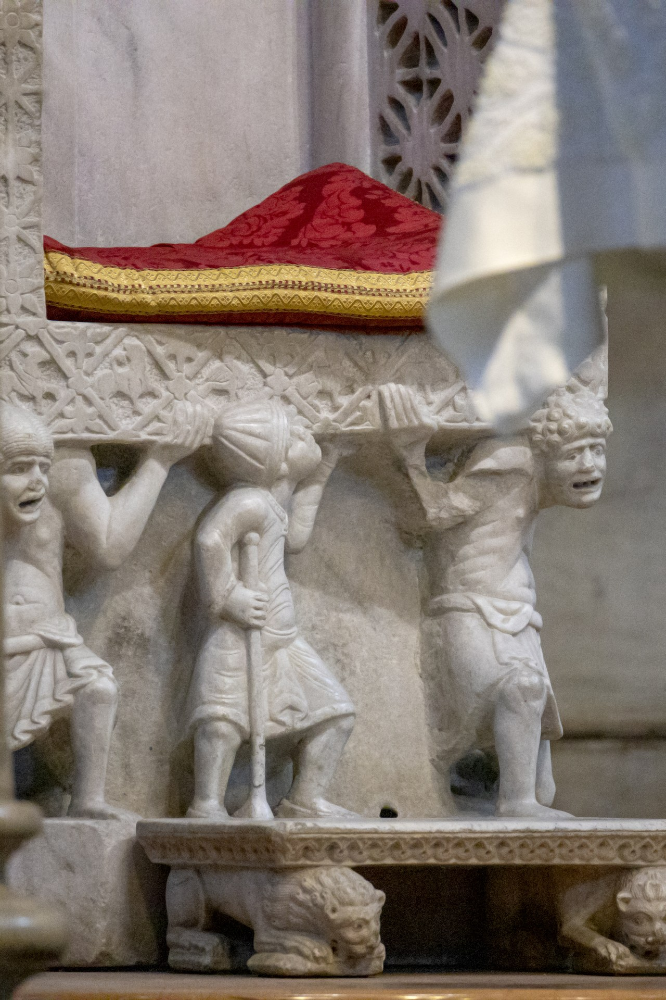</picture>
<figcaption>The <b>cathedra of Abbot Elia</b>, the marble bishop's throne of San Nicola, carved around 1100 or a little later. Photo: <a href="https://commons.wikimedia.org/wiki/File:Cattedra_dell%27abate_Elia,_databile_al_1098_o_alcuni_anni_dopo._Basilica_di_San_Nicola_a_Bari_-FG1.jpg">Cattedra dell'abate Elia, databile al 1098 o alcuni anni dopo. Basilica di San Nicola a Bari -FG1</a> by Fabrizio Garrisi, <a href="https://creativecommons.org/publicdomain/zero/1.0/">CC0</a>, via Wikimedia Commons.</figcaption>
</figure>

<figure class=photo>
<picture><source srcset="/static/art/nicholas-bari-crypt-600.webp 600w,/static/art/nicholas-bari-crypt.webp 1280w" sizes="(max-width:760px) 100vw,760px" type="image/webp">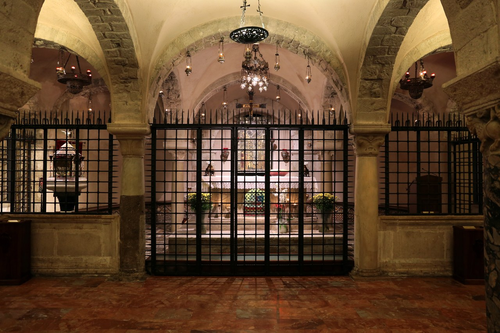</picture>
<figcaption>The <b>tomb of St Nicholas</b> behind its grille in the crypt of San Nicola, Bari, where pilgrims of East and West pray together. Photo: <a href="https://commons.wikimedia.org/wiki/File:Bari,_san_nicola,_interno,_cripta_01.jpg">Bari, san nicola, interno, cripta 01</a> by Sailko, <a href="https://creativecommons.org/licenses/by-sa/4.0">CC BY-SA 4.0</a>, via Wikimedia Commons.</figcaption>
</figure>

<figure class=photo>
<picture><source srcset="/static/art/nicholas-bari-nave-600.webp 600w,/static/art/nicholas-bari-nave.webp 1280w" sizes="(max-width:760px) 100vw,760px" type="image/webp">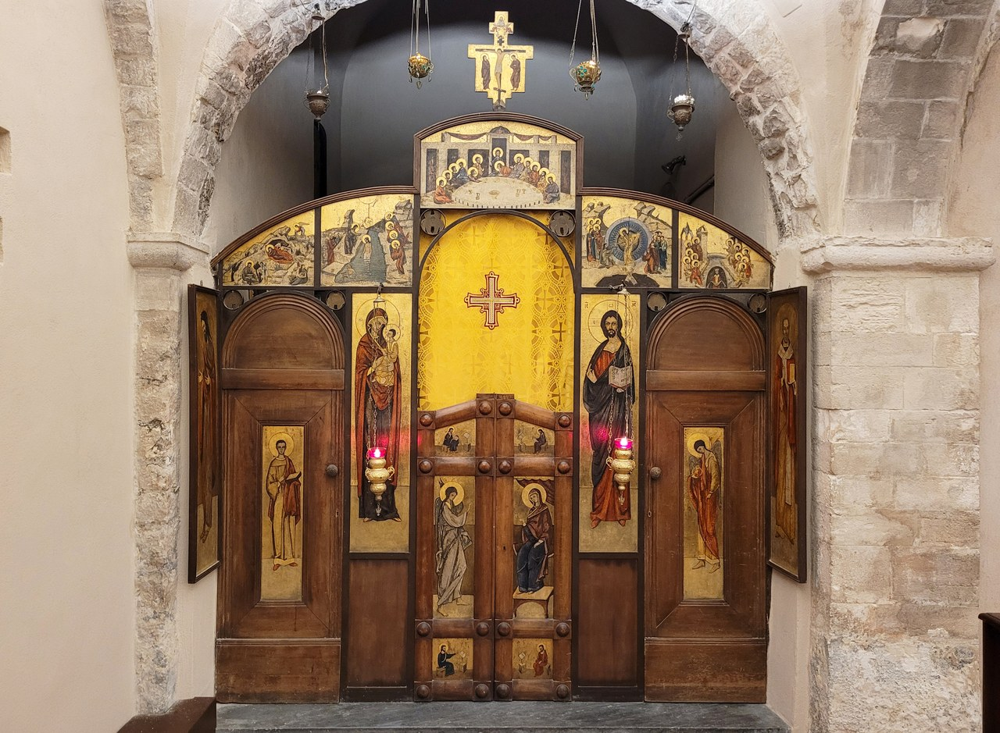</picture>
<figcaption>The <b>Orthodox chapel</b> in the crypt of San Nicola, with its iconostasis, opened in 1966 as a sign of reconciliation. Photo: <a href="https://commons.wikimedia.org/wiki/File:Basilica_di_San_Nicola_05.jpg">Basilica di San Nicola 05</a> by Bernard Gagnon, <a href="https://creativecommons.org/publicdomain/zero/1.0/">CC0</a>, via Wikimedia Commons.</figcaption>
</figure>

<figure class=photo>
<picture><source srcset="/static/art/nicholas-bari-icon-600.webp 600w,/static/art/nicholas-bari-icon.webp 1280w" sizes="(max-width:760px) 100vw,760px" type="image/webp">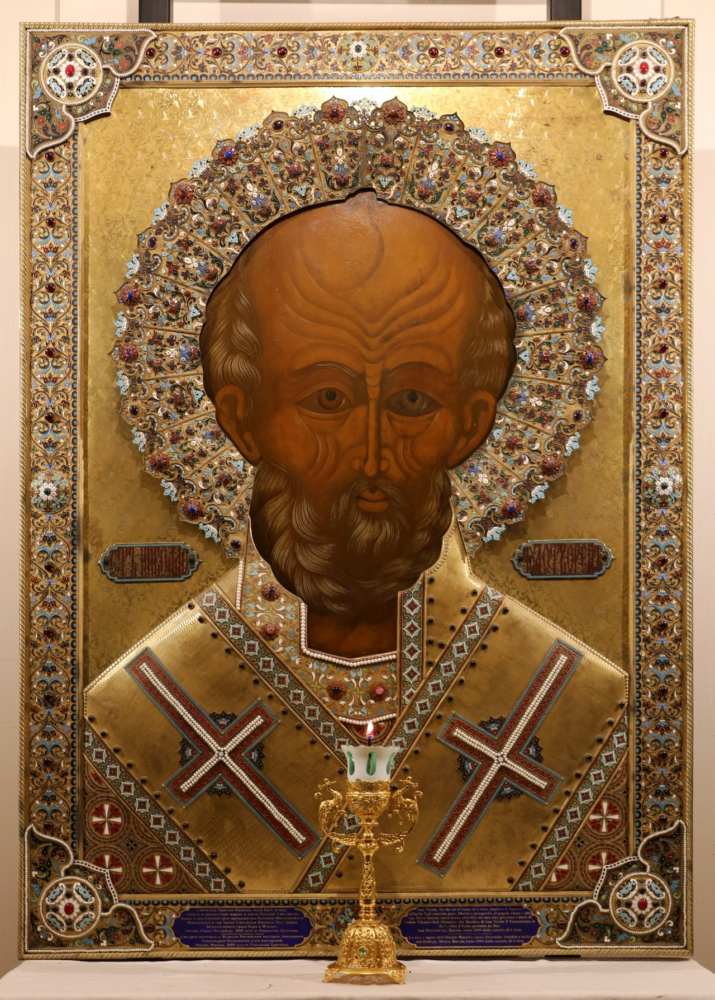</picture>
<figcaption>An icon of <b>St Nicholas</b> in a gilded cover, in the crypt at Bari. Photo: <a href="https://commons.wikimedia.org/wiki/File:Bari,_san_nicola,_interno,_cripta,_icona_di_san_nicola,_2009.jpg">Bari, san nicola, interno, cripta, icona di san nicola, 2009</a> by Sailko, <a href="https://creativecommons.org/licenses/by-sa/4.0">CC BY-SA 4.0</a>, via Wikimedia Commons.</figcaption>
</figure>

### San Nicolò al Lido, Venice

At the northern end of the **Lido**, where the lagoon opens to the Adriatic, stands the church and monastery of San Nicolò, founded in the eleventh century, which received further relics of the saint in 1100. For centuries the Doge of Venice came here after the ceremony of the "Marriage of the Sea" on Ascension Day, to hear Mass in honour of the patron of sailors. Today the church is cared for by Franciscan friars.

<figure class=photo>
<picture><source srcset="/static/art/nicholas-lido-600.webp 600w,/static/art/nicholas-lido.webp 1280w" sizes="(max-width:760px) 100vw,760px" type="image/webp"></picture>
<figcaption><b>San Nicolò al Lido</b>, Venice, from the lagoon. Photo: <a href="https://commons.wikimedia.org/wiki/File:San_Nicol%C3%B2_(Venice).jpg">San Nicolò (Venice)</a> by Didier Descouens, <a href="https://creativecommons.org/licenses/by-sa/4.0">CC BY-SA 4.0</a>, via Wikimedia Commons.</figcaption>
</figure>

<figure class=photo>
<picture><source srcset="/static/art/nicholas-lido-bella-600.webp 600w,/static/art/nicholas-lido-bella.webp 1280w" sizes="(max-width:760px) 100vw,760px" type="image/webp"></picture>
<figcaption><i>The Doge's Visit to San Nicolò after the Marriage of the Sea</i>, by <b>Gabriele Bella</b>, eighteenth century. Fondazione Querini Stampalia, Venice. Photo: <a href="https://commons.wikimedia.org/wiki/File:Pinacoteca_Querini_Stampalia_-_La_visita_del_doge_a_San_Nicol%C3%B2_dopo_lo_Sposalizio_del_Mare_-_Gabriele_Bella.jpg">Pinacoteca Querini Stampalia - La visita del doge a San Nicolò dopo lo Sposalizio del Mare - Gabriele Bella</a> by Didier Descouens, <a href="https://creativecommons.org/licenses/by-sa/4.0">CC BY-SA 4.0</a>, via Wikimedia Commons.</figcaption>
</figure>

### Other shrines

In Rome, **San Nicola in Carcere**, "in prison," stands near the Tiber, its walls built among the columns of ancient Roman temples, on a site long linked with a prison. In Lorraine, the late Gothic **basilica of Saint-Nicolas-de-Port**, built in the fifteenth and sixteenth centuries, keeps a finger bone of the saint and has long been the great pilgrim shrine of Lorraine, of which he is patron. For more of the holy places of Rome, see our [Rome pilgrimage guide](/pilgrimage/rome/).

<figure class=photo>
<picture><source srcset="/static/art/nicholas-carcere-600.webp 600w,/static/art/nicholas-carcere.webp 1280w" sizes="(max-width:760px) 100vw,760px" type="image/webp"></picture>
<figcaption><b>San Nicola in Carcere</b>, Rome. The church was built among the columns of ancient Roman temples, near the Tiber. Photo: <a href="https://commons.wikimedia.org/wiki/File:San_Nicola_in_Carcere_facade_Rome.jpg">San Nicola in Carcere facade Rome</a> by Jebulon, <a href="https://creativecommons.org/publicdomain/zero/1.0/">CC0</a>, via Wikimedia Commons.</figcaption>
</figure>

<figure class=photo>
<picture><source srcset="/static/art/nicholas-port-600.webp 600w,/static/art/nicholas-port.webp 1280w" sizes="(max-width:760px) 100vw,760px" type="image/webp"></picture>
<figcaption>The <b>Basilica of Saint-Nicolas-de-Port</b>, Lorraine. Photo: <a href="https://commons.wikimedia.org/wiki/File:Saint-Nicolas-de-Port_Basilique_St._Nicolas_1.jpg">Saint-Nicolas-de-Port Basilique St. Nicolas 1</a> by Zairon, <a href="https://creativecommons.org/licenses/by-sa/4.0">CC BY-SA 4.0</a>, via Wikimedia Commons.</figcaption>
</figure>

<h2 id=art>Nicholas in art</h2>

In the East, St Nicholas is painted as an old bishop with a high, wise forehead and a short white beard, wearing the *omophorion*, the bishop's stole embroidered with crosses, and holding the Book of the Gospels, often with Christ and the Mother of God at his shoulders. In the West he wears a mitre and carries a crozier, and at his feet or in his hand are the signs of his stories: three balls or bags of gold, an anchor or a ship, three boys in a barrel. The painting at the top of this page, by Gentile da Fabriano, shows the sick being healed at his tomb, the last scene of the Quaratesi predella; it is now in the National Gallery of Art in Washington.

### The icons of the East

<figure class=photo>
<picture><source srcset="/static/art/nicholas-icon-sinai-10th-600.webp 600w,/static/art/nicholas-icon-sinai-10th.webp 615w" sizes="(max-width:760px) 100vw,760px" type="image/webp"></picture>
<figcaption><b>St Nicholas</b>, a Byzantine icon from Constantinople, late tenth or early eleventh century, kept at the Monastery of St Catherine, Sinai. It is among the oldest icons of the saint in the world. Image: <a href="https://commons.wikimedia.org/wiki/File:%D0%9D%D0%B8%D0%BA%D0%BE%D0%BB%D0%B0%D0%B9_%D0%A7%D1%83%D0%B4%D0%BE%D1%82%D0%B2%D0%BE%D1%80%D0%B5%D1%86_%D0%B8%D0%B7_%D0%A1%D0%B8%D0%BD%D0%B0%D0%B9%D1%81%D0%BA%D0%BE%D0%B3%D0%BE_%D0%BC%D0%BE%D0%BD%D0%B0%D1%81%D1%82%D1%8B%D1%80%D1%8F_%D0%A1%D0%B2%D1%8F%D1%82%D0%BE%D0%B9_%D0%95%D0%BA%D0%B0%D1%82%D0%B5%D1%80%D0%B8%D0%BD%D1%8B.jpg">Николай Чудотворец из Синайского монастыря Святой Екатерины</a>, public domain, via Wikimedia Commons.</figcaption>
</figure>

<figure class=photo>
<picture><source srcset="/static/art/nicholas-icon-13th-600.webp 600w,/static/art/nicholas-icon-13th.webp 667w" sizes="(max-width:760px) 100vw,760px" type="image/webp"></picture>
<figcaption><b>St Nicholas</b>, a Russian icon of the thirteenth or fourteenth century. Image: <a href="https://commons.wikimedia.org/wiki/File:13th-century_unknown_painters_-_Icon_of_St_Nicholas_-_WGA23492.jpg">13th-century unknown painters - Icon of St Nicholas - WGA23492</a>, public domain, via Wikimedia Commons.</figcaption>
</figure>

<figure class=photo>
<picture><source srcset="/static/art/nicholas-icon-yaroslavl-600.webp 600w,/static/art/nicholas-icon-yaroslavl.webp 1280w" sizes="(max-width:760px) 100vw,760px" type="image/webp"></picture>
<figcaption><b>St Nicholas</b>, an icon from Yaroslavl, first half of the fourteenth century, from one of the churches of the town of Mologa. Tretyakov Gallery, Moscow. Image: <a href="https://commons.wikimedia.org/wiki/File:Saint_Nicholas_(Yaroslavl,_14th_c.,_GTG).jpg">Saint Nicholas (Yaroslavl, 14th c., GTG)</a>, public domain, via Wikimedia Commons.</figcaption>
</figure>

<figure class=photo>
<picture><source srcset="/static/art/nicholas-mozhaisky-600.webp 600w,/static/art/nicholas-mozhaisky.webp 1280w" sizes="(max-width:760px) 100vw,760px" type="image/webp"></picture>
<figcaption><b>St Nicholas of Mozhaisk</b> (<i>Nikola Mozhaisky</i>), a carved wooden statue from Moscow, fourteenth century. With sword and town in hand, he is shown as the protector of his people. Tretyakov Gallery, Moscow. Photo: <a href="https://commons.wikimedia.org/wiki/File:Saint_Nicholas_(Moscow,_14th_c.,_GTG)_by_shakko_01.jpg">Saint Nicholas (Moscow, 14th c., GTG) by shakko 01</a> by shakko, <a href="https://creativecommons.org/licenses/by-sa/3.0">CC BY-SA 3.0</a>, via Wikimedia Commons.</figcaption>
</figure>

### The Renaissance storytellers

<figure class=photo>
<picture><source srcset="/static/art/nicholas-angelico-story-600.webp 600w,/static/art/nicholas-angelico-story.webp 1280w" sizes="(max-width:760px) 100vw,760px" type="image/webp"></picture>
<figcaption><b>The Story of St Nicholas</b>: his birth, his calling and the gift to the three maidens, by <b>Fra Angelico</b>, from the predella of the Perugia Altarpiece. The panels are now divided between the Galleria Nazionale dell'Umbria in Perugia and the Pinacoteca Vaticana. Image: <a href="https://commons.wikimedia.org/wiki/File:Perugia_Altarpiece,_predella_%E2%80%93_The_Story_of_St_Nicholas.jpg">Perugia Altarpiece, predella – The Story of St Nicholas</a>, public domain, via Wikimedia Commons.</figcaption>
</figure>

<figure class=photo>
<picture><source srcset="/static/art/nicholas-gentile-panel-600.webp 600w,/static/art/nicholas-gentile-panel.webp 1280w" sizes="(max-width:760px) 100vw,760px" type="image/webp"></picture>
<figcaption><b>St Mary Magdalene and St Nicholas</b>, by <b>Gentile da Fabriano</b>, 1425, panels of the Quaratesi Polyptych, painted for the church of San Niccolò Oltrarno in Florence. Uffizi Gallery, Florence. Photo: <a href="https://commons.wikimedia.org/wiki/File:Gentile_da_Fabriano,_Sts_Mary_Magdalene_and_Nicholas_of_Bari,_Quaratesi_Polyptych,1425.jpg">Gentile da Fabriano, Sts Mary Magdalene and Nicholas of Bari, Quaratesi Polyptych,1425</a> by Diego Delso, <a href="https://creativecommons.org/licenses/by-sa/4.0">CC BY-SA 4.0</a>, via Wikimedia Commons.</figcaption>
</figure>

<figure class=photo>
<picture><source srcset="/static/art/nicholas-vigilia-600.webp 600w,/static/art/nicholas-vigilia.webp 1280w" sizes="(max-width:760px) 100vw,760px" type="image/webp"></picture>
<figcaption><i>St Nicholas Enthroned with Angels and Deacons</i>, by <b>Tommaso de Vigilia</b>, late 1480s, from the church of San Nicolò Reale in Palermo. Galleria Regionale della Sicilia, Palazzo Abatellis, Palermo. Photo: <a href="https://commons.wikimedia.org/wiki/File:Tommaso_de_Vigilia,_San_Nicola_in_cattedra_con_angeli_e_diaconi,_1488_-FG.jpg">Tommaso de Vigilia, San Nicola in cattedra con angeli e diaconi, 1488 -FG</a> by Fabrizio Garrisi, <a href="https://creativecommons.org/licenses/by-sa/4.0">CC BY-SA 4.0</a>, via Wikimedia Commons.</figcaption>
</figure>

## Path to sainthood
Nicholas was honoured as a saint by the people of Myra from the time of his death, long before there was any formal process of canonisation; he is one of the **pre-Congregation** saints. A church was built over his place of burial in the fifth century, Justinian honoured him in Constantinople in the sixth, and by the tenth century his feast was kept across the Christian world. His feast on **6 December** is an optional memorial in the General Roman Calendar; Orthodox Churches that follow the Julian calendar keep it on **19 December**. The translation of his relics to Bari is remembered on **9 May**.

## Patronages
**Children**, **sailors** and fishermen, **merchants**, **bakers**, **brewers**, **travellers**, **prisoners** and the falsely accused, unmarried girls hoping to marry, students and **pawnbrokers**. He is patron of **Greece** and the Hellenic Navy, of **Russia**, of **Bari**, **Amsterdam**, Moscow, **Lorraine**, Naples and Sicily, and of many seaport towns, and for Serbian families who keep him as the saint of their *Slava*, he is the family's own protector.

## Trivia
- In much of the Eastern Church, hymns to St Nicholas are sung on almost every **Thursday** of the year.
- In late medieval England, parishes kept his feast with a **"boy bishop"**: for a day, young people took the parts of the priests and bishops.
- Benjamin Britten wrote a cantata about his life, **_Saint Nicolas_**, in 1948, which tells the story of the three pickled boys.
- The bronze statue of Nicholas in the square at Demre was briefly replaced by a plastic Santa Claus in 2005; after local protests, the saint went back on his pedestal.
- New York's **St Nicholas Avenue**, running through Harlem, keeps the name of the city's old Dutch patron.
- In 2017 a rib of the saint was flown from Bari to Moscow and St Petersburg, and more than a million people came to pray before it.
- His name is spoken in the Divine Liturgy of St John Chrysostom, the usual liturgy of the Byzantine Churches. Read also of [St John Chrysostom](/saints/john-chrysostom/), [St Basil the Great](/saints/basil-the-great/), [St Athanasius](/saints/athanasius/) and [St Constantine](/saints/constantine/), his contemporary, and of other saints of Advent and Christmas: [St Lucy](/saints/lucy/), [St Joseph](/saints/joseph/) and [the Blessed Virgin Mary](/saints/mary/).

## Sources
- [Vatican News: St Nicholas of Bari, Bishop of Myra](https://www.vaticannews.va/en/saints/12/06/saint-nicholas-of-bari--bishop-of-myra.html)
- [Catholic Encyclopedia: St Nicholas of Myra](https://www.newadvent.org/cathen/11063b.htm)
- [Pope Benedict XVI, homily in Bari, 29 May 2005](https://www.vatican.va/content/benedict-xvi/en/homilies/2005/documents/hf_ben-xvi_hom_20050529_bari.html)
- [Pope Francis, address at the meeting for peace in Bari, 7 July 2018](https://www.vatican.va/content/francesco/en/speeches/2018/july/documents/papa-francesco_20180707_visita-bari-pace.html)
- [Wikipedia: Saint Nicholas](https://en.wikipedia.org/wiki/Saint_Nicholas)
- [Wikipedia: Translation of the Relics of Saint Nicholas from Myra to Bari](https://en.wikipedia.org/wiki/Translation_of_the_Relics_of_Saint_Nicholas_from_Myra_to_Bari)
- [Wikipedia: Basilica of Saint Nicholas, Bari](https://en.wikipedia.org/wiki/Basilica_of_Saint_Nicholas)
- [Wikipedia (Italian): Basilica di San Nicola](https://it.wikipedia.org/wiki/Basilica_di_San_Nicola)
- [Wikipedia: St. Nicholas Church, Demre](https://en.wikipedia.org/wiki/St._Nicholas_Church,_Demre)
- [Wikipedia: Myra](https://en.wikipedia.org/wiki/Myra)
- [Wikipedia: San Nicolò al Lido](https://en.wikipedia.org/wiki/San_Nicol%C3%B2_al_Lido)
- [Wikipedia: First Council of Nicaea](https://en.wikipedia.org/wiki/First_Council_of_Nicaea)
- [Wikipedia: Myrrh-streaming](https://en.wikipedia.org/wiki/Myrrh-streaming)
- [Wikipedia: Saint Nicholas Day](https://en.wikipedia.org/wiki/Saint_Nicholas_Day)
- [Wikipedia: Sinterklaas](https://en.wikipedia.org/wiki/Sinterklaas)
- [Wikipedia: Santa Claus](https://en.wikipedia.org/wiki/Santa_Claus)
- [Wikipedia: A Visit from St. Nicholas](https://en.wikipedia.org/wiki/A_Visit_from_St._Nicholas)
- [Wikipedia: Thomas Nast](https://en.wikipedia.org/wiki/Thomas_Nast)
- [Wikipedia: Quaratesi Polyptych](https://en.wikipedia.org/wiki/Quaratesi_Polyptych)
- [Wikipedia: Perugia Altarpiece](https://en.wikipedia.org/wiki/Perugia_Altarpiece)
- [Wikipedia: Altarpiece of San Nicolò della Lattuga (Titian)](https://en.wikipedia.org/wiki/Altarpiece_of_San_Nicol%C3%B2_della_Lattuga)
- [Wikipedia: Saint Nicholas of Myra Saves Three Innocents from Death (Repin)](https://en.wikipedia.org/wiki/Saint_Nicholas_of_Myra_saves_three_innocents_from_death)
- [Wikipedia: The Feast of Saint Nicholas (Steen)](https://en.wikipedia.org/wiki/The_Feast_of_Saint_Nicholas)

Fact-checked on October 15, 2026 against Vatican documents, Vatican News and New Advent (Catholic Encyclopedia). Expanded and fact-checked November 25, 2026 with the account of his life from Vatican News and the Catholic Encyclopedia; the homily of Pope Benedict XVI in Bari (2005) and the address of Pope Francis there (2018); the history of his relics in Myra, Bari and Venice; the stories of the dowries, the three innocents and the three generals, the grain ships, the slap at Nicaea and the three boys, labelled as tradition or legend; the history of Sinterklaas and Santa Claus; the churches and places connected with him; and his portrayal in art, using museum records and Wikimedia Commons. The maps were drawn for this page from Natural Earth data (public domain). Feast days follow the General Roman Calendar unless noted.

