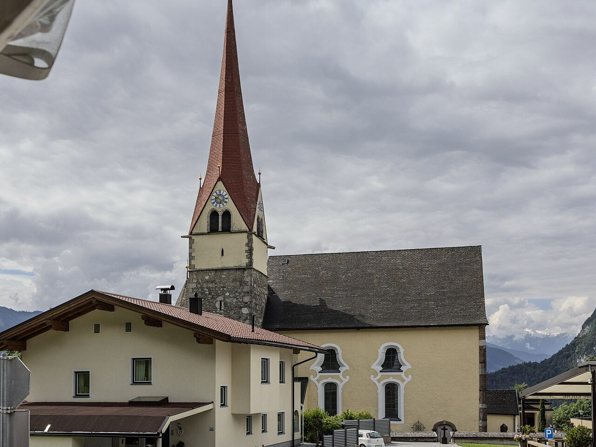

## The story
Notburga served first a kindly household at Rattenberg castle, giving surplus food to the poor at the gate, then — dismissed by a miserly mistress for exactly that charity — worked for a farmer at Eben, bargaining one condition into her labour: time for church on Sundays and feast-day eves.

## The full story

### The hanging sickle
The Tyrolean legend everyone knows: ordered to keep reaping into a feast-day evening, Notburga threw her sickle into the air saying, in effect, let God judge between us. The sickle hung suspended in the sky. She got her holy days. Later reconciled with the castle household, she served there in honour until death in 1313.

### Servants' saint
Farmers, maids and country parishes adopted her utterly: her body, exhumed and found incorrupt in local telling, stands in a glass shrine at Eben am Achensee, dressed, with sickle and keys and apron of bread — a working woman's whole iconography in one figure. Her life and the early Tyrolean cult are well rooted. The sickle hung in the air is the story the farms tell of her bargain: time for church.

<figure class=photo>
<picture><source srcset="/static/art/notburga-eben-600.webp 600w,/static/art/notburga-eben.webp 1280w" sizes="(max-width:760px) 100vw,760px" type="image/webp"></picture>
<figcaption>The church of St Notburga at Eben am Achensee, where her shrine is kept. Photo: <a href="https://commons.wikimedia.org/wiki/File:St._Notburga_church,_Eben_am_Achensee.jpg">The wub</a>, <a href="https://creativecommons.org/licenses/by-sa/4.0">CC BY-SA 4.0</a>, via Wikimedia Commons.</figcaption>
</figure>

## Path to sainthood
Local cult for five centuries; formally confirmed by Pius IX in 1862.

## Patronages
Servants, peasants and farmers, the Tyrol, poor and working women.

## Trivia
- She may be history's most practical patron: her miracle is about clocking off for church.
- Her feast closes the alpine summer in Tyrol with processions in her honour.

## Sources
- [Catholic Encyclopedia: St Notburga, New Advent](https://www.newadvent.org/cathen/11123a.htm)

Written October 19, 2026 from the sources above. The Eben photograph was added November 6, 2026. Feast days follow the General Roman Calendar unless noted.

