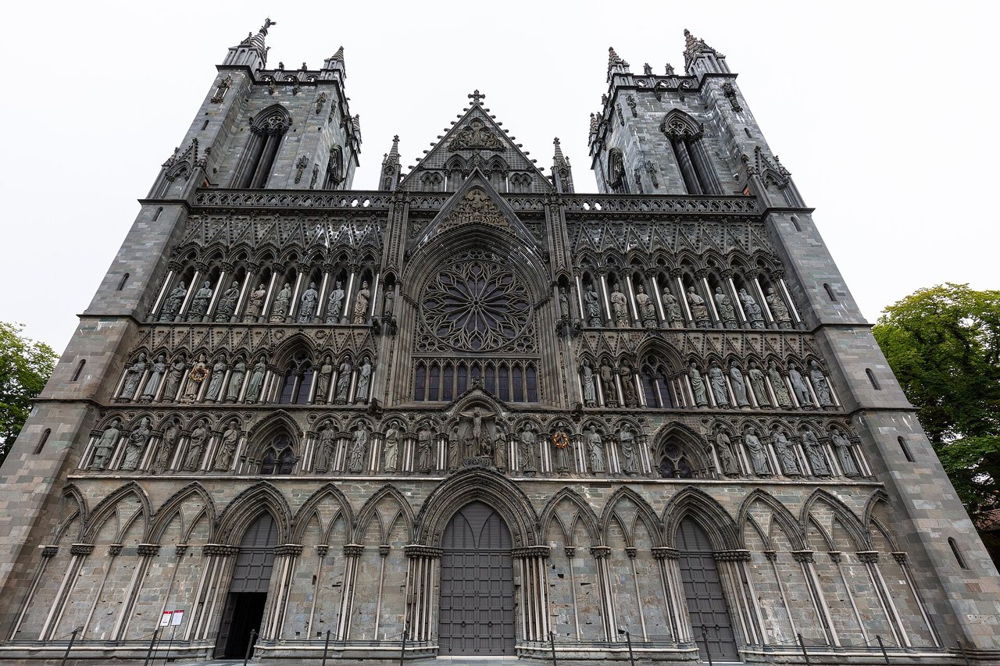

## The story
Olav Haraldsson was a Viking raider in England, France and the Baltic who was baptised in **Rouen** about 1013. He became King of Norway in 1015 and set about making it a Christian kingdom, building churches and introducing Christian laws, often by force. Driven out by Cnut the Great in 1028, he returned in 1030 and was killed at the **battle of Stiklestad** on 29 July 1030.

## The full story

### The saint king
A year later, in 1031, his body was dug up and found incorrupt, with hair and nails grown. Bishop Grimkell declared him a saint. Miracles were reported at his grave in **Nidaros** (Trondheim), where **Nidaros Cathedral** was built over it, and pilgrims came from all over the North along the routes now revived as St Olav's Ways (see our [St Olav's Way](/pilgrimage/st-olav/) pages).

### Legends
Norwegian folklore is full of Olav: he is said to have fought trolls, made springs gush where he struck the ground, and carved paths through mountains. He is shown with an axe, the weapon of his death, standing on a dragon or troll. His reign, his laws, and his death are known from skaldic poems and from Snorri Sturluson's sagas. The trolls are the folklore of the North.

<figure class=photo>
<picture><source srcset="/static/art/olav-nidaros-600.webp 600w,/static/art/olav-nidaros.webp 1280w" sizes="(max-width:760px) 100vw,760px" type="image/webp"></picture>
<figcaption>Nidaros Cathedral in Trondheim, built over his grave. The west front is the medieval church and the work of later centuries. Photo: <a href="https://commons.wikimedia.org/wiki/File:Catedral_de_Nidaros%2C_Trondheim%2C_Noruega%2C_2019-09-06%2C_DD_126.jpg">Diego Delso</a>, <a href="https://creativecommons.org/licenses/by-sa/4.0">CC BY-SA 4.0</a>, via Wikimedia Commons.</figcaption>
</figure>

## Path to sainthood
Declared a saint by local bishop in 1031; venerated across Christendom; still honoured by the Lutheran Church of Norway.

## Patronages
Norway, the Faroe Islands, carvers.

## Trivia
- His name is on the Norwegian coat of arms indirectly: the lion holds **St Olav's axe**.
- St Olave's Church in London's Hart Street was dedicated to him in memory of his help against the Danes in 1014.

## Sources
- [Catholic Encyclopedia: St Olaf Haraldson](https://www.newadvent.org/cathen/11234a.htm)

Written October 16, 2026 from the sources above. The Trondheim photograph was added November 6, 2026. Feast days follow the General Roman Calendar unless noted.

