<nav class=toc aria-label="On this page">

On this page

<ol>
<li><a href="#why">Why the Church honours him</a></li>
<li><a href="#bannavem">A boy of Roman Britain</a></li>
<li><a href="#captive">Taken captive at sixteen</a></li>
<li><a href="#prayer">A hundred prayers a day: the shepherd on the mountain</a></li>
<li><a href="#escape">"Behold, thy ship is ready": the escape</a></li>
<li><a href="#voice">Home again, and the Voice of the Irish</a></li>
<li><a href="#gaul">Years of preparation in Gaul</a></li>
<li><a href="#bishop">Bishop in Ireland</a></li>
<li><a href="#slane">The Easter fire at Slane and the king at Tara</a></li>
<li><a href="#breastplate">St Patrick's Breastplate</a></li>
<li><a href="#croagh">Forty days on Croagh Patrick</a></li>
<li><a href="#coroticus">The Letter to Coroticus</a></li>
<li><a href="#confessio">Accused, and his Confession</a></li>
<li><a href="#death">His death at Saul and his grave at Downpatrick</a></li>
<li><a href="#armagh">Armagh, his chief church</a></li>
<li><a href="#shamrock">The shamrock and the Trinity</a></li>
<li><a href="#snakes">The snakes</a></li>
<li><a href="#purgatory">Lough Derg and St Patrick's Purgatory</a></li>
<li><a href="#places">His places and churches</a></li>
<li><a href="#art">Patrick in art</a></li>
</ol>
</nav>

## His story

A sixteen-year-old boy is dragged from his father's farm by raiders and carried across the sea to a strange country, where he is set to mind another man's sheep. He has a Christian family, but by his own account he has never really believed. Out on the hillside, in snow and frost and rain, alone and hungry, he begins to pray, a hundred times a day and nearly as often at night. Six years later a voice tells him that a ship is waiting for him, and he walks two hundred miles to find it. Years afterwards, safe at home, he dreams that the people of the land of his slavery are calling him: "We entreat thee, holy youth, to come and walk still amongst us." And he goes back.

That boy was St Patrick, the Apostle of Ireland. Unlike most saints of his age, he left us his own words. Two short Latin writings of his survive: the *Confessio*, his account of his life written near its end, and his fierce and tender *Letter to the soldiers of Coroticus*. They are among the earliest documents of Irish history, and they let us hear the voice of a humble, rough-spoken, utterly grateful man, who called himself "a sinner, the rudest and least of all the faithful" and could never get over what God had done for him. All the quotations from Patrick on this page come from James O'Leary's 1880 translation of these two writings.

Around that firm core, Ireland wove a great garland of stories: the Easter fire on the Hill of Slane, the shamrock, the snakes, the cave of Purgatory on Lough Derg. Some come from the lives written about him two centuries after his death, by Muirchú and Tírechán; some are much later. We tell them gladly here, and say plainly which is which. His dates are uncertain: the annals place his coming in 432 and his death on 17 March, either around 461 or around 493. His feast on 17 March has become a celebration for the whole world.

### Late 4th or early 5th century · Bannavem Taberniae, Britain
Patrick is born into a Romano-British Christian family. His father Calpornius is a deacon and a town councillor (*decurio*); his grandfather Potitus is a priest.

### Aged nearly 16 · From Britain to Ireland
Irish raiders carry him off from his father's country house, with "many thousand" others, and he is sold into slavery in Ireland.

### Six years · Slemish or the wood of Foclut
He tends sheep and learns to pray. Muirchú places his captivity on Slemish in County Antrim; Patrick's own words point to the wood of Foclut, by the western sea, traditionally near Killala Bay in County Mayo.

### About aged 22 · The escape
A voice in his sleep tells him that his ship is ready. He flees, finds a ship, sails for three days and wanders twenty-eight days through a wilderness with the crew.

### A few years later · Britain
Home with his family, he dreams of a man named Victoricus bringing a letter headed "The Voice of the Irish".

### Years of study · Gaul (tradition)
He prepares for the priesthood. Muirchú says he studied at Auxerre with St Germanus; Tírechán names the island monastery of Lérins.

### 431 · Rome and Ireland
Pope Celestine I sends Palladius as the first bishop "to the Scotti believing in Christ", as Prosper of Aquitaine records.

### 432 (the annals) · Ireland
Patrick returns as a bishop. In Muirchú's account he lands at Inber Dea (Arklow), then sails north to Strangford Lough, where the chieftain Díchu gives him a barn at Saul for his first church.

### Easter 433 (tradition) · Slane and Tara
He lights the Paschal fire on the Hill of Slane in defiance of King Lóegaire, and preaches before the king at Tara, as Muirchú tells it.

### Lent (tradition) · Croagh Patrick
He fasts for forty days on the summit of the mountain in Mayo, as Moses did on Sinai, in Tírechán's account.

### 445 (tradition) · Armagh
He founds his principal church on the hill of Ard Macha.

### Mid-5th century · Ireland
He writes his *Letter to the soldiers of Coroticus*, after newly baptised Christians are murdered and carried off as slaves.

### Late in life · Ireland
Accused by church leaders in Britain, he writes his *Confessio*, "my confession before I die".

### 17 March, c. 461 or c. 493 · Saul and Downpatrick
Patrick dies, by tradition at Saul, and is buried at Downpatrick.

### 807 or 808 · Armagh
The scribe Ferdomnach copies Patrick's writings, and the lives of Muirchú and Tírechán, into the Book of Armagh.

### 1191 · Dublin
St Patrick's Cathedral in Dublin, beside St Patrick's holy well, is dedicated on his feast day.

### 1879 · New York
The new St Patrick's Cathedral on Fifth Avenue is dedicated on 25 May.

<figure class=photo>
<picture><source srcset="/static/art/patrick-montbaston-preaching-600.webp 600w,/static/art/patrick-montbaston-preaching.webp 1280w" sizes="(max-width:760px) 100vw,760px" type="image/webp">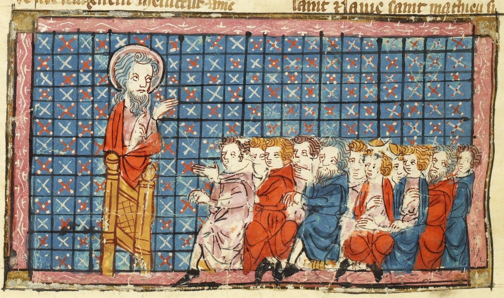</picture>
<figcaption><b>St Patrick preaching</b>, painted by Jeanne de Montbaston in Paris around 1325–1350, from a French collection of saints' lives. Nine centuries after his death, Patrick was still remembered above all as the man who came back to preach to the people who had enslaved him. Image: <a href="https://commons.wikimedia.org/wiki/File:Jeanne_de_Montbaston,_Saint_Patrick_Preaching_(c._1325-1350).jpg">Jeanne de Montbaston, Saint Patrick Preaching (c. 1325-1350)</a>, <a href="https://creativecommons.org/publicdomain/zero/1.0/">CC0</a>, via Wikimedia Commons.</figcaption>
</figure>

<h2 id=why>Why the Church honours him</h2>

- **He forgave and returned.** He went back of his own free will to the people who had enslaved him, "led by the Spirit", to give them the faith that had saved him in captivity.
- **He brought the Gospel to Ireland.** He baptised, by his own count, "many thousands", ordained clergy, and saw "the sons of the Scoti and the daughters of princes" become "monks and virgins of Christ". He is honoured as the Apostle of Ireland, with St Brigid and St Columba one of its three patron saints.
- **He prayed without ceasing.** As a slave boy he prayed "as many as a hundred prayers" a day, and the habit never left him. His story is a school of prayer.
- **He was humble and poor for Christ.** He refused gifts, would not take "even the value of my shoe", and gave all the glory to God: "do you judge, and let it be believed firmly, that it was the gift of God."
- **He stood up for the defenceless.** His *Letter to Coroticus* is one of the earliest Christian protests against slavery and the trade in human beings.
- **He trusted God in every danger.** "I daily expect either death, or treachery, or slavery... But I fear none of these things... for I have cast myself into the hands of the omnipotent God."

<h2 id=bannavem>A boy of Roman Britain</h2>

Patrick was not Irish. He was born in Roman Britain, in the last years of Roman rule, into a family that had been Christian for generations. He begins his *Confessio* with a little family history:

> I, Patrick, a sinner, the rudest and least of all the faithful, and most contemptible to very many, had for my father Calpornius, a deacon, the son of Potitus, a priest, who lived in Bannaven Taberniae, for he had a small country-house close by, where I was taken captive when I was nearly sixteen years of age.

In his *Letter to Coroticus* he adds that his father was a man of standing: "According to the flesh, I am of noble birth, my father being a Decurio", a member of the local town council. Patrick never tells us where Bannavem Taberniae was, and nobody knows for certain. It must have been near the sea, within reach of Irish raiders, and close to a Roman town. Scholars have proposed the Roman fort of Banna (Birdoswald) on Hadrian's Wall, Banwen in south Wales, and Banwell or Avonmouth in Somerset. Muirchú, writing in the seventh century, called his birthplace Nemthor, and later tradition placed it near Dumbarton on the Clyde, at Old Kilpatrick. The Catholic Encyclopedia of 1911 gives his mother's name as Conchessa and repeats an old tradition that she was a relative of St Martin of Tours.

Patrick is honest about his youth. "I knew not the true God," he writes. In his old age he still felt keenly that he had never had a proper education: "I had not learned as the others who studied the sacred writings in the best way", and he had to write Latin, a language he had lost the habit of, as "a foreign tongue".

<figure class=photo>
<picture><source srcset="/static/art/patrick-birdoswald-600.webp 600w,/static/art/patrick-birdoswald.webp 1280w" sizes="(max-width:760px) 100vw,760px" type="image/webp">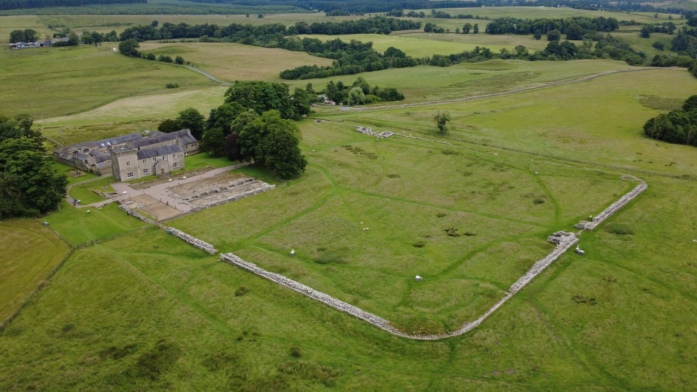</picture>
<figcaption><b>Banna (Birdoswald) Roman fort on Hadrian's Wall</b>, in Cumbria, seen from the air in 2026. It is one of several places proposed as Patrick's Bannavem Taberniae. Whether he grew up here, in Wales, in Somerset or on the Clyde, the boy who was taken came from the edge of the Roman world. Photo: <a href="https://commons.wikimedia.org/wiki/File:Banna_(Birdoswald)_Roman_Fort,_Hadrians_Wall,_From_the_air_south_west_of_the_site,_2026-07-01.png">Banna (Birdoswald) Roman Fort, Hadrians Wall, From the air south west of the site, 2026-07-01</a> by DsMaxwell, <a href="https://creativecommons.org/licenses/by-sa/4.0">CC BY-SA 4.0</a>, via Wikimedia Commons.</figcaption>
</figure>

<h2 id=captive>Taken captive at sixteen</h2>

Then the raiders came. In the early fifth century, as Roman power in Britain crumbled, Irish war bands crossed the sea to plunder its western coasts. Patrick was seized at his father's farm and carried away:

> I was taken captive when I was nearly sixteen years of age. I knew not the true God, and I was brought captive to Ireland with many thousand men, as we deserved; for we had forsaken God, and had not kept His commandments, and were disobedient to our priests, who admonished us for our salvation.

He never pretends this was anything other than a disaster. But looking back as an old man, he could see the hand of God in it. In Ireland, he says, "the Lord showed me my unbelief, that at length I might remember my iniquities", and God "looked down upon my humiliation, and had pity upon my youth and ignorance, and kept me before I knew him... and strengthened and comforted me as a father would his son." Years later he would write of "the gift of God which he gave me in the land of my captivity, for I sought him earnestly then, and found him there".

<h2 id=prayer>A hundred prayers a day: the shepherd on the mountain</h2>

Patrick was put to work as a herdsman. This passage of the *Confessio* is one of the loveliest descriptions of prayer in all early Christian writing:

> But after I had come to Ireland, I was daily tending sheep, and I prayed frequently during the day, and the love of God, and His faith and fear, increased in me more and more, and the spirit was stirred; so that in a single day I have said as many as a hundred prayers, and in the night nearly the same; so that I remained in the woods, and on the mountain, even before the dawn, I was roused to prayer, in snow, and ice, and rain, and I felt no injury from it, nor was there any slothfulness in me, as I see now, because the spirit was then fervent in me.

Where was the mountain? Muirchú says his master was a man called Miliuc, in what is now County Antrim, and the tradition of Ulster has always pointed to **Slemish**, a steep, lonely volcanic hill east of Ballymena. Patrick's own words, though, mention only one place in Ireland by name: "the wood of Focluti, which is near the western sea", and many historians think he was held there, near Killala Bay in County Mayo. Either way, he spent six years on a bare hillside with the sheep, and there the slave became a man of God.

<figure class=photo>
<picture><source srcset="/static/art/patrick-slemish-600.webp 600w,/static/art/patrick-slemish.webp 1200w" sizes="(max-width:760px) 100vw,760px" type="image/webp">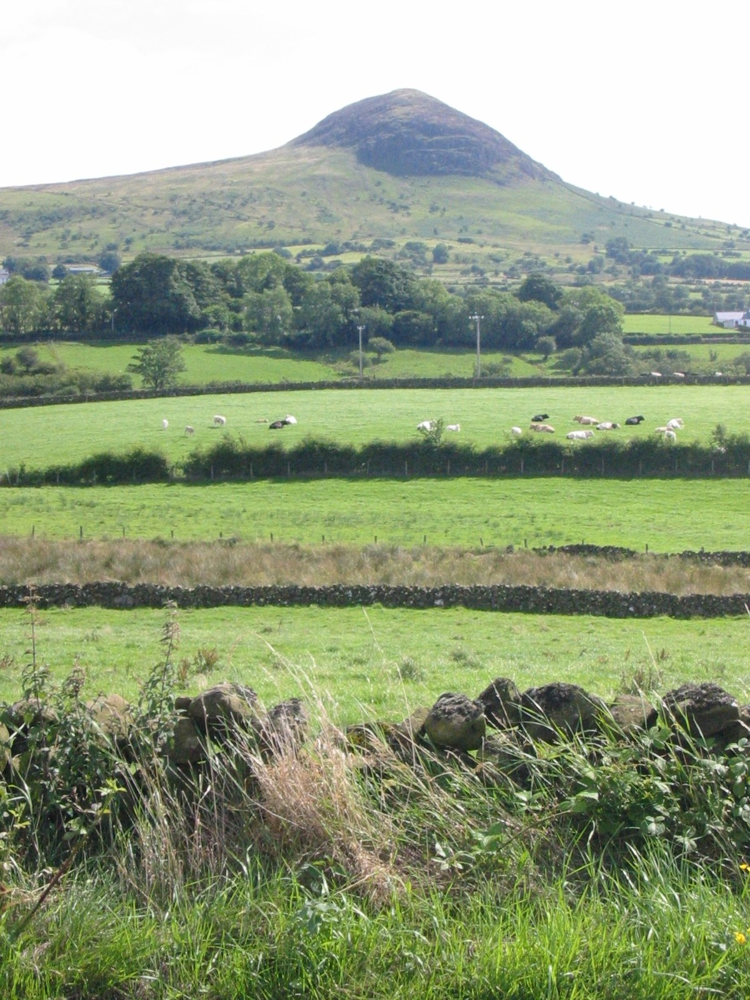</picture>
<figcaption><b>Slemish</b>, County Antrim, where tradition says the young Patrick herded his master's flocks. "I remained in the woods, and on the mountain, even before the dawn... in snow, and ice, and rain." Photo: <a href="https://commons.wikimedia.org/wiki/File:Slemish_mountain_County_Antrim.jpg">Slemish mountain County Antrim</a> by Man vyi, public domain, via Wikimedia Commons.</figcaption>
</figure>

<h2 id=escape>"Behold, thy ship is ready": the escape</h2>

After six years, God spoke to him in the night:

> And there one night I heard a voice, while I slept, saying to me: "Thou dost fast well; fasting thou shalt soon go to thy country." And again, after a very short time, I heard a response, saying to me: "Behold, thy ship is ready." And the place was not near, but perhaps about two hundred miles distant, and I had never been there, nor did I know any one who lived there.

So Patrick ran. He walked across Ireland "in the strength of the Lord, who directed my way for good; and I feared nothing", and found the ship about to sail. At first the master angrily refused to take him; then, as Patrick turned away to pray, one of the sailors called him back. After three days at sea they reached land, perhaps in Gaul, and wandered for twenty-eight days through a deserted country until their food ran out. The ship's master turned to the young Christian:

> "What sayest thou, O Christian? Your God is great and all-powerful; why canst thou not, then, pray for us, since we are perishing with hunger, and may never see the face of man again?" And I said to them plainly: "Turn sincerely to the Lord my God, to whom nothing is impossible, that He may send us food on your way until ye are satisfied, for it abounds everywhere for Him."

"And with God's help it was so done," he writes, "for, lo! a flock of swine appeared in the way before our eyes." The hungry men feasted, and from then on they treated him with honour.

That same night Patrick passed through a dark trial of his own. He felt he was attacked by Satan, "and there fell, as it were, a great stone upon me, and there was no strength in my limbs." He called out the name of the prophet Elijah, "Elias", "and at the same moment I saw the sun rising in the heavens; and while I cried out Elias with all my might, behold! the splendor of the sun was shed upon me, and immediately shook from me all heaviness. And I believe that Christ my Lord cried out for me." For Patrick, Christ himself was the true sun.

<h2 id=voice>Home again, and the Voice of the Irish</h2>

At last he came home. "And again, after a few years, I was with my relations in Britain, who received me as a son, and earnestly besought me that then, at least, after I had gone through so many tribulations, I would go nowhere from them." Anyone could understand that. But God had other plans, and once more they came to him in a dream:

> And there I saw, in the midst of the night, a man who appeared to come from Ireland, whose name was Victorious, and he had innumerable letters with him, one of which he gave to me; and I read the commencement of the epistle containing "The Voice of the Irish"; and as I read aloud the beginning of the letter, I thought I heard in my mind the voice of those who were near the wood of Focluti, which is near the western sea; and they cried out: "We entreat thee, holy youth, to come and walk still amongst us." And my heart was greatly touched, so that I could not read any more, and so I awoke.

(The man's name is usually given as Victoricus; O'Leary's 1880 translation prints "Victorious".) "Thanks be to God," Patrick adds, "that, after very many years, the Lord hath granted them their desire!" Other nights brought other graces. He heard words he could not understand until at the end it was said: "He who gave His life for thee is He who speaks in thee"; "and so I awoke full of joy". Another time he felt someone praying within him "earnestly with groans", and remembered St Paul's words that the Spirit helps our weakness and prays within us.

<figure class=photo>
<picture><source srcset="/static/art/patrick-killala-600.webp 600w,/static/art/patrick-killala.webp 1280w" sizes="(max-width:760px) 100vw,760px" type="image/webp">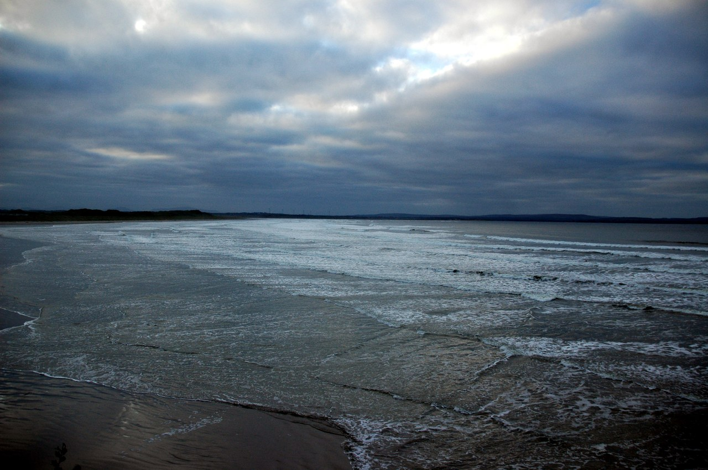</picture>
<figcaption><b>Killala Bay</b> from Enniscrone, County Mayo, in 2023. Near these shores, many historians believe, lay "the wood of Focluti, which is near the western sea", the only place in Ireland Patrick names. It was from here that he heard the Irish calling him home. Photo: <a href="https://commons.wikimedia.org/wiki/File:Enniscrone_-_Killala_Bay_-_24.11.2023_17-25-31.jpg">Enniscrone - Killala Bay - 24.11.2023 17-25-31</a> by Zwiadowca21, <a href="https://creativecommons.org/licenses/by-sa/4.0">CC BY-SA 4.0</a>, via Wikimedia Commons.</figcaption>
</figure>

<h2 id=gaul>Years of preparation in Gaul</h2>

Patrick does not tell us where he studied. But he speaks of "my Gallican brethren", and longs in old age to go "even to Gallia, to visit my brethren, and to see the face of my Lord's saints", so it seems he had spent time in Gaul (France). The later lives fill in the picture. **Muirchú** says that Patrick set out for Rome but stayed instead for many years with the great bishop **St Germanus of Auxerre**, and that Germanus ordained him; Vatican News follows this tradition. **Tírechán** says that he studied for thirty years at the famous island monastery of **Lérins**, off the coast of Provence. Both are traditions, written two centuries later, but both are fitting: Auxerre and Lérins were among the great schools of holiness in fifth-century Gaul.

Meanwhile, in 431, Pope Celestine I sent **Palladius**, a deacon of a noble family of Gaul, as "first bishop to the Scotti believing in Christ", in the words of the chronicler Prosper of Aquitaine: there were already some Christians in Ireland. His mission was short. The Irish annals date Patrick's own coming to 432, though the date may have been chosen to give him the glory of the first mission. Not everyone wanted Patrick to go. "Many gifts were offered to me with sorrow and tears" to keep him at home, he writes, "and I offended many of my seniors then against my will. But, guided by God, I yielded in no way to them." A dear friend, though, stood by him and told him: "Thou art going to be given the rank of bishop".

<figure class=photo>
<picture><source srcset="/static/art/patrick-auxerre-600.webp 600w,/static/art/patrick-auxerre.webp 1280w" sizes="(max-width:760px) 100vw,760px" type="image/webp">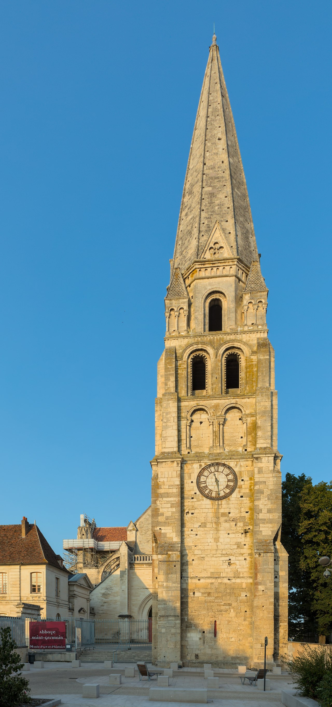</picture>
<figcaption>The <b>tower of St John at the former abbey of Saint-Germain, Auxerre</b>, in Burgundy. Muirchú says that Patrick studied and was ordained here, at the side of St Germanus, before returning to Ireland. The abbey grew up around Germanus's tomb. Photo: <a href="https://commons.wikimedia.org/wiki/File:Auxerre_-_Abbaye_Saint-Germain_-_01.jpg">Auxerre - Abbaye Saint-Germain - 01</a> by Benjamin Smith, <a href="https://creativecommons.org/licenses/by-sa/4.0">CC BY-SA 4.0</a>, via Wikimedia Commons.</figcaption>
</figure>

<h2 id=bishop>Bishop in Ireland</h2>

So Patrick, now a bishop, came back to the island of his slavery and spent the rest of his life there. He never went home again. "I am bound in the spirit," he writes, though he longed to see Britain, "as if to my country and parents", and Gaul "to visit my brethren". "And I fear to lose the labor which I have commenced—and not I, but the Lord Christ, who commanded me to come and be with them for the rest of my life."

Muirchú says he first landed at **Inber Dea**, now Arklow in County Wicklow, then sailed north to Strangford Lough. There the local chieftain **Díchu** believed and gave him a barn, in Irish *sabhall*, for his first church: the place is still called **Saul**. Tírechán has him begin instead in Brega, in Meath, near Tara, and gives him his first Irish disciple, the boy **Benen** (Benignus), who would one day succeed him at Armagh.

What Patrick himself tells us is simpler and more moving. He travelled the length of the country, "in distant places, where none had been further or had ever come to baptize, or ordain the clergy, or confirm the people". He baptised "many thousands", and he saw young people give themselves wholly to God:

> Wherefore behold how in Ireland they who never had the knowledge of God, and hitherto only worshipped unclean idols, have lately become the people of the Lord, and are called the sons of God. The sons of the Scoti and the daughters of princes are seen to be monks and virgins of Christ.

He remembered especially "one blessed Irish maiden, of adult age, noble and very beautiful, whom I baptized", who came to him a few days later to say she had received a command from God to become a virgin of Christ. Six days later "she most excellently and eagerly entered" that life. Many did the same, he says, often against the wishes of their families; and those in slavery, though "most severely persecuted", persevered "in spite of terrors and threats".

It was dangerous work. He paid kings for safe passage, and hired their sons as escorts. Once his enemies "wished to kill me; but the time had not come yet; but they put me in irons, and carried off all we possessed. But on the fourteenth day the Lord released me from their power." And he would not take a penny for himself:

> But when it happened that I baptized so many thousand men, did I expect even half a "screpall" from them? Tell me, and I will return it to you. Or when the Lord ordained clergy through my humility and ministry, did I confer the grace gratuitously? If I asked of any of them even the value of my shoe, tell me, and I will repay you more.

<figure class=photo>
<picture><source srcset="/static/art/patrick-jurby-600.webp 600w,/static/art/patrick-jurby.webp 1280w" sizes="(max-width:760px) 100vw,760px" type="image/webp">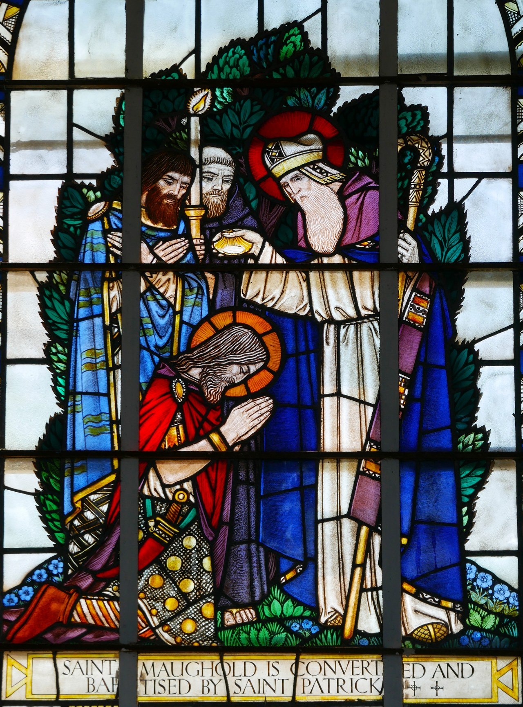</picture>
<figcaption><b>St Patrick baptising St Maughold</b>, a stained glass window at Jurby on the Isle of Man. Manx tradition remembers Maughold as one of Patrick's converts, who became a saint of the island. Image: <a href="https://commons.wikimedia.org/wiki/File:St._Patrick_baptising_St._Maughold_-_Stained_glass_window_at_Jurby,_Isle_of_Man.jpg">St. Patrick baptising St. Maughold - Stained glass window at Jurby, Isle of Man</a>, <a href="https://creativecommons.org/publicdomain/zero/1.0/">CC0</a>, via Wikimedia Commons.</figcaption>
</figure>

<figure class=photo>
<picture><source srcset="/static/art/patrick-zettler-cashel-600.webp 600w,/static/art/patrick-zettler-cashel.webp 1064w" sizes="(max-width:760px) 100vw,760px" type="image/webp">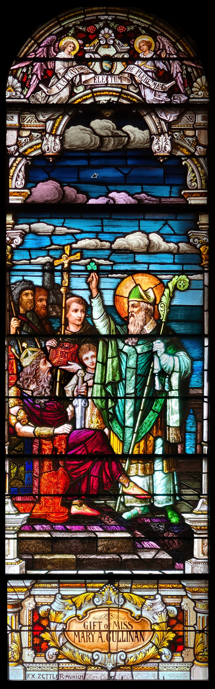</picture>
<figcaption><b>St Patrick baptising the King of Cashel</b>, by the Zettler studio of Munich, in Mary Immaculate of Lourdes Church, Newton, Massachusetts. The inscription is from Psalm 89: "I have exalted the chosen one from my people." Photo: <a href="https://commons.wikimedia.org/wiki/File:Zettler_Stained_Glass_Window_(Baptism_of_the_King_of_Cashel_by_St._Patrick)_%22exaltavi_electum_de_plebe_mea%22_%22I_have_exalted_the_chosen_one_from_my_people%22_from_Mary_Immaculate_of_Lourdes_Church,_Newton,_MA.png">Zettler Stained Glass Window (Baptism of the King of Cashel by St. Patrick) "exaltavi electum de plebe mea" "I have exalted the chosen one from my people" from Mary Immaculate of Lourdes Church, Newton, MA</a> by NateBergin, <a href="https://creativecommons.org/licenses/by/4.0">CC BY 4.0</a>, via Wikimedia Commons.</figcaption>
</figure>

<h2 id=slane>The Easter fire at Slane and the king at Tara</h2>

The most famous story of Patrick's mission comes from Muirchú. It is Easter Eve, and the High King **Lóegaire** is holding a great festival at **Tara**, the ancient seat of the kings. By royal command no fire may be lit in the land until the king's fire is kindled. But on the **Hill of Slane**, across the valley, Patrick lights the Paschal fire, the new fire of the Easter Vigil, the light of the risen Christ. The Catholic Encyclopedia retells the scene: the king's druids cry out, "O King, live for ever; this fire, which has been lighted in defiance of the royal edict, will blaze for ever in this land unless it be this very night extinguished." The king's men cannot put it out. Patrick is summoned to Tara, and there the next day, Easter Sunday, he preaches before the king. Some of the court believe, and the king, though he does not convert, allows him to preach.

Historians think that Muirchú placed at Slane a fire that may first have been told of elsewhere, and set it in 433. Slane stands on high ground about sixteen kilometres from Tara, and on a clear night a fire there could be seen from the royal hill. Whatever happened on that night, the story says something true. Patrick's mission brought a new light into Ireland, and it could not be put out. Every Easter Vigil, as the new fire is lit in the dark, the Church in Ireland remembers Slane.

<figure class=photo>
<picture><source srcset="/static/art/patrick-loughrea-fire-600.webp 600w,/static/art/patrick-loughrea-fire.webp 1280w" sizes="(max-width:760px) 100vw,760px" type="image/webp">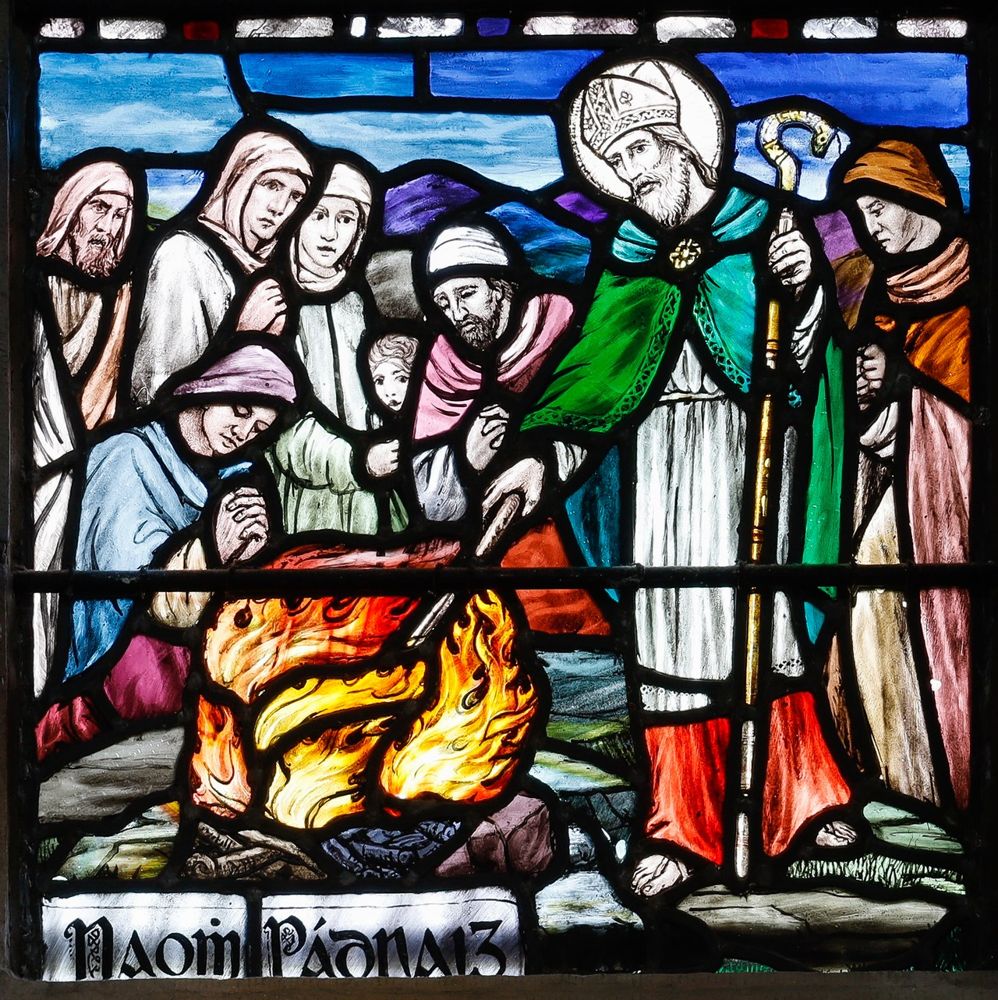</picture>
<figcaption><b>St Patrick and the Easter fire</b>, by Alfred Ernest Child, made in 1937 at the An Túr Gloine workshop in Dublin for St Brendan's Cathedral, Loughrea. The window quotes Muirchú: "Holy Patrick therefore celebrating holy Easter ignites the divine fire especially bright and blessed..." Photo: <a href="https://commons.wikimedia.org/wiki/File:Loughrea_St._Brendan%27s_Cathedral_East_Aisle_%E2%80%9CNao%E1%B9%81_P%C3%A1dra%C4%B1g%E2%80%9D_by_Alfred_Ernest_Child_Detail_Easter_Fire_2019_09_05.jpg">Loughrea St. Brendan's Cathedral East Aisle “Naoṁ Pádraıg” by Alfred Ernest Child Detail Easter Fire 2019 09 05</a> by Andreas F. Borchert, <a href="https://creativecommons.org/licenses/by-sa/4.0">CC BY-SA 4.0</a>, via Wikimedia Commons.</figcaption>
</figure>

<figure class=photo>
<picture><source srcset="/static/art/patrick-slane-600.webp 600w,/static/art/patrick-slane.webp 1280w" sizes="(max-width:760px) 100vw,760px" type="image/webp">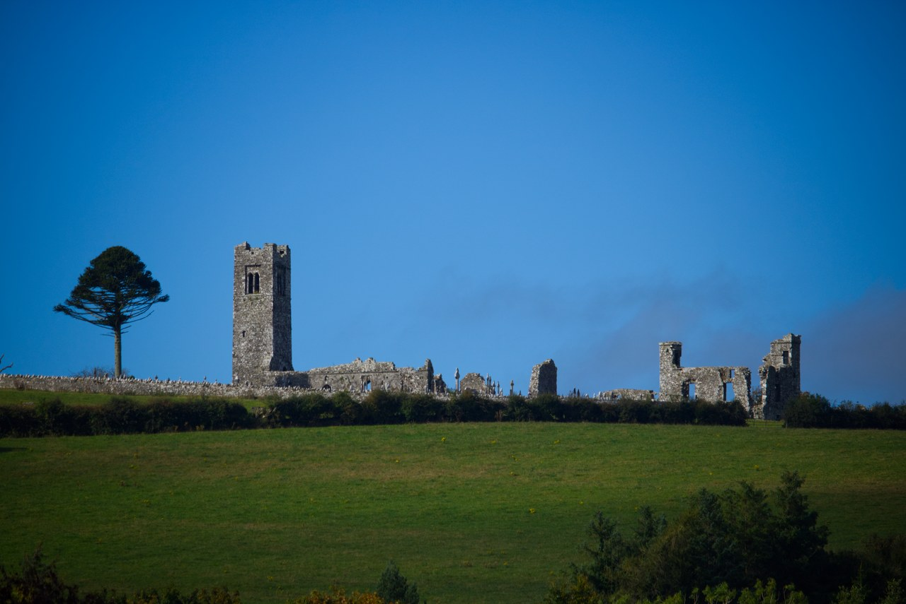</picture>
<figcaption>The <b>Hill of Slane</b>, County Meath, with the ruins of its later friary church and college. Here, in Muirchú's story, Patrick lit the Paschal fire on Easter Eve, within sight of Tara. Photo: <a href="https://commons.wikimedia.org/wiki/File:Slane_Hill.jpg">Slane Hill</a> by Nordision, <a href="https://creativecommons.org/licenses/by-sa/4.0">CC BY-SA 4.0</a>, via Wikimedia Commons.</figcaption>
</figure>

<figure class=photo>
<picture><source srcset="/static/art/patrick-tara-600.webp 600w,/static/art/patrick-tara.webp 1280w" sizes="(max-width:760px) 100vw,760px" type="image/webp">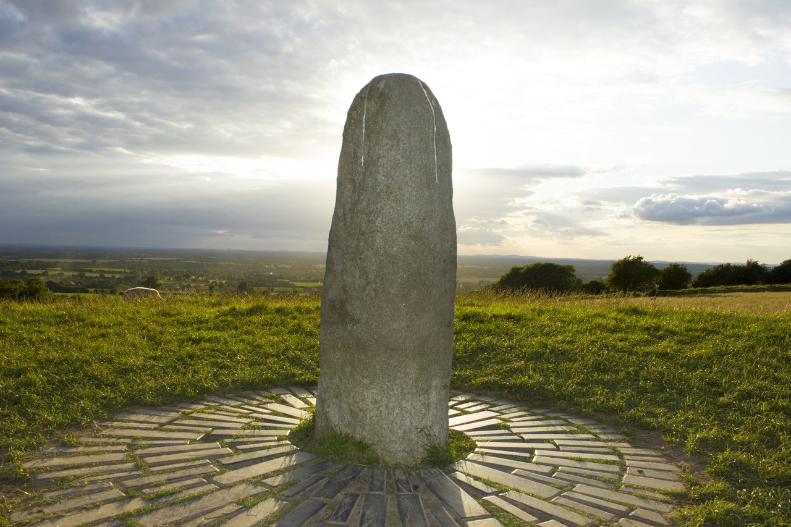</picture>
<figcaption>The <b>Lia Fáil</b>, the "Stone of Destiny", on the <b>Hill of Tara</b>, the ancient seat of the High Kings of Ireland, where legend says the stone would roar beneath the true king. To Tara, says Muirchú, Patrick came on Easter Sunday to preach before King Lóegaire. Photo: <a href="https://commons.wikimedia.org/wiki/File:Lia_Fail.jpg">Lia Fail</a> by JohnJDuncan, <a href="https://creativecommons.org/licenses/by-sa/4.0">CC BY-SA 4.0</a>, via Wikimedia Commons.</figcaption>
</figure>

<figure class=photo>
<picture><source srcset="/static/art/patrick-macon-laoghaire-600.webp 600w,/static/art/patrick-macon-laoghaire.webp 1280w" sizes="(max-width:760px) 100vw,760px" type="image/webp">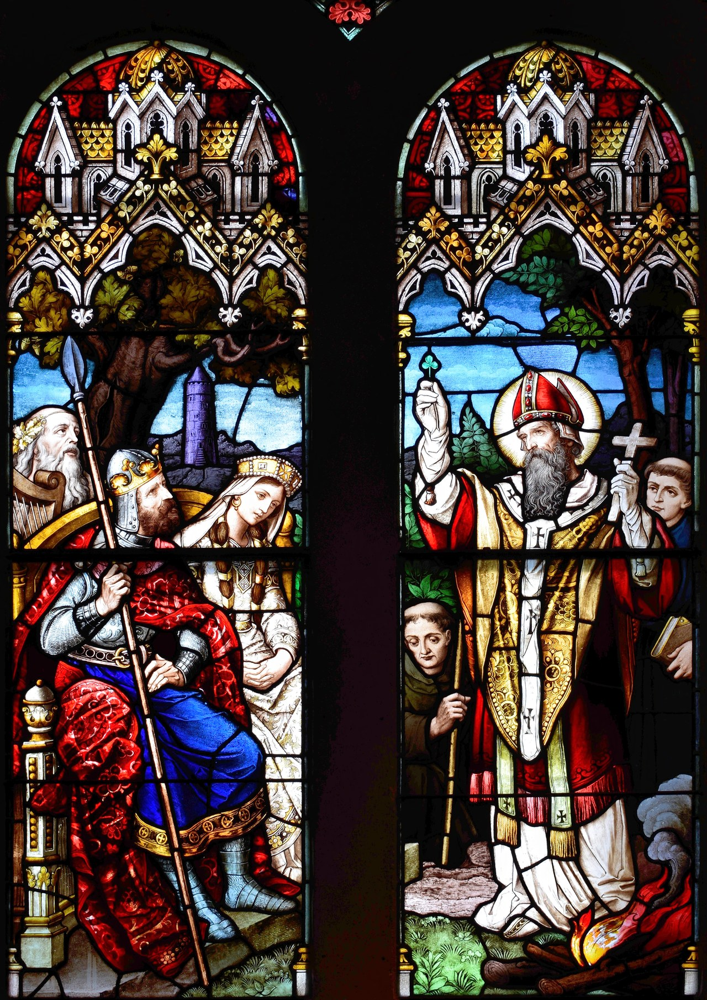</picture>
<figcaption><b>St Patrick preaching to King Laoghaire</b> (Lóegaire), by Mayer & Co. of Munich and New York, in St Joseph's Church, Macon, Georgia. The king listens, his warriors behind him; Patrick speaks of Christ. Photo: <a href="https://commons.wikimedia.org/wiki/File:Saint_Joseph_Church_(Macon,_GA)_-_stained_glass,_Saint_Patrick_preaching_to_King_Laoghaire.jpg">Saint Joseph Church (Macon, GA) - stained glass, Saint Patrick preaching to King Laoghaire</a> by Nheyob, <a href="https://creativecommons.org/publicdomain/zero/1.0/">CC0</a>, via Wikimedia Commons.</figcaption>
</figure>

<h2 id=breastplate>St Patrick's Breastplate</h2>

Ireland's best-loved prayer is the **Breastplate of St Patrick**, also called the **Lorica**, a "breastplate" or prayer of protection, and in Irish *Fáeth Fiada*. The eleventh-century *Liber Hymnorum*, which preserves it, tells how Patrick sang it when King Lóegaire laid an ambush to stop him reaching Tara; as the saint and his companions passed by, the men lying in wait saw only wild deer with a fawn following them. So it came to be called "the Deer's Cry".

Scholars date the Old Irish text, on the evidence of its language, to the early eighth century, so it is probably not Patrick's own composition. It is "attributed" to him, and it is entirely worthy of him. It is the faith of a man who knew danger every day and put himself into God's hands. In 1889 Cecil Frances Alexander turned it into the English hymn that is still sung across the world on his feast:

> I bind unto myself to-day 
> The strong name of the Trinity, 
> By invocation of the same. 
> The Three in One and One in Three.

It takes in the whole of creation:

> I bind unto myself to-day 
> The virtues of the star-lit heaven. 
> The glorious sun's life-giving ray, 
> The whiteness of the moon at even, 
> The flashing of the lightning free, 
> The whirling wind's tempestuous shocks, 
> The stable earth, the deep salt sea 
> Around the old eternal rocks.

And at its heart is the great prayer to Christ:

> Christ be with me, Christ within me, 
> Christ behind me, Christ before me, 
> Christ beside me, Christ to win me, 
> Christ to comfort and restore me, 
> Christ beneath me, Christ above me, 
> Christ in quiet, Christ in danger, 
> Christ in hearts of all that love me, 
> Christ in mouth of friend and stranger.

<figure class=photo>
<picture><source srcset="/static/art/patrick-dublin-window-600.webp 600w,/static/art/patrick-dublin-window.webp 1144w" sizes="(max-width:760px) 100vw,760px" type="image/webp">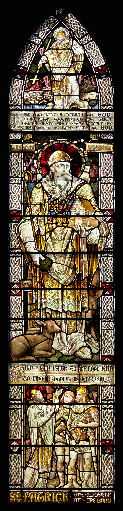</picture>
<figcaption><b>St Patrick</b>, a stained glass window by Heaton, Butler & Bayne in St Patrick's Cathedral, Dublin. "Christ be with me, Christ within me, Christ behind me, Christ before me." Photo: <a href="https://commons.wikimedia.org/wiki/File:08_Heaton,_Butler_%26_Bayne,_St._Patrick_Stained_Glass,_St._Patrick%27s_Cathedral,_Dublin.png">08 Heaton, Butler & Bayne, St. Patrick Stained Glass, St. Patrick's Cathedral, Dublin</a> by NateBergin, <a href="https://creativecommons.org/licenses/by/4.0">CC BY 4.0</a>, via Wikimedia Commons.</figcaption>
</figure>

<h2 id=croagh>Forty days on Croagh Patrick</h2>

Above Clew Bay in County Mayo rises a pyramid of a mountain, 764 metres high, which the Irish call simply "the Reek". Its proper name is **Croagh Patrick**, Patrick's Stack. Tírechán, writing in the seventh century, says that Patrick went up the mountain and spent forty days on its summit, as Moses did on Mount Sinai. A ninth-century life adds that flocks of black demon birds tormented him there, until he drove them away by ringing his bell. The Catholic Encyclopedia calls the mountain "the Mount Sinai of Ireland".

Archaeologists have found that there was a stone chapel on the summit as early as the fifth century. On **Reek Sunday**, the last Sunday in July, thousands of pilgrims climb the steep, stony path to Mass at the summit chapel, some of them barefoot, as an act of penance. It is a custom that goes back at least to the Middle Ages.

<figure class=photo>
<picture><source srcset="/static/art/patrick-croagh-600.webp 600w,/static/art/patrick-croagh.webp 1280w" sizes="(max-width:760px) 100vw,760px" type="image/webp">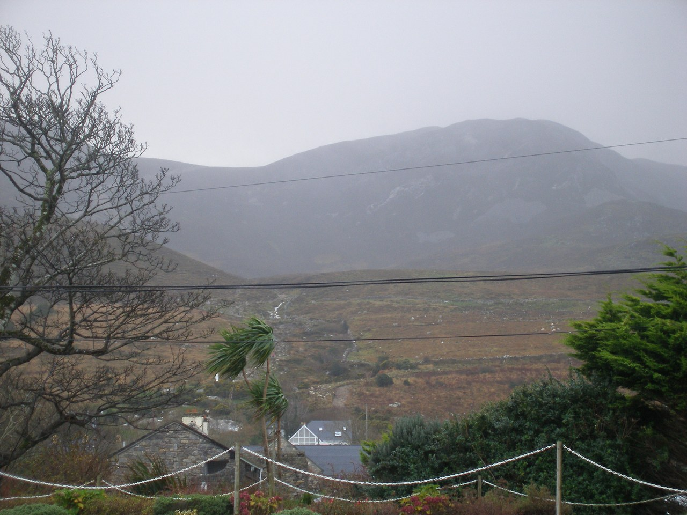</picture>
<figcaption><b>Croagh Patrick</b>, "Ireland's holy mountain", seen from Clew Bay in December. Here Patrick fasted for the forty days of Lent, in Tírechán's account. Photo: <a href="https://commons.wikimedia.org/wiki/File:Croagh_Patrick,_Irelands%27_Holy_Mountain_viewed_from_Clew_Bay._December_2007_-_panoramio.jpg">Croagh Patrick, Irelands' Holy Mountain viewed from Clew Bay. December 2007 - panoramio</a> by Gary Miotla, <a href="https://creativecommons.org/licenses/by/3.0">CC BY 3.0</a>, via Wikimedia Commons.</figcaption>
</figure>

<figure class=photo>
<picture><source srcset="/static/art/patrick-aghagower-600.webp 600w,/static/art/patrick-aghagower.webp 1106w" sizes="(max-width:760px) 100vw,760px" type="image/webp">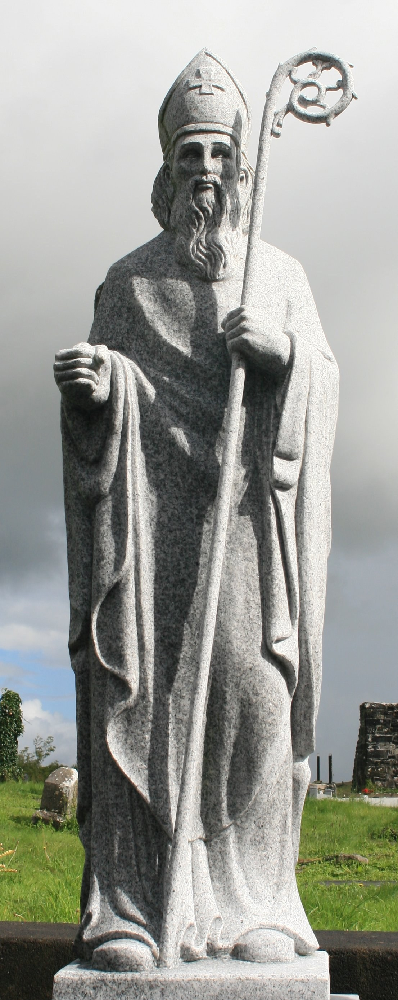</picture>
<figcaption><b>St Patrick at Aghagower</b>, County Mayo, near Croagh Patrick, where tradition says he founded a church early in his mission. The old pilgrim road to the Reek passed this way. Photo: <a href="https://commons.wikimedia.org/wiki/File:Aghagower_St_Patrick_Statue_2007_08_12.jpg">Aghagower St Patrick Statue 2007 08 12</a> by Andreas F. Borchert, <a href="https://creativecommons.org/licenses/by-sa/4.0">CC BY-SA 4.0</a>, via Wikimedia Commons.</figcaption>
</figure>

<h2 id=coroticus>The Letter to Coroticus</h2>

The other writing of Patrick's that survives was born in grief. Soldiers of a British warlord named **Coroticus**, Christians at least in name, raided the Irish coast and fell on a group of Patrick's new converts. Coroticus is widely thought to have been Ceretic, king of Alt Clut, around Dumbarton. They struck, Patrick writes, "on the day following that in which they were clothed in white and received the chrism of neophytes". Some were "cruelly cut up and slain with the sword"; others were carried off to be sold as slaves. Patrick sent "a holy priest, whom I have taught from his infancy", with a letter begging them to give back the captives. "They laughed at them."

So he wrote again, a letter for all to hear, and it is a cry from the heart of a man who had himself been a slave:

> I Patrick, a sinner and unlearned, have been appointed a bishop in Ireland, and I accept from God what I am. I dwell amongst barbarians as a proselyte and a fugitive for the love of God.

He defends his love for the Irish: "Did I come to Ireland according to God or according to the flesh? Who compelled me? I was led by the Spirit... Have I not a pious mercy towards that nation which formerly took me captive?" He shames the raiders with the example of other Christians: "It is the custom of the Christians of Rome and Gaul to send holy men to the Franks and other nations, with many thousand solidi, to redeem baptized captives." And then he turns to his lost children, and the bishop's anger melts into tenderness:

> O beautiful and well-beloved brethren and children! whom I have brought forth in Christ in such multitudes, what shall I do for you?

The soldiers despised the Irish, he says: "They think it an indignity that we have been born in Ireland." But to the dead he gives the Church's comfort: "Thanks be to God, ye who have believed and have been baptized have gone from earth to paradise. Certainly, ye have begun to migrate where there is no night or death or sorrow."

<h2 id=confessio>Accused, and his Confession</h2>

Late in Patrick's life came his hardest blow. Church leaders in Britain, his own "elders", turned against him. Some may have thought him unlearned, or suspected that he was getting rich from his converts. A sin he had confessed as a boy came back to haunt him: "they found me after thirty years, and brought against me words that I had confessed before I was a deacon". The dearest friend to whom he had once confided it, the very man who had told him "Thou art going to be given the rank of bishop", now spoke against him in public.

Patrick's answer is the *Confessio*. It is less a defence than a hymn of thanksgiving, a confession in the old sense of the word: a confession of God's goodness. He writes as a man who has nothing left to lose:

> Before I was humbled, I was like a stone lying in deep mire, until He who is powerful came, and in his mercy raised me up, and indeed again succored and placed me in His part; and therefore I ought to cry out loudly, and thank the Lord in some degree for all his benefits.

He is content to be poor: "But even Christ the Lord was poor for us." He looks death in the face without fear: "I daily expect either death, or treachery, or slavery, or an occasion of some kind or another. But I fear none of these things, relying on the heavenly promise; for I have cast myself into the hands of the omnipotent God." Against the sun-worship of pagan Ireland he sets his own faith: "we who believe in and adore the true sun, Christ, who will never perish". And he ends simply: "And this is my confession before I die."

In the Book of Armagh, the scribe who copied it out, around 807, added a note beneath the last line: "Thus far is what Patrick wrote with his own hand; he was translated to heaven on the seventeenth of March."

<figure class=photo>
<picture><source srcset="/static/art/patrick-book-armagh-600.webp 600w,/static/art/patrick-book-armagh.webp 600w" sizes="(max-width:760px) 100vw,760px" type="image/webp">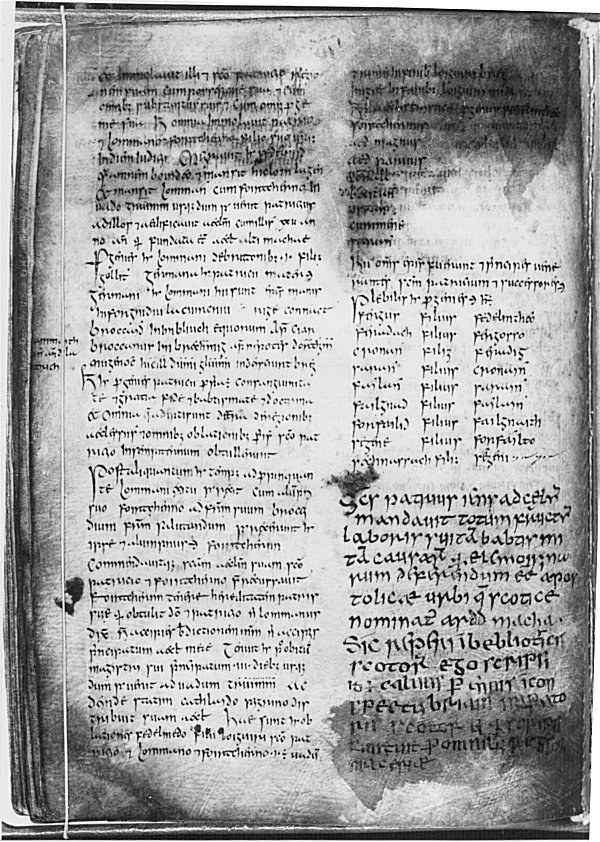</picture>
<figcaption>A page of the <b>Book of Armagh</b> (Trinity College Dublin, MS 52), written around 807 by the scribe Ferdomnach for Torbach, the abbot of Armagh. It preserves Patrick's <i>Confessio</i> together with the earliest lives of the saint by Muirchú and Tírechán. For centuries it was believed to be partly in Patrick's own hand. Image: <a href="https://commons.wikimedia.org/wiki/File:Book_of_Armagh.jpg">Book of Armagh</a>, public domain, via Wikimedia Commons.</figcaption>
</figure>

<h2 id=death>His death at Saul and his grave at Downpatrick</h2>

We do not know when Patrick died. The Irish annals give two dates, around 461 and around 493, and scholars still debate them. But Ireland has never doubted the day: **17 March**. Tradition says that he died at **Saul**, the place of his first church, in County Down, where he had begun his mission among the people of Díchu, and that he was buried a couple of miles away, on the hill at **Downpatrick**, "Patrick's fort", where Down Cathedral now stands.

The annals tell a lovely legend, the Battle for the Body of St Patrick. The men of Armagh wanted to carry him to his great church; the men of Ulster wanted to keep him. A river rose in flood between them. When peace was made, "it appeared to each of them that each had the body conveying it to their respective territories", so neither side went home disappointed; and his body was buried at Downpatrick "with great honour and veneration". During the twelve nights that monks watched beside him with psalms and hymns, it was said, there was no darkness in the land around, "but as if it were the full undarkened light of day."

In 1196 the Norman lord John de Courcy claimed to have found the bones of Patrick, Brigid and Columba at Downpatrick, and had them reburied in the cathedral. Historians think the story was crafted for his own purposes, but Ireland has kept the lovely thought that its three patrons lie together on the hill of Down. A great boulder of Mourne granite inscribed with his name was placed on the traditional grave in 1900.

<figure class=photo>
<picture><source srcset="/static/art/patrick-down-grave-600.webp 600w,/static/art/patrick-down-grave.webp 1280w" sizes="(max-width:760px) 100vw,760px" type="image/webp">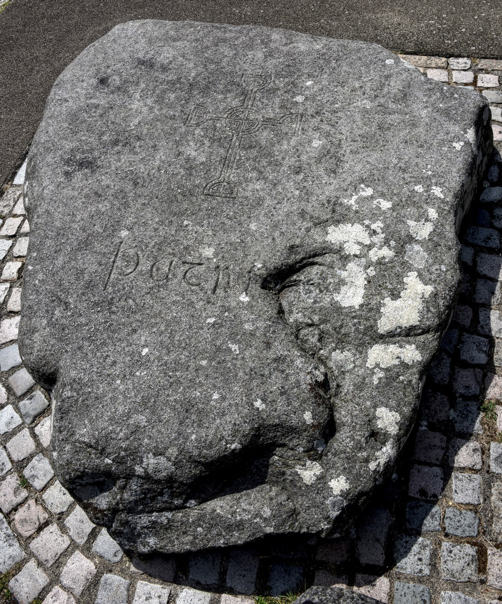</picture>
<figcaption>The <b>stone on St Patrick's traditional grave</b> in the churchyard of Down Cathedral, Downpatrick. The Mourne granite boulder was laid here in 1900 to mark the place where, by long tradition, the apostle of Ireland was buried. Photo: <a href="https://commons.wikimedia.org/wiki/File:Gravestone_of_St._Patrick,_Downpatrick_2018-07-25.jpg">Gravestone of St. Patrick, Downpatrick 2018-07-25</a> by August Schwerdfeger, <a href="https://creativecommons.org/licenses/by/4.0">CC BY 4.0</a>, via Wikimedia Commons.</figcaption>
</figure>

<figure class=photo>
<picture><source srcset="/static/art/patrick-saul-statue-600.webp 600w,/static/art/patrick-saul-statue.webp 1280w" sizes="(max-width:760px) 100vw,760px" type="image/webp">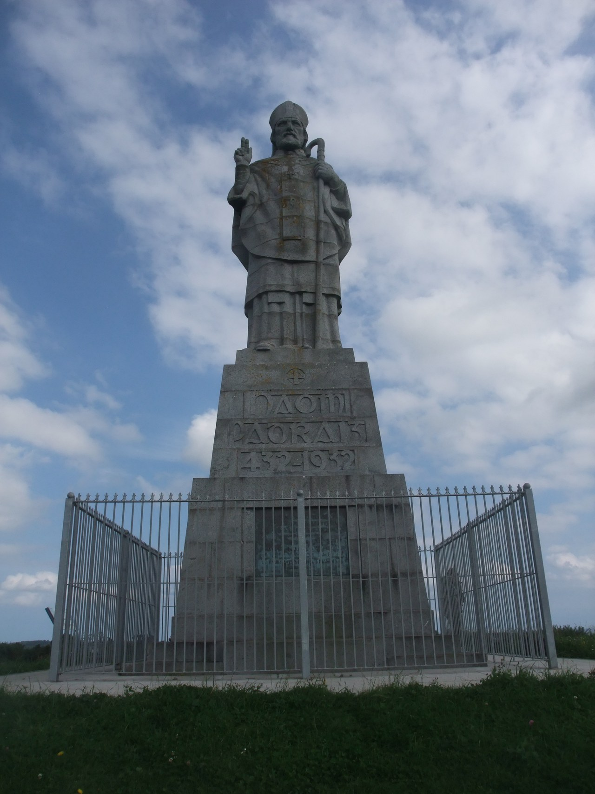</picture>
<figcaption>The great <b>statue of St Patrick on Slieve Patrick</b>, above Saul. Bronze panels on its base show scenes from his life. Below it lies Saul, where he began his mission and, tradition says, ended his life. Photo: <a href="https://commons.wikimedia.org/wiki/File:Slieve_Patrick_Statue_Of_St._Patrick.JPG">Slieve Patrick Statue Of St. Patrick</a> by Irishdeltaforce, <a href="https://creativecommons.org/licenses/by-sa/3.0">CC BY-SA 3.0</a>, via Wikimedia Commons.</figcaption>
</figure>

<h2 id=armagh>Armagh, his chief church</h2>

Patrick's chief church was at **Armagh**, Ard Macha, "Macha's height". Tradition says he founded it in 445. Muirchú tells how a chieftain named **Dáire** at first refused to give him the hilltop and gave him lower ground instead. When Dáire's horses died after grazing on the church's land, and Dáire himself fell ill after ordering Patrick killed, the saint's holy water healed them both. Dáire gave him a bronze cauldron and then the hill itself, and there Patrick built his church.

By the seventh century Armagh was the greatest monastery in the north of Ireland, and its bishops, the *comarbai* or heirs of Patrick, claimed to lead the whole Irish Church. Brian Boru, High King of Ireland, honoured it as the head church of Ireland in 1004, and was buried there after the Battle of Clontarf in 1014. Today Armagh has two cathedrals, both dedicated to St Patrick, facing each other from two hills: the ancient one, now the Church of Ireland cathedral, and the great twin-spired Catholic cathedral, built between 1840 and 1904. The Catholic Archbishop of Armagh and his Church of Ireland counterpart each bear the title **Primate of All Ireland**.

<figure class=photo>
<picture><source srcset="/static/art/patrick-armagh-window-600.webp 600w,/static/art/patrick-armagh-window.webp 1280w" sizes="(max-width:760px) 100vw,760px" type="image/webp">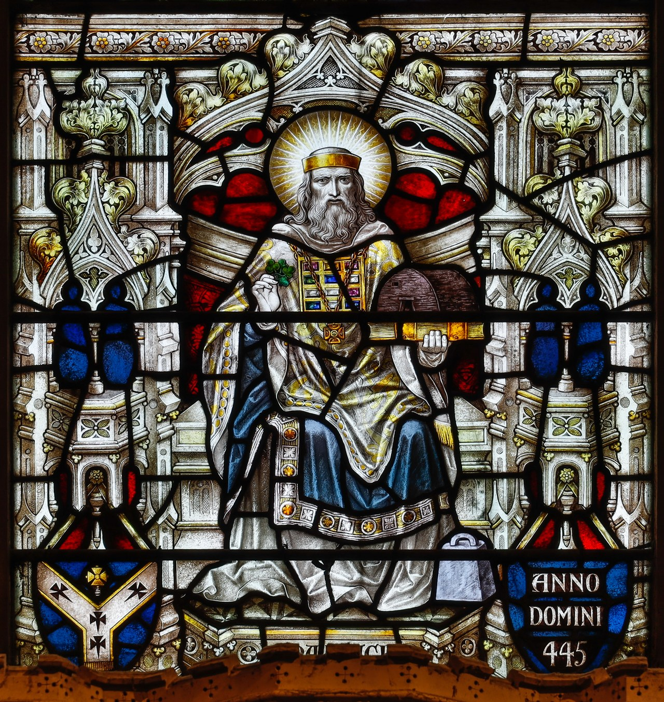</picture>
<figcaption><b>St Patrick</b>, a detail of the east window of St Patrick's Cathedral (Church of Ireland), Armagh. The date on the glass, 445, is the traditional year of his founding of the church on the hill of Ard Macha. Photo: <a href="https://commons.wikimedia.org/wiki/File:Armagh_St._Patrick%27s_Cathedral_of_the_Church_of_Ireland_East_Window_Detail_Saint_Patrick_2019_09_09.jpg">Armagh St. Patrick's Cathedral of the Church of Ireland East Window Detail Saint Patrick 2019 09 09</a> by Andreas F. Borchert, <a href="https://creativecommons.org/licenses/by-sa/4.0">CC BY-SA 4.0</a>, via Wikimedia Commons.</figcaption>
</figure>

<h2 id=shamrock>The shamrock and the Trinity</h2>

Everyone knows the story. Patrick, the tradition says, plucked a little shamrock from the grass and held it up to show his hearers how the one God can be three Persons: three leaves, one stem. The Catholic Encyclopedia sets the scene at Tara, before the assembled chieftains. It is a beautiful and memorable piece of teaching, the kind a shepherd would think of, and Patrick certainly believed and preached the Holy Trinity with all his heart. His *Confessio* ends its creed with the praise of the Father, the Son and the Holy Spirit.

But we should say kindly that it is a late tradition. The story does not appear in writing until 1726, in a book on Irish plants by the botanist Caleb Threlkeld, though coins of the 1680s already show Patrick holding a shamrock, and the custom of wearing the shamrock on his day was well known by then. Vatican News puts it gently: the first written testimony "dates back to 1726, though the tradition could have much older roots." The shamrock has become the badge of Ireland and of his feast, and in that, at least, the tradition is surely right: Patrick taught the Irish to see the glory of God in the ordinary things of their own green land.

<figure class=photo>
<picture><source srcset="/static/art/patrick-tara-statue-600.webp 600w,/static/art/patrick-tara-statue.webp 1280w" sizes="(max-width:760px) 100vw,760px" type="image/webp">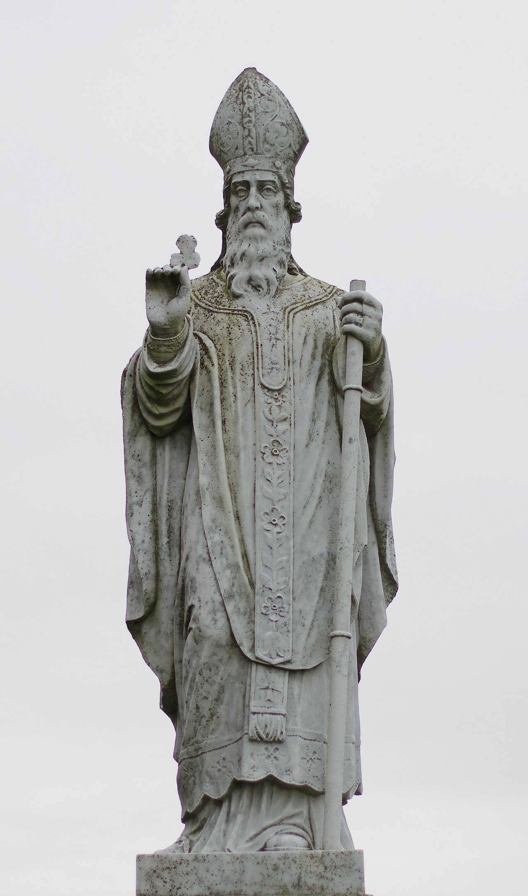</picture>
<figcaption><b>St Patrick with the shamrock</b>, the statue on the Hill of Tara. Here, by one tradition, he held up the little three-leaved plant to explain the Holy Trinity. Photo: <a href="https://commons.wikimedia.org/wiki/File:St_Patrick_status_Hill_of_Tara.jpg">St Patrick status Hill of Tara</a> by Rob Hurson, <a href="https://creativecommons.org/licenses/by-sa/4.0">CC BY-SA 4.0</a>, via Wikimedia Commons.</figcaption>
</figure>

<figure class=photo>
<picture><source srcset="/static/art/patrick-wellcome-600.webp 600w,/static/art/patrick-wellcome.webp 1280w" sizes="(max-width:760px) 100vw,760px" type="image/webp">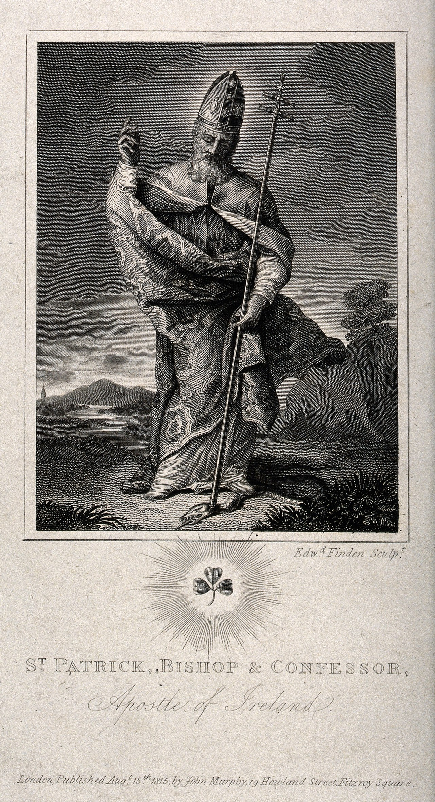</picture>
<figcaption><b>St Patrick, Bishop and Confessor, Apostle of Ireland</b>, a nineteenth-century print from the Wellcome Collection. By then a shamrock had become his emblem, printed beneath him like a signature. Photo: <a href="https://commons.wikimedia.org/wiki/File:Saint_Patrick_Wellcome_V0032787.jpg">Saint Patrick Wellcome V0032787</a> by Wellcome Collection, <a href="https://creativecommons.org/licenses/by/4.0">CC BY 4.0</a>, via Wikimedia Commons.</figcaption>
</figure>

<h2 id=snakes>The snakes</h2>

The most famous legend of all is that Patrick drove the snakes out of Ireland. It is a legend, and an old naturalists' joke says there were none to drive out: since the Ice Age Ireland has never had snakes, and the Roman writer Solinus noted it as early as the third century. The story of Patrick banishing them first appears in the late twelfth century, in the life of Patrick by Jocelyn of Furness, who says the saint chased them into the sea after they attacked him during his fast on a mountain. Gerald of Wales told it too, though he doubted it was true.

Yet Christians have always seen a deeper meaning in it. In the Bible the serpent stands for the old enemy, and in Patrick's Ireland the old gods and the old fears gave way before the Gospel he preached. The *Breastplate* itself prays "against all Satan's spells and wiles". The snakes curling at his feet in countless windows and statues are a picture of that victory.

<figure class=photo>
<picture><source srcset="/static/art/patrick-greenville-snakes-600.webp 600w,/static/art/patrick-greenville-snakes.webp 1280w" sizes="(max-width:760px) 100vw,760px" type="image/webp">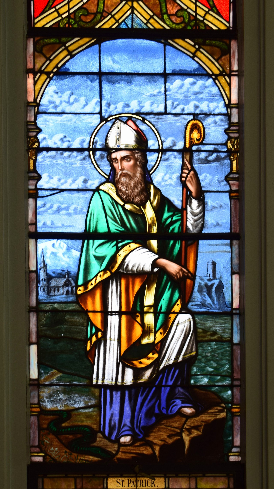</picture>
<figcaption><b>St Patrick expelling the snakes from Ireland</b>, a stained glass window in St Mary's Church, Greenville, Ohio. Photo: <a href="https://commons.wikimedia.org/wiki/File:Saint_Mary%27s_Church_(Greenville,_Ohio)_-_stained-glass,_St._Patrick_expelling_snakes_from_Ireland.jpg">Saint Mary's Church (Greenville, Ohio) - stained-glass, St. Patrick expelling snakes from Ireland</a> by Nheyob, <a href="https://creativecommons.org/licenses/by/4.0">CC BY 4.0</a>, via Wikimedia Commons.</figcaption>
</figure>

<figure class=photo>
<picture><source srcset="/static/art/patrick-borrekens-600.webp 600w,/static/art/patrick-borrekens.webp 1280w" sizes="(max-width:760px) 100vw,760px" type="image/webp">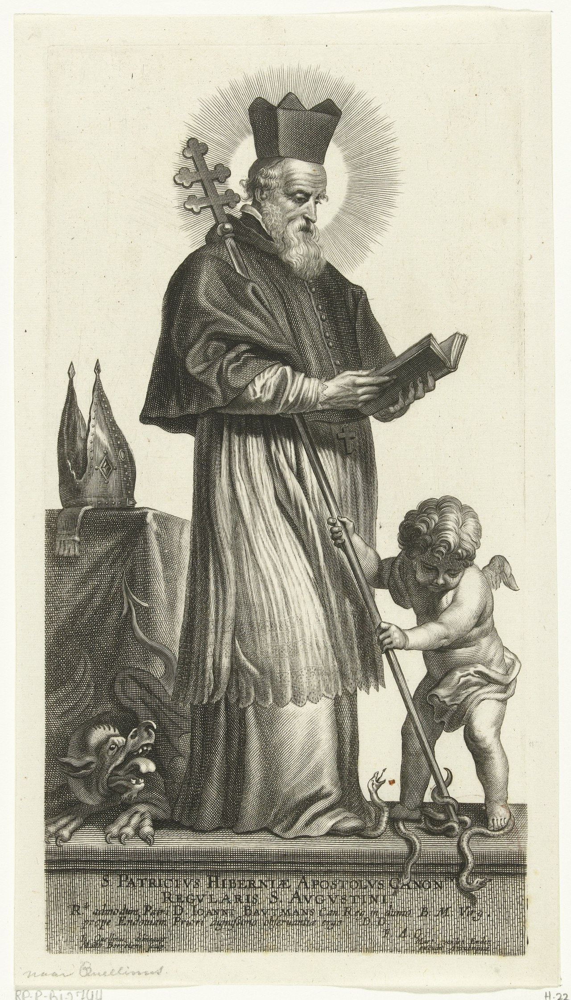</picture>
<figcaption><b>St Patrick</b>, an engraving by Mattheus Borrekens of Antwerp, made between 1625 and 1670 (Rijksmuseum, Amsterdam). The Latin inscription honours him as "Apostle of Ireland" and claims him for the Canons Regular of St Augustine; a cherub holds his crozier while the snakes slither away. Image: <a href="https://commons.wikimedia.org/wiki/File:Mattheus_Borrekens,_Saint_Patrice.jpg">Mattheus Borrekens, Saint Patrice</a>, <a href="https://creativecommons.org/publicdomain/zero/1.0/">CC0</a>, via Wikimedia Commons.</figcaption>
</figure>

<h2 id=purgatory>Lough Derg and St Patrick's Purgatory</h2>

In the hills of south Donegal, close to the border, lies **Lough Derg**, and on a small island in the lake, **Station Island**, is one of the oldest and hardest pilgrimages in Christendom: **St Patrick's Purgatory**. The legend says that Christ showed Patrick a cave there, a pit or well, where anyone who prayed with true repentance could see the pains of purgatory and be cleansed. From the twelfth century the story of a knight named Owein who went down into it spread across Europe, and pilgrims came from as far as Hungary and Catalonia. The Catholic Encyclopedia says simply that Lough Derg was one of Patrick's "chosen places of solitude and retreat".

The cave itself was closed long ago, but the pilgrimage goes on. Between June and mid-August pilgrims come for three days of prayer, fasting and penance. They go barefoot around the stone "beds", the remains of ancient monks' cells; they keep an all-night vigil in the basilica on the first night; and each day they eat a single simple meal of dry toast, oatcakes and black tea or coffee. It is a hard, humble and joyful place, very like the shepherd who prayed in the snow.

<figure class=photo>
<picture><source srcset="/static/art/patrick-ortelius-600.webp 600w,/static/art/patrick-ortelius.webp 494w" sizes="(max-width:760px) 100vw,760px" type="image/webp">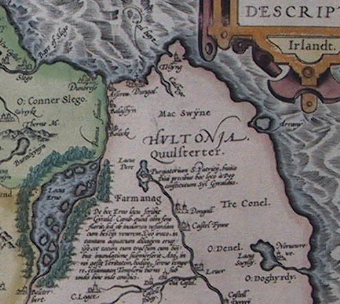</picture>
<figcaption><b>St Patrick's Purgatory</b> on Abraham Ortelius's map of Ireland of 1592. Sixteenth-century mapmakers marked the little island of the Purgatory, so famous had it become across Europe. Image: <a href="https://commons.wikimedia.org/wiki/File:Ortelius_1592_St_Patrick%27s_Purgatory_Map.jpg">Ortelius 1592 St Patrick's Purgatory Map</a>, public domain, via Wikimedia Commons.</figcaption>
</figure>

<figure class=photo>
<picture><source srcset="/static/art/patrick-lough-derg-statue-600.webp 600w,/static/art/patrick-lough-derg-statue.webp 640w" sizes="(max-width:760px) 100vw,760px" type="image/webp">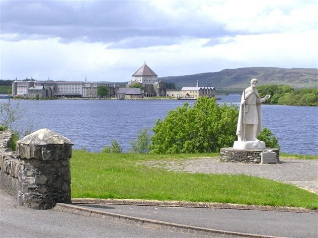</picture>
<figcaption><b>St Patrick's statue on the shore of Lough Derg</b>, looking across the water to Station Island and its basilica, the place of his Purgatory. Photo: <a href="https://commons.wikimedia.org/wiki/File:St._Patrick%27s_statue,_Lough_Derg_-_geograph.org.uk_-_449800.jpg">St. Patrick's statue, Lough Derg - geograph.org.uk - 449800</a> by Kenneth Allen, <a href="https://creativecommons.org/licenses/by-sa/2.0">CC BY-SA 2.0</a>, via Wikimedia Commons.</figcaption>
</figure>

<h2 id=places>His places and churches</h2>

<figure class=map><figcaption>St Patrick's Ireland: the places of his captivity, mission, prayer and burial, with the proposed sites of his British birthplace and an inset of Ulster. Map by The Daily Word; coastlines from Natural Earth (public domain); many sites rest on tradition and locations are approximate. Tap to enlarge.</figcaption></figure>

### Bannavem Taberniae: the search for his birthplace

No one knows where Patrick was born, and several places in Britain lay claim to him. Among them are **Banna (Birdoswald)**, a Roman fort on Hadrian's Wall in Cumbria; **Banwen** in south Wales; **Banwell** and **Avonmouth** in Somerset; and **Old Kilpatrick**, near Dumbarton on the Clyde, which later tradition identified with Muirchú's "Nemthor". Each keeps his memory.

### Slemish and the wood of Foclut

**Slemish**, the steep plug of an old volcano a few miles east of Ballymena in County Antrim, is the traditional place of his slavery, in Muirchú's account. In the far west, the **wood of Foclut** that Patrick names himself is generally placed near **Killala Bay** in County Mayo.

<figure class=photo>
<picture><source srcset="/static/art/patrick-slemish-2-600.webp 600w,/static/art/patrick-slemish-2.webp 640w" sizes="(max-width:760px) 100vw,760px" type="image/webp">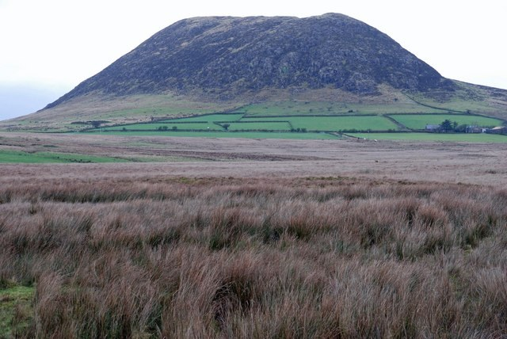</picture>
<figcaption><b>Slemish</b> across the mid-Antrim bog, from the bridge over the Douglas Burn. The hill dominates the landscape for miles around, as it must have done for the young slave keeping his sheep. Photo: <a href="https://commons.wikimedia.org/wiki/File:Slemish_(6)_-_geograph.org.uk_-_624718.jpg">Slemish (6) - geograph.org.uk - 624718</a> by Albert Bridge, <a href="https://creativecommons.org/licenses/by-sa/2.0">CC BY-SA 2.0</a>, via Wikimedia Commons.</figcaption>
</figure>

### The Hill of Slane and the Hill of Tara

Above the River Boyne in County Meath, the **Hill of Slane** is crowned by the ruins of a friary church and college, restored in 1512, on the place where tradition says Patrick lit the Easter fire. Across the valley, the **Hill of Tara** keeps the earthworks of the ancient High Kings, the standing stone called the Lia Fáil, a church and a statue of St Patrick.

<figure class=photo>
<picture><source srcset="/static/art/patrick-slane-church-600.webp 600w,/static/art/patrick-slane-church.webp 1280w" sizes="(max-width:760px) 100vw,760px" type="image/webp">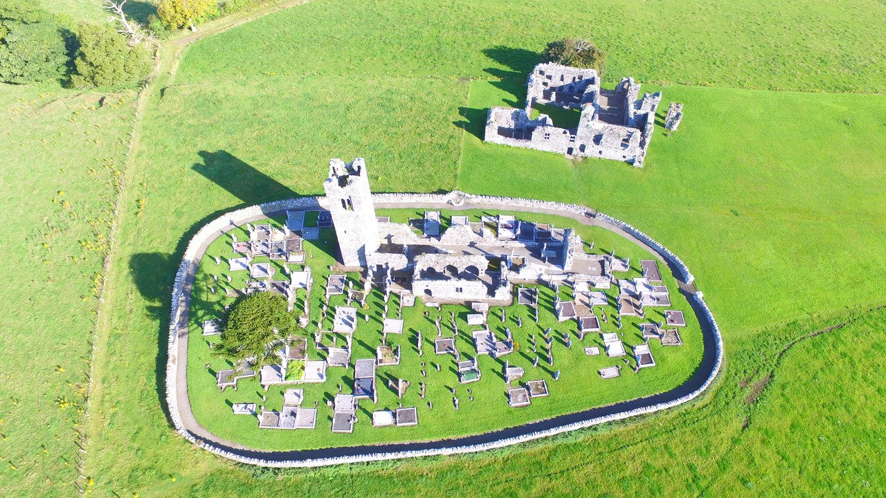</picture>
<figcaption>The <b>ruined church on the Hill of Slane</b> from the air, its graveyard enclosed by a stone wall. Its tower looks out across the valley towards Tara. Photo: <a href="https://commons.wikimedia.org/wiki/File:Hill_of_Slane_Church_1.JPG">Hill of Slane Church 1</a> by Raemond Carolan, <a href="https://creativecommons.org/licenses/by-sa/4.0">CC BY-SA 4.0</a>, via Wikimedia Commons.</figcaption>
</figure>

### Saul: St Patrick's Memorial Church

**Saul** (Sabhall Phádraig, "Patrick's barn"), near Downpatrick, is where tradition says Díchu gave Patrick a barn for his first church in Ireland, and where he died. The little **St Patrick's Memorial Church** of the Church of Ireland, with its replica round tower, was built in 1932, fifteen hundred years after the traditional date of his coming, to commemorate his first church. On the crest of nearby **Slieve Patrick** stands the great granite statue of the saint.

<figure class=photo>
<picture><source srcset="/static/art/patrick-saul-600.webp 600w,/static/art/patrick-saul.webp 1280w" sizes="(max-width:760px) 100vw,760px" type="image/webp">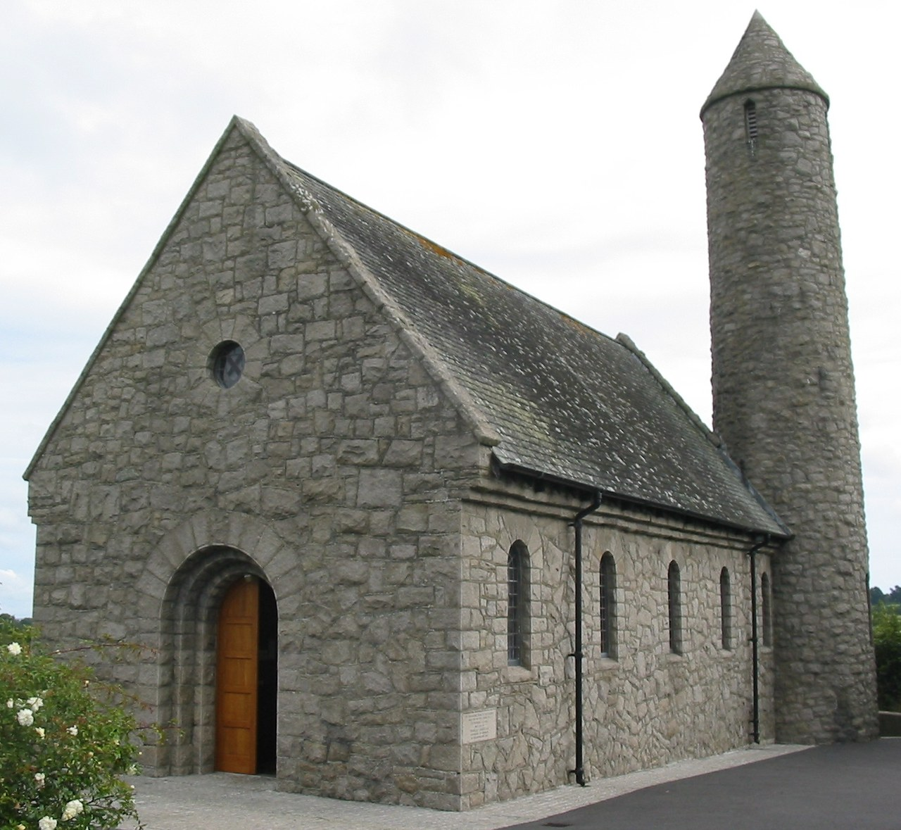</picture>
<figcaption><b>St Patrick's Memorial Church, Saul</b>, built in 1932 with a replica of an Irish round tower, on the site of Patrick's first church in Ireland. Photo: <a href="https://commons.wikimedia.org/wiki/File:Saul_church_County_Down.jpg">Saul church County Down</a> by Man vyi, public domain, via Wikimedia Commons.</figcaption>
</figure>

<figure class=photo>
<picture><source srcset="/static/art/patrick-saul-2-600.webp 600w,/static/art/patrick-saul-2.webp 1024w" sizes="(max-width:760px) 100vw,760px" type="image/webp">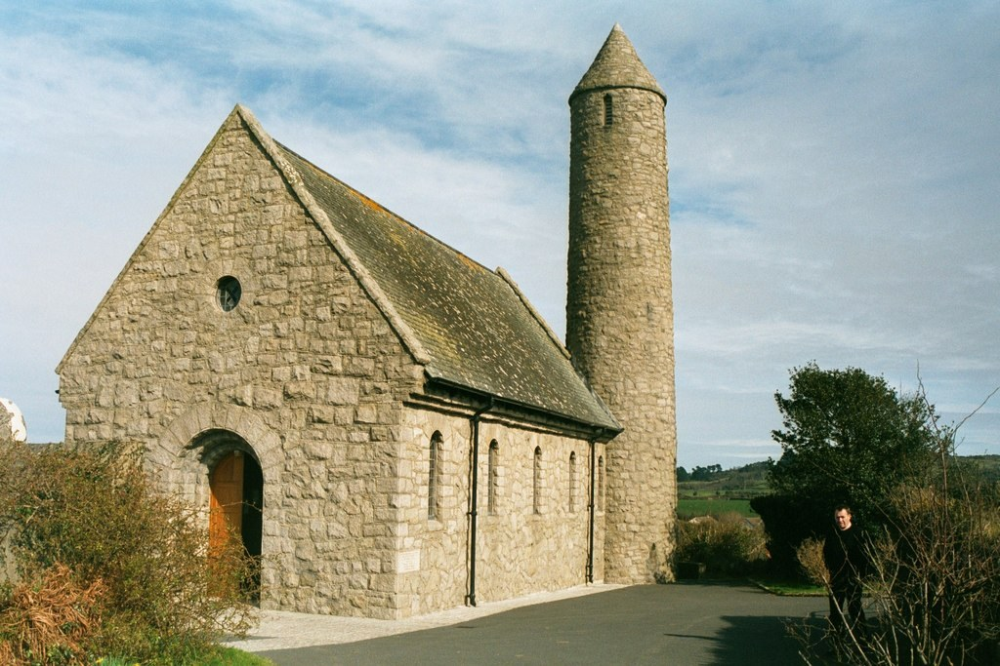</picture>
<figcaption>Another view of the <b>Memorial Church at Saul</b>. Its simple lines recall the barn that Díchu gave to Patrick for a church. Photo: <a href="https://commons.wikimedia.org/wiki/File:St._Patrick%27s_Memorial_Church,_Saul_-_geograph.org.uk_-_3760972.jpg">St. Patrick's Memorial Church, Saul - geograph.org.uk - 3760972</a> by Alpin Stewart, <a href="https://creativecommons.org/licenses/by-sa/2.0">CC BY-SA 2.0</a>, via Wikimedia Commons.</figcaption>
</figure>

### Downpatrick: Down Cathedral, his grave and Struell Wells

**Down Cathedral**, the Cathedral Church of the Holy and Undivided Trinity, stands on Cathedral Hill above the town of **Downpatrick**. A monastic community lived here in the early Irish Church; in 1124 **St Malachy** became bishop and rebuilt the church; and the present cathedral, now of the Church of Ireland, incorporates parts of the medieval abbey. In the churchyard is the stone on **St Patrick's grave**. A mile and a half east of the town are **Struell Wells**, four holy wells long associated with the saint, still visited by people seeking healing.

<figure class=photo>
<picture><source srcset="/static/art/patrick-down-600.webp 600w,/static/art/patrick-down.webp 1280w" sizes="(max-width:760px) 100vw,760px" type="image/webp">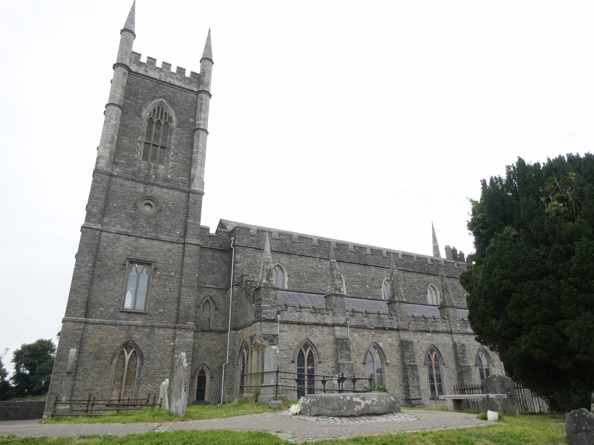</picture>
<figcaption><b>Down Cathedral</b>, Downpatrick, with St Patrick's grave in its churchyard. The cathedral's hill has kept his memory since the early Middle Ages. Photo: <a href="https://commons.wikimedia.org/wiki/File:Down_Cathedral_and_St_Patrick%27s_grave_at_Downpatrick_-_geograph.org.uk_-_8136423.jpg">Down Cathedral and St Patrick's grave at Downpatrick - geograph.org.uk - 8136423</a> by Gareth James, <a href="https://creativecommons.org/licenses/by-sa/2.0">CC BY-SA 2.0</a>, via Wikimedia Commons.</figcaption>
</figure>

<figure class=photo>
<picture><source srcset="/static/art/patrick-down-interior-600.webp 600w,/static/art/patrick-down-interior.webp 1280w" sizes="(max-width:760px) 100vw,760px" type="image/webp">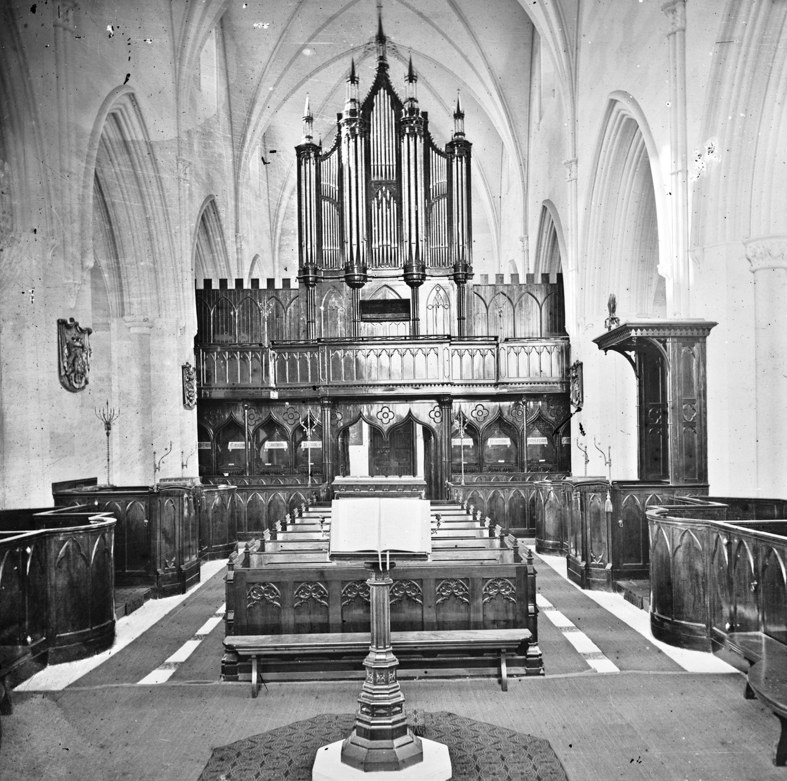</picture>
<figcaption>The <b>interior of Down Cathedral</b> in an early photograph from the collections of the National Library of Ireland, with its box pews and great organ. Photo: <a href="https://commons.wikimedia.org/wiki/File:Down_Cathedral,_Downpatrick_(interior).jpg">Down Cathedral, Downpatrick (interior)</a> by the National Library of Ireland, no known copyright restrictions, via Wikimedia Commons.</figcaption>
</figure>

<figure class=photo>
<picture><source srcset="/static/art/patrick-struell-600.webp 600w,/static/art/patrick-struell.webp 1280w" sizes="(max-width:760px) 100vw,760px" type="image/webp">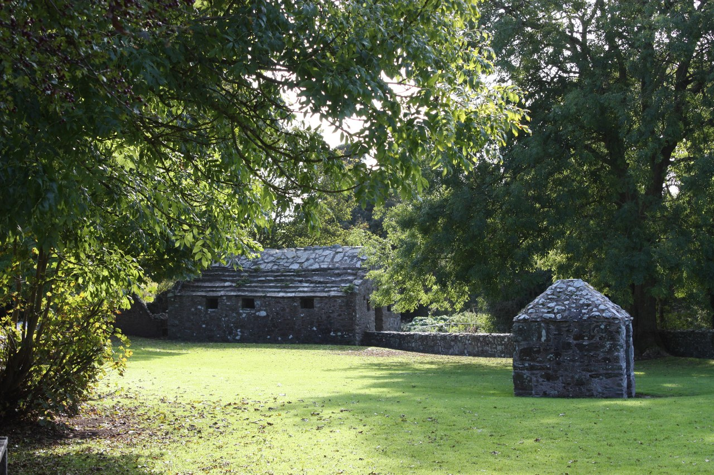</picture>
<figcaption><b>Struell Wells</b>, near Downpatrick: four holy wells long associated with St Patrick, still visited by people seeking healing. Photo: <a href="https://commons.wikimedia.org/wiki/File:Struell_Wells_(19),_October_2009.JPG">Struell Wells (19), October 2009</a> by Ardfern, <a href="https://creativecommons.org/licenses/by-sa/3.0">CC BY-SA 3.0</a>, via Wikimedia Commons.</figcaption>
</figure>

### Armagh: the two St Patrick's Cathedrals

On Armagh's highest hill stands **St Patrick's Cathedral of the Church of Ireland**, on the site of Patrick's own church. It was destroyed and rebuilt seventeen times over the centuries; Brian Boru was buried here, and its windows honour the scribes of the Book of Armagh. On the opposite hill stands the Catholic **St Patrick's Cathedral**, begun under Archbishop Crolly (its foundation stone was laid on St Patrick's Day 1838), halted by the Famine in 1847 and completed in 1904, with twin spires and interior walls covered in mosaics.

<figure class=photo>
<picture><source srcset="/static/art/patrick-armagh-coi-600.webp 600w,/static/art/patrick-armagh-coi.webp 1280w" sizes="(max-width:760px) 100vw,760px" type="image/webp">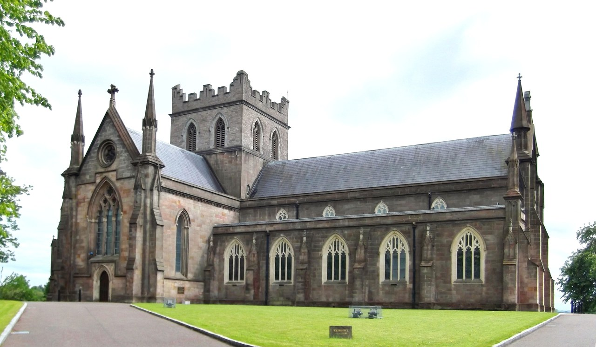</picture>
<figcaption><b>St Patrick's Cathedral (Church of Ireland), Armagh</b>, on the hill where tradition says Patrick founded his church in 445. Photo: <a href="https://commons.wikimedia.org/wiki/File:Armagh_Cathedral_(Church_of_Ireland).jpg">Armagh Cathedral (Church of Ireland)</a> by JohnArmagh, cropped by Rabanus Flavus, <a href="https://creativecommons.org/licenses/by-sa/4.0">CC BY-SA 4.0</a>, via Wikimedia Commons.</figcaption>
</figure>

<figure class=photo>
<picture><source srcset="/static/art/patrick-armagh-ferdomnach-600.webp 600w,/static/art/patrick-armagh-ferdomnach.webp 1280w" sizes="(max-width:760px) 100vw,760px" type="image/webp">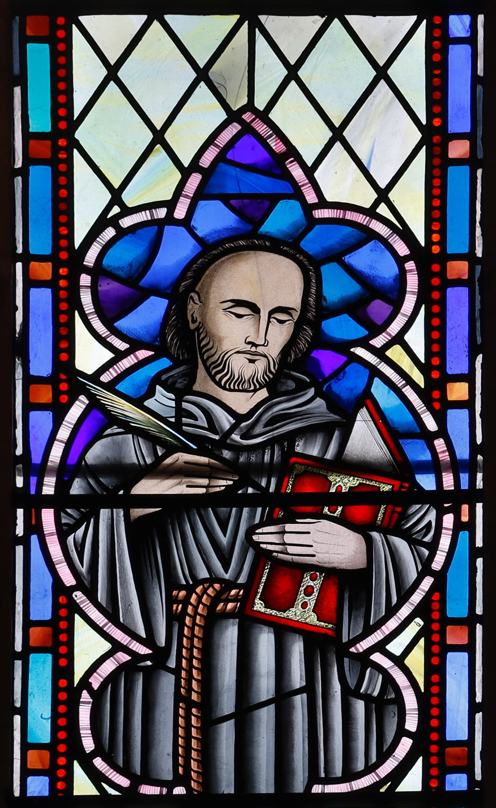</picture>
<figcaption><b>Ferdomnach</b>, the scribe of the Book of Armagh, in a window in the sanctuary of the Church of Ireland cathedral at Armagh, which honours the scribes Ferdomnach and Torbach who kept Patrick's words alive. Photo: <a href="https://commons.wikimedia.org/wiki/File:Armagh_St._Patrick%27s_Cathedral_of_the_Church_of_Ireland_Sanctuary_W27_Scribes_Ferdomnach_and_Torbach_Detail_Ferdomnach_2019_09_09.jpg">Armagh St. Patrick's Cathedral of the Church of Ireland Sanctuary W27 Scribes Ferdomnach and Torbach Detail Ferdomnach 2019 09 09</a> by Andreas F. Borchert, <a href="https://creativecommons.org/licenses/by-sa/4.0">CC BY-SA 4.0</a>, via Wikimedia Commons.</figcaption>
</figure>

<figure class=photo>
<picture><source srcset="/static/art/patrick-armagh-rc-600.webp 600w,/static/art/patrick-armagh-rc.webp 1280w" sizes="(max-width:760px) 100vw,760px" type="image/webp">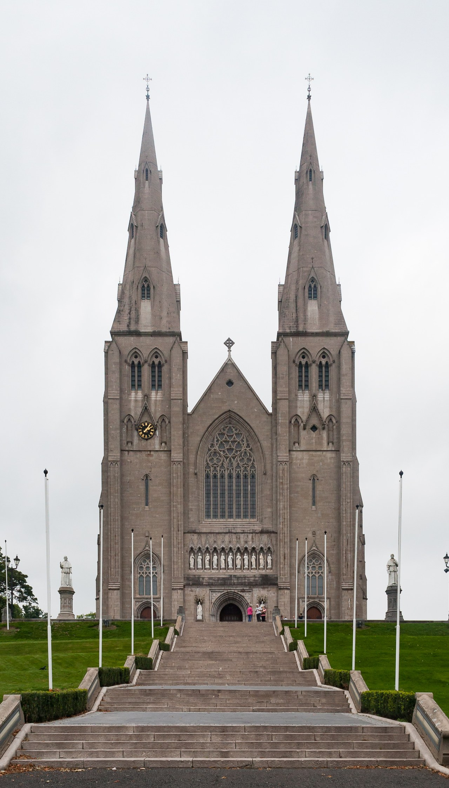</picture>
<figcaption><b>St Patrick's Cathedral (Catholic), Armagh</b>, seen from the stairs on its southern side. It was built between 1840 and 1904 and is the seat of the Archbishop of Armagh, Primate of All Ireland. Photo: <a href="https://commons.wikimedia.org/wiki/File:Armagh_Roman_Catholic_Cathedral_of_St._Patrick_2013_09_24.jpg">Armagh Roman Catholic Cathedral of St. Patrick 2013 09 24</a> by Andreas F. Borchert, <a href="https://creativecommons.org/licenses/by-sa/4.0">CC BY-SA 4.0</a>, via Wikimedia Commons.</figcaption>
</figure>

<figure class=photo>
<picture><source srcset="/static/art/patrick-armagh-rc-nave-600.webp 600w,/static/art/patrick-armagh-rc-nave.webp 1280w" sizes="(max-width:760px) 100vw,760px" type="image/webp">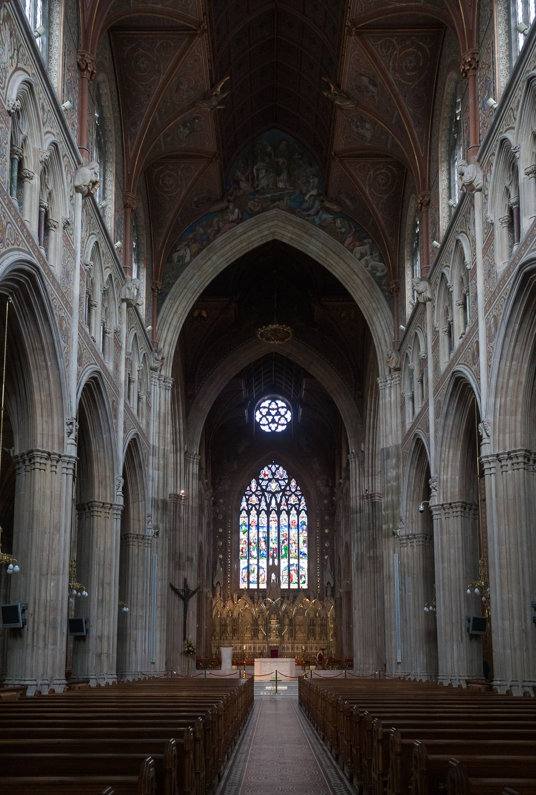</picture>
<figcaption>The <b>nave of the Catholic cathedral at Armagh</b>, looking towards the high altar. Cardinal Logue's mosaics adorn almost every inch of its walls. Photo: <a href="https://commons.wikimedia.org/wiki/File:Armagh_Roman_Catholic_Cathedral_of_St._Patrick_Nave_2013_09_24.jpg">Armagh Roman Catholic Cathedral of St. Patrick Nave 2013 09 24</a> by Andreas F. Borchert, <a href="https://creativecommons.org/licenses/by-sa/4.0">CC BY-SA 4.0</a>, via Wikimedia Commons.</figcaption>
</figure>

<figure class=photo>
<picture><source srcset="/static/art/patrick-armagh-rc-statue-600.webp 600w,/static/art/patrick-armagh-rc-statue.webp 1280w" sizes="(max-width:760px) 100vw,760px" type="image/webp">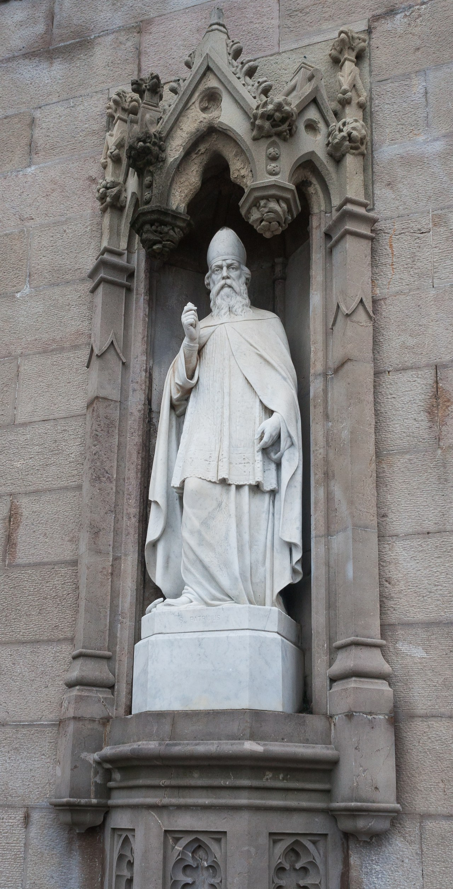</picture>
<figcaption><b>St Patrick</b> in the south portal of the Catholic cathedral at Armagh, welcoming those who climb its great steps. Photo: <a href="https://commons.wikimedia.org/wiki/File:Armagh_Roman_Catholic_Cathedral_of_St._Patrick_South_Portal_Statue_of_St._Patrick_2013_09_24.jpg">Armagh Roman Catholic Cathedral of St. Patrick South Portal Statue of St. Patrick 2013 09 24</a> by Andreas F. Borchert, <a href="https://creativecommons.org/licenses/by-sa/4.0">CC BY-SA 4.0</a>, via Wikimedia Commons.</figcaption>
</figure>

### St Patrick's Cathedral, Dublin

The national cathedral of the Church of Ireland stands beside the place of an ancient holy well of St Patrick, on what was once an island between two branches of the River Poddle. It was dedicated to "God, our Blessed Lady Mary and St Patrick" on 17 March 1191 and built between 1191 and 1270, and it is the largest church in Ireland. Jonathan Swift, the author of *Gulliver's Travels*, was its dean.

<figure class=photo>
<picture><source srcset="/static/art/patrick-dublin-nave-600.webp 600w,/static/art/patrick-dublin-nave.webp 1280w" sizes="(max-width:760px) 100vw,760px" type="image/webp">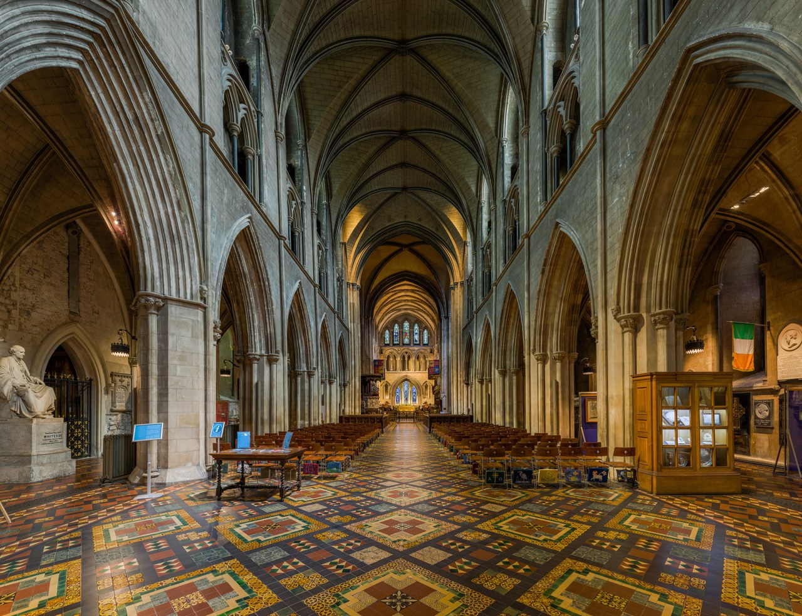</picture>
<figcaption>The <b>nave of St Patrick's Cathedral, Dublin</b>, looking towards the choir. It was dedicated on the saint's feast day in 1191. Photo: <a href="https://commons.wikimedia.org/wiki/File:St_Patrick%27s_Cathedral_Nave_2,_Dublin,_Ireland_-_Diliff.jpg">St Patrick's Cathedral Nave 2, Dublin, Ireland - Diliff</a> by Diliff, <a href="https://creativecommons.org/licenses/by-sa/3.0">CC BY-SA 3.0</a>, via Wikimedia Commons.</figcaption>
</figure>

<figure class=photo>
<picture><source srcset="/static/art/patrick-dublin-600.webp 600w,/static/art/patrick-dublin.webp 1280w" sizes="(max-width:760px) 100vw,760px" type="image/webp">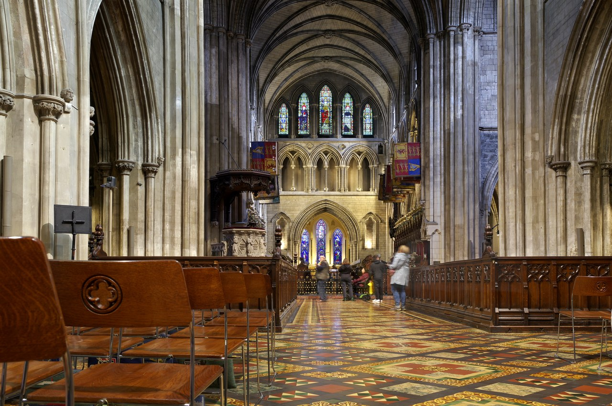</picture>
<figcaption>Another view <b>inside St Patrick's Cathedral, Dublin</b>, the largest church in Ireland, built beside St Patrick's holy well. Photo: <a href="https://commons.wikimedia.org/wiki/File:Ireland_Dublin_St._Patrick%27s_Cathedral_BW_2025-09-15_16-34-09.jpg">Ireland Dublin St. Patrick's Cathedral BW 2025-09-15 16-34-09</a> by Berthold Werner, <a href="https://creativecommons.org/licenses/by-sa/4.0">CC BY-SA 4.0</a>, via Wikimedia Commons.</figcaption>
</figure>

### Croagh Patrick: the summit chapel

The small chapel on the summit of **Croagh Patrick** was dedicated on 20 July 1905, but there was a stone chapel here as early as the fifth century. On Reek Sunday Mass is celebrated here for the pilgrims who have climbed the mountain.

<figure class=photo>
<picture><source srcset="/static/art/patrick-croagh-chapel-600.webp 600w,/static/art/patrick-croagh-chapel.webp 1280w" sizes="(max-width:760px) 100vw,760px" type="image/webp">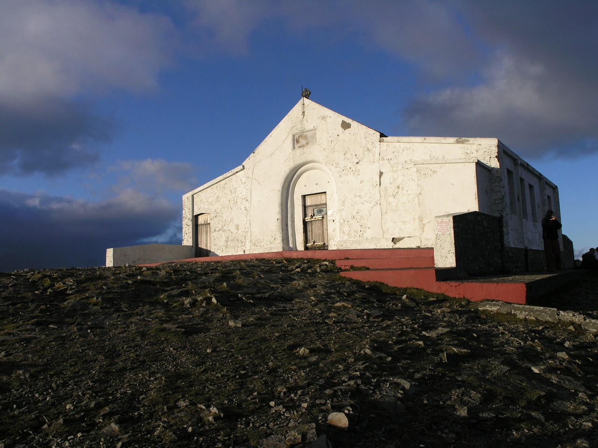</picture>
<figcaption><b>St Patrick's Chapel on the summit of Croagh Patrick</b>, dedicated in 1905, the goal of the pilgrims on Reek Sunday. Photo: <a href="https://commons.wikimedia.org/wiki/File:St._Patrick%27s_Chapel,_Croagh_Patrick.jpg">St. Patrick's Chapel, Croagh Patrick</a> by Johnflan, <a href="https://creativecommons.org/licenses/by-sa/4.0">CC BY-SA 4.0</a>, via Wikimedia Commons.</figcaption>
</figure>

### Lough Derg: the basilica of St Patrick's Purgatory

On **Station Island** in Lough Derg, County Donegal, the **basilica**, designed by William Scott, stands at the heart of the three-day pilgrimage, surrounded by the hostels and the penitential beds. The pilgrimage moved to Station Island from neighbouring Saints Island in 1497, and the island has been in the care of the Diocese of Clogher since 1785.

<figure class=photo>
<picture><source srcset="/static/art/patrick-lough-derg-600.webp 600w,/static/art/patrick-lough-derg.webp 1280w" sizes="(max-width:760px) 100vw,760px" type="image/webp">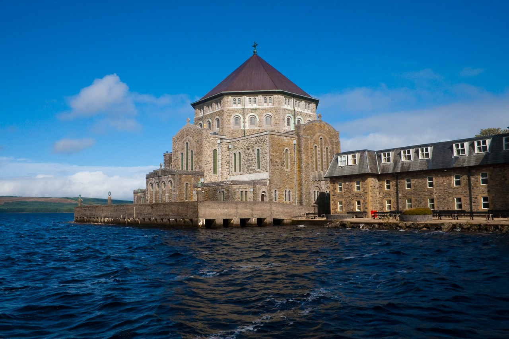</picture>
<figcaption>The <b>basilica on Station Island, Lough Derg</b>, designed by William Scott. Pilgrims spend the first night of their pilgrimage here in an all-night vigil of prayer. Photo: <a href="https://commons.wikimedia.org/wiki/File:Lough_Derg_Station_Island_Basilica_SE_2009_09_17.jpg">Lough Derg Station Island Basilica SE 2009 09 17</a> by Andreas F. Borchert, <a href="https://creativecommons.org/licenses/by-sa/4.0">CC BY-SA 4.0</a>, via Wikimedia Commons.</figcaption>
</figure>

<figure class=photo>
<picture><source srcset="/static/art/patrick-lough-derg-wakeman-600.webp 600w,/static/art/patrick-lough-derg-wakeman.webp 1280w" sizes="(max-width:760px) 100vw,760px" type="image/webp">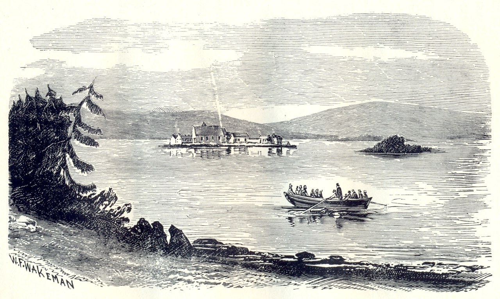</picture>
<figcaption><b>Pilgrims rowed to Station Island</b>, an engraving by William Frederick Wakeman, 1876. Image: <a href="https://commons.wikimedia.org/wiki/File:William_Frederick_Wakeman_Lough_Derg.png">William Frederick Wakeman Lough Derg</a>, public domain, via Wikimedia Commons.</figcaption>
</figure>

<figure class=photo>
<picture><source srcset="/static/art/patrick-lough-derg-1890-600.webp 600w,/static/art/patrick-lough-derg-1890.webp 827w" sizes="(max-width:760px) 100vw,760px" type="image/webp">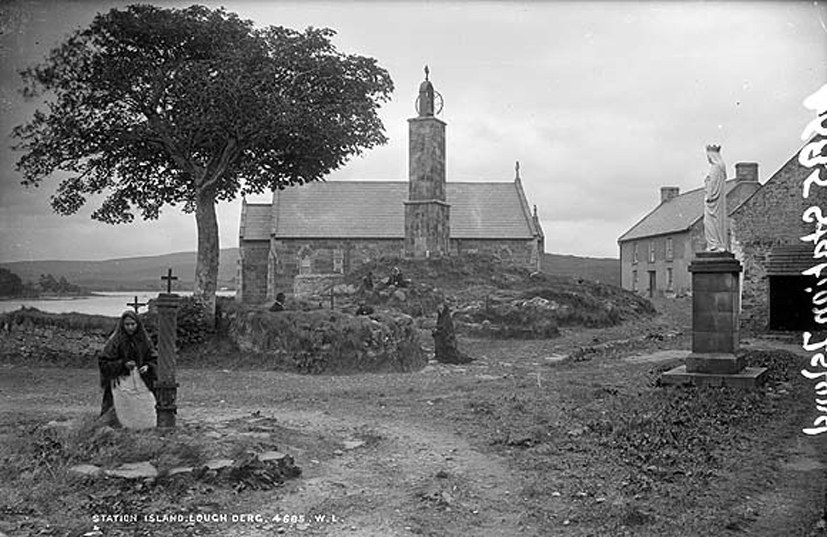</picture>
<figcaption><b>"Doing the stations" on Lough Derg</b>, around 1890, from the National Library of Ireland. The central prayer of the pilgrimage was the "station": prayers said at the penitential beds, in and around the basilica. Photo: <a href="https://commons.wikimedia.org/wiki/File:Doing_the_stations_(6024596111).jpg">Doing the stations (6024596111)</a> by the National Library of Ireland, no known copyright restrictions, via Wikimedia Commons.</figcaption>
</figure>

### St Patrick's Cathedral, New York

Patrick's people took him with them across the world, and nowhere more magnificently than in New York. **St Patrick's Cathedral** on Fifth Avenue, designed by James Renwick Jr., was begun in 1858, completed in 1878 and dedicated on 25 May 1879; its spires were added in 1888. It is the seat of the Archbishop of New York and the largest Gothic Revival Catholic cathedral in North America.

<figure class=photo>
<picture><source srcset="/static/art/patrick-nyc-600.webp 600w,/static/art/patrick-nyc.webp 1280w" sizes="(max-width:760px) 100vw,760px" type="image/webp">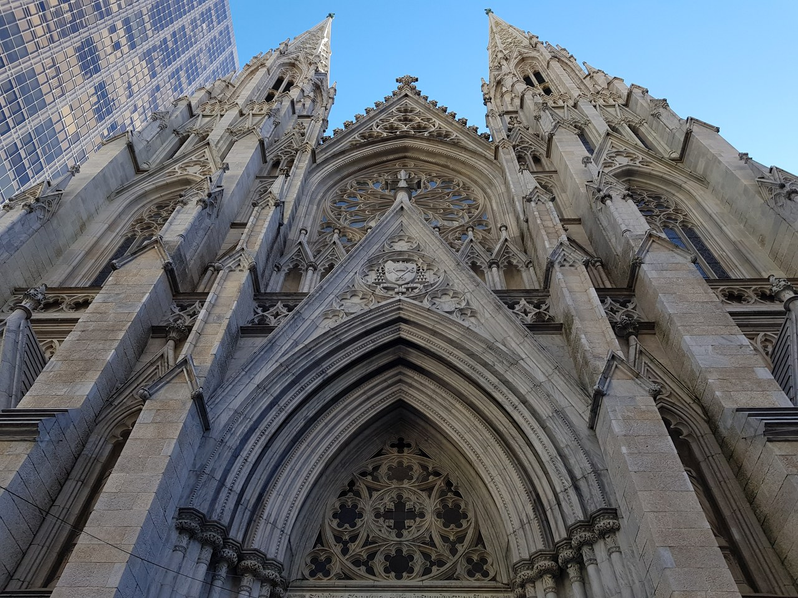</picture>
<figcaption>The <b>façade of St Patrick's Cathedral, New York</b>, on Fifth Avenue. Photo: <a href="https://commons.wikimedia.org/wiki/File:Exterior_of_St._Patrick%27s_Cathedral_(Manhattan)_25-10-2018.jpg">Exterior of St. Patrick's Cathedral (Manhattan) 25-10-2018</a> by Sebring12Hrs, <a href="https://creativecommons.org/licenses/by-sa/4.0">CC BY-SA 4.0</a>, via Wikimedia Commons.</figcaption>
</figure>

<figure class=photo>
<picture><source srcset="/static/art/patrick-nyc-interior-600.webp 600w,/static/art/patrick-nyc-interior.webp 1280w" sizes="(max-width:760px) 100vw,760px" type="image/webp">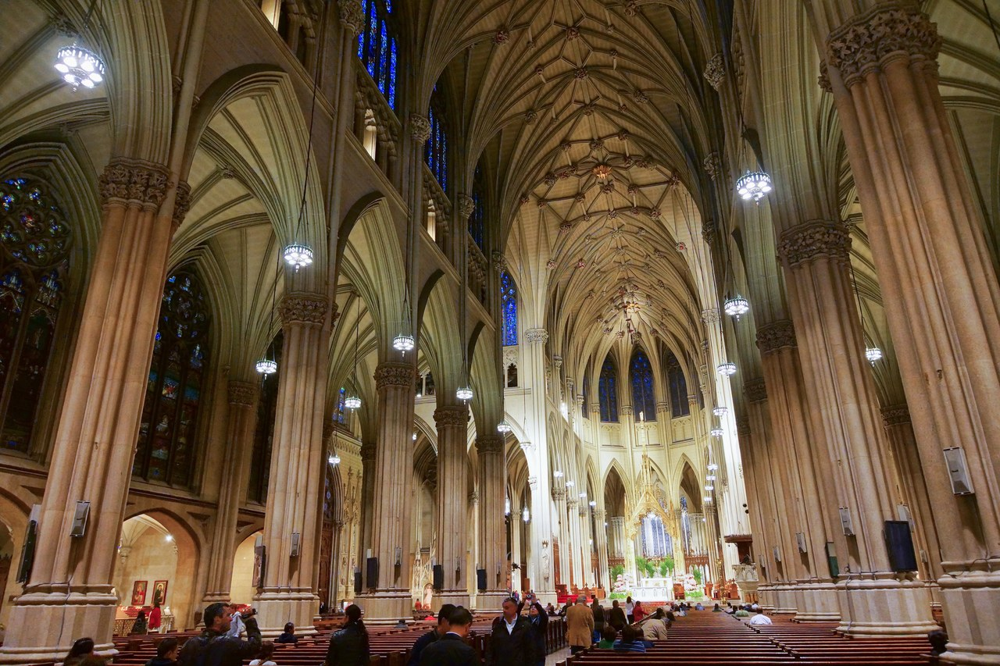</picture>
<figcaption><b>Inside St Patrick's Cathedral, New York</b>, looking towards the high altar. Photo: <a href="https://commons.wikimedia.org/wiki/File:NYC_-_St._Patrick%27s_Cathedral_-_Interior.JPG">NYC - St. Patrick's Cathedral - Interior</a> by Jean-Christophe BENOIST, <a href="https://creativecommons.org/licenses/by/3.0">CC BY 3.0</a>, via Wikimedia Commons.</figcaption>
</figure>

<figure class=photo>
<picture><source srcset="/static/art/patrick-nyc-1900-600.webp 600w,/static/art/patrick-nyc-1900.webp 1237w" sizes="(max-width:760px) 100vw,760px" type="image/webp">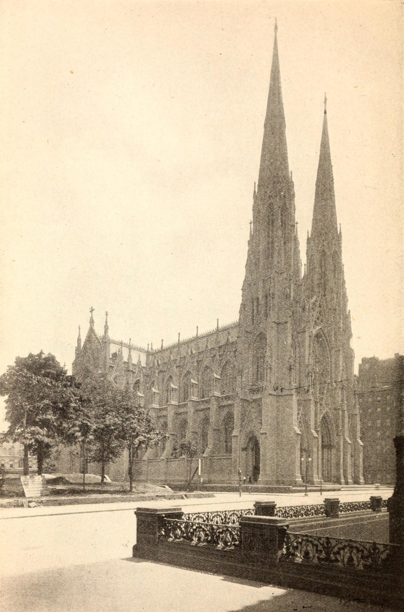</picture>
<figcaption><b>St Patrick's Cathedral, New York</b>, in the early 1900s, when it already towered over the brownstones of Fifth Avenue. Image: <a href="https://commons.wikimedia.org/wiki/File:Saint_Patrick%27s_Cathedral,_New_York.jpg">Saint Patrick's Cathedral, New York</a>, public domain, via Wikimedia Commons.</figcaption>
</figure>

### Auxerre and Lérins

In Burgundy, the former abbey of **Saint-Germain at Auxerre** keeps the tomb of St Germanus, with whom Muirchú says Patrick studied. Off the coast near Cannes, on the island of Saint-Honorat, the monks of **Lérins Abbey** still pray where, in Tírechán's account, Patrick spent his years of study.

<figure class=photo>
<picture><source srcset="/static/art/patrick-lerins-600.webp 600w,/static/art/patrick-lerins.webp 1280w" sizes="(max-width:760px) 100vw,760px" type="image/webp">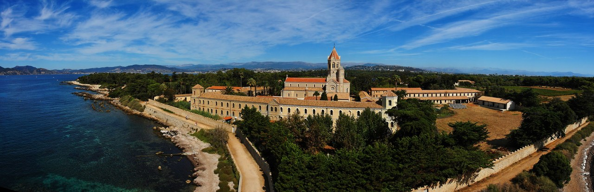</picture>
<figcaption><b>Lérins Abbey</b> on the island of Saint-Honorat, off the coast near Cannes, where Tírechán says Patrick studied for thirty years. Photo: <a href="https://commons.wikimedia.org/wiki/File:Church_and_monastery_of_the_L%C3%A9rins_Abbey.jpg">Church and monastery of the Lérins Abbey</a> by Alberto Fernandez Fernandez, <a href="https://creativecommons.org/licenses/by/2.5">CC BY 2.5</a>, via Wikimedia Commons.</figcaption>
</figure>

<h2 id=art>Patrick in art</h2>

### Manuscripts and early printed books

<figure class=photo>
<picture><source srcset="/static/art/patrick-book-armagh-evang-600.webp 600w,/static/art/patrick-book-armagh-evang.webp 586w" sizes="(max-width:760px) 100vw,760px" type="image/webp">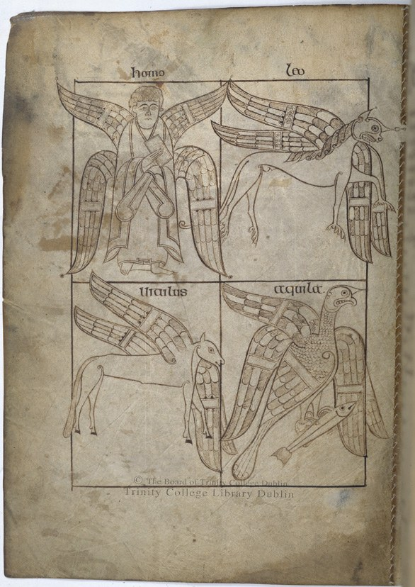</picture>
<figcaption>The <b>symbols of the four evangelists</b> in the Book of Armagh (Trinity College Dublin, MS 52, folio 32v), drawn around 807. The same book holds Patrick's <i>Confessio</i>. Image: <a href="https://commons.wikimedia.org/wiki/File:Book_of_Armagh_-_Trinity_College_MS52_f32v_(Symbols_of_evangelists).jpg">Book of Armagh - Trinity College MS52 f32v (Symbols of evangelists)</a>, public domain, via Wikimedia Commons.</figcaption>
</figure>

<figure class=photo>
<picture><source srcset="/static/art/patrick-montbaston-king-600.webp 600w,/static/art/patrick-montbaston-king.webp 1280w" sizes="(max-width:760px) 100vw,760px" type="image/webp">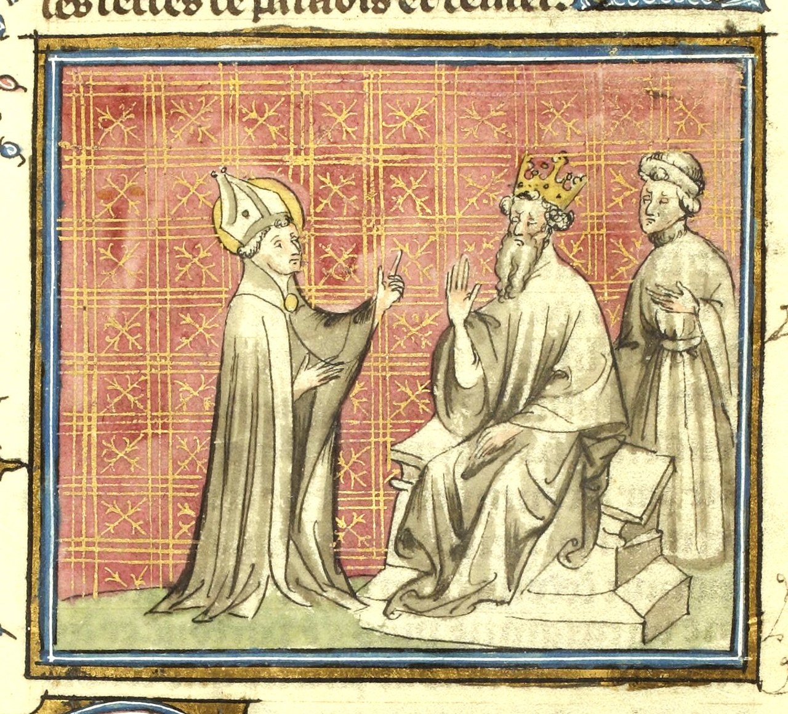</picture>
<figcaption><b>St Patrick and the King</b>, painted by Richard de Montbaston in Paris in 1348. Patrick, in his bishop's mitre, addresses the king of Ireland, as in the stories of Tara. Image: <a href="https://commons.wikimedia.org/wiki/File:Richard_de_Montbaston,_Saint_Patrick_and_the_King_(1348).jpg">Richard de Montbaston, Saint Patrick and the King (1348)</a>, <a href="https://creativecommons.org/publicdomain/zero/1.0/">CC0</a>, via Wikimedia Commons.</figcaption>
</figure>

<figure class=photo>
<picture><source srcset="/static/art/patrick-legendari-600.webp 600w,/static/art/patrick-legendari.webp 914w" sizes="(max-width:760px) 100vw,760px" type="image/webp">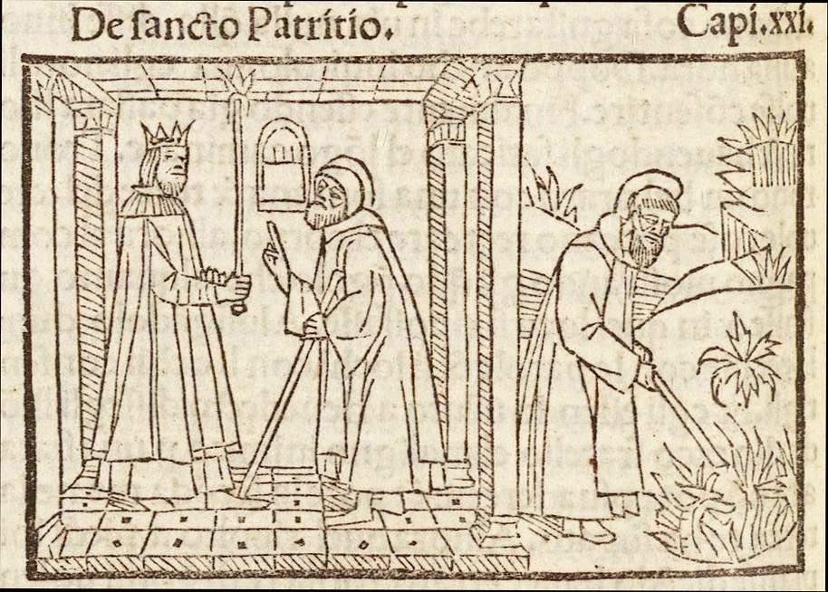</picture>
<figcaption><b>St Patrick</b> in an Italian edition of the <i>Golden Legend</i>, Venice, 1497. Collections of saints' lives like this carried Patrick's stories, and the fame of his Purgatory, to readers all over Europe. Image: <a href="https://commons.wikimedia.org/wiki/File:Legendari_di_sancti_istoriado_uulgar,_1497_%E2%80%93_(san_Patrizio)_-_BEIC_IE4411197.jpg">Legendari di sancti istoriado uulgar, 1497 – (san Patrizio) - BEIC IE4411197</a>, public domain, via Wikimedia Commons.</figcaption>
</figure>

<figure class=photo>
<picture><source srcset="/static/art/patrick-nuremberg-600.webp 600w,/static/art/patrick-nuremberg.webp 246w" sizes="(max-width:760px) 100vw,760px" type="image/webp">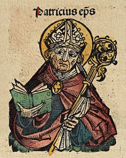</picture>
<figcaption><b>St Patrick, bishop</b>, a woodcut from the <i>Nuremberg Chronicle</i> of 1493, by the workshop of Michael Wolgemut and Wilhelm Pleydenwurff. Image: <a href="https://commons.wikimedia.org/wiki/File:Nuremberg_chronicles_f_145v_4.jpg">Nuremberg chronicles f 145v 4</a>, public domain, via Wikimedia Commons.</figcaption>
</figure>

### Tiepolo's *St Patrick, Bishop of Ireland*

<figure class=photo>
<picture><source srcset="/static/art/patrick-tiepolo-600.webp 600w,/static/art/patrick-tiepolo.webp 1280w" sizes="(max-width:760px) 100vw,760px" type="image/webp"></picture>
<figcaption>Giambattista Tiepolo, <i><b>St Patrick, Bishop of Ireland</b></i>, 1746 (Musei Civici, Padua). Tiepolo painted it for the Canons Regular of the Lateran at the church of San Giovanni di Verdara in Padua, who honoured Patrick as one of their own. The bishop stands on a marble pedestal and raises his hand to heal an invalid. Image: <a href="https://commons.wikimedia.org/wiki/File:Tiepolo-s.patrizio.jpg">Tiepolo-s.patrizio</a>, public domain, via Wikimedia Commons.</figcaption>
</figure>

### Relics and shrines

<figure class=photo>
<picture><source srcset="/static/art/patrick-bell-600.webp 600w,/static/art/patrick-bell.webp 1280w" sizes="(max-width:760px) 100vw,760px" type="image/webp"></picture>
<figcaption><b>St Patrick's Bell</b> (Clog Phádraig), seventh century, in the National Museum of Ireland. The annals say it was one of the relics taken from his tomb; it is "the Bell of the Testament". Photo: <a href="https://commons.wikimedia.org/wiki/File:St_Patrick%27s_Bell,_7th_century.jpg">St Patrick's Bell, 7th century</a> by Ceoil, <a href="https://creativecommons.org/licenses/by-sa/4.0">CC BY-SA 4.0</a>, via Wikimedia Commons.</figcaption>
</figure>

<figure class=photo>
<picture><source srcset="/static/art/patrick-bell-shrine-600.webp 600w,/static/art/patrick-bell-shrine.webp 1280w" sizes="(max-width:760px) 100vw,760px" type="image/webp"></picture>
<figcaption><b>The Shrine of St Patrick's Bell</b>, made for it at the order of King Domnall Ua Lochlainn between 1091 and 1105 (National Museum of Ireland). Its gold and silver interlace is among the finest Irish metalwork of its age. Photo: <a href="https://commons.wikimedia.org/wiki/File:St_Patrick%27s_Bell_Shrine.jpg">St Patrick's Bell Shrine</a> by Ceoil, <a href="https://creativecommons.org/licenses/by-sa/4.0">CC BY-SA 4.0</a>, via Wikimedia Commons.</figcaption>
</figure>

<figure class=photo>
<picture><source srcset="/static/art/patrick-domnach-airgid-600.webp 600w,/static/art/patrick-domnach-airgid.webp 1280w" sizes="(max-width:760px) 100vw,760px" type="image/webp"></picture>
<figcaption>The <b>Domhnach Airgid</b> ("silver church"), a book shrine believed to have held relics associated with St Patrick, remodelled around 1350 (National Museum of Ireland). Photo: <a href="https://commons.wikimedia.org/wiki/File:Domhnach_Airgid.jpg">Domhnach Airgid</a> by Martinvl, public domain, via Wikimedia Commons.</figcaption>
</figure>

### Stained glass

<figure class=photo>
<picture><source srcset="/static/art/patrick-loughrea-600.webp 600w,/static/art/patrick-loughrea.webp 1280w" sizes="(max-width:760px) 100vw,760px" type="image/webp"></picture>
<figcaption><b>St Patrick</b>, the whole window by Alfred Ernest Child (An Túr Gloine, 1937) in St Brendan's Cathedral, Loughrea, of which the Easter fire scene above is a detail. Photo: <a href="https://commons.wikimedia.org/wiki/File:Loughrea_St._Brendan%27s_Cathedral_East_Aisle_%E2%80%9CNao%E1%B9%81_P%C3%A1dra%C4%B1g%E2%80%9D_by_Alfred_Ernest_Child_2019_09_05.jpg">Loughrea St. Brendan's Cathedral East Aisle “Naoṁ Pádraıg” by Alfred Ernest Child 2019 09 05</a> by Andreas F. Borchert, <a href="https://creativecommons.org/licenses/by-sa/4.0">CC BY-SA 4.0</a>, via Wikimedia Commons.</figcaption>
</figure>

<figure class=photo>
<picture><source srcset="/static/art/patrick-kildare-window-600.webp 600w,/static/art/patrick-kildare-window.webp 1280w" sizes="(max-width:760px) 100vw,760px" type="image/webp"></picture>
<figcaption>The <b>west window of Kildare Cathedral</b>, by Heaton, Butler & Bayne (1896–1909), with scenes from the lives of St Patrick (left), St Brigid (centre) and St Columba (right), the three patron saints of Ireland. Photo: <a href="https://commons.wikimedia.org/wiki/File:Kildare_Cathedral_Nave_West_Window_Saints_Patrick,_Brigid,_and_Columba_2013_09_04.jpg">Kildare Cathedral Nave West Window Saints Patrick, Brigid, and Columba 2013 09 04</a> by Andreas F. Borchert, <a href="https://creativecommons.org/licenses/by-sa/4.0">CC BY-SA 4.0</a>, via Wikimedia Commons.</figcaption>
</figure>

<figure class=photo>
<picture><source srcset="/static/art/patrick-saltlake-600.webp 600w,/static/art/patrick-saltlake.webp 1280w" sizes="(max-width:760px) 100vw,760px" type="image/webp"></picture>
<figcaption><b>St Patrick</b>, a window of 1904 in the Holy Cross Chapel, Salt Lake City, Utah. Photo: <a href="https://commons.wikimedia.org/wiki/File:Holy_Cross_Chapel_Salt_Lake_City_Stained_Glass_Window_of_St._Patrick_1904.jpg">Holy Cross Chapel Salt Lake City Stained Glass Window of St. Patrick 1904</a> by NateBergin, <a href="https://creativecommons.org/licenses/by/4.0">CC BY 4.0</a>, via Wikimedia Commons.</figcaption>
</figure>

<figure class=photo>
<picture><source srcset="/static/art/patrick-tuam-600.webp 600w,/static/art/patrick-tuam.webp 1001w" sizes="(max-width:760px) 100vw,760px" type="image/webp"></picture>
<figcaption>The <b>St Patrick window</b> in the Cathedral of the Assumption, Tuam, County Galway, designed and made by Richard King in 1961. Photo: <a href="https://commons.wikimedia.org/wiki/File:Tuam_Cathedral_of_the_Assumption_St_Patrick%27s_Window_2009_09_14.jpg">Tuam Cathedral of the Assumption St Patrick's Window 2009 09 14</a> by Andreas F. Borchert, <a href="https://creativecommons.org/licenses/by-sa/4.0">CC BY-SA 4.0</a>, via Wikimedia Commons.</figcaption>
</figure>

<figure class=photo>
<picture><source srcset="/static/art/patrick-thurles-600.webp 600w,/static/art/patrick-thurles.webp 924w" sizes="(max-width:760px) 100vw,760px" type="image/webp"></picture>
<figcaption><b>St Patrick</b>, by Wailes of Newcastle, in the ambulatory of the Cathedral of the Assumption, Thurles, County Tipperary. Photo: <a href="https://commons.wikimedia.org/wiki/File:Thurles_Cathedral_Ambulatory_Window_20_Saint_Patrick_2012_09_06.jpg">Thurles Cathedral Ambulatory Window 20 Saint Patrick 2012 09 06</a> by Andreas F. Borchert, <a href="https://creativecommons.org/licenses/by-sa/4.0">CC BY-SA 4.0</a>, via Wikimedia Commons.</figcaption>
</figure>

## Path to sainthood

Patrick was honoured as a saint by the people of Ireland from the time of his death, long before there was any formal process of canonisation; he is one of the **pre-Congregation** saints. By the seventh century, when Muirchú and Tírechán wrote his lives, Armagh claimed him as its founder and his heirs led the Irish Church, and in the 550s, the annals say, his relics were enshrined by St Columba. His feast on **17 March** is kept in the General Roman Calendar. In Ireland it is a solemnity and a holy day of obligation. He is also honoured by the Church of Ireland and the wider Anglican Communion (a Lesser Festival in the Church of England), by Lutherans, and by the Orthodox, who call him "Equal-to-the-Apostles" and "Enlightener of Ireland". On 9 March 2017 the Russian Orthodox Church added his name to its calendar.

## Patronages

**Ireland**, with St Brigid and St Columba; **Nigeria**; the **Archdiocese of New York** and many other dioceses of the Irish diaspora; and **engineers**.

## Trivia

- **He wasn't Irish**: he was a Roman Briton, whose mother tongue was probably British Celtic, the ancestor of Welsh.
- The *Confessio* and the *Letter to Coroticus* are the only writings generally accepted as Patrick's own, and they are among the earliest documents of Irish history.
- In his own writings Patrick never mentions the shamrock, the snakes or the fire at Slane. All of them come from later lives and traditions.
- The **first St Patrick's Day parade in Ireland** was held in Waterford in 1903; North America had been holding parades for centuries before that.
- The cross associated with Patrick was long the **cross pattée**; the red saltire "St Patrick's Cross" dates only from 1783 and the Order of St Patrick.
- The tune of the hymn *I bind unto myself today* combines two traditional Irish melodies, "St Patrick" and "Gartan", arranged by Charles Villiers Stanford in 1902.
- Patrick's Bell, his "Bell of the Testament", and its jewelled shrine can be seen today in the National Museum of Ireland in Dublin.
- Read also of Ireland's other patrons, [St Brigid](/saints/brigid/) and [St Columba](/saints/columba/), and of [St Kevin of Glendalough](/saints/kevin/), [St Brendan the Navigator](/saints/brendan/), [St Cuthbert](/saints/cuthbert/), and [St Martin of Tours](/saints/martin-of-tours/), whose kinsman, tradition says, Patrick was.

## Sources
- [Vatican News: St Patrick, bishop, disciple of Ireland](https://www.vaticannews.va/en/saints/03/17/st--patrick--bishop--disciple-of-ireland-.html)
- [Catholic Encyclopedia: St Patrick](https://www.newadvent.org/cathen/11554a.htm)
- [Britannica: St Patrick](https://www.britannica.com/biography/Saint-Patrick)
- [Royal Irish Academy: St Patrick's Confessio](https://www.confessio.ie/)
- [Wikisource: The Confession of St Patrick (O'Leary, *The Most Ancient Lives of Saint Patrick*, 1880)](https://en.wikisource.org/wiki/The_Most_Ancient_Lives_of_Saint_Patrick/The_Confession_of_St._Patrick)
- [Wikisource: St Patrick's Epistle to Coroticus (O'Leary, 1880)](https://en.wikisource.org/wiki/The_Most_Ancient_Lives_of_Saint_Patrick/St._Patrick%27s_Epistle_to_Coroticus)
- [Wikisource: St Patrick's Breastplate, version of Mrs Alexander (Wright, *The Writings of Saint Patrick*)](https://en.wikisource.org/wiki/The_Writings_of_Saint_Patrick,_the_Apostle_of_Ireland/Version_of_Mrs._Alexander)
- [Wikipedia: Saint Patrick](https://en.wikipedia.org/wiki/Saint_Patrick)
- [Wikipedia: Saint Patrick's Breastplate](https://en.wikipedia.org/wiki/Saint_Patrick%27s_Breastplate)
- [Wikipedia: Muirchú moccu Machtheni](https://en.wikipedia.org/wiki/Muirch%C3%BA_moccu_Machtheni)
- [Wikipedia: Tírechán](https://en.wikipedia.org/wiki/T%C3%ADrech%C3%A1n)
- [Wikipedia: Palladius (bishop of Ireland)](https://en.wikipedia.org/wiki/Palladius_(bishop_of_Ireland))
- [Wikipedia: Germanus of Auxerre](https://en.wikipedia.org/wiki/Germanus_of_Auxerre)
- [Wikipedia: Book of Armagh](https://en.wikipedia.org/wiki/Book_of_Armagh)
- [Wikipedia: Slemish](https://en.wikipedia.org/wiki/Slemish)
- [Wikipedia: Slane](https://en.wikipedia.org/wiki/Slane)
- [Wikipedia: Hill of Tara](https://en.wikipedia.org/wiki/Hill_of_Tara)
- [Wikipedia: Saul, County Down](https://en.wikipedia.org/wiki/Saul,_County_Down)
- [Wikipedia: Downpatrick](https://en.wikipedia.org/wiki/Downpatrick)
- [Wikipedia: Down Cathedral](https://en.wikipedia.org/wiki/Down_Cathedral)
- [Wikipedia: Armagh](https://en.wikipedia.org/wiki/Armagh)
- [Wikipedia: St Patrick's Cathedral, Armagh (Church of Ireland)](https://en.wikipedia.org/wiki/St_Patrick%27s_Cathedral,_Armagh_(Church_of_Ireland))
- [Wikipedia: St Patrick's Cathedral, Armagh (Roman Catholic)](https://en.wikipedia.org/wiki/St_Patrick%27s_Cathedral,_Armagh_(Roman_Catholic))
- [Wikipedia: St Patrick's Cathedral, Dublin](https://en.wikipedia.org/wiki/St_Patrick%27s_Cathedral,_Dublin)
- [Wikipedia: Croagh Patrick](https://en.wikipedia.org/wiki/Croagh_Patrick)
- [Wikipedia: Lough Derg (Ulster)](https://en.wikipedia.org/wiki/Lough_Derg_(Ulster))
- [Wikipedia: St Patrick's Purgatory](https://en.wikipedia.org/wiki/St_Patrick%27s_Purgatory)
- [Wikipedia: St. Patrick's Cathedral (Manhattan)](https://en.wikipedia.org/wiki/St._Patrick%27s_Cathedral_(Manhattan))
- [Wikipedia: Shamrock](https://en.wikipedia.org/wiki/Shamrock)
- [Wikipedia: Saint Patrick's Day](https://en.wikipedia.org/wiki/Saint_Patrick%27s_Day)
- [Wikipedia: Saint Patrick, Bishop of Ireland (Tiepolo)](https://en.wikipedia.org/wiki/Saint_Patrick,_Bishop_of_Ireland)

Fact-checked on October 15, 2026 against New Advent (Catholic Encyclopedia), Vatican documents and news reports. Britannica links are given for further reading. Feast days follow the General Roman Calendar. Expanded and fact-checked November 25, 2026 against St Patrick's own Confessio and Letter to Coroticus (in James O'Leary's public-domain translation of 1880), Cecil Frances Alexander's version of the Breastplate, Vatican News and the Catholic Encyclopedia, and the history of his places and churches in Ireland, Britain, Gaul and New York. Stories from the later lives by Muirchú and Tírechán, and later traditions such as the shamrock, the snakes and St Patrick's Purgatory, are labelled as such. Images are public domain or openly licensed, via Wikimedia Commons; the map is by The Daily Word.

