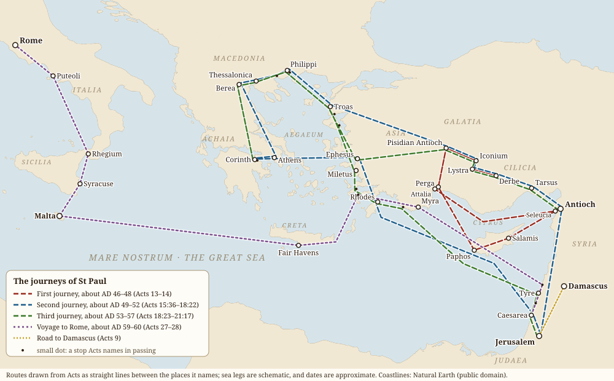
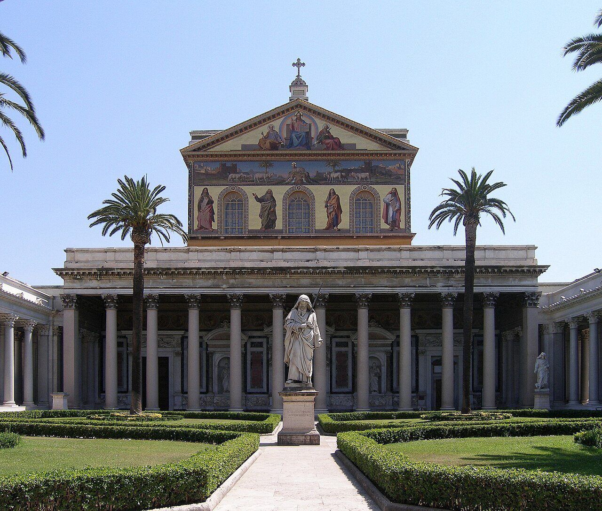
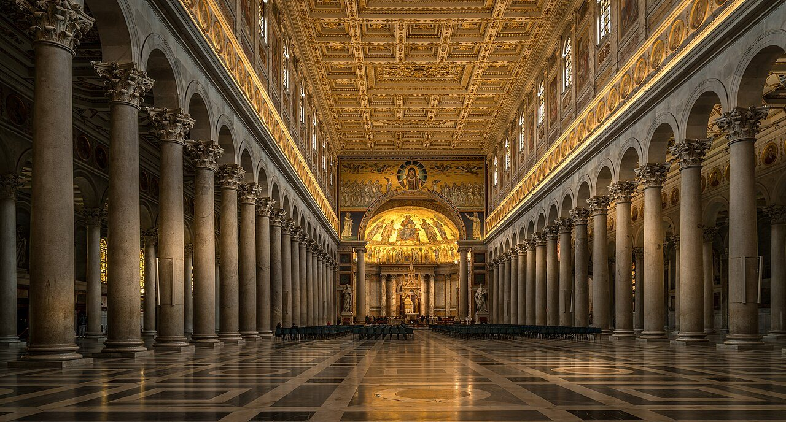
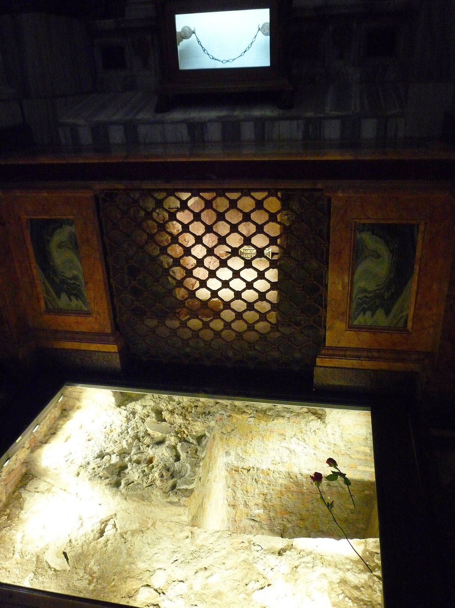
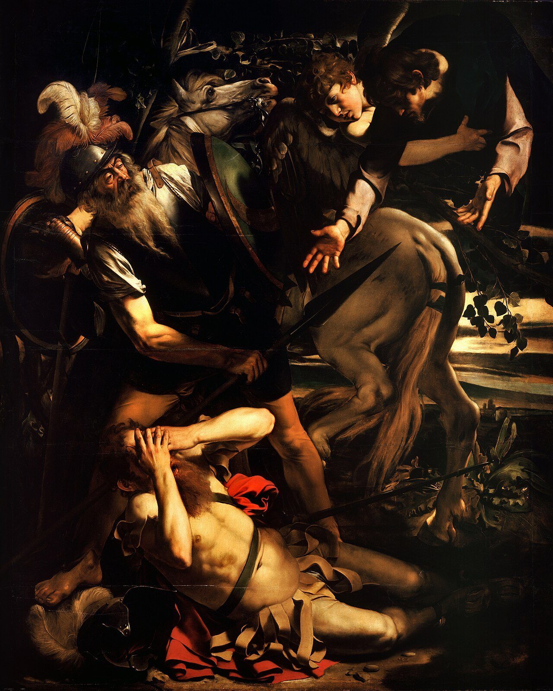
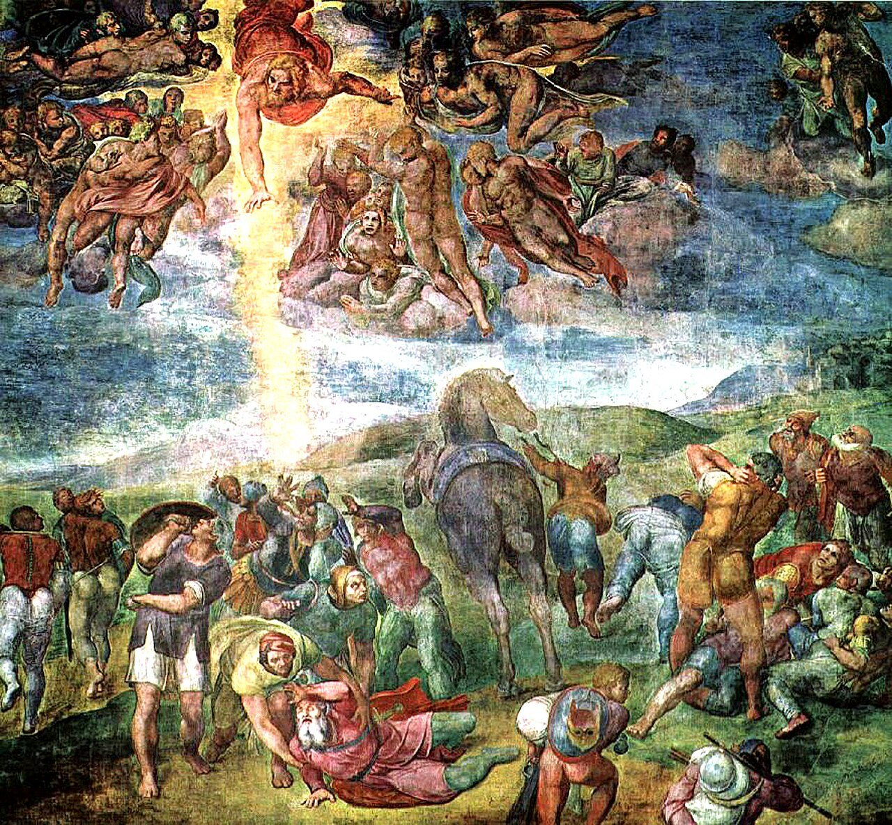
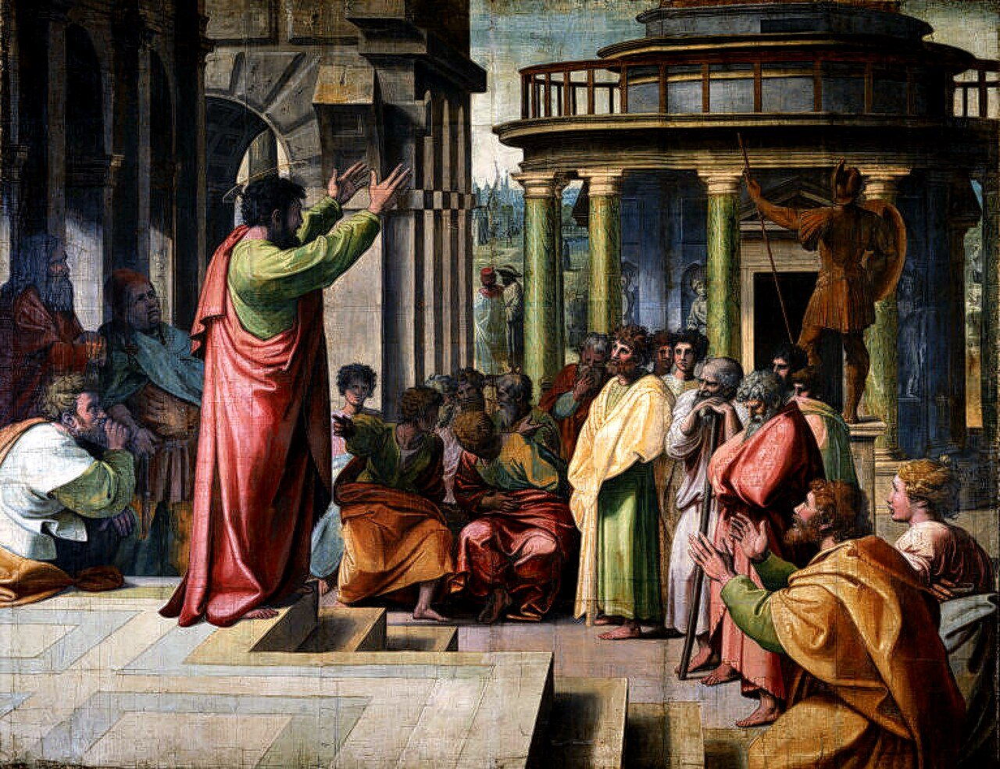
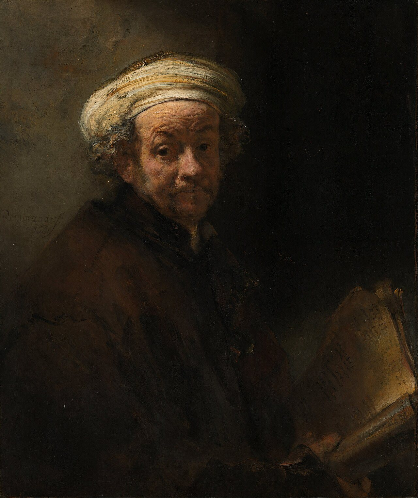

<nav class=toc aria-label="On this page">

On this page

<ol>
<li><a href="#damascus">The light on the Damascus road</a></li>
<li><a href="#journeys">The journeys, and the old cities</a></li>
<li><a href="#basilica">St Paul Outside the Walls</a></li>
<li><a href="#art">Paul in art</a></li>
<li><a href="#recognise">How to recognise him in art</a></li>
</ol>
</nav>

## His story
Saul of Tarsus, a Pharisee and Roman citizen, persecuted the first Christians until the risen Christ stopped him on the road to Damascus (Acts 9). He became the great missionary of the early Church, travelling thousands of miles through Asia Minor and Greece, founding churches and writing letters that make up much of the New Testament. Tradition says he was beheaded in Rome under Nero.

<h2 id=damascus>The light on the Damascus road</h2>

Saul had already watched one Christian die. When [Stephen](/saints/stephen/) was stoned outside Jerusalem, the men laid their cloaks "at a young man's feet, whose name was Saul" (Acts 7:58), and Saul "was consenting unto his death" (Acts 8:1). Afterwards he went from house to house, dragging believers to prison. Then he asked the high priest for letters to the synagogues of **Damascus**, so that any he found there "of this way," men or women, he might bring bound to Jerusalem (Acts 9:1–2).

Near the city, at midday, the road was stopped by heaven.

KJV · Acts 9:3–4
And as he journeyed, he came near Damascus: and suddenly there shined round about him a light from heaven: and he fell to the earth, and heard a voice saying unto him, Saul, Saul, why persecutest thou me?

Greek · SBLGNT · Acts 9:4

Σαοὺλ Σαούλ, τί με διώκεις;

Saoul, Saoul, ti me diōkeis?

Latin · Vulgate · Acts 9:4
Saule, Saule, quid me persequeris?

"Who art thou, Lord?" he asked, and the answer came: "I am Jesus whom thou persecutest" (Acts 9:5). The voice did not say *my followers*. To strike the Church was to strike Christ himself. The men travelling with Saul stood speechless, hearing a voice but seeing no one. Saul rose from the ground, and when he opened his eyes he could see nothing. They led him by the hand into Damascus, "and he was three days without sight, and neither did eat nor drink" (Acts 9:8–9).

In the city lived a disciple named **Ananias**. The Lord sent him to the street called Straight, to the house of Judas, where Saul was praying. Ananias was afraid. He had heard what this man had done to the saints in Jerusalem. But the Lord said, "Go thy way: for he is a chosen vessel unto me, to bear my name before the Gentiles" (Acts 9:15). So the frightened disciple went in to the persecutor, and called him brother.

KJV · Acts 9:17–18
And Ananias went his way, and entered into the house; and putting his hands on him said, Brother Saul, the Lord, even Jesus, that appeared unto thee in the way as thou camest, hath sent me, that thou mightest receive thy sight, and be filled with the Holy Ghost. And immediately there fell from his eyes as it had been scales: and he received sight forthwith, and arose, and was baptized.

That is how Acts tells the healing. Ananias lays his hands on him, something like scales falls from his eyes, and he sees. There is no washing of the eyes in the story. The water comes after, in baptism, and Paul himself later remembers Ananias saying, "arise, and be baptized, and wash away thy sins" (Acts 22:16). The washing Scripture names is of sins, not of sight. Within days the man who came to arrest Christians was preaching in the synagogues of Damascus that Jesus is the Son of God (Acts 9:20). The church keeps the day on **25 January**, the feast of the Conversion of St Paul.

Luke thought the moment so important that Acts tells it three times. In **Acts 22**, Paul tells it himself to the crowd in the Temple courts, in Hebrew, adding that he "could not see for the glory of that light" (Acts 22:11). In **Acts 26**, before King Agrippa, he describes a light "above the brightness of the sun," and the Lord's word that it was "hard for thee to kick against the pricks" (Acts 26:13–14), like an ox kicking the goad. Paul's own letters say it more briefly: last of all, Christ "was seen of me also, as of one born out of due time" (1 Corinthians 15:8). The places of the story, Straight Street, the house of Ananias and the gate where he was later let down in a basket, are on the [Damascus page](/pilgrimage/st-paul/damascus/).

<h2 id=journeys>The journeys, and the old cities</h2>

After Damascus, Arabia and some quiet years in [Tarsus](/pilgrimage/st-paul/tarsus/), [Barnabas](/saints/barnabas/) brought Paul to [Antioch](/pilgrimage/st-paul/antioch/), where the disciples were first called Christians (Acts 11:26). From Antioch the Church sent him out. Acts follows him on three journeys and a last voyage, and the old names on the map below are the names he knew.

- **The first journey** (about AD 46–48; Acts 13–14). With Barnabas and young John Mark, Paul sailed from Seleucia to **Cyprus**, crossing the island from Salamis to **Paphos**, where the proconsul Sergius Paulus believed. From here on Acts calls him Paul. They crossed to **Perga**, climbed to **Pisidian Antioch**, and went on to **Iconium**, **Lystra** and **Derbe**. At Lystra the crowd first took them for gods, and then stoned Paul and left him for dead. They went back the way they came, strengthening each new church, and sailed home from Attalia.
- **The second journey** (about AD 49–52; Acts 15:36–18:22). With Silas, Paul revisited the churches of Galatia and took young Timothy with him. At **Troas** a vision of a man of Macedonia called him into Europe. At **[Philippi](/pilgrimage/st-paul/philippi/)** Lydia was baptized, and Paul and Silas sang hymns at midnight in the jail. Then came **[Thessalonica](/pilgrimage/st-paul/thessaloniki/)** and **Berea**, whose people "searched the scriptures daily," and **[Athens](/pilgrimage/st-paul/athens/)**, where Paul spoke on the Areopagus of the unknown God. At **[Corinth](/pilgrimage/st-paul/corinth/)** he stayed a year and a half, making tents with Aquila and Priscilla. He touched at **[Ephesus](/pilgrimage/st-paul/ephesus/)**, landed at **Caesarea**, went up to **Jerusalem**, and returned to Antioch.
- **The third journey** (about AD 53–57; Acts 18:23–21:17). Paul spent nearly three years at **Ephesus**, until the silversmiths of Artemis filled the theatre crying "Great is Diana of the Ephesians." He went again through Macedonia and Greece, wrote to the Romans from Corinth, and came back by Troas, where a young man named Eutychus fell from a window during his long sermon and was raised. At **Miletus** he said goodbye to the elders of Ephesus, who wept because they would not see his face again. By Rhodes and **Tyre** he came to Caesarea and to Jerusalem, where he was arrested in the Temple.
- **The voyage to Rome** (about AD 59–60; Acts 27–28). After two years held at **Caesarea**, Paul appealed to Caesar. He sailed under guard by Sidon and **Myra** to **Fair Havens** on Crete. A winter storm drove the ship fourteen days across the sea until it broke up off **[Malta](/pilgrimage/st-paul/malta/)**, and all 276 aboard came safe to land. In spring they sailed by **Syracuse** and Rhegium to **Puteoli**, and walked the Appian Way to **[Rome](/pilgrimage/st-paul/rome/)**. Acts ends with Paul there two years in his own hired house, "preaching the kingdom of God… with all confidence, no man forbidding him" (Acts 28:31).

<figure class=map><figcaption>Paul's journeys as Acts tells them, with the old names of the cities. Lines are drawn straight between the places Acts names; sea legs are schematic and dates are approximate. Map by The Daily Word; coastlines from Natural Earth (public domain). Tap to enlarge.</figcaption></figure>

Each of these places has its own page in the [Footsteps of St Paul](/pilgrimage/st-paul/) guide.

<h2 id=basilica>St Paul Outside the Walls</h2>

Tradition says Paul was beheaded at the place now called **Tre Fontane**, and buried about two miles away beside the road to Ostia, in a burial ground on land belonging to a Christian woman named Lucina. Rome has kept his grave ever since. Around the year 200 a Roman priest named Gaius, quoted by Eusebius, could already point visitors to the "trophies" of the apostles: Peter's on the Vatican hill, Paul's on the Ostian Way.

<figure class=photo><picture><source srcset="/static/art/rome-paul-hero-600.webp 600w,/static/art/rome-paul-hero.webp 1280w" sizes="(max-width:760px) 100vw,760px" type="image/webp"></picture>
<figcaption>The basilica from its quadriporticus, with Giuseppe Obici's statue of St Paul in the garden. Photo: <a href="https://commons.wikimedia.org/wiki/File:Rom,_Sankt_Paul_vor_den_Mauern,_San_Paolo_fuori_le_mura.jpg">Dnalor 01</a>, <a href="https://creativecommons.org/licenses/by-sa/3.0/at/deed.en">CC BY-SA 3.0 AT</a>, via Wikimedia Commons.</figcaption>
</figure>

**Constantine** built the first church over the grave; tradition says Pope Sylvester consecrated it in 324. It was small. In **386** the emperors **Theodosius I**, Valentinian II and Arcadius began a far greater basilica, with a nave and four aisles, and it was finished in the next century under Honorius and Pope Leo the Great. For centuries it was larger than old St Peter's. The poet Prudentius, who saw it new, wrote of its gilded beams and its columns in rows.

For fourteen hundred years it stood almost unchanged. Then, on the night of **15 July 1823**, a fire that began on the roof, where a workman had been repairing the gutters, brought down nearly all of it. Pope Leo XII asked the whole world to help rebuild (the encyclical *Ad plurimas*, 1825), and gifts came even from far outside the Church: alabaster columns from the viceroy of Egypt, malachite and lapis lazuli from the tsar of Russia. The architects Pasquale Belli and then Luigi Poletti raised it again on the old plan. Gregory XVI consecrated the transept and high altar in 1840, and Pius IX consecrated the whole basilica on **10 December 1854**, two days after he defined the Immaculate Conception. A little of the old church survived and was set back in place: the fifth-century mosaic of the triumphal arch, paid for by the empress Galla Placidia; the thirteenth-century apse mosaic of Honorius III; the Gothic ciborium of **Arnolfo di Cambio** (1285) over the altar; and the tall Romanesque Easter candlestick.

<figure class=photo><picture><source srcset="/static/art/rome-paul-nave-600.webp 600w,/static/art/rome-paul-nave.webp 1280w" sizes="(max-width:760px) 100vw,760px" type="image/webp"></picture>
<figcaption>The rebuilt nave, with its 80 granite columns, the frieze of papal portraits above them, and Arnolfo's ciborium before the apse. Photo: <a href="https://commons.wikimedia.org/wiki/File:San_Paolo_fuori_le_mura-2.jpg">Herbert Weber, Hildesheim</a>, <a href="https://creativecommons.org/licenses/by-sa/4.0">CC BY-SA 4.0</a>, via Wikimedia Commons.</figcaption>
</figure>

It is a **papal basilica**, one of the four major basilicas of Rome with St Peter's, St John Lateran and St Mary Major, and one of the [seven pilgrim churches](/pilgrimage/rome/). The Holy See owns it, though it stands on Italian soil, and Benedictine monks of the abbey beside it have kept it for more than a thousand years. Look up as you walk: round the nave and aisles runs a line of **mosaic medallions of every pope**, from Peter to the present day. The old church had a painted series begun in the fifth century; the mosaics were made after the fire. Romans like to say the world will end when the empty frames run out. That is a saying, not a prophecy.

On the right of the portico is the **Holy Door**, one of the four in Rome's papal basilicas, walled shut except in a Jubilee. It was last opened for the Jubilee of 2025. Inside it stands an older door of bronze, cast in Constantinople and given in 1070 by Pantaleone, a merchant of Amalfi, with panels of Christ and the apostles. South of the transept lies the **cloister**, built by the Vassalletto family between about 1205 and 1241, its paired columns twisted and inlaid with gold and coloured glass.

Under the papal altar is the grave. A marble slab of the fourth century is cut with the words **PAULO APOSTOLO MART**, "to Paul, apostle and martyr." Pilgrims to the Jubilee of 2000 were sad that they could not see or come near the tomb, and so between **2002 and 2006** Vatican archaeologists led by Giorgio Filippi dug beneath the altar. In December 2006 they announced a large marble sarcophagus there, about 2.5 metres long, and opened a window so pilgrims can now see one side of it. In 2009 a small probe was passed inside. It found grains of red incense, a piece of purple linen laminated with gold, blue cloth, and fragments of bone that carbon-dating placed in the first or second century. On **28 June 2009**, closing the Pauline Year, **Pope Benedict XVI** said the findings "would seem to confirm the unanimous and undisputed tradition" that these are the apostle's remains. The Vatican's own scientists added that the dating fits the tradition but cannot prove it.

<figure class=photo><picture><source srcset="/static/art/rome-paul-tomb-600.webp 600w,/static/art/rome-paul-tomb.webp 1280w" sizes="(max-width:760px) 100vw,760px" type="image/webp"></picture>
<figcaption>Looking down into the confessio, where the sarcophagus beneath the slab inscribed PAULO APOSTOLO MART can be seen. Photo: <a href="https://commons.wikimedia.org/wiki/File:Paolo_fuori_leMura_fc17.jpg">Fczarnowski</a>, <a href="https://creativecommons.org/licenses/by-sa/3.0">CC BY-SA 3.0</a>, via Wikimedia Commons.</figcaption>
</figure>

Every year the Week of Prayer for Christian Unity ends here, on 25 January, the feast of Paul's conversion, with the pope at Vespers by the apostle's tomb. The Church also keeps the **Dedication of the Basilicas of Sts Peter and Paul** on **18 November**. For opening hours, the metro and the walk from St Peter's, see the [St Paul Outside the Walls](/pilgrimage/rome/st-paul-outside-the-walls/) pilgrimage page.

<h2 id=art>Paul in art</h2>

The painting at the head of this page is the one most people picture when they hear "the road to Damascus."

**Caravaggio, *The Conversion on the Way to Damascus*, 1600–01.** Tiberio Cerasi, treasurer to Pope Clement VIII, bought a chapel in **Santa Maria del Popolo** in Rome in 1600 and asked Caravaggio for two paintings: Paul's conversion and the crucifixion of [Peter](/saints/peter/). They still face each other there, in the Cerasi Chapel. There is no crowd and no Christ in the sky, only light. Saul lies on his back with his arms open, his eyes shut, his sword on the ground, while a groom steadies the great horse. Acts never mentions a horse. Painters gave him one so that a proud man could be seen to fall.

<figure class=photo><picture><source srcset="/static/art/paul-hero-600.webp 600w,/static/art/paul-hero.webp 1280w" sizes="(max-width:760px) 100vw,760px" type="image/webp"></picture>
<figcaption>Caravaggio, <em>The Conversion of Saint Paul</em>, about 1600–01, oil on cypress panel. The Odescalchi Balbi collection, Rome. Public domain, via <a href="https://commons.wikimedia.org/wiki/File:The_Conversion_of_Saint_Paul-Caravaggio_(c._1600-1).jpg">Wikimedia Commons</a>.</figcaption>
</figure>

**Caravaggio, *The Conversion of Saint Paul* (the Odescalchi version), about 1600–01.** This is thought to be his first painting for the Cerasi Chapel, on wood, and it was not hung there; the canvas above took its place. It is crowded and loud. Christ himself, held up by an angel, reaches down. Saul covers his eyes with both hands, an old soldier lifts his spear against the light, and the horse rears. It has stayed in private hands and now belongs to the Odescalchi Balbi family in Rome. Seen together, the two paintings show a painter learning to say more with less.

<figure class=photo><picture><source srcset="/static/art/paul-michelangelo-saul-600.webp 600w,/static/art/paul-michelangelo-saul.webp 1280w" sizes="(max-width:760px) 100vw,760px" type="image/webp"></picture>
<figcaption>Michelangelo, <em>The Conversion of Saul</em>, 1542–45, fresco. Pauline Chapel (Cappella Paolina), Apostolic Palace, Vatican. Public domain, via <a href="https://commons.wikimedia.org/wiki/File:Conversion_of_Saint_Paul_(Michelangelo_Buonarroti).jpg">Wikimedia Commons</a> (Web Gallery of Art).</figcaption>
</figure>

**Michelangelo, *The Conversion of Saul*, 1542–45.** Pope Paul III, who bore the apostle's name, had Michelangelo paint his private chapel in the Vatican, the Pauline Chapel, just after the *Last Judgment*. These two frescoes, Saul's conversion facing Peter's crucifixion, were the last paintings of his life; he was nearly seventy when he began. Christ dives headfirst out of heaven, and a shaft of light strikes the fallen Saul. Michelangelo painted him not as a young man but as an old one, white-bearded, which some have read as the painter's own face. The chapel is the pope's, so it is seldom open to visitors. A restoration finished in 2009, in the Pauline Year.

<figure class=photo><picture><source srcset="/static/art/paul-athens-raphael-600.webp 600w,/static/art/paul-athens-raphael.webp 1280w" sizes="(max-width:760px) 100vw,760px" type="image/webp"></picture>
<figcaption>Raphael, <em>St Paul Preaching at Athens</em>, 1515, tapestry cartoon. Royal Collection, on loan to the Victoria and Albert Museum, London. Public domain, via <a href="https://commons.wikimedia.org/wiki/File:V%26A_-_Raphael,_St_Paul_Preaching_in_Athens_(1515).jpg">Wikimedia Commons</a>.</figcaption>
</figure>

**Raphael, *St Paul Preaching at Athens*, 1515.** Pope Leo X ordered ten tapestries of the lives of Peter and Paul to hang below the frescoes of the Sistine Chapel, and Raphael drew the full-size designs, the cartoons, for the weavers of Brussels. Seven of the cartoons survive. Charles I of England bought them in 1623, and they belong to the British royal collection. Here Paul stands on the Areopagus with both arms raised, speaking of "the unknown God" (Acts 17:23), and the philosophers listen, doubt, and argue. In the lower right are Dionysius the Areopagite and a woman named Damaris, the two Acts says believed. The [Athens page](/pilgrimage/st-paul/athens/) tells that day.

<figure class=photo><picture><source srcset="/static/art/paul-rembrandt-self-600.webp 600w,/static/art/paul-rembrandt-self.webp 1280w" sizes="(max-width:760px) 100vw,760px" type="image/webp"></picture>
<figcaption>Rembrandt, <em>Self-Portrait as the Apostle Paul</em>, 1661. Rijksmuseum, Amsterdam. Public domain, via <a href="https://commons.wikimedia.org/wiki/File:Rembrandt_Harmensz._van_Rijn_-_Zelfportret_als_de_apostel_Paulus_-_Google_Art_Project.jpg">Wikimedia Commons</a> (Google Art Project).</figcaption>
</figure>

**Rembrandt, *Self-Portrait as the Apostle Paul*, 1661.** Rembrandt painted Paul many times, but only once with his own face. He was fifty-five, bankrupt, and had lost his wife and most of his fortune. He looks out at us with raised brows, a manuscript of the letters in his hands and the hilt of Paul's sword showing at his breast. It is a quiet confession: the painter as the sinner who was made an apostle, "the chief" of sinners, as Paul called himself (1 Timothy 1:15). It hangs in the Rijksmuseum, Amsterdam.

<h2 id=recognise>How to recognise him in art</h2>

Once you know the signs, Paul is easy to find in a church.

- **A sword.** It is the sword of his martyrdom. As a Roman citizen he was beheaded, not crucified. Sometimes he holds two swords, or leans on one. Later preachers added the "sword of the Spirit, which is the word of God" (Ephesians 6:17).
- **A book or a scroll.** These are his letters, thirteen of them in the New Testament.
- **His face.** Since the fourth century artists have given him a high, balding forehead and a long, dark, pointed beard. Peter has a short, round, curly beard and a full head of grey hair. The two types are already fixed in the Roman catacombs and gold glass.
- **Beside Peter.** The two are painted together so often that they almost make one picture: Peter with the keys, Paul with the sword. Crossed keys and sword stand for the Church of Rome, and the two share a feast on **29 June**.
- **Falling from a horse**, blinded by light. This is the conversion, as in the paintings above. The horse is the painters', not Scripture's.

## Path to sainthood
Venerated as an apostle from the beginning (pre-Congregation). His tomb is honoured at the Basilica of [St Paul Outside the Walls](/pilgrimage/rome/st-paul-outside-the-walls/). He shares **29 June** with St Peter, and the Church keeps his conversion on **25 January**.

## Patronages
Missionaries, writers, journalists, theologians, and tentmakers.

## Trivia
- He made a living as a **tentmaker** (Acts 18:3).
- Thirteen New Testament letters bear his name. Scholars agree almost universally that seven are his own; authorship of the others is debated.
- On **28 June 2009** **Pope Benedict XVI** announced that bone fragments from the sarcophagus under St Paul Outside the Walls had been carbon-dated to the 1st or 2nd century, which he said "seems to confirm" the tradition that they are Paul's.

## Sources
- [Benedict XVI, General Audience opening the Pauline catechesis (2 Jul 2008), vatican.va](https://www.vatican.va/content/benedict-xvi/en/audiences/2008/documents/hf_ben-xvi_aud_20080702.html)
- [Vatican News: St Paul](https://www.vaticannews.va/en/saints/06/29/saint-paul--apostle-of-the-city-of-rome.html)
- [Britannica: St Paul the Apostle](https://www.britannica.com/biography/Saint-Paul-the-Apostle)
- [Catholic Encyclopedia: St Paul](https://www.newadvent.org/cathen/11567b.htm)
- [Reuters: Pope says bone fragments found in St Paul's tomb (2009)](https://www.reuters.com/article/lifestyle/science/pope-says-bone-fragments-found-in-st-pauls-tomb-idUSTRE55R22O/)
- Acts 7:58–9:31; Acts 13–28; Acts 22:3–21; Acts 26:9–23; 1 Corinthians 15:8; Galatians 1:13–24; 2 Corinthians 11:32–33
- [Holy See: Papal Basilica of St Paul Outside the Walls](https://www.vatican.va/various/basiliche/san_paolo/index_en.html)
- [Basilica Papale di San Paolo fuori le Mura (official site)](https://www.basilicasanpaolo.org/)
- [Benedict XVI, homily at First Vespers closing the Pauline Year, 28 June 2009](https://www.vatican.va/content/benedict-xvi/en/homilies/2009/documents/hf_ben-xvi_hom_20090628_chius-anno-paolino.html) (the findings in the sarcophagus)
- [Wikipedia: Basilica of Saint Paul Outside the Walls](https://en.wikipedia.org/wiki/Basilica_of_Saint_Paul_Outside_the_Walls) (history, the 1823 fire and the 2002–2006 excavation, with references)
- [Wikipedia: Conversion on the Way to Damascus](https://en.wikipedia.org/wiki/Conversion_on_the_Way_to_Damascus) and [The Conversion of Saint Paul (Caravaggio)](https://en.wikipedia.org/wiki/The_Conversion_of_Saint_Paul_(Caravaggio)); [Wikipedia: Pauline Chapel](https://en.wikipedia.org/wiki/Pauline_Chapel); [Wikipedia: Raphael Cartoons](https://en.wikipedia.org/wiki/Raphael_Cartoons); [Rijksmuseum: Self-Portrait as the Apostle Paul](https://www.rijksmuseum.nl/en/collection/SK-A-4050)
- [Footsteps of St Paul](/pilgrimage/st-paul/), with a page for each city

Fact-checked on October 15, 2026 against New Advent (Catholic Encyclopedia), Vatican documents and news reports. Britannica links are given for further reading. Feast days follow the General Roman Calendar. Expanded November 12, 2026: Scripture is quoted briefly from the public-domain King James Version, with the Greek from the SBLGNT and the Latin from the Vulgate. The conversion is told as Acts tells it; Acts describes scales falling from his eyes and then baptism, not a washing of the eyes. The map was drawn for this page from the places Acts names.

