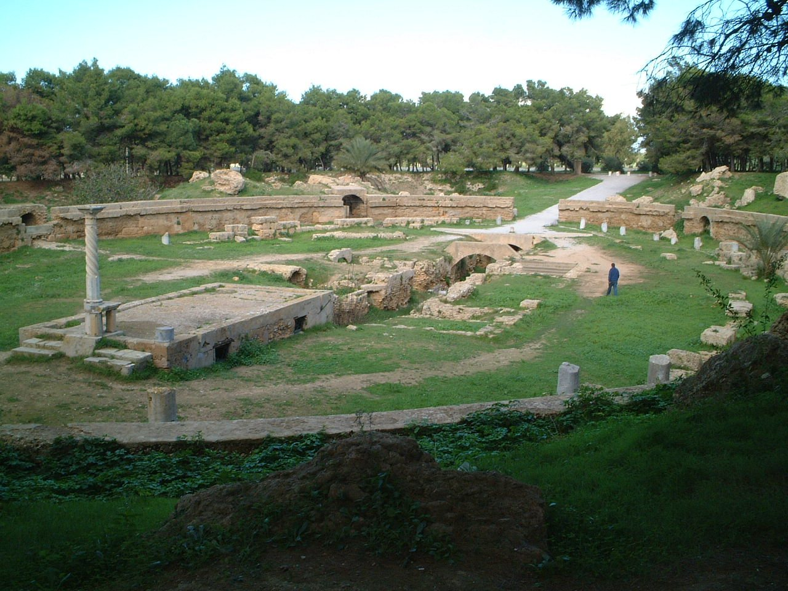

## The story
**Vibia Perpetua**, 22, was a well-born young mother in Carthage, nursing her baby son. **Felicity** was a slave, eight months pregnant. Both were catechumens, preparing for baptism, when they were arrested with three men under the emperor Septimius Severus. They are named in the Roman Canon of the Mass.

## The full story

### Her own words
The ***Passion of Perpetua and Felicity*** contains Perpetua's own prison diary, the oldest surviving writing by a Christian woman. She describes the dark, stifling prison, her anguish for her baby, and her father begging her to deny Christ: she pointed to a water jug and said that just as it could not be called anything but what it was, she could not call herself anything but a Christian. She recorded her visions, including a bronze ladder to heaven guarded by a dragon, whose head she stepped on.

### The arena
Felicity feared she would not be martyred with the others, because the law forbade executing pregnant women; two days before the games she gave birth to a daughter, who was adopted by a Christian woman. On 7 March 203 they were sent into the arena of Carthage for the emperor's son's birthday. Tossed by a wild cow, Perpetua fixed her hair and helped Felicity up. They exchanged the kiss of peace, and were killed by the sword; Perpetua guided the trembling hand of the young gladiator to her own throat. The diary in the Passion is hers. An editor, sometimes thought to be Tertullian, wrote the account of the arena.

<figure class=photo>
<picture><source srcset="/static/art/perpetua-carthage-600.webp 600w,/static/art/perpetua-carthage.webp 1280w" sizes="(max-width:760px) 100vw,760px" type="image/webp"></picture>
<figcaption>The Roman amphitheatre at Carthage, the arena of the city where the Passion places their death. Photo: <a href="https://commons.wikimedia.org/wiki/File:Carthage_amphitheatre.jpg">Neil Rickards</a>, <a href="https://creativecommons.org/licenses/by/2.0">CC BY 2.0</a>, via Wikimedia Commons.</figcaption>
</figure>

## Path to sainthood
Pre-Congregation saints.

## Patronages
Mothers, expectant mothers, ranchers, Carthage.

## Trivia
- A 4th-century inscription naming them was found in the Basilica Maiorum in Carthage in 1907.
- St Augustine preached on their feast several times.

## Sources
- [Catholic Encyclopedia: Sts Felicitas and Perpetua](https://www.newadvent.org/cathen/06029a.htm)

Written October 16, 2026 from the sources above. The Carthage photograph was added November 6, 2026. Feast days follow the General Roman Calendar unless noted.

