<nav class=toc aria-label="On this page">

On this page

<ol>
<li><a href="#voice">The voice of Peter</a></li>
<li><a href="#travels">His travels</a></li>
<li><a href="#churches">The churches he shepherded</a></li>
<li><a href="#symbols">His symbols</a></li>
<li><a href="#art">Peter in art</a></li>
<li><a href="#visit">Where to visit</a></li>
</ol>
</nav>

## His story
Simon, a fisherman from Bethsaida working at Capernaum on the Sea of Galilee, was called by Jesus with his brother Andrew (Mark 1:16–18). Jesus renamed him *Kephas/Petros*, "Rock" (Matthew 16:18). He denied Jesus three times, was restored after the Resurrection (John 21), led the early Jerusalem church, and according to tradition died a martyr in Rome under Nero.

<h2 id=voice>The voice of Peter</h2>

At Caesarea Philippi, Jesus asked the Twelve who they said he was. Simon answered for them all, and the Lord gave him a name and a promise that the Church has never forgotten:

KJV · Matthew 16:18
And I say also unto thee, That thou art Peter, and upon this rock I will build my church; and the gates of hell shall not prevail against it.

Greek · SBLGNT · Matthew 16:18

Κἀγὼ δέ σοι λέγω ὅτι σὺ εἶ Πέτρος, καὶ ἐπὶ ταύτῃ τῇ πέτρᾳ οἰκοδομήσω μου τὴν ἐκκλησίαν, καὶ πύλαι ᾅδου οὐ κατισχύσουσιν αὐτῆς.

Kagō de soi legō hoti sy ei Petros, kai epi tautē tē petra oikodomēsō mou tēn ekklēsian, kai pylai hādou ou katischysousin autēs.

Latin · Vulgate · Matthew 16:18
Et ego dico tibi, quia tu es Petrus, et super hanc petram aedificabo ecclesiam meam, et portae inferi non praevalebunt adversus eam.

The next sentence places the keys of the kingdom in his hands (Matthew 16:19). After the Resurrection, on the shore of Galilee, the same Lord who had heard him deny three times asked him three times, "Lovest thou me?" and entrusted him with the flock:

KJV · John 21:17
He saith unto him the third time, Simon, son of Jonas, lovest thou me? Peter was grieved because he said unto him the third time, Lovest thou me? And he said unto him, Lord, thou knowest all things; thou knowest that I love thee. Jesus saith unto him, Feed my sheep.

In the Acts of the Apostles we hear that voice again, no longer afraid. At Pentecost he stands up and calls the city to repentance (Acts 2:38). At the Beautiful Gate, to a lame man who asked for alms, he says, "Silver and gold have I none; but such as I have give I thee: In the name of Jesus Christ of Nazareth rise up and walk" (Acts 3:6). In the house of Cornelius he learns, and then teaches, that God is no respecter of persons, and that in every nation those who fear him are accepted (Acts 10:34–35).

Two letters in the New Testament bear his name. **First Peter** is a letter of living hope, written to Christians scattered through Asia Minor, "strangers" in a hard world. It calls them a chosen generation and a royal priesthood, living stones built upon the Lord, and it tells them to cast all their care upon him, "for he careth for you." **Second Peter** remembers the Transfiguration as something the writer had seen with his own eyes, warns the churches against false teachers, and speaks of the Lord's patience: he is not slow, as some count slowness, but is "not willing that any should perish, but that all should come to repentance" (2 Peter 3:9). The Church has long received both letters under Peter's name; as with other apostolic books, modern scholars discuss the authorship of the second in particular.

There is one more gift traditionally tied to Peter's memory: the Gospel according to [St Mark](/saints/mark/). Papias, early in the second century, said that Mark had been Peter's interpreter and wrote down what Peter remembered of the Lord. The shortest Gospel, in that old telling, is the fisherman's witness, set down by a younger companion who had learned to listen.

KJV · 1 Peter 2:9
But ye are a chosen generation, a royal priesthood, an holy nation, a peculiar people; that ye should shew forth the praises of him who hath called you out of darkness into his marvellous light:

<h2 id=travels>His travels</h2>

Scripture lets us walk a long road with Peter. He was a fisherman of **Bethsaida**, working the lake from **Capernaum**, when Jesus called him and his brother Andrew and promised to make them fishers of men. He was in the Lord's inner company, on the mountain of the Transfiguration and in the garden of Gethsemane. He confessed the Christ; he also denied him, and wept. After the Resurrection he ran to the empty tomb, and the risen Lord met him again by the water, with a catch of fish and a charge to feed the sheep.

After Pentecost he is the leading voice of the church in **Jerusalem**. With John he goes up to the Temple; he speaks before the council; he is sent, with John, to Samaria (Acts 8:14). Then the road opens north and west. At **Lydda** he heals Aeneas; at **Joppa** he raises Tabitha; at **Caesarea**, in the house of the Roman centurion Cornelius, the Holy Spirit falls on the Gentiles, and the door of the Church is seen to stand open (Acts 10).

Scripture also places him at **Antioch**. Paul tells us that Peter was there, and that there was a sharp moment between them over table-fellowship with Gentile believers (Galatians 2:11–14). It is a real disagreement, recorded in love of the truth, and it belongs to the Church's growing pains, not to any fall from apostleship. Paul can still name James, Cephas and John as pillars, who gave him the right hand of fellowship (Galatians 2:9).

What comes after that is given to us chiefly by tradition, and should be heard as tradition. The Church has long believed that Peter went to **Rome**, the heart of the empire, and that he was martyred there under Nero, around the years 64–67. A greeting at the end of First Peter, from "the church that is at Babylon" (1 Peter 5:13), has often been read as a quiet name for that city. Later writers say he asked to be crucified upside down, feeling unworthy to die as his Lord had died. A later legend, not found in Scripture, says that as he was leaving Rome to escape death he met the risen Christ on the Appian Way and asked, *Domine, quo vadis?* — "Lord, whither goest thou?" — and that the Lord answered he was going to Rome to be crucified again. Peter turned back. The story is legend; the faith it tries to honour is the same faith that held him to the end.

<h2 id=churches>The churches he shepherded</h2>

In **Jerusalem** Peter is, by the witness of Acts, a shepherd of the first community: preaching, healing, standing before rulers, and learning, sometimes slowly, how wide the mercy of God would be.

**Antioch** is the other great city of his ministry in the East. There the disciples were first called Christians (Acts 11:26), and there, by a firm tradition, Peter was the church's first bishop, before the see passed to Evodius and then to Ignatius. The old cave church still cut into the cliff above Antakya remembers that beginning.

**Rome** is the city in which the tradition of his last years and his death is bound. Catholic tradition regards him as the first bishop of Rome, the first pope. The great basilica on the Vatican Hill stands over the grave that the Church has honoured since the first centuries, and the keys he was given have become the emblem of that see. Whatever later titles gathered around his name, the charge itself remains the one spoken on the shore: "Feed my sheep."

<h2 id=symbols>His symbols</h2>

Peter is known at once, in paint and in stone, by a few simple signs, each of them born from the Gospel.

The **keys** are the first. "I will give unto thee the keys of the kingdom of heaven," Jesus said, "and whatsoever thou shalt bind on earth shall be bound in heaven: and whatsoever thou shalt loose on earth shall be loosed in heaven" (Matthew 16:19). In the bronze statue attributed to Arnolfo di Cambio, which pilgrims have touched for centuries in St Peter's Basilica, the apostle holds those keys in his lap. The same keys, crossed, became the emblem of the papacy: not a badge of power for its own sake, but a sign of the authority to bind and loose, given to a forgiven fisherman.

The **inverted cross** remembers his martyrdom. Early tradition, preserved by Origen and recorded by Eusebius, says he asked to be crucified head downward, unworthy to die in the same posture as the Lord. Caravaggio painted that terrible tenderness, and it stands at the head of this page.

The **rooster** remembers the night he fell, and the morning he wept. Before the cock crew, he had denied his Lord three times. The church of St Peter in Gallicantu in Jerusalem takes its name from that crowing; a golden rooster still stands on its roof, not as a mark of shame only, but as a sign that failure was not the end of the story.

The **boat and the fish** remember what he was when he was called, and what he was sent to become. "Follow me, and I will make you fishers of men." Raphael's great cartoon of the miraculous draught shows Christ in Peter's boat, the nets breaking with the catch, the moment on the water that has always seemed, to the Church, a picture of her own life.

<figure class=photo><picture><source srcset="/static/art/peter-arnolfo-600.webp 600w,/static/art/peter-arnolfo.webp 1280w" sizes="(max-width:760px) 100vw,760px" type="image/webp">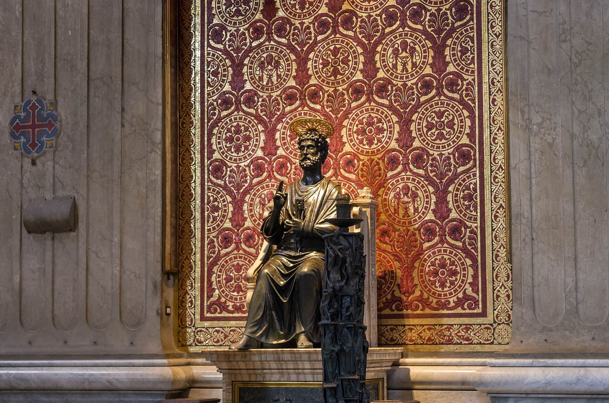</picture>
<figcaption>St Peter with the keys, the bronze statue in St Peter's Basilica traditionally attributed to Arnolfo di Cambio, late thirteenth century. Photo: <a href="https://commons.wikimedia.org/wiki/File:Statue_of_Saint_Peter_by_Arnolfo_di_Cambio_02.jpg">Antoine Taveneaux</a>, <a href="https://creativecommons.org/licenses/by-sa/3.0/">CC BY-SA 3.0</a>, via Wikimedia Commons.</figcaption>
</figure>

<figure class=photo><picture><source srcset="/static/art/peter-draught-600.webp 600w,/static/art/peter-draught.webp 1280w" sizes="(max-width:760px) 100vw,760px" type="image/webp">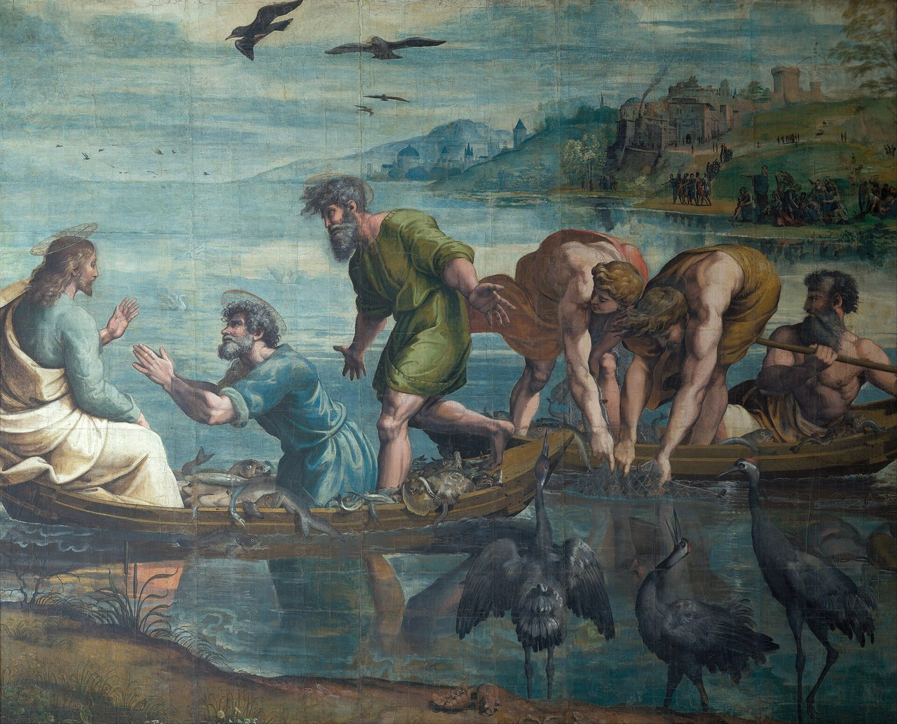</picture>
<figcaption>Raphael, <em>The Miraculous Draught of Fishes</em>, 1515–16, cartoon for a Sistine Chapel tapestry. Victoria and Albert Museum, London. Public domain, via <a href="https://commons.wikimedia.org/wiki/File:Raphael_-_The_Miraculous_Draft_of_Fishes_-_Google_Art_Project.jpg">Wikimedia Commons</a>.</figcaption>
</figure>

<h2 id=art>Peter in art</h2>

Artists have loved Peter because the Gospels let us see him so close: bold and afraid, sinking and standing, denying and confessing, until at last he follows his Lord even to the cross. The painting at the head of this page is one of the greatest of those last pictures.

In the Cerasi Chapel of Santa Maria del Popolo in Rome, **Caravaggio** (1600–01) paints the **Crucifixion of St Peter** as a labour. Three workmen strain to raise the inverted cross; the old apostle, already nailed, looks down into the darkness, not in despair but in a hard, obedient faith. There is almost no sky. The holiness is in the weight of the wood.

**Pietro Perugino**, on the north wall of the Sistine Chapel (1481–82), paints an earlier hour: the **Delivery of the Keys**. In a wide, calm square, Christ hands the golden and silver keys to a kneeling Peter, the other apostles watching, the Temple imagined behind them. It is the verse in Matthew made visible, and it has taught generations to see the gift of the keys.

**Raphael**, in the Stanza di Eliodoro in the Vatican (1514), paints the **Liberation of St Peter** from Acts 12. The fresco is a night scene in three lights: the soldiers sleeping in the prison, the angel waking Peter as the chains fall, and the apostle led out under a moon. The iron has dropped from his hands, as the Scripture says, and he does not yet know whether it is a vision.

In the Brancacci Chapel in Florence, **Masaccio** (about 1425) paints **The Tribute Money**, the story unique to Matthew (17:24–27). In one continuous space Peter appears three times: first at Christ's side as the Lord tells him to find a coin in the mouth of a fish; then at the water's edge, stooping for that coin; then paying the collector. It is among the founding pictures of the Renaissance, and it is still a picture of trust.

**Rembrandt**, in 1660, paints **The Denial of St Peter**, now in the Rijksmuseum in Amsterdam. A maid, holding a candle, accuses him; armour gleams; Peter's hands are raised in the old, sad protest, and his face already knows the cock is about to crow. The light is small, and it falls on him.

**Annibale Carracci**, about 1602, paints the legend of **Domine, quo vadis?** Christ, carrying his cross, meets Peter on the road out of Rome. The National Gallery in London keeps the little picture; it is a later story, and it has helped many to imagine the apostle turning back toward his death.

<figure class=photo><picture><source srcset="/static/art/peter-caravaggio-600.webp 600w,/static/art/peter-caravaggio.webp 1280w" sizes="(max-width:760px) 100vw,760px" type="image/webp">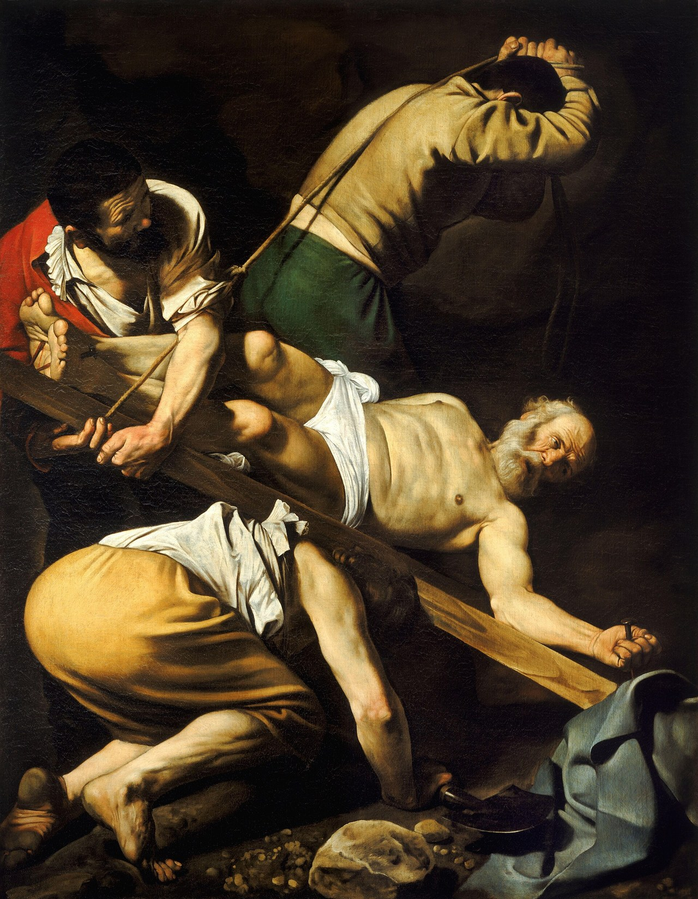</picture>
<figcaption>Caravaggio, <em>The Crucifixion of Saint Peter</em>, 1600–01. Cerasi Chapel, Santa Maria del Popolo, Rome. The painting also stands at the head of this page. Public domain, via <a href="https://commons.wikimedia.org/wiki/File:Crucifixion_of_Saint_Peter-Caravaggio_(c.1600).jpg">Wikimedia Commons</a>.</figcaption>
</figure>

<figure class=photo><picture><source srcset="/static/art/peter-perugino-600.webp 600w,/static/art/peter-perugino.webp 1280w" sizes="(max-width:760px) 100vw,760px" type="image/webp">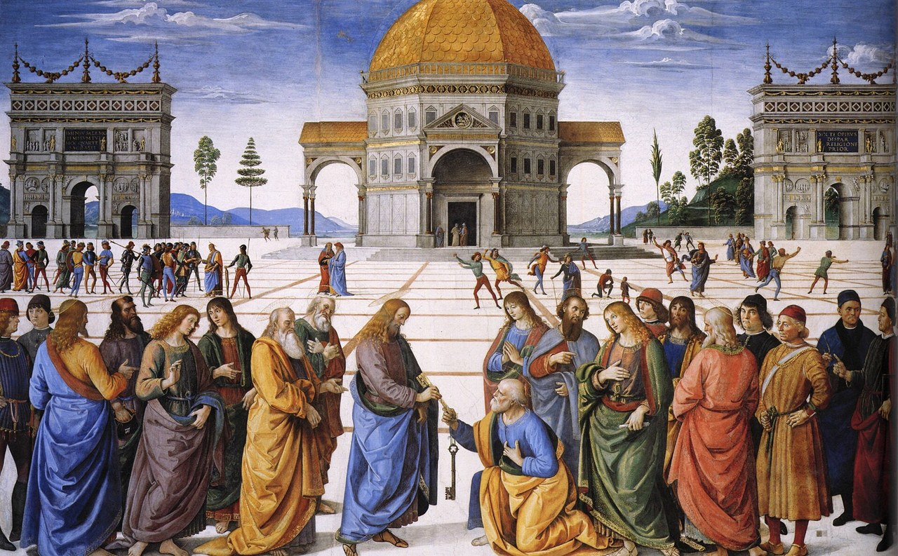</picture>
<figcaption>Pietro Perugino, <em>The Delivery of the Keys</em>, 1481–82. Sistine Chapel, Vatican. Public domain, via <a href="https://commons.wikimedia.org/wiki/File:Perugino_-_Entrega_de_las_llaves_a_San_Pedro_(Capilla_Sixtina,_1481-82).jpg">Wikimedia Commons</a>.</figcaption>
</figure>

<figure class=photo><picture><source srcset="/static/art/peter-raphael-liberation-600.webp 600w,/static/art/peter-raphael-liberation.webp 1280w" sizes="(max-width:760px) 100vw,760px" type="image/webp">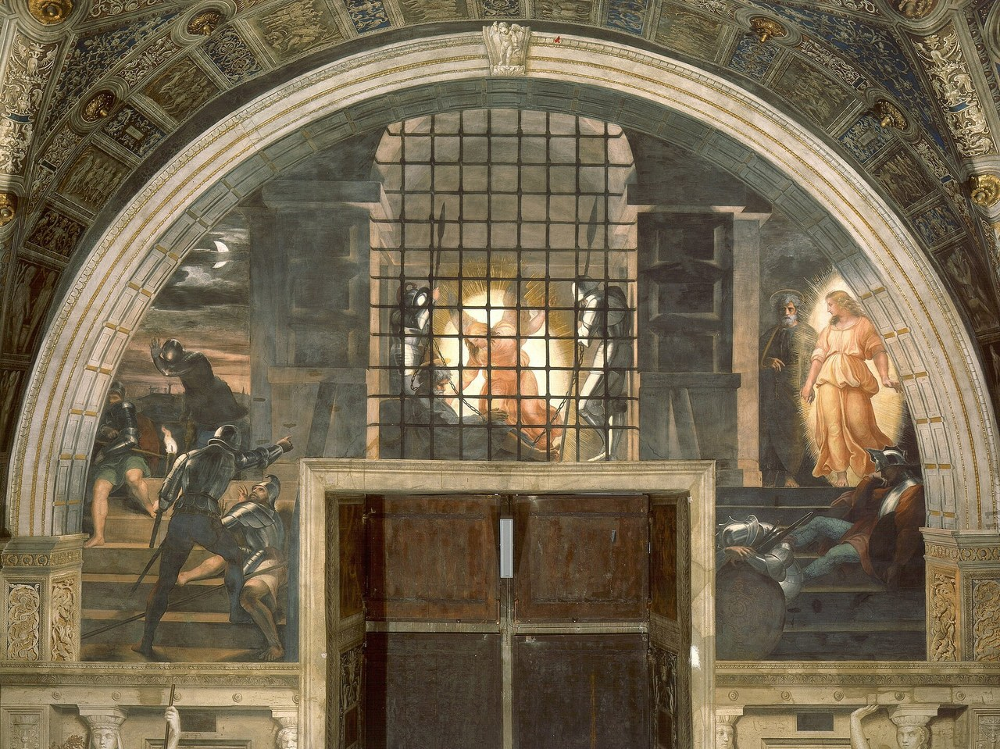</picture>
<figcaption>Raphael, <em>The Liberation of Saint Peter</em>, 1514. Stanza di Eliodoro, Vatican Museums. Public domain, via <a href="https://commons.wikimedia.org/wiki/File:Raphael_-_Deliverance_of_Saint_Peter.jpg">Wikimedia Commons</a>.</figcaption>
</figure>

<figure class=photo><picture><source srcset="/static/art/peter-masaccio-600.webp 600w,/static/art/peter-masaccio.webp 1280w" sizes="(max-width:760px) 100vw,760px" type="image/webp">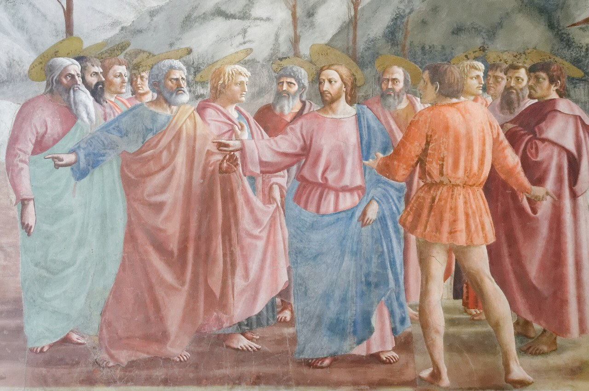</picture>
<figcaption>Masaccio, <em>The Tribute Money</em>, about 1425. Brancacci Chapel, Santa Maria del Carmine, Florence. Public domain, via <a href="https://commons.wikimedia.org/wiki/File:The_Tribute_Money_Masaccio_Cappella_Brancacci.jpg">Wikimedia Commons</a>.</figcaption>
</figure>

<figure class=photo><picture><source srcset="/static/art/peter-rembrandt-denial-600.webp 600w,/static/art/peter-rembrandt-denial.webp 1280w" sizes="(max-width:760px) 100vw,760px" type="image/webp">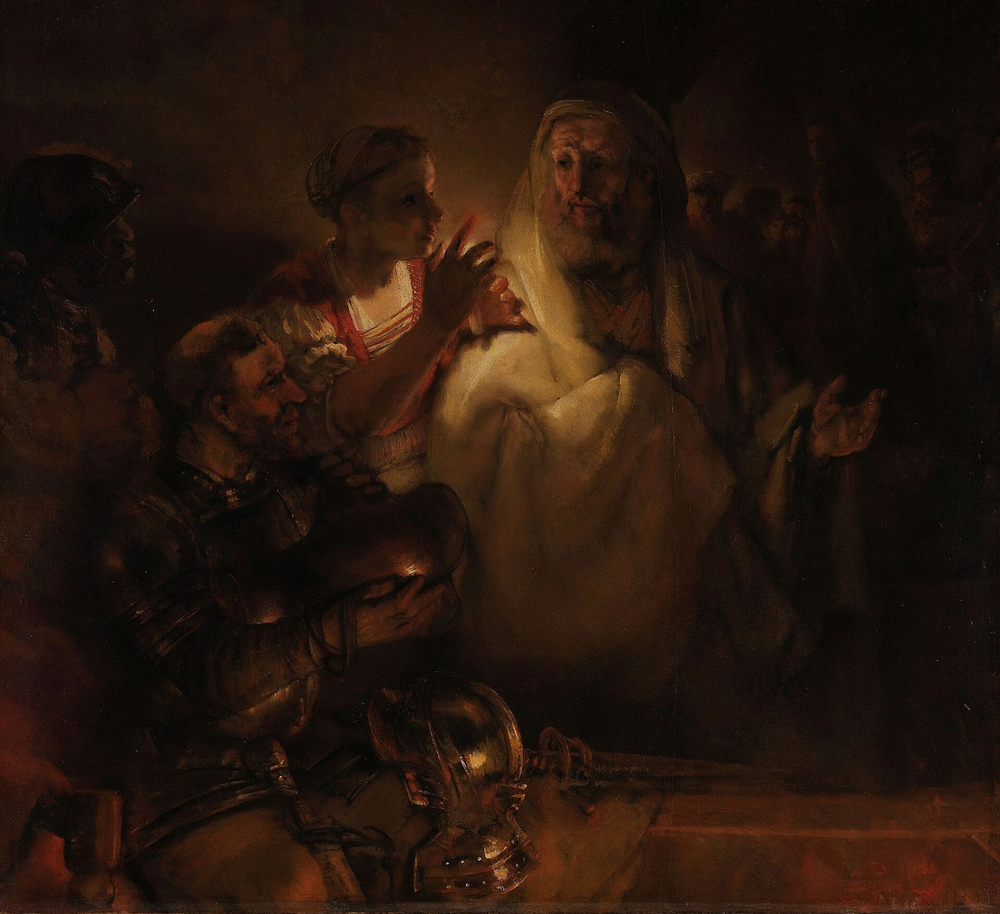</picture>
<figcaption>Rembrandt, <em>The Denial of Saint Peter</em>, 1660. Rijksmuseum, Amsterdam. Public domain, via <a href="https://commons.wikimedia.org/wiki/File:De_verloochening_van_Petrus_Rijksmuseum_SK-A-3137.jpeg">Wikimedia Commons</a>.</figcaption>
</figure>

<figure class=photo><picture><source srcset="/static/art/peter-carracci-600.webp 600w,/static/art/peter-carracci.webp 1280w" sizes="(max-width:760px) 100vw,760px" type="image/webp">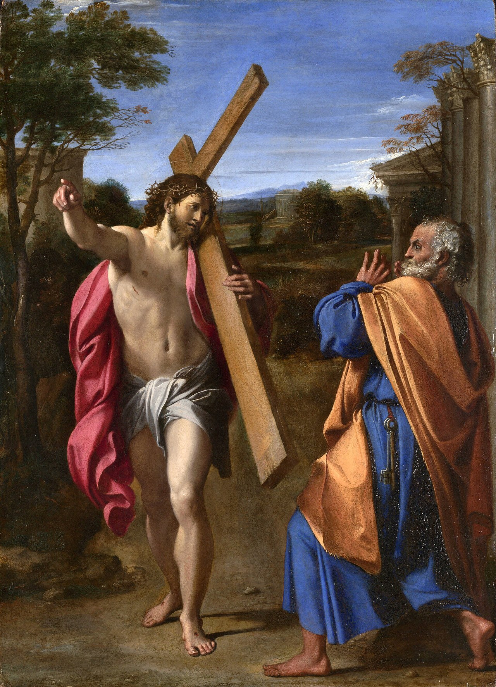</picture>
<figcaption>Annibale Carracci, <em>Domine, quo vadis?</em>, about 1602. National Gallery, London. Public domain, via <a href="https://commons.wikimedia.org/wiki/File:Domine,_quo_vadis.jpg">Wikimedia Commons</a>.</figcaption>
</figure>

## Path to sainthood
An apostle, venerated from the beginning. No formal canonisation (pre-Congregation). Catholic tradition regards him as the first pope.

## Patronages
Fishermen, net makers, popes, and locksmiths (the keys of the kingdom).

<h2 id=visit>Where to visit</h2>

**St Peter's Basilica** in Vatican City is the great church of his memory, raised over the grave that Christians have honoured on the Vatican Hill since the second century. Bernini's bronze baldachin stands above the papal altar and the confessio; below, in the niche of the pallia, a mosaic of Christ looks out over the place of the tomb. The **Scavi**, the excavations under the basilica, can be visited only on a small guided tour booked in advance. What can be seen there, and what Pope Paul VI said of the bones in 1968, is told briefly in the notes below.

<figure class=photo><picture><source srcset="/static/art/peter-basilica-600.webp 600w,/static/art/peter-basilica.webp 1280w" sizes="(max-width:760px) 100vw,760px" type="image/webp">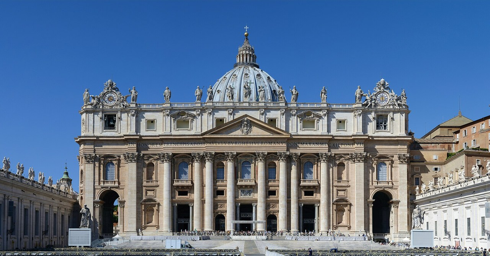</picture>
<figcaption>St Peter's Basilica, Vatican City. Photo: <a href="https://commons.wikimedia.org/wiki/File:Basilica_di_San_Pietro_in_Vaticano_September_2015-1a.jpg">Alvesgaspar</a>, <a href="https://creativecommons.org/licenses/by-sa/4.0/">CC BY-SA 4.0</a>, via Wikimedia Commons.</figcaption>
</figure>

<figure class=photo><picture><source srcset="/static/art/peter-baldachin-600.webp 600w,/static/art/peter-baldachin.webp 1280w" sizes="(max-width:760px) 100vw,760px" type="image/webp">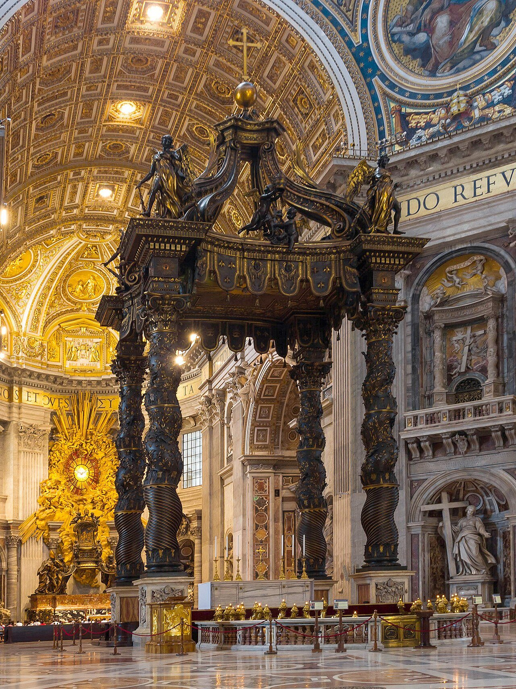</picture>
<figcaption>Bernini's bronze baldachin (1623–34) over the papal altar and the confessio above Peter's tomb. Photo: <a href="https://commons.wikimedia.org/wiki/File:Baldaquin_Bernin_Saint-Pierre_Vatican.jpg">Jebulon</a>, <a href="https://creativecommons.org/publicdomain/zero/1.0/">CC0</a>, via Wikimedia Commons.</figcaption>
</figure>

<figure class=photo><picture><source srcset="/static/art/peter-confessio-600.webp 600w,/static/art/peter-confessio.webp 1280w" sizes="(max-width:760px) 100vw,760px" type="image/webp">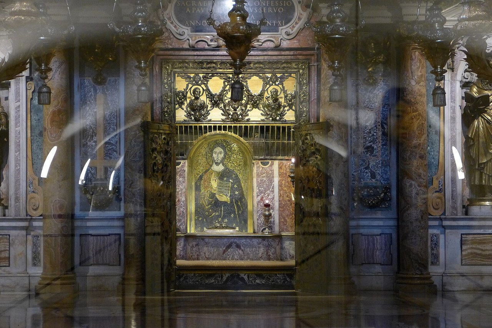</picture>
<figcaption>The Niche of the Pallia in the confessio of St Peter's, directly above the traditional tomb of the apostle. Photo: <a href="https://commons.wikimedia.org/wiki/File:Rom,_Vatikan,_Petrusgrab_unterhalb_des_Papstaltars_des_Petersdoms_in_den_Vatikanischen_Grotten.jpg">Dnalor 01</a>, <a href="https://creativecommons.org/licenses/by-sa/3.0/at/">CC BY-SA 3.0 AT</a>, via Wikimedia Commons.</figcaption>
</figure>

On the shore of Galilee two places keep his memory in the landscape of the Gospels. At **Capernaum**, under a modern memorial church, excavations have uncovered a first-century house that was already being honoured as a place of prayer by the fourth century. Tradition knows it as the **house of Peter**, where Jesus healed the apostle's mother-in-law. A little way along the lake, at **Tabgha**, the modest black-basalt **Church of the Primacy of St Peter** stands by the water, at the place remembered for the breakfast after the Resurrection and the words "Feed my sheep."

<figure class=photo><picture><source srcset="/static/art/peter-capernaum-house-600.webp 600w,/static/art/peter-capernaum-house.webp 1280w" sizes="(max-width:760px) 100vw,760px" type="image/webp">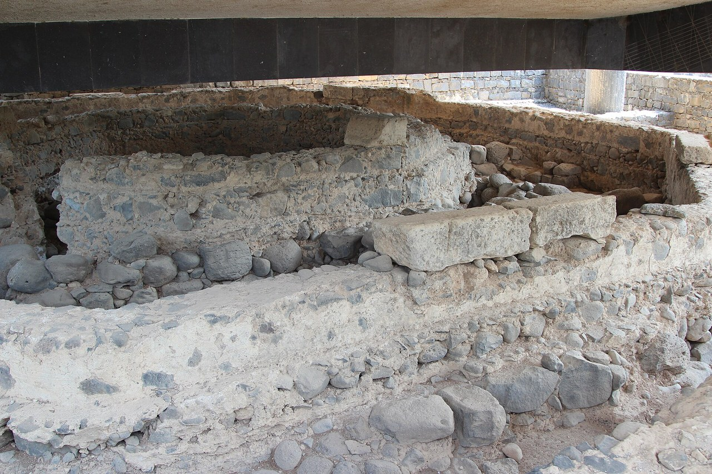</picture>
<figcaption>The remains traditionally identified as the house of Peter, Capernaum, under the modern memorial church. Photo: <a href="https://commons.wikimedia.org/wiki/File:Holy_Land_2016_P0456_Capernaum_ruins_of_Saint_Peters_House_under_Saint_Peter_Church.jpg">Fallaner</a>, <a href="https://creativecommons.org/licenses/by-sa/4.0/">CC BY-SA 4.0</a>, via Wikimedia Commons.</figcaption>
</figure>

<figure class=photo><picture><source srcset="/static/art/peter-tabgha-600.webp 600w,/static/art/peter-tabgha.webp 1280w" sizes="(max-width:760px) 100vw,760px" type="image/webp">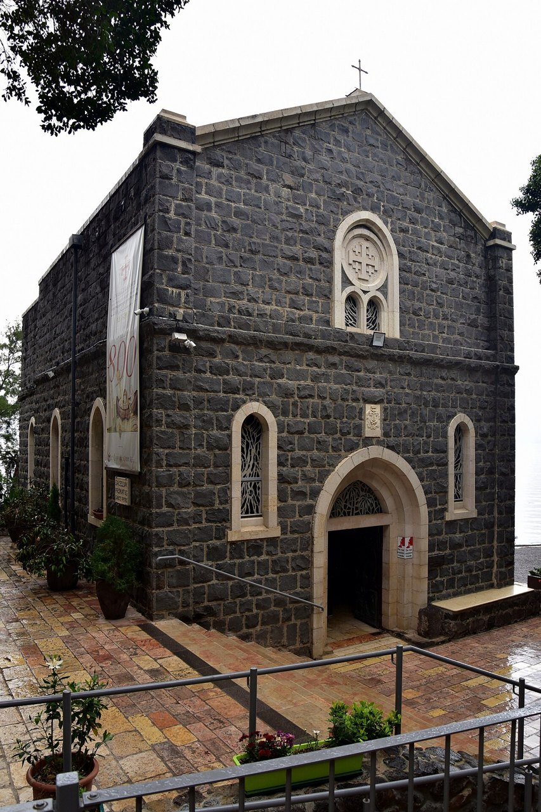</picture>
<figcaption>The Church of the Primacy of St Peter, Tabgha, on the shore of the Sea of Galilee. Photo: <a href="https://commons.wikimedia.org/wiki/File:Church_of_the_Primacy_of_St_Peter,_2019_(01).jpg">Bahnfrend</a>, <a href="https://creativecommons.org/licenses/by-sa/4.0/">CC BY-SA 4.0</a>, via Wikimedia Commons.</figcaption>
</figure>

On the eastern slope of Mount Zion in Jerusalem stands **St Peter in Gallicantu**, "at the cockcrow." The church marks the traditional site of the house of Caiaphas, and of Peter's denial. A golden rooster on the roof makes the name visible. In Rome, just outside the Appian Way, the little church of **Santa Maria in Palmis**, better known as **Domine Quo Vadis**, keeps the legend of that meeting on the road. Nearby, **San Pietro in Vincoli** — St Peter in Chains — holds the relic of the chains from which, in the story of Acts 12, the angel set him free; Michelangelo's *Moses* is in the same church, but the chains are why it bears Peter's name.

In **Antakya**, ancient Antioch, the **Church of St Peter** is still a cave in the cliff, with a modest stone façade. Tradition says the first Christians of that city gathered in this rock. Whether or not the walls are as old as the apostle, the place has long been honoured as a shrine of the church he shepherded there.

<figure class=photo><picture><source srcset="/static/art/peter-gallicantu-600.webp 600w,/static/art/peter-gallicantu.webp 1280w" sizes="(max-width:760px) 100vw,760px" type="image/webp">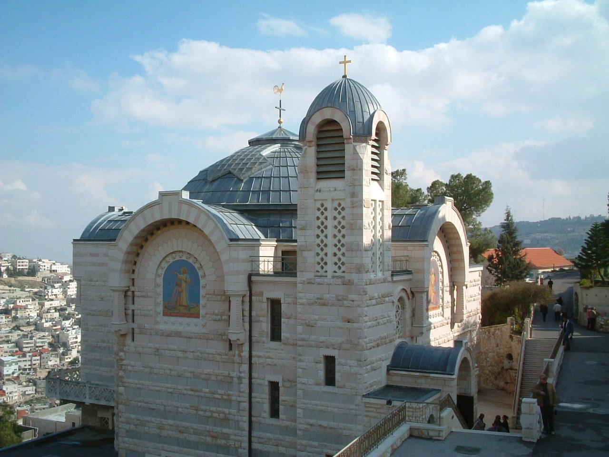</picture>
<figcaption>St Peter in Gallicantu, Jerusalem. The golden rooster on the roof remembers the cockcrow of the denial. Photo: <a href="https://commons.wikimedia.org/wiki/File:Church_of_Saint_Peter_in_Gallicantu.jpg">Victor Rivera Melendez</a>, <a href="https://creativecommons.org/licenses/by-sa/3.0/">CC BY-SA 3.0</a>, via Wikimedia Commons.</figcaption>
</figure>

<figure class=photo><picture><source srcset="/static/art/peter-quo-vadis-600.webp 600w,/static/art/peter-quo-vadis.webp 1280w" sizes="(max-width:760px) 100vw,760px" type="image/webp">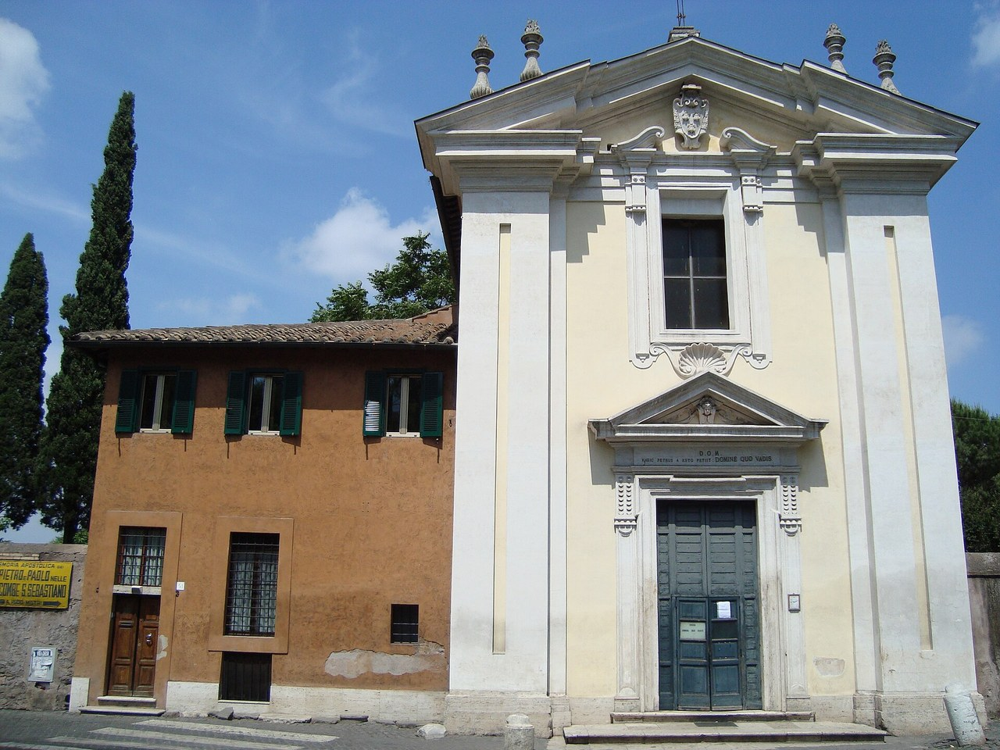</picture>
<figcaption>Santa Maria in Palmis, the church of Domine Quo Vadis, on the Appian Way, Rome. Photo: <a href="https://commons.wikimedia.org/wiki/File:Eglise_Domine_Quo_Vadis_de_Rome.JPG">LPLT</a>, <a href="https://creativecommons.org/licenses/by-sa/3.0/">CC BY-SA 3.0</a>, via Wikimedia Commons.</figcaption>
</figure>

<figure class=photo><picture><source srcset="/static/art/peter-vincoli-600.webp 600w,/static/art/peter-vincoli.webp 1280w" sizes="(max-width:760px) 100vw,760px" type="image/webp">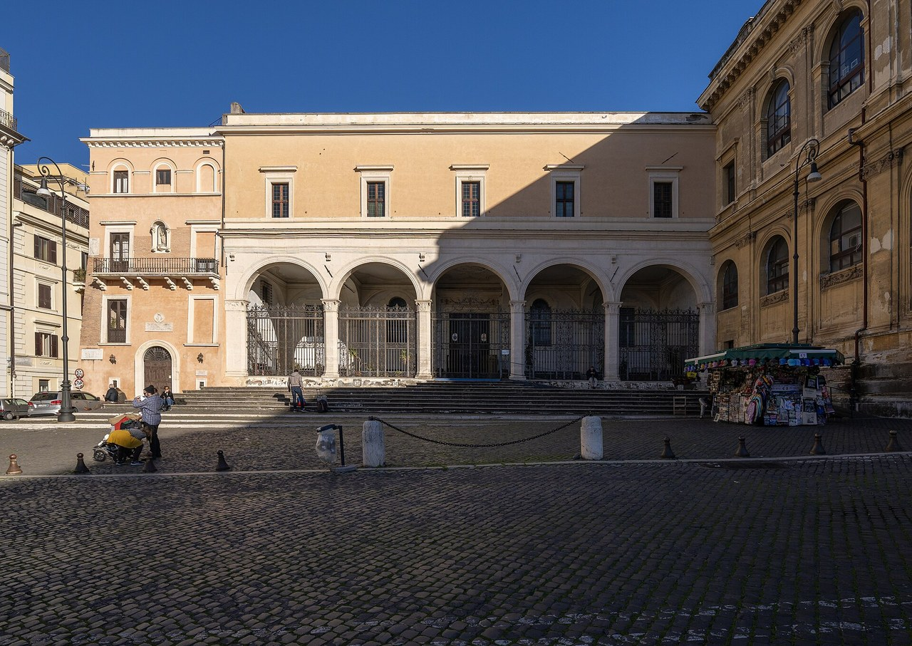</picture>
<figcaption>San Pietro in Vincoli, Rome. Photo: <a href="https://commons.wikimedia.org/wiki/File:San_Pietro_in_Vincoli_-_esterno.jpg">Rione I Monti</a>, <a href="https://creativecommons.org/licenses/by/4.0/">CC BY 4.0</a>, via Wikimedia Commons.</figcaption>
</figure>

<figure class=photo><picture><source srcset="/static/art/peter-chains-600.webp 600w,/static/art/peter-chains.webp 1280w" sizes="(max-width:760px) 100vw,760px" type="image/webp">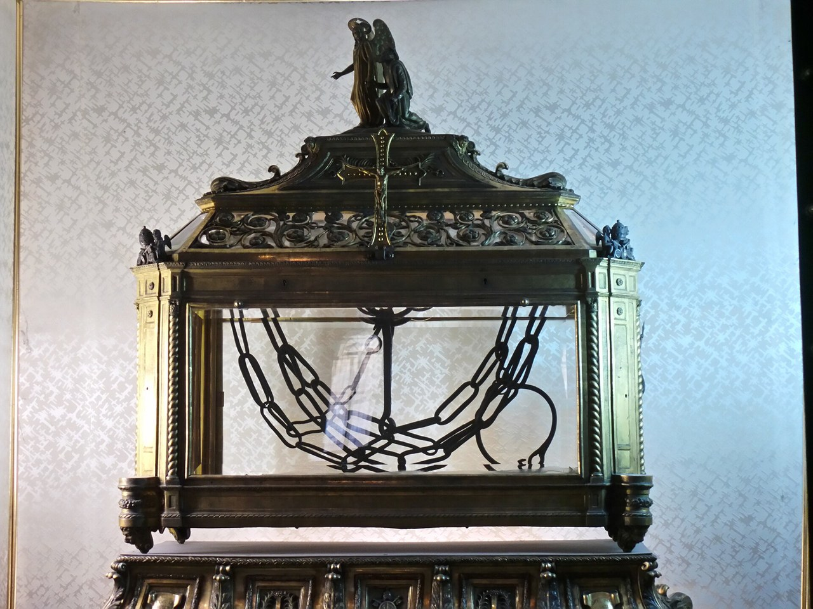</picture>
<figcaption>The chains of St Peter, San Pietro in Vincoli, Rome. Photo: <a href="https://commons.wikimedia.org/wiki/File:Ketten_des_Petrus.jpg">Rabax63</a>, <a href="https://creativecommons.org/licenses/by-sa/4.0/">CC BY-SA 4.0</a>, via Wikimedia Commons.</figcaption>
</figure>

<figure class=photo><picture><source srcset="/static/art/peter-antioch-600.webp 600w,/static/art/peter-antioch.webp 1280w" sizes="(max-width:760px) 100vw,760px" type="image/webp">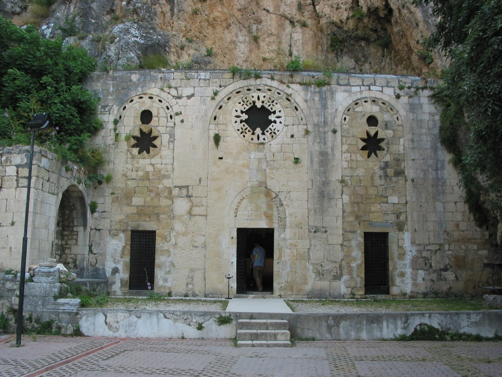</picture>
<figcaption>The cave church of St Peter, Antakya (ancient Antioch). Photo: <a href="https://commons.wikimedia.org/wiki/File:Antioch_Saint_Pierre_Church_Front.JPG">Volkan Hatem</a>, <a href="https://creativecommons.org/licenses/by/2.5/">CC BY 2.5</a>, via Wikimedia Commons.</figcaption>
</figure>

## Trivia
- Early tradition (recorded by Origen, via Eusebius) says he asked to be **crucified upside down**, feeling unworthy to die as Jesus did.
- Excavations under St Peter's Basilica in the 1940s–60s found a 1st-century tomb area. On **26 June 1968** **Pope Paul VI** announced that bones found there had been identified "in a way we can consider convincing" as Peter's, based largely on Margherita Guarducci's work. He stopped short of certainty, and scholars still debate it.
- Peter's in-law appears in the Gospels: Jesus healed his **mother-in-law** (Mark 1:30), so Peter was married.

## Sources
- [Benedict XVI, General Audience "Peter, the rock" (7 Jun 2006), vatican.va](https://www.vatican.va/content/benedict-xvi/en/audiences/2006/documents/hf_ben-xvi_aud_20060607.html)
- [Vatican News: St Peter](https://www.vaticannews.va/en/saints/06/29/saint-peter--apostle-of-the-city-of-rome.html)
- [Britannica: St Peter the Apostle](https://www.britannica.com/biography/Saint-Peter-the-Apostle)
- [Catholic Encyclopedia: St Peter](https://www.newadvent.org/cathen/11744a.htm) (Origen on the upside-down crucifixion)
- [AP: Vatican unveils bone fragments said to be Peter's](https://apnews.com/general-news-f8e5f9f5489d450d8224ecb4fc28737e)
- [Wikipedia: Saint Peter](https://en.wikipedia.org/wiki/Saint_Peter), [St. Peter's Basilica](https://en.wikipedia.org/wiki/St._Peter%27s_Basilica), [Saint Peter's tomb](https://en.wikipedia.org/wiki/Saint_Peter%27s_tomb), [Church of the Primacy of Saint Peter](https://en.wikipedia.org/wiki/Church_of_the_Primacy_of_Saint_Peter), [Church of Saint Peter in Gallicantu](https://en.wikipedia.org/wiki/Church_of_Saint_Peter_in_Gallicantu), [Santa Maria in Palmis](https://en.wikipedia.org/wiki/Santa_Maria_in_Palmis), [San Pietro in Vincoli](https://en.wikipedia.org/wiki/San_Pietro_in_Vincoli) and [Church of Saint Peter (Antioch)](https://en.wikipedia.org/wiki/Church_of_Saint_Peter)
- [Wikipedia: The Crucifixion of Saint Peter (Caravaggio)](https://en.wikipedia.org/wiki/Crucifixion_of_Saint_Peter_(Caravaggio)), [Delivery of the Keys (Perugino)](https://en.wikipedia.org/wiki/Delivery_of_the_Keys_(Perugino)), [The Liberation of Saint Peter](https://en.wikipedia.org/wiki/Liberation_of_Saint_Peter_(Raphael)), [The Tribute Money (Masaccio)](https://en.wikipedia.org/wiki/The_Tribute_Money_(Masaccio)), [The Denial of Saint Peter (Rembrandt)](https://en.wikipedia.org/wiki/The_Denial_of_Saint_Peter_(Rembrandt)) and [Domine, quo vadis?](https://en.wikipedia.org/wiki/Domine,_quo_vadis%3F)
- [National Gallery, London: Carracci, Domine, quo vadis?](https://www.nationalgallery.org.uk/paintings/annibale-carracci-christ-appearing-to-saint-peter-on-the-appian-way)
- [Rijksmuseum: Rembrandt, The Denial of St Peter](https://www.rijksmuseum.nl/en/collection/SK-A-3137)
- Greek of Matthew 16:18 from the [SBL Greek New Testament](https://sblgnt.com/). Latin from the Vulgate.

Fact-checked on October 15, 2026 against New Advent (Catholic Encyclopedia), Vatican documents and news reports. Britannica links are given for further reading. Feast days follow the General Roman Calendar. Expanded November 13, 2026 with additional Scripture, art and places of pilgrimage, using Wikimedia Commons, museum catalogues and standard references. Scripture is quoted briefly from the public-domain King James Version, with the Greek of Matthew 16:18 from the SBLGNT and the Latin from the Vulgate. Where a story is legend rather than history, the text says so.

