<nav class=toc aria-label="On this page">

On this page

<ol>
<li><a href="#why">Why the Church honours him</a></li>
<li><a href="#bethsaida">A Greek name in Bethsaida</a></li>
<li><a href="#follow">"Follow me"</a></li>
<li><a href="#come">"Come and see"</a></li>
<li><a href="#bread">"Whence shall we buy bread?"</a></li>
<li><a href="#greeks">"Sir, we would see Jesus"</a></li>
<li><a href="#father">"Lord, shew us the Father"</a></li>
<li><a href="#pentecost">The Upper Room and Pentecost</a></li>
<li><a href="#two">Two Philips: the Apostle and the Evangelist</a></li>
<li><a href="#hierapolis">Hierapolis: the city of the hot springs</a></li>
<li><a href="#legend">The Acts of Philip: the serpent, Mariamne and Bartholomew</a></li>
<li><a href="#tomb">The Martyrion and the tomb found in 2011</a></li>
<li><a href="#relics">His relics: Constantinople, Rome and Florence</a></li>
<li><a href="#calendars">The two calendars</a></li>
<li><a href="#places">His places and churches</a></li>
<li><a href="#art">Philip in art</a></li>
</ol>
</nav>

## His story

He was from Bethsaida, the fishing town of Peter and Andrew, and he had a Greek name. Jesus went looking for him and said two words: "Follow me." **St Philip** did, and at once went looking for someone else. When his friend Nathanael scoffed that nothing good could come out of Nazareth, Philip did not argue. He said, "Come and see." That is the whole of his character in three words, and it has made him the patron, in spirit, of everyone who has ever brought a friend to meet Christ.

St John's Gospel gives Philip more lines than the other three Gospels together, and they are some of the most human in the New Testament. He is the practical man who works out what bread for five thousand would cost. He is the one the Greek pilgrims come to when they want to see Jesus. And on the night before the Passion he asks the question in many of our hearts, "Lord, shew us the Father," and receives one of the greatest answers Jesus ever gave: "he that hath seen me hath seen the Father."

After Pentecost the New Testament falls silent about him. The early Church remembered that he died and was buried at **Hierapolis** in Phrygia, the white-terraced spa town now called Pamukkale in Turkey, and in 2011 archaeologists found the tomb that pilgrims had venerated there for centuries. Along the way his memory became tangled with that of another Philip, the deacon and evangelist of the Acts of the Apostles, and a later book, the *Acts of Philip*, filled the gaps with dragons and serpents. Where a story comes from legend rather than history, we say so, gently, and tell it anyway, because the Church has loved these stories for a very long time.

### Early 1st century · Bethsaida
Philip grows up in **Bethsaida**, on the north shore of the Sea of Galilee, "the city of Andrew and Peter" (John 1:44).

### c. AD 28 · "Follow me"
The day after Andrew and Peter meet Jesus by the Jordan, Jesus "findeth Philip, and saith unto him, Follow me" (John 1:43).

### The same days · "Come and see"
Philip brings **Nathanael** to Jesus (John 1:45–46).

### The years with Jesus · Loaves, Greeks and the Father
Jesus tests him before feeding the five thousand (John 6:5–7). Greek pilgrims ask him to see Jesus (John 12:20–22). At the Last Supper he asks, "Lord, shew us the Father" (John 14:8–9).

### c. AD 30 · Pentecost
He is named with the apostles in the Upper Room (Acts 1:13), waiting in prayer for the Holy Spirit.

### Later 1st century (tradition) · Asia and Phrygia
Tradition says he preached in the Greek world of Asia Minor, and that he died at **Hierapolis** in Phrygia.

### c. 190 · "Philip, one of the twelve apostles, who sleeps in Hierapolis"
**Polycrates**, bishop of Ephesus, names him among the "great lights" of Asia in a letter to Pope Victor.

### Early 5th century · The Martyrion
A great octagonal shrine, the **Martyrion**, rises on the hill above Hierapolis, beside a church built around his tomb.

### c. 570 · Rome
Relics venerated as those of Philip and **James the Less** are laid beneath the altar of the new basilica of the **Holy Apostles** in Rome.

### 1205 · Florence
A relic of his arm comes from the East to the Baptistery of Florence.

### 2011 · The tomb found
Francesco D'Andria's Italian mission uncovers the 1st-century tomb at the heart of the pilgrimage church of Hierapolis.

<figure class=photo>
<picture><source srcset="/static/art/philip-ravenna-600.webp 600w,/static/art/philip-ravenna.webp 1280w" sizes="(max-width:760px) 100vw,760px" type="image/webp">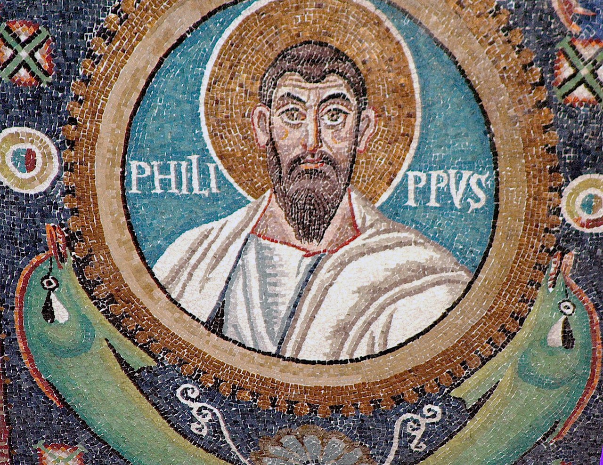</picture>
<figcaption>St Philip in a mosaic medallion in the <b>Basilica of San Vitale, Ravenna</b>, from the 6th century, among the apostles on the great arch before the sanctuary. It is one of the oldest portraits of him that survive. Photo: <a href="https://commons.wikimedia.org/wiki/File:Philip_the_Apostle._Detail_of_the_mosaic_in_the_Basilica_of_San_Vitale._Ravena,_Italy.jpg">Philip the Apostle. Detail of the mosaic in the Basilica of San Vitale. Ravena, Italy</a> by Richard Mortel, <a href="https://creativecommons.org/licenses/by/2.0">CC BY 2.0</a>, via Wikimedia Commons.</figcaption>
</figure>

<h2 id=why>Why the Church honours him</h2>

- **He answered at once.** Jesus came looking for him, and Philip followed. We are not told that he asked a single question.
- **He brought others to Christ.** His first act as a disciple was to find Nathanael, and when Nathanael doubted, Philip did not argue. He said, "Come and see."
- **He was honest about what he did not understand.** He worked out that bread for the crowd was impossible, and he asked to be shown the Father. Jesus answered him patiently both times, and the Church still lives on those answers.
- **He was a bridge to the Greeks.** With his Greek name and his home on the edge of the Greek-speaking world, he was the one the first Greek seekers turned to.
- **He carried the Gospel into Asia.** The earliest bishops of Asia Minor remembered his tomb at Hierapolis as one of the "great lights" of their Church, beside the tomb of St John at Ephesus.
- **He gave his life for Christ.** Tradition remembers him as a martyr, and his tomb was a place of pilgrimage for centuries.

<h2 id=bethsaida>A Greek name in Bethsaida</h2>

**Bethsaida**, the "house of fishing," stood near the place where the Jordan runs into the Sea of Galilee from the north. It was the home town of three of the Twelve. "Now Philip was of Bethsaida," St John writes, "the city of Andrew and Peter" (John 1:44). Like his neighbours, Philip probably grew up among fishermen, boats and nets.

His name tells us something about his world. *Philippos* is a Greek name, meaning "lover of horses," the name of the father of Alexander the Great. Bethsaida lay just across the Jordan in the territory of Herod Philip, one of Herod the Great's sons, who rebuilt it as a city and named it Julias in honour of the emperor's family. In Galilee, Jewish faith and Greek language lived side by side, and it is no surprise that Philip and Andrew, the two apostles with Greek names, would be the ones the Greek pilgrims came to.

<figure class=photo>
<picture><source srcset="/static/art/philip-galilee-600.webp 600w,/static/art/philip-galilee.webp 1280w" sizes="(max-width:760px) 100vw,760px" type="image/webp">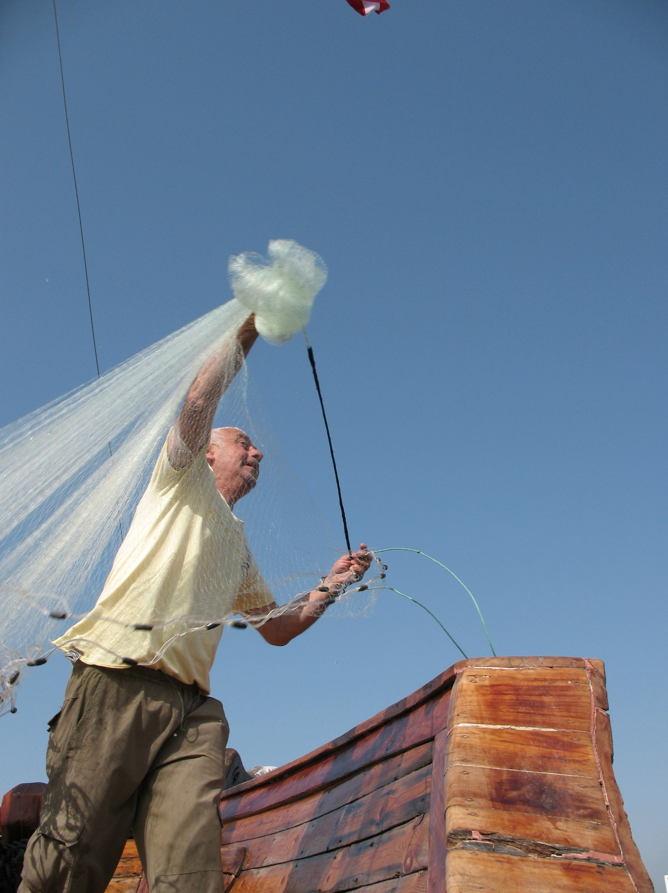</picture>
<figcaption>Casting a net from a boat on the <b>Sea of Galilee</b>. Philip grew up among the fishermen of this lake, whose work Jesus turned into a picture of the apostles' mission. Photo: <a href="https://commons.wikimedia.org/wiki/File:Net_fishing_on_Sea_of_Galilee_0865_(507838951).jpg">Net fishing on Sea of Galilee 0865 (507838951)</a> by James Emery, <a href="https://creativecommons.org/licenses/by/2.0">CC BY 2.0</a>, via Wikimedia Commons.</figcaption>
</figure>

<h2 id=follow>"Follow me"</h2>

St John tells the story of the first disciples day by day. Andrew and another disciple of John the Baptist followed Jesus and stayed with him; the next day Andrew brought his brother Simon Peter. And then:

> The day following Jesus would go forth into Galilee, and findeth Philip, and saith unto him, Follow me. (John 1:43)

Every other disciple in that first chapter is brought to Jesus by someone else. Philip is the only one whom Jesus himself goes out to find. We are told nothing of what Philip said or felt, only what he did next.

<h2 id=come>"Come and see"</h2>

> Philip findeth Nathanael, and saith unto him, We have found him, of whom Moses in the law, and the prophets, did write, Jesus of Nazareth, the son of Joseph. And Nathanael said unto him, Can there any good thing come out of Nazareth? Philip saith unto him, Come and see. (John 1:45–46)

Nathanael, of **Cana** in Galilee (John 21:2), knew the scriptures, and he knew Nazareth, a small village with nothing in the prophets to recommend it. Philip did not try to win the argument. He simply invited him to meet Jesus for himself. And when Nathanael came, Jesus greeted him as "an Israelite indeed, in whom is no guile," and told him, "Before that Philip called thee, when thou wast under the fig tree, I saw thee." Nathanael's doubt fell away at once: "Rabbi, thou art the Son of God; thou art the King of Israel" (John 1:47–49).

The Church has long identified Nathanael with the apostle [Bartholomew](/saints/bartholomew/), whose name follows Philip's in the lists of the Twelve in Matthew, Mark and Luke. If that is right, the two friends were called together and stayed together, and the old *Acts of Philip*, as we shall see, sends them out on their last mission side by side.

<h2 id=bread>"Whence shall we buy bread?"</h2>

One spring, near the Passover, a great crowd followed Jesus to a hillside by the lake. St John tells us that Jesus turned to Philip, the local man who would know the shops and markets of the district:

> When Jesus then lifted up his eyes, and saw a great company come unto him, he saith unto Philip, Whence shall we buy bread, that these may eat? And this he said to prove him: for he himself knew what he would do. Philip answered him, Two hundred pennyworth of bread is not sufficient for them, that every one of them may take a little. (John 6:5–7)

Two hundred "pennies," or denarii, was roughly two hundred days' wages for a labourer. Philip had done the sum quickly and correctly, and it was hopeless. Then Andrew found a boy with five barley loaves and two small fishes, and Jesus fed the whole multitude with them, with twelve baskets left over. The test was not whether Philip could count. It was whether he would learn to trust the Lord with what could not be counted.

<h2 id=greeks>"Sir, we would see Jesus"</h2>

In the last week of Jesus' life, Jerusalem was full of pilgrims for the Passover, among them some Greeks who had come to worship the God of Israel:

> The same came therefore to Philip, which was of Bethsaida of Galilee, and desired him, saying, Sir, we would see Jesus. Philip cometh and telleth Andrew: and again Andrew and Philip tell Jesus. (John 12:21–22)

"Sir, we would see Jesus." Generations of preachers have found those words carved into their pulpits, as a reminder of what people come to church for. Jesus answered them with words about his coming Passion: "Except a corn of wheat fall into the ground and die, it abideth alone: but if it die, it bringeth forth much fruit" (John 12:24). The first Greeks to seek him were a sign of the harvest of all the nations that would grow from the Cross.

<h2 id=father>"Lord, shew us the Father"</h2>

At the Last Supper, Jesus told his apostles that he was going to prepare a place for them, and that he was the way, the truth and the life. "If ye had known me, ye should have known my Father also: and from henceforth ye know him, and have seen him." Philip could not quite take it in:

> Philip saith unto him, Lord, shew us the Father, and it sufficeth us. Jesus saith unto him, Have I been so long time with you, and yet hast thou not known me, Philip? he that hath seen me hath seen the Father; and how sayest thou then, Shew us the Father? (John 14:8–9)

It is a gentle rebuke, and a tremendous revelation. Philip had been with Jesus for three years, and the face of God had been in front of him all along. "Believest thou not that I am in the Father, and the Father in me?" (John 14:10). Philip's honest question has given every Christian since one of the clearest statements of who Jesus is.

<h2 id=pentecost>The Upper Room and Pentecost</h2>

Philip was with the others when the risen Lord appeared to them, and after the Ascension St Luke names him in the Upper Room: "Peter, and James, and John, and Andrew, Philip, and Thomas, Bartholomew, and Matthew..." (Acts 1:13). There, with Mary the mother of Jesus, they "continued with one accord in prayer and supplication." On the day of **Pentecost** the Holy Spirit came upon them "as of fire," and the man from Bethsaida began his work as an apostle. From this point the New Testament never mentions him again.

<h2 id=two>Two Philips: the Apostle and the Evangelist</h2>

There is another Philip in the Acts of the Apostles, and it is easy to mix them up, as Christians have done since the 2nd century.

After Pentecost the apostles chose seven men "of honest report, full of the Holy Ghost and wisdom" to serve the poor of the Jerusalem Church, and the second name after Stephen was **Philip** (Acts 6:5). When persecution scattered the Church, this Philip "went down to the city of Samaria, and preached Christ unto them" (Acts 8:5). An angel then sent him to the desert road from Jerusalem to Gaza, where he met an Ethiopian official reading Isaiah in his chariot. "Understandest thou what thou readest?" Philip asked, and the man replied, "How can I, except some man should guide me?" Philip told him the good news of Jesus, and when they came to water the Ethiopian said, "See, here is water; what doth hinder me to be baptized?" (Acts 8:26–39). Years later, St Paul and St Luke stayed at Caesarea "in the house of Philip the evangelist, which was one of the seven," who "had four daughters, virgins, which did prophesy" (Acts 21:8–9). St Luke keeps the two Philips quite distinct.

<figure class=photo>
<picture><source srcset="/static/art/philip-rembrandt-600.webp 600w,/static/art/philip-rembrandt.webp 1280w" sizes="(max-width:760px) 100vw,760px" type="image/webp">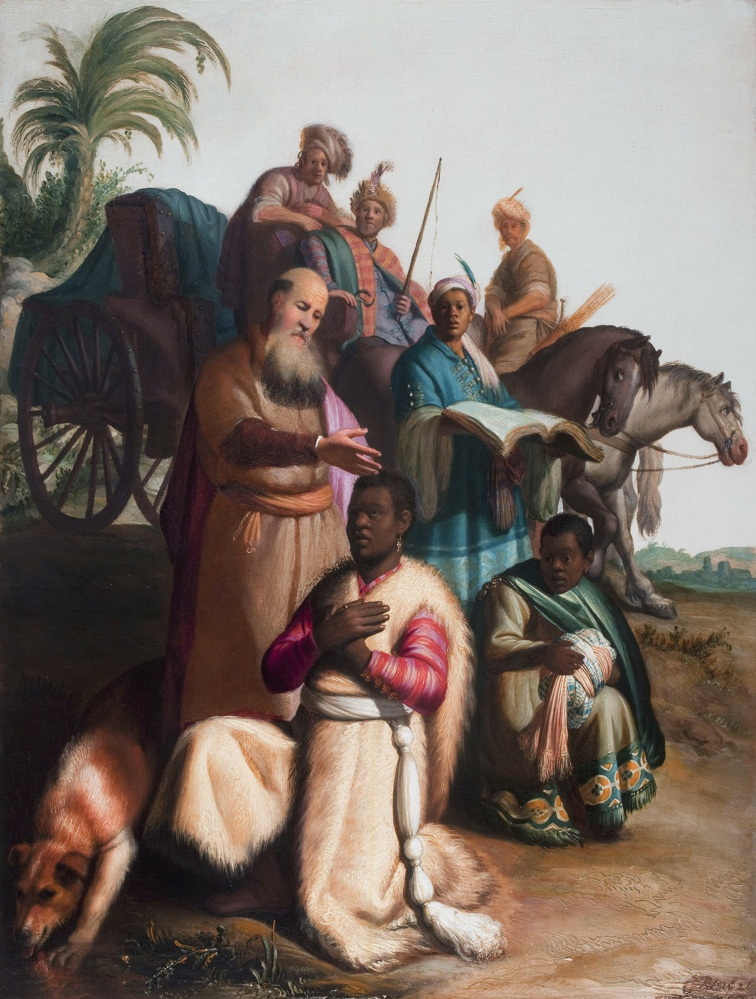</picture>
<figcaption><i>The Baptism of the Eunuch</i>, painted by the young <b>Rembrandt</b> in 1626. This is Philip the Evangelist, one of the seven deacons, baptising the Ethiopian on the road to Gaza. Museum Catharijneconvent, Utrecht. Image: <a href="https://commons.wikimedia.org/wiki/File:Rembrandt,_The_Baptism_of_the_Eunuch,_1626,_Museum_Catharijneconvent,_Utrecht.jpg">Rembrandt, The Baptism of the Eunuch, 1626, Museum Catharijneconvent, Utrecht</a>, public domain, via Wikimedia Commons.</figcaption>
</figure>

Later writers did not always do the same. The historian **Eusebius** collected the evidence in the 4th century. **Polycrates**, bishop of Ephesus, writing about the year 190, counted among the "great lights" of Asia:

> "Philip, one of the twelve apostles, who sleeps in Hierapolis, and his two aged virgin daughters, and another daughter who lived in the Holy Spirit and now rests at Ephesus."

A writer named Proclus spoke of "four prophetesses, the daughters of Philip, at Hierapolis in Asia," whose tomb, he said, was there with their father's. Eusebius himself says that **Papias**, the early bishop of Hierapolis, had heard wonderful stories from "the daughters of Philip," including the raising of a dead man; and he simply calls their father "Philip the apostle." The prophesying daughters belong, in Acts, to the Evangelist. So were the two men confused?

The Catholic Encyclopedia puts the question honestly: it is "difficult to decide which of the two, the Apostle or the deacon, was buried in Hieropolis." Many modern historians think it was the Evangelist. But Polycrates was a bishop of Asia writing barely a century after the event, and he was quite clear that the Philip of Hierapolis was "one of the twelve apostles." It is possible, too, that both men ended their lives in Asia. The Church has kept the older memory, and honours the tomb at Hierapolis as the Apostle's, while remembering the Evangelist separately (6 June in the Roman Martyrology, 11 October in the East).

<h2 id=hierapolis>Hierapolis: the city of the hot springs</h2>

**Hierapolis**, the "holy city," stood on a high terrace above the Lycus valley in Phrygia, in what is now south-western Turkey. Hot springs full of dissolved calcium poured over the cliff and froze into dazzling white terraces of stone, which the Turks call **Pamukkale**, "cotton castle." The kings of Pergamon founded a spa there in the 2nd century before Christ, and under Rome it became a rich city of baths, temples and a great theatre. UNESCO has listed it as a World Heritage Site since 1988.

The Gospel came there early. Writing to the nearby town of Colossae, St Paul praises Epaphras, who "hath a great zeal for you, and them that are in Laodicea, and them in Hierapolis" (Colossians 4:13). There were Christians in Hierapolis, then, while the apostles were still alive.

The city also had a darker shrine. Beside the temple of Apollo was the **Plutonium**, a cave sacred to Pluto, god of the underworld, from which a deadly vapour rose. The geographer Strabo wrote that any animal sent in died at once, and that only the eunuch priests of Cybele could enter and come out alive. Archaeologists re-excavated it in 2013 and found the temple, a pool, steps and a dedication to Pluto and Kore. For the first Christians of Hierapolis, it was a very visible "gate of hell," and it may help to explain why the legends of Philip are full of serpents and dark powers.

<h2 id=legend>The Acts of Philip: the serpent, Mariamne and Bartholomew</h2>

The *Acts of Philip*, probably written in the 4th or 5th century, is a long and colourful book of legends, not history. The Catholic Encyclopedia frankly calls it "purely legendary." But it shaped the way artists and Christians pictured Philip for a thousand years, and its stories carry a real lesson.

In the *Acts*, Christ sends Philip to a city called **Ophioryme**, the "street of the snake," whose people worship a great Viper. With him go his sister **Mariamne**, who is braver than he is, and his friend **Bartholomew**. On the way they meet a leopard and a young goat who ask to follow Christ, and they defeat a dragon and its serpents by sprinkling water and making the sign of the cross. In the city, which the book identifies with Hierapolis, Philip heals a man named **Stachys** who had been blind for forty years, and **Nicanora**, the wife of the proconsul. Her furious husband has the apostles scourged, and Philip and Bartholomew are hung up, Philip head downward, with iron hooks through his heels and ankles.

What happens next is the heart of the story. Hanging on the cross, Philip loses his temper and calls on God to open the abyss and swallow his persecutors, and the earth opens. But the Lord appears and rebukes him for repaying evil with evil, frees the people from the abyss, and tells Philip that he must wait forty days outside paradise for his anger. Philip asks to be buried where he dies, forgives, and gives up his spirit. Bartholomew is taken down, Mariamne and Bartholomew bury him, and the city turns to Christ.

In the 13th century the *Golden Legend* told a simpler version, much loved by painters: that Philip preached for twenty years in **Scythia**, where the pagans tried to force him to sacrifice to a statue of Mars; that a dragon came out from under the statue and killed the priest's son with its breath; that Philip drove the dragon away, raised the dead, and converted the people; and that he then went to Hierapolis, where at the age of eighty-seven he was crucified "like unto his master," and was buried with his two daughters on either side of him.

<h2 id=tomb>The Martyrion and the tomb found in 2011</h2>

Whatever the details of his death, the Christians of Hierapolis never forgot where he lay. In the early **5th century** they built a magnificent shrine on the hill east of the city, the **Martyrion of St Philip**: an octagonal central hall surrounded by eight chapels, four triangular courtyards and twenty-eight rooms for pilgrims. A processional road led out of the city, over a bridge, past a bath house where pilgrims washed, and up a long stairway of travertine to the shrine on the summit. The Italian archaeologist Paolo Verzone began excavating the octagon in 1957, but no tomb was found beneath it.

<figure class=photo>
<picture><source srcset="/static/art/philip-hierapolis-600.webp 600w,/static/art/philip-hierapolis.webp 1280w" sizes="(max-width:760px) 100vw,760px" type="image/webp">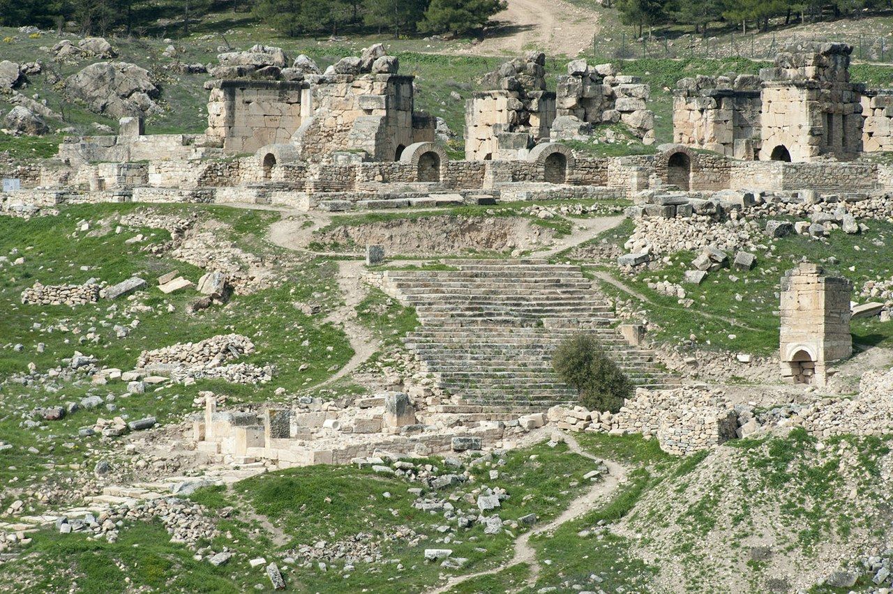</picture>
<figcaption>The <b>Martyrion of St Philip</b> at Hierapolis, built in the early 5th century on the hill above the city, as it stood in 2011. Photo: <a href="https://commons.wikimedia.org/wiki/File:St._Philip_Martyrium_in_Hierapolis_4914.jpg">St. Philip Martyrium in Hierapolis 4914</a> by Dosseman, <a href="https://creativecommons.org/licenses/by-sa/4.0">CC BY-SA 4.0</a>, via Wikimedia Commons.</figcaption>
</figure>

Francesco D'Andria of the University of Salento, who took over the Italian mission in 2000, decided to look around the octagon instead of under it. Then in 2010 his team began clearing a great heap of stones on the level ground just below the Martyrion, about forty yards away, and found a church with three aisles, built in the 5th century. At its centre, carefully enclosed, was something unexpected: an ordinary Roman tomb of the 1st century.

In the summer of 2011 the excavators found that the tomb had been fitted with a marble platform and staircases, so that pilgrims could climb up to pray at it and come down on the other side. The marble steps had been worn hollow by countless feet. The façade was scratched with crosses, and there were holes for the nails of a metal door, as if something precious had been kept inside. Beside it were small baths for the sick. An early Christian bronze bread stamp from Hierapolis, now in the Virginia Museum of Fine Arts, shows St Philip standing between two buildings at the top of a stair: a domed shrine and a basilica. "We have come to the certainty of having found the tomb of the Apostle Philip," D'Andria told reporters in July 2011. On 14 November that year, Philip's feast in the Eastern Church, the Ecumenical Patriarch **Bartholomew** celebrated the Divine Liturgy at the tomb.

The tomb was empty. Its relics had been taken away long before, probably to Constantinople and then, by the Roman tradition, to Rome.

<figure class=photo>
<picture><source srcset="/static/art/philip-tomb-600.webp 600w,/static/art/philip-tomb.webp 1280w" sizes="(max-width:760px) 100vw,760px" type="image/webp">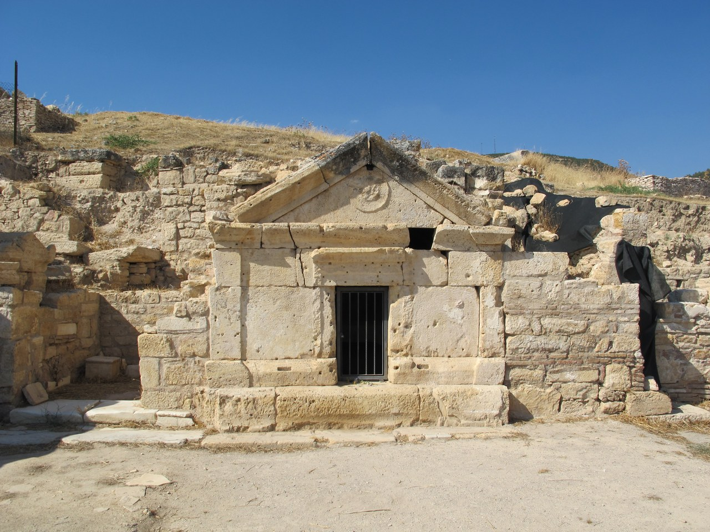</picture>
<figcaption>The 1st-century Roman tomb at the centre of the 5th-century church below the Martyrion, uncovered in 2011 and identified by the excavators as the tomb of St Philip that pilgrims came to venerate. Photo: <a href="https://commons.wikimedia.org/wiki/File:Hyerapolis,_martyrion_di_san_filippo,_annessi_03.JPG">Hyerapolis, martyrion di san filippo, annessi 03</a> by Sailko, <a href="https://creativecommons.org/licenses/by-sa/3.0">CC BY-SA 3.0</a>, via Wikimedia Commons.</figcaption>
</figure>

<h2 id=relics>His relics: Constantinople, Rome and Florence</h2>

The Church of Rome has honoured Philip together with St [James the Less](/saints/james-the-less/) since the 6th century. Pope Pelagius I began a basilica for the two apostles near the Forum of Trajan in the middle of the 6th century, and Pope John III dedicated it about the year 570, laying their relics beneath the high altar. The church became known as the **Santi Apostoli**, the Holy Apostles. Rebuilt in the 15th and again in the early 18th century, it is cared for today by the Franciscan friars.

For centuries no one saw the relics. Then in **1873**, during work on the sanctuary, they were rediscovered under the high altar, and on 1 May 1879 they were solemnly placed in a new crypt designed by Luca Carimini, where they rest in a marble sarcophagus today. In 2021 a team of scientists published tests on some of the material. A bone long said to be a femur of St James proved to date from the 3rd or 4th century, so it cannot be his; but oil and pottery found in the reliquary under the altar fit well with a translation of relics in the time of Pope Pelagius, just as the old records say. As so often with the relics of the apostles, faith and history meet here with honesty and with reverence.

<figure class=photo>
<picture><source srcset="/static/art/philip-crypt-600.webp 600w,/static/art/philip-crypt.webp 1280w" sizes="(max-width:760px) 100vw,760px" type="image/webp">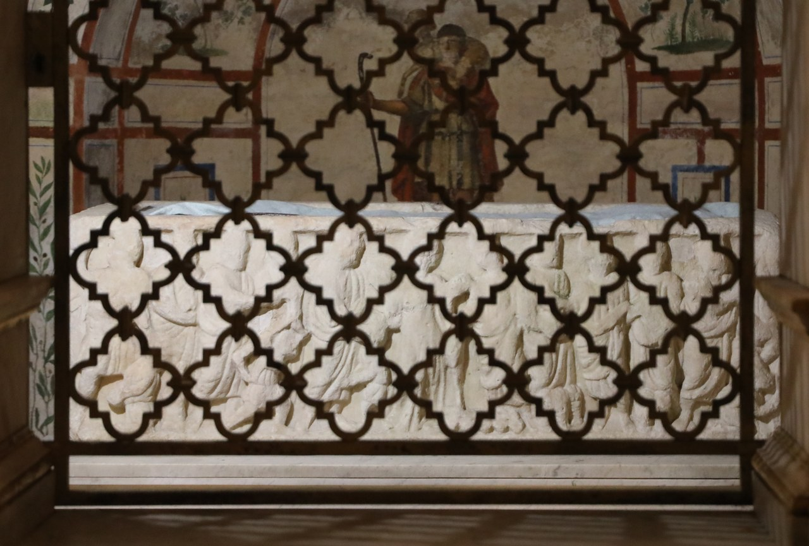</picture>
<figcaption>The sarcophagus holding the relics of Sts Philip and James in the crypt of the <b>Santi Apostoli</b>, Rome, enthroned there on 1 May 1879 after their rediscovery beneath the high altar in 1873. Photo: <a href="https://commons.wikimedia.org/wiki/File:Roma,_ss._apostoli,_interno,_confessione_(cripta),_sarciofago_con_le_spoglie_degli_apostoli_01.jpg">Roma, ss. apostoli, interno, confessione (cripta), sarciofago con le spoglie degli apostoli 01</a> by Sailko, <a href="https://creativecommons.org/licenses/by/3.0">CC BY 3.0</a>, via Wikimedia Commons.</figcaption>
</figure>

Florence has a share in Philip too. In **1205**, after the crusaders' sack of Constantinople, a relic of his **arm** was sent from the East to the Baptistery of St John in Florence by Aymar the Monk, the Latin Patriarch of Jerusalem, who had once been a cleric of the Baptistery. Between 1422 and 1425 the goldsmith Antonio del Vagliente made a splendid silver-gilt reliquary for it, crowned with a statuette of the apostle attributed to Michelozzo, and a small 12th-century Byzantine plaque engraved with the saint's image still lies on the bone. It is kept today in the Chapel of Relics of the Museo dell'Opera del Duomo.

<h2 id=calendars>The two calendars</h2>

For many centuries the West kept Philip and James on **1 May**, the anniversary of the dedication of their basilica in Rome. In 1955 Pius XII placed [St Joseph the Worker](/saints/joseph/#worker) on 1 May and moved the apostles to 11 May. The Roman calendar of 1969 moved them again, to **3 May**, where Catholics keep them now. Lutheran calendars, and the Church of England, still keep Philip and James on **1 May**. The Daily Word's feast table follows that split: Lutheran on the first, Catholic Joseph the Worker on the first, and the apostles on the third in the current Roman book.

The Orthodox and Eastern Catholic Churches keep Philip's feast alone on **14 November**. The next day begins the forty-day fast before Christmas, and so the Eastern Advent is still often called **St Philip's Fast**.

<h2 id=places>His places and churches</h2>

Philip's places run from the shore of Galilee to the hot springs of Phrygia, and from there to Rome, Florence, and across the ocean to Montevideo.

<figure class=map><figcaption>St Philip's world: his home at Bethsaida, Jerusalem, Hierapolis where he was buried, Ephesus where one of the daughters named by Polycrates rests, Constantinople, and Rome and Florence, where his relics are honoured. Open circles mark the places of Philip the Evangelist in the Acts of the Apostles. The insets show Galilee, where he called Nathanael, and the Lycus valley, where St Paul's letter to the Colossians mentions Hierapolis. Map by The Daily Word; borders from Natural Earth (public domain); the Jordan, the Sea of Galilee, the Lycus and the relic routes are drawn approximately. Tap to enlarge.</figcaption></figure>

### Bethsaida, Israel

The site of Bethsaida is not certain, but most archaeologists identify it with **et-Tell**, a mound just north of the Sea of Galilee, excavated since 1987. Its black basalt city gate, houses and fishing tools bring the home town of Philip, Andrew and Peter vividly to life.

<figure class=photo>
<picture><source srcset="/static/art/philip-bethsaida-600.webp 600w,/static/art/philip-bethsaida.webp 1280w" sizes="(max-width:760px) 100vw,760px" type="image/webp">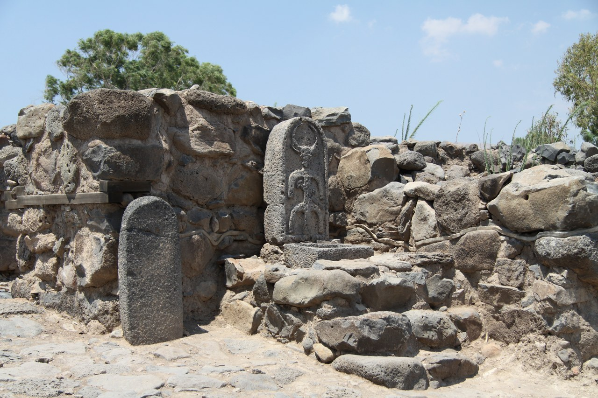</picture>
<figcaption>The ruins of the city gate and a standing stone at <b>et-Tell</b>, north of the Sea of Galilee, the site most often identified with Bethsaida, the home of Philip. Photo: <a href="https://commons.wikimedia.org/wiki/File:Ruins_of_Bethsaida_village_in_summer_2011_(7).JPG">Ruins of Bethsaida village in summer 2011 (7)</a> by Chmee2, <a href="https://creativecommons.org/licenses/by/3.0">CC BY 3.0</a>, via Wikimedia Commons.</figcaption>
</figure>

### Hierapolis and Pamukkale, Turkey

The ruins of Hierapolis spread across the plateau above the travertine terraces. Visitors walk in from the north along the broad colonnaded street, through the Gate of Frontinus, past the baths and the theatre, to the Plutonium beside the temple of Apollo. From there a path climbs the eastern hill to the **Martyrion of St Philip** and, just below it, the church of his tomb. A good walk of an hour or two, followed by the pilgrims' own route up the stairway, still ends at the shrine.

<figure class=photo>
<picture><source srcset="/static/art/philip-pamukkale-600.webp 600w,/static/art/philip-pamukkale.webp 1280w" sizes="(max-width:760px) 100vw,760px" type="image/webp">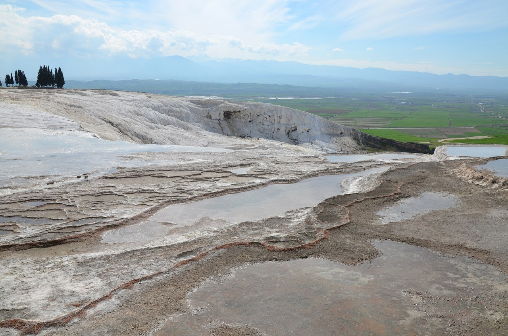</picture>
<figcaption>The travertine terraces of <b>Pamukkale</b>, formed by the hot springs that made Hierapolis a famous spa long before Philip came there. Photo: <a href="https://commons.wikimedia.org/wiki/File:The_hot_springs_and_travertines,_terraces_of_carbonate_minerals_left_by_the_flowing_water,_Hierapolis,_Phrygia,_Turkey_(32481236792).jpg">The hot springs and travertines, terraces of carbonate minerals left by the flowing water, Hierapolis, Phrygia, Turkey (32481236792)</a> by Carole Raddato, <a href="https://creativecommons.org/licenses/by-sa/2.0">CC BY-SA 2.0</a>, via Wikimedia Commons.</figcaption>
</figure>

<figure class=photo>
<picture><source srcset="/static/art/philip-frontinus-600.webp 600w,/static/art/philip-frontinus.webp 1280w" sizes="(max-width:760px) 100vw,760px" type="image/webp">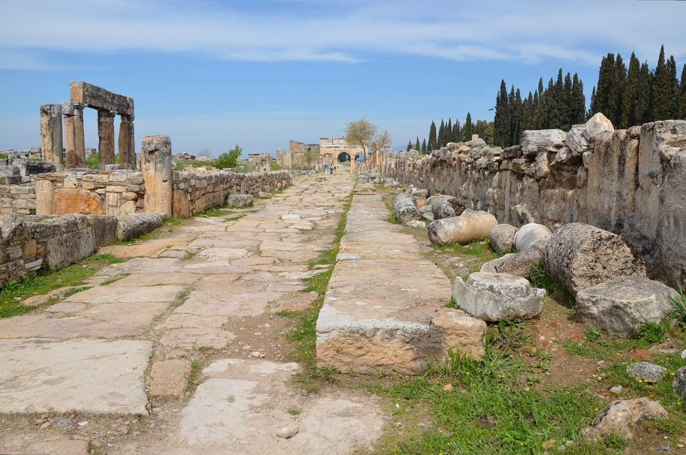</picture>
<figcaption>The main street of <b>Hierapolis</b>, running north to south through the city. Pilgrims to St Philip's tomb walked these stones. Photo: <a href="https://commons.wikimedia.org/wiki/File:Frontinus_Street_extending_in_the_north-south_direction_of_the_city,_Hierapolis,_Phrygia,_Turkey_(31528771814).jpg">Frontinus Street extending in the north-south direction of the city, Hierapolis, Phrygia, Turkey (31528771814)</a> by Carole Raddato, <a href="https://creativecommons.org/licenses/by-sa/2.0">CC BY-SA 2.0</a>, via Wikimedia Commons.</figcaption>
</figure>

<figure class=photo>
<picture><source srcset="/static/art/philip-plutonium-600.webp 600w,/static/art/philip-plutonium.webp 1280w" sizes="(max-width:760px) 100vw,760px" type="image/webp">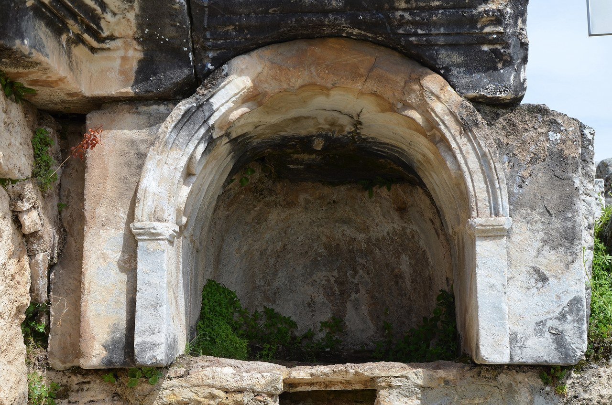</picture>
<figcaption>The <b>Plutonium</b> of Hierapolis, the "gate of Pluto," a cave sacred to the god of the underworld from which deadly gas still rises. It was re-excavated in 2013. Photo: <a href="https://commons.wikimedia.org/wiki/File:The_Plutonium_(Pluto%27s_Gate),_a_sacred_cave_believed_to_be_an_entrance_to_the_underworld_and_the_oldest_local_sanctuary,_Hierapolis,_Phrygia,_Turkey_(31528582034).jpg">The Plutonium (Pluto's Gate), a sacred cave believed to be an entrance to the underworld and the oldest local sanctuary, Hierapolis, Phrygia, Turkey (31528582034)</a> by Carole Raddato, <a href="https://creativecommons.org/licenses/by-sa/2.0">CC BY-SA 2.0</a>, via Wikimedia Commons.</figcaption>
</figure>

<figure class=photo>
<picture><source srcset="/static/art/philip-martyrion-wide-600.webp 600w,/static/art/philip-martyrion-wide.webp 1280w" sizes="(max-width:760px) 100vw,760px" type="image/webp">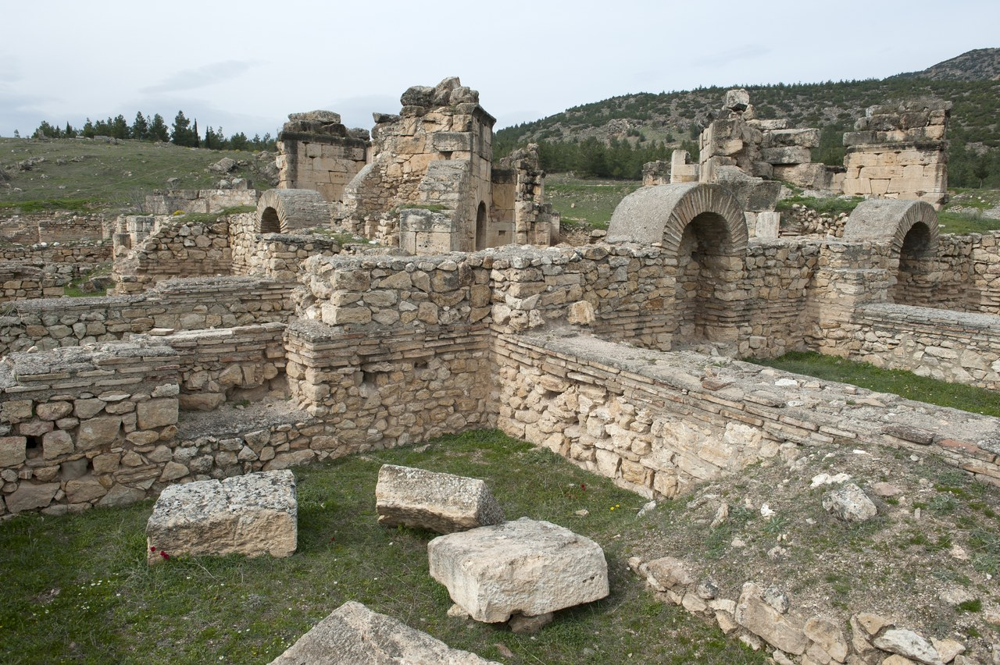</picture>
<figcaption>The <b>Martyrion of St Philip</b>, on the hill east of the city: an octagonal hall surrounded by chapels and pilgrims' rooms, built in the early 5th century and ruined by an earthquake in the 7th. Photo: <a href="https://commons.wikimedia.org/wiki/File:Hierapolis_Martyrium_of_St_Philip_the_Apostle_4961.jpg">Hierapolis Martyrium of St Philip the Apostle 4961</a> by Dosseman, <a href="https://creativecommons.org/licenses/by-sa/4.0">CC BY-SA 4.0</a>, via Wikimedia Commons.</figcaption>
</figure>

<figure class=photo>
<picture><source srcset="/static/art/philip-martyrion-arch-600.webp 600w,/static/art/philip-martyrion-arch.webp 1280w" sizes="(max-width:760px) 100vw,760px" type="image/webp">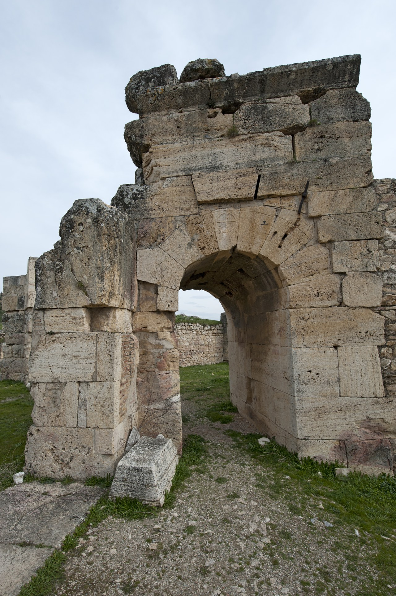</picture>
<figcaption>One of the great travertine arches of the <b>Martyrion</b>, which surrounded the central hall. Photo: <a href="https://commons.wikimedia.org/wiki/File:Hierapolis_Martyrium_of_St_Philip_the_Apostle_4967.jpg">Hierapolis Martyrium of St Philip the Apostle 4967</a> by Dosseman, <a href="https://creativecommons.org/licenses/by-sa/4.0">CC BY-SA 4.0</a>, via Wikimedia Commons.</figcaption>
</figure>

<figure class=photo>
<picture><source srcset="/static/art/philip-tomb-church-600.webp 600w,/static/art/philip-tomb-church.webp 1280w" sizes="(max-width:760px) 100vw,760px" type="image/webp">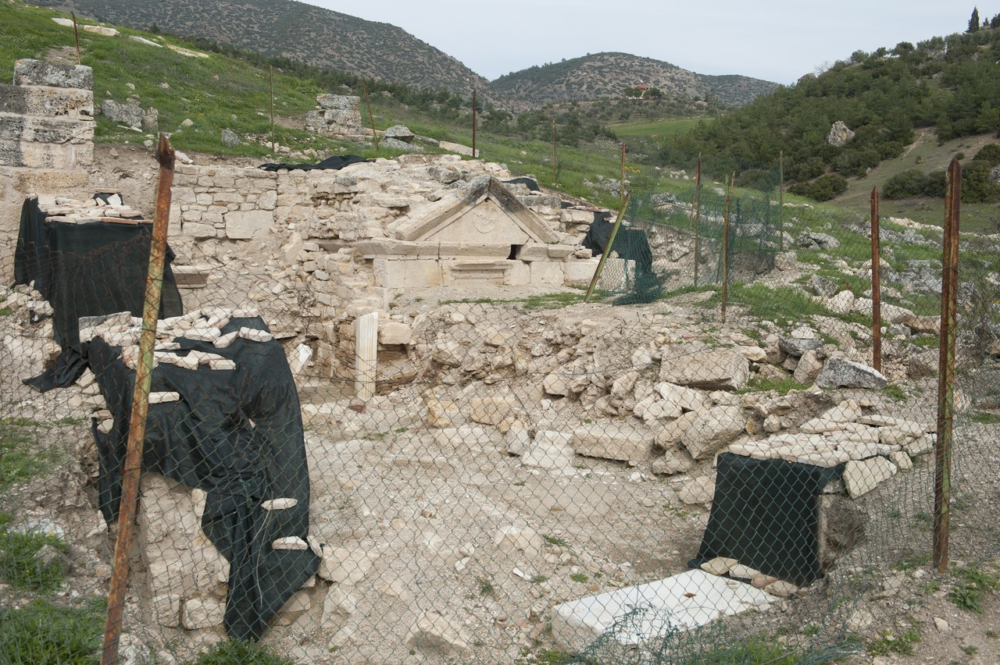</picture>
<figcaption>The church of St Philip's tomb in <b>March 2011</b>, before the excavation was complete. The tomb stands at the centre of the church, a few dozen yards from the Martyrion. Photo: <a href="https://commons.wikimedia.org/wiki/File:Hierapolis_Tomb_of_Saint_Philip_before_complete_excavation_4958.jpg">Hierapolis Tomb of Saint Philip before complete excavation 4958</a> by Dosseman, <a href="https://creativecommons.org/licenses/by-sa/4.0">CC BY-SA 4.0</a>, via Wikimedia Commons.</figcaption>
</figure>

### The Basilica of the Holy Apostles, Rome

The **Santi Apostoli** stands on a narrow piazza near the Piazza Venezia. Behind its 19th-century façade by Giuseppe Valadier and its Renaissance portico is a broad, gilded 18th-century nave. Above the high altar hangs Domenico Maria Muratori's vast painting of the martyrdom of Philip and James, said to be the largest altarpiece in Rome, about 14 metres high; the relics of the two apostles are in the crypt below. The basilica is one of the station churches of Lent, and on Philip and James's feast the faithful come to pray at their tomb.

<figure class=photo>
<picture><source srcset="/static/art/philip-santi-apostoli-600.webp 600w,/static/art/philip-santi-apostoli.webp 1280w" sizes="(max-width:760px) 100vw,760px" type="image/webp">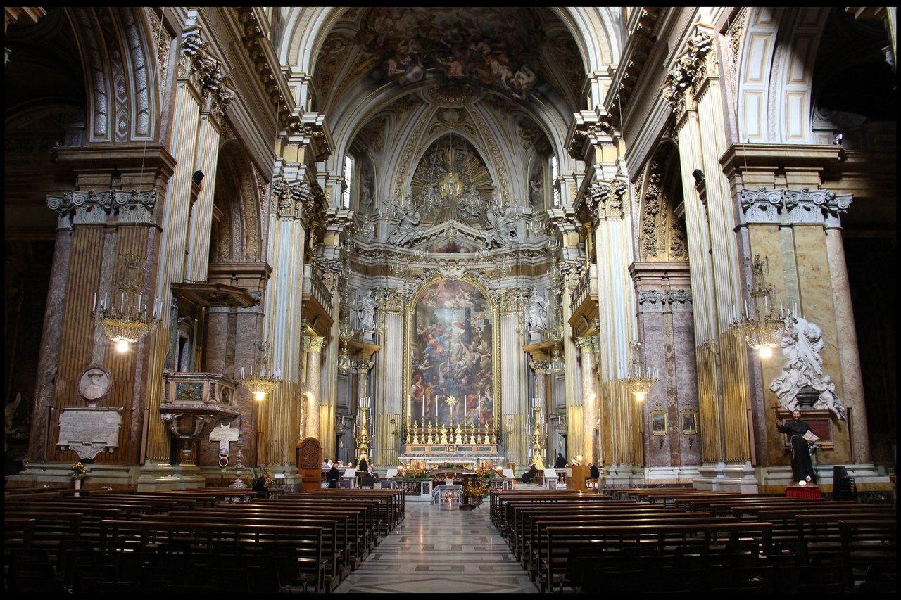</picture>
<figcaption>The <b>Basilica of the Holy Apostles</b> (Santi XII Apostoli), Rome, dedicated about 570 to Sts Philip and James the Less, whose relics rest beneath its high altar. Photo: <a href="https://commons.wikimedia.org/wiki/File:Roma_-_Basilica_dei_Santi_XII_Apostoli_(41978101135).jpg">Roma - Basilica dei Santi XII Apostoli (41978101135)</a> by Fred Romero, <a href="https://creativecommons.org/licenses/by/2.0">CC BY 2.0</a>, via Wikimedia Commons.</figcaption>
</figure>

<figure class=photo>
<picture><source srcset="/static/art/philip-santi-apostoli-interior-600.webp 600w,/static/art/philip-santi-apostoli-interior.webp 1280w" sizes="(max-width:760px) 100vw,760px" type="image/webp">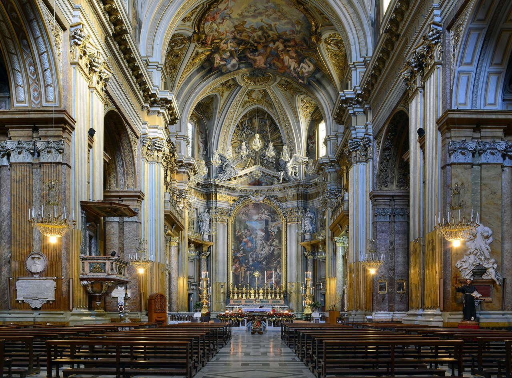</picture>
<figcaption>The nave of the <b>Santi Apostoli</b>, rebuilt in the early 18th century, looking toward the high altar and Muratori's altarpiece. Photo: <a href="https://commons.wikimedia.org/wiki/File:Basilica_dei_Santi_Apostoli_(Roma)_-_Interior.jpg">Basilica dei Santi Apostoli (Roma) - Interior</a> by Livioandronico2013, <a href="https://creativecommons.org/licenses/by-sa/4.0">CC BY-SA 4.0</a>, via Wikimedia Commons.</figcaption>
</figure>

<figure class=photo>
<picture><source srcset="/static/art/philip-muratori-600.webp 600w,/static/art/philip-muratori.webp 1280w" sizes="(max-width:760px) 100vw,760px" type="image/webp">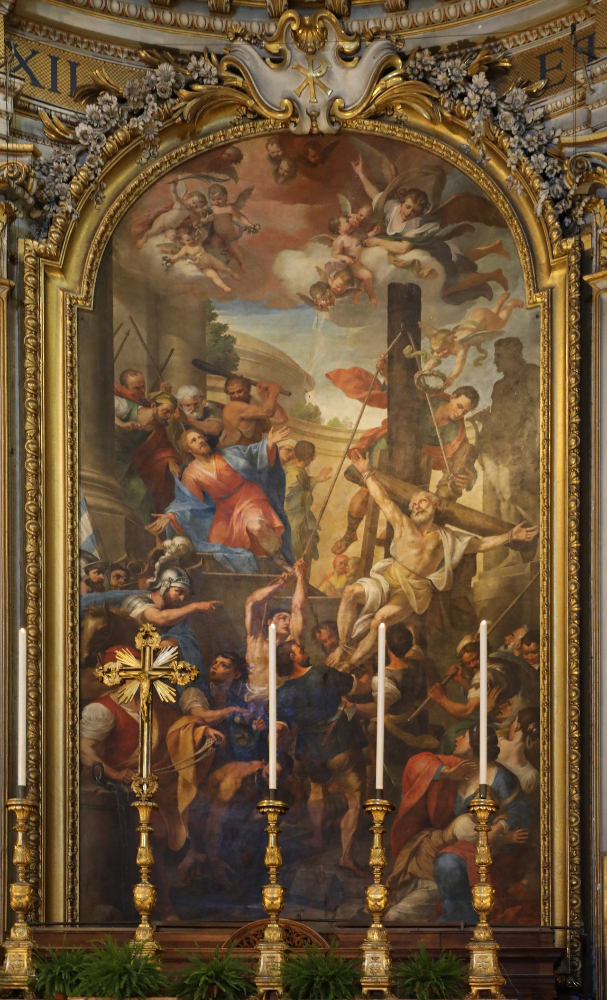</picture>
<figcaption><i>The Martyrdom of Sts Philip and James</i>, by <b>Domenico Maria Muratori</b>, above the high altar of the Santi Apostoli, painted in the early 18th century (1704 by some accounts, 1715 according to the basilica). It is said to be the largest altarpiece in Rome, about 14 metres by 6.7. Photo: <a href="https://commons.wikimedia.org/wiki/File:Domenico_maria_muratori,_martirio_dei_ss._apostoli_filippo_e_giacomo,_1704,_01.jpg">Domenico maria muratori, martirio dei ss. apostoli filippo e giacomo, 1704, 01</a> by Sailko, <a href="https://creativecommons.org/licenses/by/3.0">CC BY 3.0</a>, via Wikimedia Commons.</figcaption>
</figure>

### Montevideo Cathedral, Uruguay

When the Spanish founded **Montevideo** in the 1720s, its first officials chose Sts **Philip and James** as the city's patrons, probably in honour of the reigning king, Philip V, and its full colonial name became San Felipe y Santiago de Montevideo. Its cathedral, the Metropolitan Cathedral of the Immaculate Conception and Sts Philip and James, faces the old Plaza de la Constitución, and since 2018 relics of the two apostles have been venerated there. The Archdiocese of Montevideo revived their feast in 2014, and keeps it every year around 3 May.

<figure class=photo>
<picture><source srcset="/static/art/philip-montevideo-600.webp 600w,/static/art/philip-montevideo.webp 1280w" sizes="(max-width:760px) 100vw,760px" type="image/webp">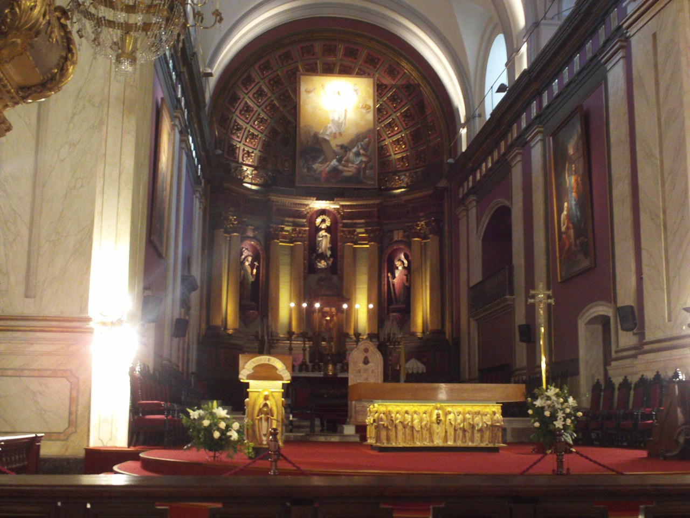</picture>
<figcaption>The sanctuary of the <b>Metropolitan Cathedral of Montevideo</b>, dedicated to the Immaculate Conception and to Sts Philip and James, the patrons of the city. Photo: <a href="https://commons.wikimedia.org/wiki/File:Montevideo_metropolitan_cathedral_interior.JPG">Montevideo metropolitan cathedral interior</a> by Ypsilon from Finland, <a href="https://creativecommons.org/publicdomain/zero/1.0/">CC0</a>, via Wikimedia Commons.</figcaption>
</figure>

<h2 id=art>Philip in art</h2>

Artists have shown Philip in two quite different ways. In the Byzantine East he is often a young man, sometimes beardless, holding a scroll, among the apostles on either side of Christ. In the West, from the late Middle Ages, he is usually older and bearded, and carries a cross, sometimes a tall staff topped with a small cross, recalling the tradition of his crucifixion. Occasionally he holds loaves of bread, for his question by the lake.

### Byzantine mosaics and icons

<figure class=photo>
<picture><source srcset="/static/art/philip-hosios-loukas-600.webp 600w,/static/art/philip-hosios-loukas.webp 1280w" sizes="(max-width:760px) 100vw,760px" type="image/webp">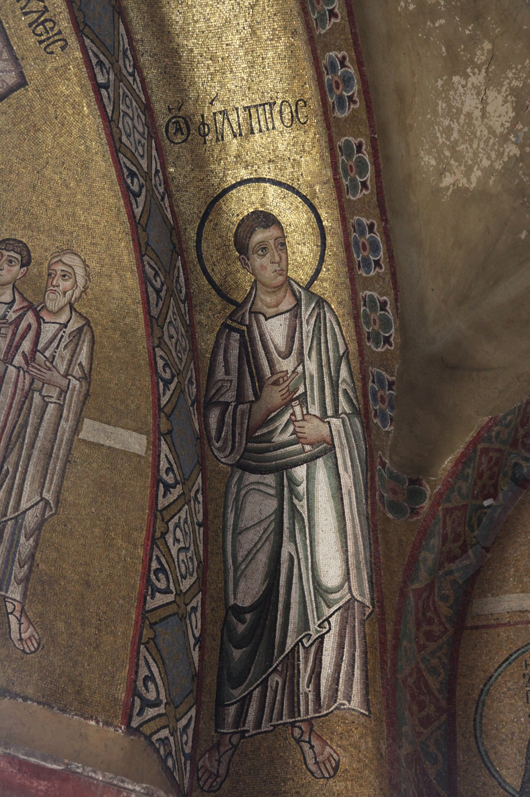</picture>
<figcaption>St Philip as a young man in an <b>11th-century mosaic</b> in the narthex of the monastery of <b>Hosios Loukas</b> in central Greece, one of the masterpieces of Byzantine art. Photo: <a href="https://commons.wikimedia.org/wiki/File:Hosios_Loukas_(narthex)_-_West_wall,_4th_arch_(S.Philip)_01.jpg">Hosios Loukas (narthex) - West wall, 4th arch (S.Philip) 01</a> by Hans A. Rosbach, <a href="https://creativecommons.org/licenses/by-sa/3.0">CC BY-SA 3.0</a>, via Wikimedia Commons.</figcaption>
</figure>

<figure class=photo>
<picture><source srcset="/static/art/philip-sinai-icon-600.webp 600w,/static/art/philip-sinai-icon.webp 356w" sizes="(max-width:760px) 100vw,760px" type="image/webp">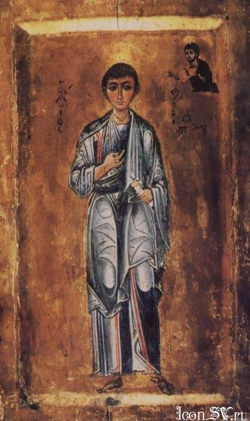</picture>
<figcaption><i>The Apostle Philip</i>, an icon of the <b>10th century</b> from the Monastery of St Catherine at Mount Sinai, about 33 centimetres high. The young, beardless Philip is typical of Byzantine art. Image: <a href="https://commons.wikimedia.org/wiki/File:Icon_of_Apostle_Philip_(10th_c,_St._Catherine_monastery,_Sinai).jpg">Icon of Apostle Philip (10th c, St. Catherine monastery, Sinai)</a>, public domain, via Wikimedia Commons.</figcaption>
</figure>

<figure class=photo>
<picture><source srcset="/static/art/philip-hermitage-icon-600.webp 600w,/static/art/philip-hermitage-icon.webp 1280w" sizes="(max-width:760px) 100vw,760px" type="image/webp">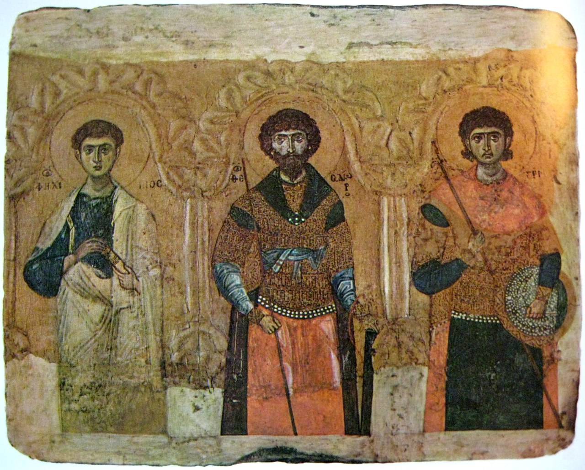</picture>
<figcaption>St Philip, on the left, with the soldier saints <b>Theodore and Demetrius</b>, a Byzantine icon of the late 11th or early 12th century. State Hermitage Museum, St Petersburg. Photo: <a href="https://commons.wikimedia.org/wiki/File:Philip,_theodore_and_demetrius.jpg">Philip, theodore and demetrius</a> by Shakko, <a href="https://creativecommons.org/licenses/by-sa/3.0">CC BY-SA 3.0</a>, via Wikimedia Commons.</figcaption>
</figure>

### Filippino Lippi: the Strozzi Chapel, Florence

The banker **Filippo Strozzi** wanted his chapel in Santa Maria Novella to honour his name saint, and in the late 1480s he engaged **Filippino Lippi**, son of the painter friar Filippo Lippi. The frescoes were not finished until about 1502, after Strozzi's death, and they are among the strangest and most brilliant of the Renaissance. On the right wall, Philip drives the dragon from the temple of Mars, the story from the *Golden Legend*: a fantastic pagan altar towers over the scene, the god brandishes his spear, the priest's son lies dead, and the worshippers reel back holding their noses from the dragon's breath, while the apostle calmly points it away. Above, in the lunette, soldiers haul Philip up on his cross with ropes.

<figure class=photo>
<picture><source srcset="/static/art/philip-lippi-dragon-600.webp 600w,/static/art/philip-lippi-dragon.webp 1000w" sizes="(max-width:760px) 100vw,760px" type="image/webp">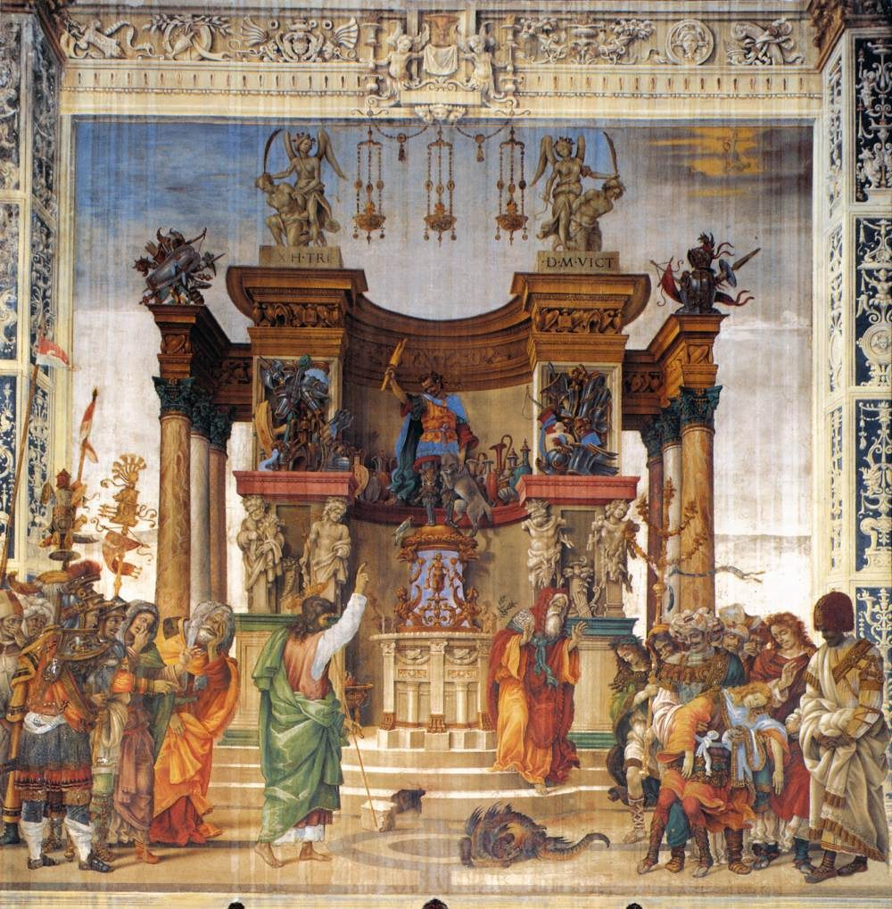</picture>
<figcaption><i>St Philip driving the dragon from the temple</i>, by <b>Filippino Lippi</b>, 1487–1502, in the Strozzi Chapel of <b>Santa Maria Novella</b>, Florence. Following the <i>Golden Legend</i>, the dragon has come out from under the statue of Mars and killed the priest's son with its breath; Philip sends it into the desert. Image: <a href="https://commons.wikimedia.org/wiki/File:Filippino_Lippi_-_St_Philip_Driving_the_Dragon_from_the_Temple_of_Hieropolis_-_WGA13146.jpg">Filippino Lippi - St Philip Driving the Dragon from the Temple of Hieropolis - WGA13146</a>, public domain, via Wikimedia Commons.</figcaption>
</figure>

<figure class=photo>
<picture><source srcset="/static/art/philip-lippi-crucifixion-600.webp 600w,/static/art/philip-lippi-crucifixion.webp 1200w" sizes="(max-width:760px) 100vw,760px" type="image/webp">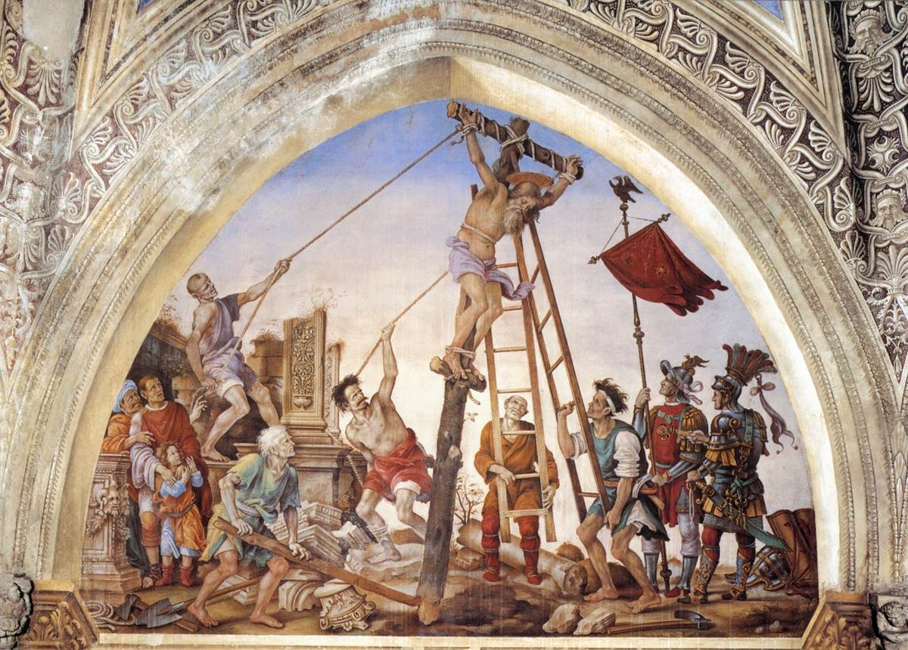</picture>
<figcaption><i>The Crucifixion of St Philip</i>, by <b>Filippino Lippi</b>, in the lunette above the dragon scene in the Strozzi Chapel. Image: <a href="https://commons.wikimedia.org/wiki/File:Filippino_Lippi_-_Crucifixion_of_St_Philip_-_WGA13153.jpg">Filippino Lippi - Crucifixion of St Philip - WGA13153</a>, public domain, via Wikimedia Commons.</figcaption>
</figure>

### Dürer, Rubens and El Greco

<figure class=photo>
<picture><source srcset="/static/art/philip-durer-600.webp 600w,/static/art/philip-durer.webp 804w" sizes="(max-width:760px) 100vw,760px" type="image/webp">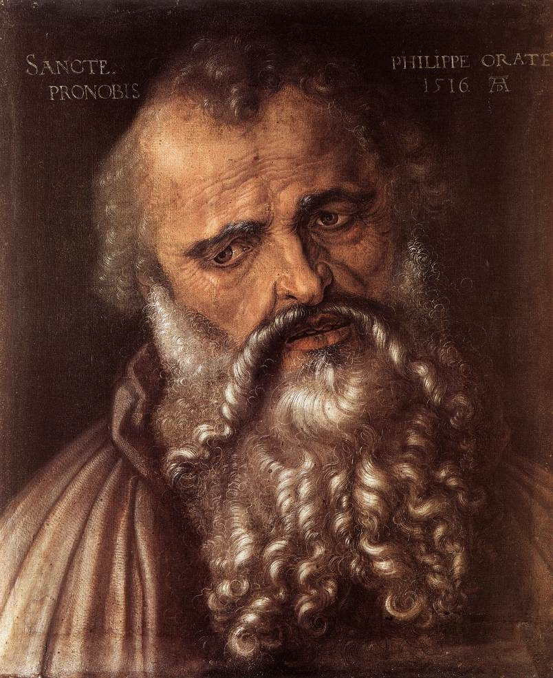</picture>
<figcaption><i>The Apostle Philip</i>, by <b>Albrecht Dürer</b>, monogrammed and dated 1516. Dürer painted Philip and James as a pair of intense, close-up heads. Uffizi Galleries, Florence. Image: <a href="https://commons.wikimedia.org/wiki/File:Durer,_san_filippo.jpg">Durer, san filippo</a>, public domain, via Wikimedia Commons.</figcaption>
</figure>

**Peter Paul Rubens** painted a complete set of the apostles for the Duke of Lerma, Spain's chief minister, about 1610–12. The set is now in the **Prado**. His Philip holds against his shoulder the cross of his martyrdom, far taller than he is, and lifts his eyes calmly to heaven.

<figure class=photo>
<picture><source srcset="/static/art/philip-rubens-600.webp 600w,/static/art/philip-rubens.webp 1280w" sizes="(max-width:760px) 100vw,760px" type="image/webp">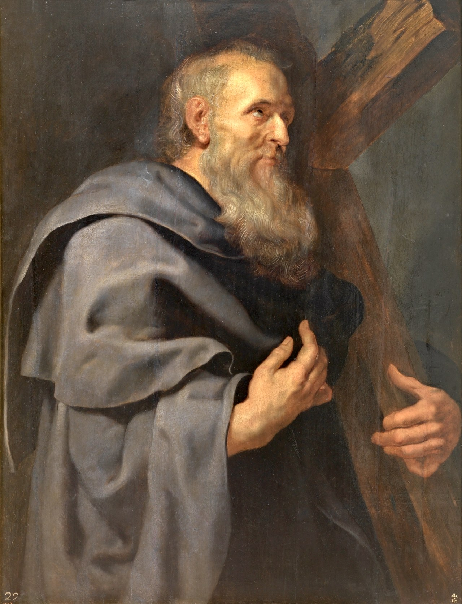</picture>
<figcaption><i>Saint Philip</i>, by <b>Peter Paul Rubens</b>, 1610–1612, from the apostle series painted for the Duke of Lerma. Museo Nacional del Prado, Madrid. Image: <a href="https://commons.wikimedia.org/wiki/File:Rubens_apostel_philippus.jpg">Rubens apostel philippus</a>, public domain, via Wikimedia Commons.</figcaption>
</figure>

<figure class=photo>
<picture><source srcset="/static/art/philip-el-greco-600.webp 600w,/static/art/philip-el-greco.webp 1280w" sizes="(max-width:760px) 100vw,760px" type="image/webp">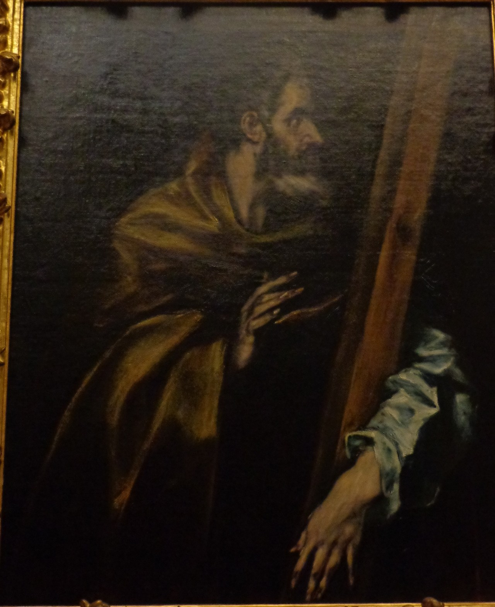</picture>
<figcaption><i>Saint Philip</i>, by <b>El Greco</b>, from the series of the apostles he painted for the sacristy of <b>Toledo Cathedral</b> in the early 17th century. Image: <a href="https://commons.wikimedia.org/wiki/File:El_Greco_-_Saint_Philip,_Toledo_Cathedral.jpg">El Greco - Saint Philip, Toledo Cathedral</a>, public domain, via Wikimedia Commons.</figcaption>
</figure>

### Georges de La Tour

About 1625 the Lorraine painter **Georges de La Tour** painted a series of the apostles that later hung in the cathedral of Albi in southern France and was afterwards dispersed among many museums. His Philip, now in the **Chrysler Museum of Art** in Norfolk, Virginia, is no prince of the Church but a rough, humble countryman with folded hands, and the museum points out the startling flicker of light in the simple glass buttons of his coarse tunic. It is a portrait of a man who would say, "Come and see."

<figure class=photo>
<picture><source srcset="/static/art/philip-la-tour-600.webp 600w,/static/art/philip-la-tour.webp 832w" sizes="(max-width:760px) 100vw,760px" type="image/webp">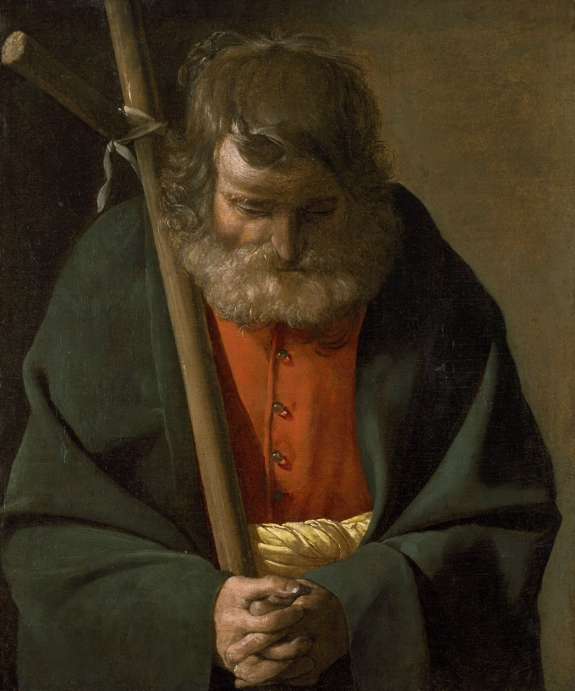</picture>
<figcaption><i>Saint Philip</i>, by <b>Georges de La Tour</b>, about 1625, from the series of apostles later at Albi. Chrysler Museum of Art, Norfolk, Virginia, gift of Walter P. Chrysler, Jr. Image: <a href="https://commons.wikimedia.org/wiki/File:La_Tour_-_Saint_Philip,_ca._1625,_77.431.jpg">La Tour - Saint Philip, ca. 1625, 77.431</a>, <a href="https://creativecommons.org/licenses/by-sa/4.0">CC BY-SA 4.0</a>, via Wikimedia Commons.</figcaption>
</figure>

### Lucas Cranach

<figure class=photo>
<picture><source srcset="/static/art/philip-cranach-600.webp 600w,/static/art/philip-cranach.webp 1280w" sizes="(max-width:760px) 100vw,760px" type="image/webp">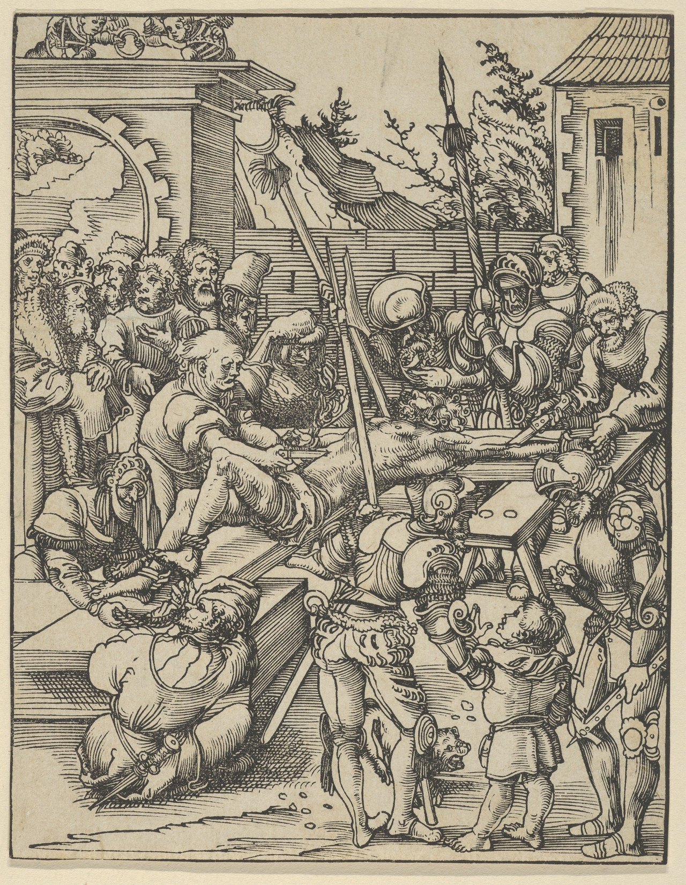</picture>
<figcaption><i>Philip</i>, from the <b>Martyrdom of the Twelve Apostles</b>, a series of woodcuts by <b>Lucas Cranach the Elder</b>. Each print shows the death of one apostle as the late medieval legends told it. The Metropolitan Museum of Art, New York, Rogers Fund, 1917. Image: <a href="https://commons.wikimedia.org/wiki/File:Philip_from_the_Martyrdom_of_the_Twelve_Apostles_MET_DP841872.jpg">Philip from the Martyrdom of the Twelve Apostles MET DP841872</a>, <a href="https://creativecommons.org/publicdomain/zero/1.0/">CC0</a>, via Wikimedia Commons.</figcaption>
</figure>

## Path to sainthood
An apostle, venerated from the earliest days of the Church, long before formal canonisation existed. His name is in the Roman Canon of the Mass, among the apostles named after Peter and Paul. His feast is **3 May** in the Roman calendar, with St James the Less; **1 May** in Lutheran and Anglican calendars; and **14 November** in the Orthodox Church.

## Patronages
The city of **Montevideo**, and so he is often named a patron of **Uruguay**; and, by old tradition, **hatters** and **pastry cooks**, the bakers perhaps for his question about bread. More solidly, he is the apostle of "Come and see": everyone who introduces a friend to the faith.

## Trivia
- John's Gospel gives Philip more lines than Matthew, Mark and Luke together, and he is in all four lists of the Twelve.
- *Philippos* means "lover of horses."
- Do not confuse him with [St Philip Neri](/saints/philip-neri/), the 16th-century Roman priest, whose feast is 26 May, or with Philip the Evangelist of Acts, kept on 6 June in the Roman Martyrology and 11 October in the East.
- "Sir, we would see Jesus" (John 12:21) has been carved inside many pulpits, facing the preacher.
- In the Eastern Churches, the forty-day fast before Christmas begins the day after his feast and is often called **St Philip's Fast**.
- An early Christian bronze bread stamp from Hierapolis, now in Richmond, Virginia, shows Philip standing between his shrine and the church of his tomb. It helped confirm the 2011 discovery.
- Hierapolis had a "gate of hell," the Plutonium, a cave of poisonous gas, just down the hill from Philip's shrine.

## Sources
- John 1:43–49; 6:5–7; 12:20–24; 14:8–10; Acts 1:13; 6:5; 8:5–40; 21:8–9; Colossians 4:13; and the lists in Matthew 10, Mark 3 and Luke 6 (King James Version)
- [Catholic Encyclopedia: St Philip the Apostle](https://www.newadvent.org/cathen/11799a.htm)
- [Eusebius, *Church History*, Book III, chapters 31 and 39 (Polycrates, Proclus and Papias on Philip), New Advent](https://www.newadvent.org/fathers/250103.htm)
- [Eusebius, *Church History*, Book V, chapter 24 (Polycrates' letter to Victor), New Advent](https://www.newadvent.org/fathers/250105.htm)
- [Jacobus de Voragine, *The Golden Legend*, vol. 3: the Life of St Philip (Fordham Medieval Sourcebook)](https://sourcebooks.web.fordham.edu/basis/goldenlegend/GoldenLegend-Volume3.asp)
- [e-Clavis: Christian Apocrypha, *Acts of Philip* (NASSCAL)](https://www.nasscal.com/e-clavis-christian-apocrypha/acts-of-philip/)
- [Associates for Biblical Research: The Martyrium of Apostle Philip](https://biblearchaeology.org/research-articles/martyrium-of-apostle-philip-found/)
- [Biblical Archaeology Society: Tomb of Apostle Philip Found](https://www.biblicalarchaeology.org/daily/biblical-sites-places/biblical-archaeology-sites/tomb-of-apostle-philip-found/)
- [Vatican Radio: Archaeologists report finding St Philip's tomb (30 July 2011)](https://www.archivioradiovaticana.va/storico/2011/07/30/archaeologists_report_finding_st_philips_tomb/in2-508838)
- [ZENIT via EWTN: "How I Discovered the Tomb of the Apostle Philip," interview with Francesco D'Andria (2012)](https://www.ewtn.com/catholicism/library/how-i-discovered-the-tomb-of-the-apostle-philip-1949)
- [UNESCO: Hierapolis-Pamukkale](https://whc.unesco.org/en/list/485/)
- [Archaeology Magazine: Structures of Pluto's Gate uncovered in Turkey (2013)](https://archaeology.org/news/2013/04/02/130403-turkey-hierapolis-pluto-s-gate/)
- [Pontifical North American College: Santi XII Apostoli, station church](https://www.pnac.org/station-churches/week-1/friday-santi-xii-apostoli/)
- [Basilica Santi XII Apostoli: the crypt](https://www.santiapostoli.it/cripta/)
- [Basilica Santi XII Apostoli: the high altar and Muratori's altarpiece](https://www.santiapostoli.it/laltare/)
- [*npj Heritage Science* (2021): Investigations of the relics and altar materials of Sts James and Philip at the Santi XII Apostoli](https://www.nature.com/articles/s40494-021-00481-9)
- [Opera di Santa Maria del Fiore: Reliquary of St Philip](https://duomo.firenze.it/en/discover/opera-duomo-museum/the-halls/cappella-delle-reliquie/9082/orafi-vari-reliquiario-di-san-filippo)
- [Iglesia Católica Montevideo: the origin of the feast of Sts Philip and James](https://icm.org.uy/como-se-origino-la-fiesta-de-san-felipe-y-santiago/)
- [Orthodox Church in America: fasting seasons (St Philip's Fast)](https://www.oca.org/liturgics/outlines/fasting-fast-free-seasons-of-the-church)
- [Santa Maria Novella: the Filippo Strozzi Chapel](https://www.smn.it/en/artworks/filippo-strozzi-chapel/)
- [Museo del Prado: Rubens, *San Felipe*](https://www.museodelprado.es/coleccion/obra-de-arte/san-felipe/a0e78920-8f28-47f5-8cd5-f50ba1dfa8c5)
- [Chrysler Museum of Art: Georges de La Tour, *Saint Philip*](https://chrysler.emuseum.com/objects/24762/saint-philip)
- [Uffizi Galleries: Dürer, *San Filippo apostolo*](https://www.uffizifirenze.it/san-filippo-apostolo.html)
- [The Metropolitan Museum of Art: Cranach, *Philip* from the Martyrdom of the Twelve Apostles](https://www.metmuseum.org/art/collection/search/435303)
- [Vereniging Rembrandt: Rembrandt, *The Baptism of the Eunuch* (1626), Museum Catharijneconvent](https://www.verenigingrembrandt.nl/nl/kunst/doop-van-de-kamerling)

Fact-checked on November 6, 2026 against the New Testament, Eusebius, and New Advent. Expanded November 25, 2026 with the story of his life told from the Gospel of John and the Acts of the Apostles, with the early witnesses preserved by Eusebius (Polycrates, Proclus and Papias); the legends of the <i>Acts of Philip</i> and the <i>Golden Legend</i>, labelled as such; the excavations at Hierapolis as reported by the Italian archaeological mission; the history of his relics in Rome and Florence; the places and churches connected with him; and his portrayal in art, using museum records and Wikimedia Commons. Scripture quotations follow the King James Version. The map was drawn for this page from Natural Earth data (public domain). Calendar dates follow the current Roman calendar, the Lutheran 1 May and the Orthodox 14 November.

