<nav class=toc aria-label="On this page">

On this page

<ol>
<li><a href="#pearl">The pearl of Roccaporena</a></li>
<li><a href="#bees">The white bees at her cradle</a></li>
<li><a href="#wife">Wife and mother</a></li>
<li><a href="#feud">The feud, and her forgiveness</a></li>
<li><a href="#peace">How peace was made</a></li>
<li><a href="#flight">Carried by three saints</a></li>
<li><a href="#vine">The dry wood that became a vine</a></li>
<li><a href="#thorn">The thorn</a></li>
<li><a href="#rose">The rose and the two figs</a></li>
<li><a href="#death">Her passing, and the bells</a></li>
<li><a href="#impossible">Saint of the impossible, and the roses of 22 May</a></li>
<li><a href="#art">Rita in art</a></li>
<li><a href="#visit">Where to visit</a></li>
</ol>
</nav>

## Her story
Rita is the saint of the impossible because her own life was full of things that could not be mended: a hard marriage, a murdered husband, two sons drawn toward revenge, a convent door that would not open. One by one, by prayer and forgiveness, God mended them. She was a daughter, a wife, a mother, a widow and a nun, and every one of those lives is remembered in the mountains of Umbria, between the hamlet of **Roccaporena** where she was born and the little town of **Cascia** where she died.

This page tells her story as the Church at Cascia has kept it: from the Augustinian nuns who still live in her monastery, the shrine at Roccaporena, and the old Lives written for her beatification. Rita left no writings of her own. What she left, the nuns say, is the example of a simple life lived every day for God.

<figure class=map><a href="/static/maps/map-rita-italy.svg">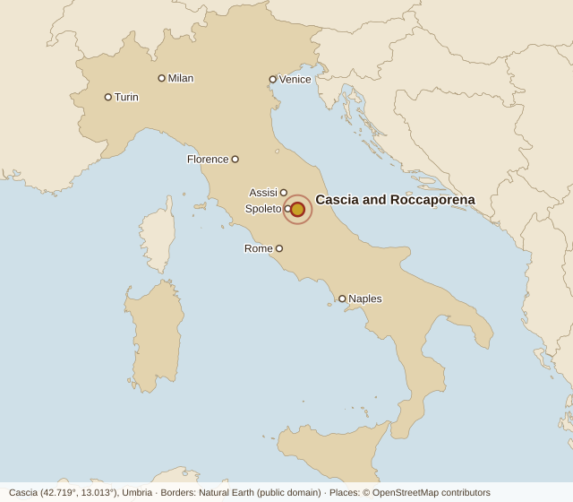</a><figcaption>Cascia and Roccaporena lie in the Valnerina, in the mountains of south-eastern Umbria, east of Spoleto. Map by The Daily Word; borders from Natural Earth (public domain). Tap to enlarge.</figcaption></figure>

<h2 id=pearl>The pearl of Roccaporena</h2>

Her baptismal name was **Margherita**, which means "pearl"; Rita is its loving short form. She was born at Roccaporena, a hamlet in a narrow gorge about 5 km from Cascia, the only child of **Antonio Lotti** and **Amata Ferri**. Her parents were not nobles, but they were respected, and the statutes of the free commune of Cascia gave them a hard and holy task. They were *pacieri*, peacemakers: when families quarrelled and blood was likely to be shed, Antonio and Amata were sent to reconcile them. The old Lives call them the "Peacemakers of Jesus Christ." Rita grew up watching her mother and father make peace, and it became her own vocation.

She was baptised in Cascia, in the Augustinian church of **San Giovanni Battista**, and the only schooling she had was from the Augustinian friars. From them she learned her love for the three saints who would guard her all her life: **St John the Baptist**, **St Augustine**, and **St Nicholas of Tolentino**. From her girlhood, tradition says, she longed to give herself wholly to God as a nun.

The shrine keeps two reckonings of her years: born in 1371 and died in 1447, or born in 1381 and died in 1457. Both agree that she lived 76 years. This page follows the second, as the shrine's own timeline does.

<h2 id=bees>The white bees at her cradle</h2>

The first wonder told of Rita happened before she could speak. Her parents worked their fields, and one day they laid the infant in a little basket cot in the garden of the house while they worked nearby. On the fifth day after her birth, the nuns of Cascia tell, a swarm of **white bees** came and settled on the sleeping child. They went in and out of her mouth, as bees go in and out of a hive, and not one of them stung her.

At that moment a farm labourer, reaping in a field close by, cut his hand deeply with his scythe. Bleeding badly, he left his work and hurried down toward the village for help. As he passed the cot he saw the bees swarming over the baby's face and swept his wounded hand through the air to drive them away. When he lowered his arm, the wound was healed. It is remembered as the first miracle of Rita's life.

Bees in the Christian tradition are a sign of work, sweetness and a life ordered toward the common good; honey has always had something holy about it. The people of Cascia saw in the white bees a promise that this child would be industrious, sweet in her virtue, and given to God. And the bees have never left her story. In the cloister of her monastery, in the old wall beside the stairs, there are small holes where **masonry bees** still live and work, and pilgrims are shown them to this day. Blessed Mother Maria Teresa Fasce, the abbess who built the basilica, named the nuns' magazine *From the Bees to the Roses*, and their home for children in need is still called the **Beehive of St Rita**.

<h2 id=wife>Wife and mother</h2>

When the time came, Rita did not enter the cloister. In obedience to her parents she was married, very young, to **Paolo di Ferdinando di Mancino** (often called Paolo Mancini), in the little church of **San Montano** at Roccaporena. These were years of bitter factions between Guelphs and Ghibellines, and Paolo was a man of his time: an armed man of the Ghibelline party, said by some to have commanded the small garrison at the castle of Collegiacone above the valley.

The old Lives, and the Roman Martyrology after them, remember him as a hard and violent husband whom Rita bore with in patience and won back to God. The nuns of Cascia today speak more gently of him, as a young man who loved her and whom she loved, a quick and resentful partisan whom she helped to live a truly Christian life. Either way the fruit was the same. By her prayer, her calm, and the gift for peace she had learned at home, Paolo was changed. God blessed them with two sons, **Giangiacomo** and **Paolo Maria**, perhaps twins. The family moved to a mill Paolo owned on the river below Roccaporena, the **Mulinaccio**, where he set down his arms and worked grinding grain. For a few years it was a peaceful home.

<h2 id=feud>The feud, and her forgiveness</h2>

The peace did not last. Around **1406**, Paolo was ambushed and killed at night. The shrine at Cascia places the killing near the Mulinaccio; Roccaporena remembers it near the tower of Collegiacone, as he was making his way home. Rita heard and ran to him, and found him dying. She could do nothing but stay with him through his last breath.

What she did next is the beginning of her holiness. She took her husband's **bloodstained shirt** and hid it, so that her boys would never see it and nurse a desire for vengeance. And she forgave his killers from her heart. She never revealed their names, not to the magistrates, not to her husband's family, and not to her sons. The Mancini could not forgive her for it. In the world they lived in, a murdered man's kin were bound by honour to answer blood with blood, and a widow's silence looked like betrayal.

Her sons were growing up into that world, and Rita's greatest fear was not for their lives but for their souls. As they grew, they came to feel, as the custom of the time taught them, that avenging their father was a duty. She showed them the crucified Christ, who forgave those who killed him, and pleaded with them, and they would not bend. Then she did the hardest thing a mother can do. She went to God and offered him her sons: let him take them, she prayed, rather than let them stain their hands with blood and lose their souls.

Within a year of their father's death both young men fell ill and died, one after the other, most likely of the plague that was then passing through Italy; Roccaporena remembers that they died in its **Lazzaretto**, the little hospital of the village. The Church has always understood it as God's answer to a mother's prayer. They died reconciled to God, in peace, with no blood on their hands. Rita was left without husband or children, a widow of not much more than thirty, alone in Roccaporena. Tradition says it was then that she began climbing, day after day, to the top of the great rock above the village to pray.

<h2 id=peace>How peace was made</h2>

Alone, Rita turned to the desire of her girlhood. She went down to Cascia and knocked at the door of the Augustinian **Monastery of St Mary Magdalene**, and asked to be received. She was refused. She came back and asked again, and was refused again. A third time, the old Lives say, the answer was no.

The reason was the feud. The nuns feared being drawn into a quarrel that had already cost a man's life. The monastery today tells that there was even a nun in the house who was a relative of Paolo's and, like the rest of his family, could not accept Rita's silence about the names of his murderers. Rita had forgiven; her family had not. To receive her would be to bring the vendetta inside the cloister. So she was given a condition: peace first.

Rita took her task to her three protectors, St John the Baptist, St Augustine and St Nicholas of Tolentino, and then she went to work as her parents had taught her. She went to her husband's family, to Paolo's brothers, and begged them to lay aside their hatred and their pride. Moved by her courage, and by a widow who asked nothing for herself, they agreed. Then she went to the other family, the killers' kin, who were astonished that peace was being offered to them, and they agreed as well. The two families met and **reconciled in public**. They exchanged the embrace of peace, and, as the National Shrine of St Rita in Philadelphia tells it, they signed a written agreement that put the vendetta to rest for ever. A fresco of that embrace was afterwards painted on a wall of the **church of San Francesco** in Cascia, as a reminder to the town of what forgiveness had done there.

So the feud ended not with one more killing but with an embrace, and the woman who had lost everything to it was the one who ended it. Cascia has called her its *paciera*, its peacemaker, ever since. Even inside the monastery she went on being one: in 1426, when a quarrel over the holy name of Jesus divided the town and led to more bloodshed, she laboured again for peace, and both of the rival inscriptions, the *YHS* of St Bernardine and the Augustinian *XPS*, appear on her coffin.

<h2 id=flight>Carried by three saints</h2>

How Rita finally came inside the monastery is the best-loved story of all, and it is the "translation" that Poussin painted. One night, tradition says, Rita had climbed as usual to the **Scoglio**, the rock above Roccaporena, to pray. There her three patron saints came to her: **St John the Baptist**, **St Augustine** and **St Nicholas of Tolentino**. They lifted her up and carried her through the air, over the valley, all the way to Cascia, and set her down, in a way she herself never understood, inside the monastery.

In the morning the nuns came into their **choir** to pray and found her there, kneeling, though every door and gate was still locked. They could not explain how she had come in. Persuaded by the wonder, and by her smile, the tradition says, they received her among them. It was about **1407**, and she was about 36 years old. Though she could not read, she was admitted as a choir nun. She received the habit and the Rule of St Augustine, made her profession, and lived under that Rule in the monastery for the rest of her life, some forty years.

Visitors to the monastery today are shown that ancient choir, where the tradition says the three saints set her down. A processional banner commissioned by the town of Cascia in **1614**, still carried in the procession on her feast, shows her entry into the monastery on one side and the thorn on the other.

<figure class=photo><picture><source srcset="/static/art/rita-poussin-600.webp 600w,/static/art/rita-poussin.webp 1280w" sizes="(max-width:760px) 100vw,760px" type="image/webp">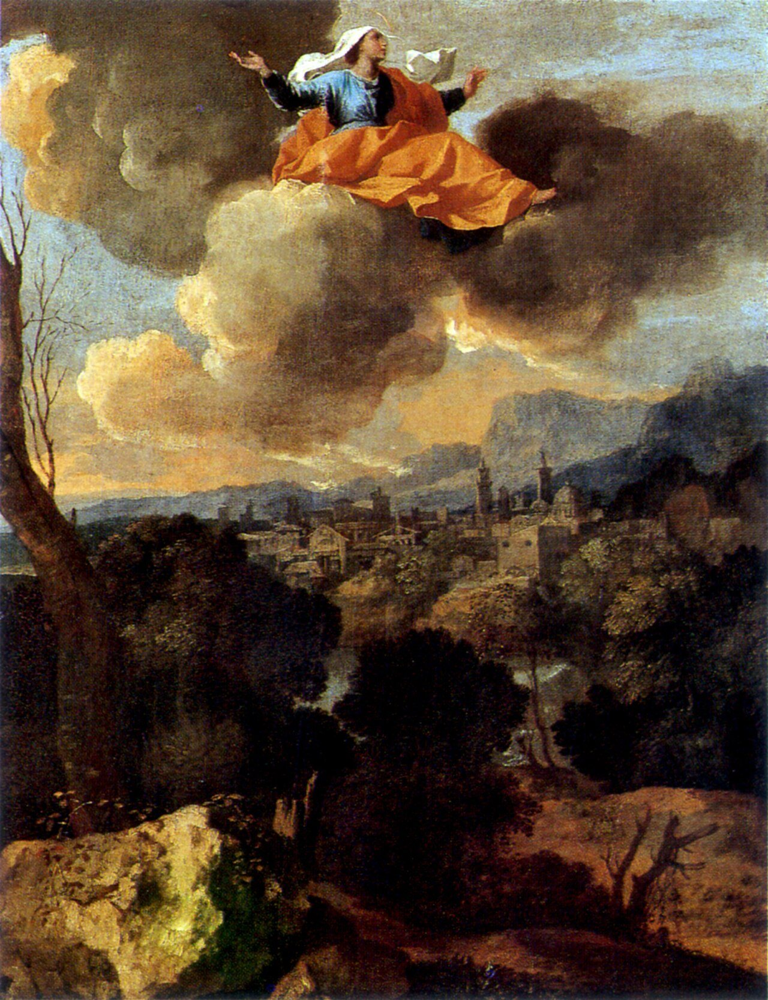</picture>
<figcaption>Nicolas Poussin, <em>The Translation of Saint Rita of Cascia</em>, mid-1630s, oil on panel. Rita is carried through the air toward Cascia above a town that seems to be Spoleto. Dulwich Picture Gallery, London. Public domain, via <a href="https://commons.wikimedia.org/wiki/File:La_Translation_miraculeuse_de_sainte_Rita_de_Cascia_-_Poussin_-_DulwichPG.jpg">Wikimedia Commons</a>.</figcaption>
</figure>

<h2 id=vine>The dry wood that became a vine</h2>

The abbess, it is said, wanted to try the humility of her new novice. She gave Rita a piece of **dry, dead wood**, had her plant it in the garden of the cloister, and told her to water it every day. Rita did not ask why. Day after day, drawing water from the well, she watered the dead stick. And God rewarded her obedience: the wood took root, put out leaves, and grew into a living, fruitful **vine**.

The vine is Rita's sign of obedience, patience and spiritual fruitfulness. A vine still grows in the cloister beside the old well, and it bears white grapes every year. The one you see today is more than two hundred years old, the nuns say, not the plant of the story, but it stands in its place and keeps its meaning.

<h2 id=thorn>The thorn</h2>

Rita's years in the cloister were years of prayer, fasting and penance, and of charity outside the walls as well: she and her sisters visited the old, nursed the sick and cared for the poor, and Cascia remembers that she tended the victims of the plague without ever catching it. More and more, her prayer was drawn to the sufferings of Christ.

On **Good Friday, 1442**, Rita heard a sermon on the Passion preached by the Franciscan **St James of the Marches**. She came back to the monastery deeply moved and knelt before an image of Christ crucified, and asked the Lord to let her share, even a little, in his suffering. Her prayer was answered. A thorn from the crown on the crucifix, a light, a flash, the nuns say they cannot know exactly what, pierced her **forehead**, and it remained there, in her flesh and in her soul.

The wound never closed. For fifteen years, until her death, Rita bore it as a sign of her union with Christ. It was sore and festered, and for much of those years she lived apart in her cell, speaking with no one but God, the old Lives say; she spoke little of the wound, and called it simply that, her wound. Once only, the shrine tells, she made a journey beyond the lands of Cascia: a pilgrimage on foot to **Rome**, linked by tradition with the canonisation of her protector St Nicholas of Tolentino in 1446. So that she could go, the wound healed before she set out, and it opened again when she came home. On the coffin made for her soon after her death, an epitaph says it plainly: *"For fifteen years you suffered the thorn."*

Pilgrims to the monastery can still pray in the **Oratory of the Crucifix**, before the painted cross that tradition holds is the very one of the miracle.

<h2 id=rose>The rose and the two figs</h2>

In the winter before her death, Rita was very ill and confined to her bed. A cousin came to visit her from Roccaporena, and as she was leaving she asked if there was anything Rita wanted from home. Rita asked for a **rose** from the garden of her family's house, and **two figs**.

It was January. Snow lay over the mountains. The cousin humoured her, thinking the fever had made her wander. But when she came back to Roccaporena and went into the little garden, she found, in the snow, a rose in full bloom on a bare bush, and two ripe figs on the fig tree. She picked them and carried them back over the valley to Cascia, and gave them to Rita.

Rita received them quietly, with thanks, as an answer. All her years in the cloister she had prayed for her husband, who had died by violence, and for her two sons, who had died so young. Roccaporena tells that the rose was for Paolo and the two figs for her two boys. Out of the cold ground where they lay, God had brought something living and sweet, out of season; and she understood that he had taken all three into heaven, and that she would soon be with them. This wonder is not only a pious story: witnesses told of it in the inquiry held for her beatification in 1626.

That is why Rita, the saint of the thorn, is also the saint of the **rose**. "Like the rose," her nuns say, "Rita was able to flourish despite the thorns that life had reserved for her," spreading the good fragrance of Christ and melting the winter of many hearts. The garden at Roccaporena is now the **Orto del Miracolo**, the Garden of the Miracle, with a bronze of Rita receiving the rose and figs; and the rose garden of the monastery at Cascia was planted from its roses.

<h2 id=death>Her passing, and the bells</h2>

Rita died in her cell in the night between **21 and 22 May 1457**. Roccaporena's tradition tells that before she closed her eyes she saw Jesus and his Mother inviting her into Paradise; a sister saw her soul rise to heaven with the angels; a sweet fragrance filled the monastery, and her cell shone as if the sun had come into it. And at that hour the **bells of the monastery began to ring by themselves**, moved by invisible hands, and the people of Cascia, as if called from heaven, came running to the convent to honour the holy nun.

So many came, and kept coming, that the sisters could not bury her. Among them was a carpenter, **Mastro Cecco Barbari**, whose hands were crippled. Looking at her body, he said, "If only I were not crippled, I would make the coffin for her myself." At those words his hands were healed, and he made the first simple coffin; the testimony is in the records of her cause. Soon after came the painted **"solemn casket"**, on which the earliest portrait of Rita still survives. The town began that same year to write down her miracles in a *Codex miraculorum*.

Rita has **never been buried**. Her body, never embalmed, has been kept and venerated for more than five centuries; it is the body of the first of the miracles approved for her canonisation, the sweet fragrance that came from it. Since **18 May 1947** it has rested in the basilica at Cascia, in a silver and crystal urn made in 1930. Her face, hands and feet are preserved, and physicians who examined her found, in the bone of her forehead, the mark of the wound she bore for fifteen years.

<h2 id=impossible>Saint of the impossible, and the roses of 22 May</h2>

Very soon after her death, the people of Cascia were calling on Rita against the plague, which she had nursed without fear. The miracles multiplied, and in Spain she came to be called *La Santa de los imposibles*, the saint of the impossible; at her canonisation she was hailed as the patroness of impossible causes. It suits her. Every part of her story is an impossible thing made possible by prayer: a hard heart softened, a feud ended by an embrace, a locked door opened in the night, a rose in the snow.

Pope **Urban VIII**, who had been bishop of Spoleto and knew her country, allowed her Mass and Office in 1627–28. Her cause was taken up again centuries later, and Pope **Leo XIII** canonised her on **24 May 1900**. In the great Jubilee of 2000, Pope St John Paul II received her pilgrims in Rome, where her body had been brought for the occasion, and praised the way she lived the "feminine genius" in both physical and spiritual motherhood.

Her feast is **22 May**. In Cascia it is kept with a novena, a torchlight procession on the evening of the 21st remembering the night the town ran to her monastery, a costumed pageant of her life, and a solemn Mass. At the end of the Mass comes the **blessing of the roses**: thousands of pilgrims lift their roses toward the sky to receive the blessing, and carry them home to share with their families and loved ones. Roses are blessed on her day in Augustinian churches and shrines of St Rita all over the world.

<h2 id=art>Rita in art</h2>

Rita is easy to know in a picture. She wears the black habit and white wimple of an Augustinian nun, with a wound or a thorn in her forehead. She often holds a crucifix, or a crown of thorns, and roses; sometimes figs, bees or a vine are near her, and sometimes a skull, as a reminder of the death she prepared for so faithfully.

The oldest image of all is the portrait painted on her **solemn casket**, made within a few years of her death and now kept in her cell in the monastery. It shows her as the people of Cascia first remembered her, a nun in a brown habit and white veil with a halo of gold, pointing to the thorn in her forehead.

<figure class=photo><picture><source srcset="/static/art/rita-casket-portrait-600.webp 600w,/static/art/rita-casket-portrait.webp 1280w" sizes="(max-width:760px) 100vw,760px" type="image/webp">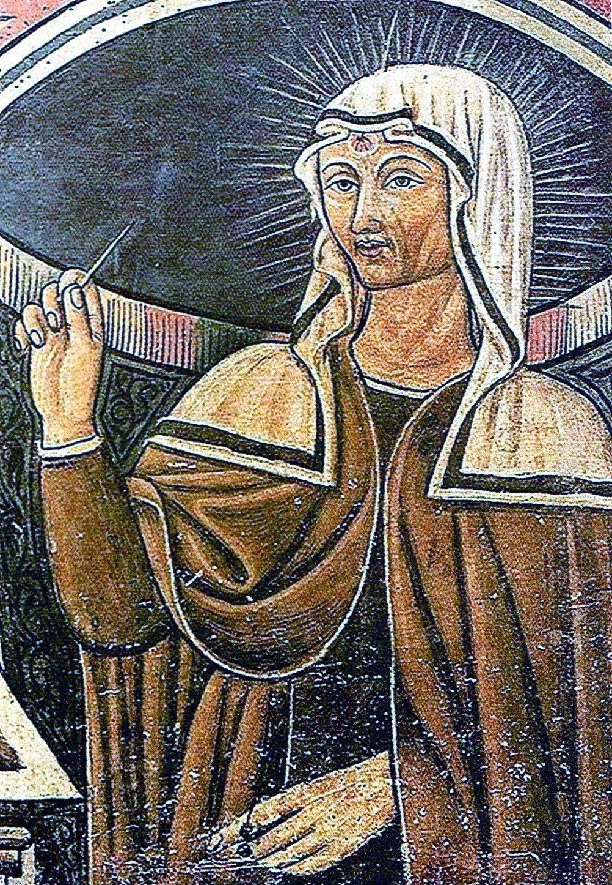</picture>
<figcaption>St Rita, detail of the painted "solemn casket" that held her body, 15th century. Monastery of St Rita, Cascia. Public domain, via <a href="https://commons.wikimedia.org/wiki/File:Santa_Rita_da_Cascia.jpg">Wikimedia Commons</a>.</figcaption>
</figure>

Devotion to Rita spread quickly through Spain and Portugal and their lands overseas. This sixteenth-century Portuguese painting shows her standing alone in a quiet landscape, holding the crucifix close to her face, with a branch of thorns in her hand.

<figure class=photo><picture><source srcset="/static/art/rita-portuguese-600.webp 600w,/static/art/rita-portuguese.webp 1280w" sizes="(max-width:760px) 100vw,760px" type="image/webp">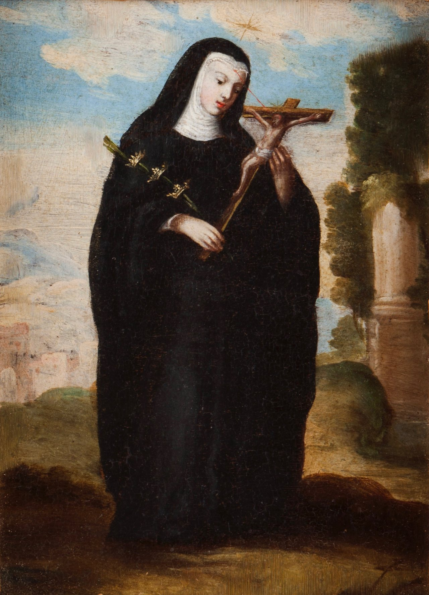</picture>
<figcaption><em>Saint Rita of Cascia</em>, Portuguese school, 16th century. Public domain, via <a href="https://commons.wikimedia.org/wiki/File:Santa_Rita_de_C%C3%A1ssia_-_escola_portuguesa,_s%C3%A9c._XVI.png">Wikimedia Commons</a>.</figcaption>
</figure>

**Nicolas Poussin**'s little panel of the mid-1630s, shown above with her flight to Cascia and at the top of this page, was painted in Rome in the years just after her beatification. It may have belonged to the Barberini family, the family of Pope Urban VIII, who beatified her; it is a rare picture in which Poussin seems to have painted a real town, and the hill city below her is probably Spoleto.

In Rome, the Augustinians honoured her in their great church of **Sant'Agostino**, where Giacinto Brandi painted her. In **1736** the engraver **Jacob Frey** made this print after Brandi's picture. Rita, the thorn in her brow, swoons into the arms of angels beneath a crucifix, while an angel kneels to tend her. The words above her name are from Job: *Ipse vulnerat, et medetur*, "He woundeth, and his hands make whole."

<figure class=photo><picture><source srcset="/static/art/rita-frey-600.webp 600w,/static/art/rita-frey.webp 1280w" sizes="(max-width:760px) 100vw,760px" type="image/webp">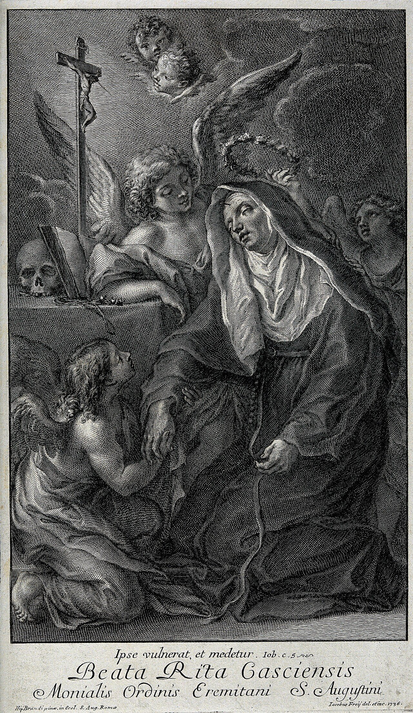</picture>
<figcaption>Jacob Frey after Giacinto Brandi, <em>Beata Rita Casciensis</em>, line engraving, 1736. Wellcome Collection. <a href="https://creativecommons.org/licenses/by/4.0/">CC BY 4.0</a>, via <a href="https://commons.wikimedia.org/wiki/File:The_blessed_Rita_Gasciensis._Line_engraving_by_J._Frey,_1736_Wellcome_V0031636.jpg">Wikimedia Commons</a>.</figcaption>
</figure>

In Caracas, in the eighteenth century, the Venezuelan painter **Juan Pedro López** painted her receiving consolation: an angel in red and gold wraps her in his arms as she turns from her book toward the cross, her hand on her heart.

<figure class=photo><picture><source srcset="/static/art/rita-lopez-600.webp 600w,/static/art/rita-lopez.webp 1280w" sizes="(max-width:760px) 100vw,760px" type="image/webp">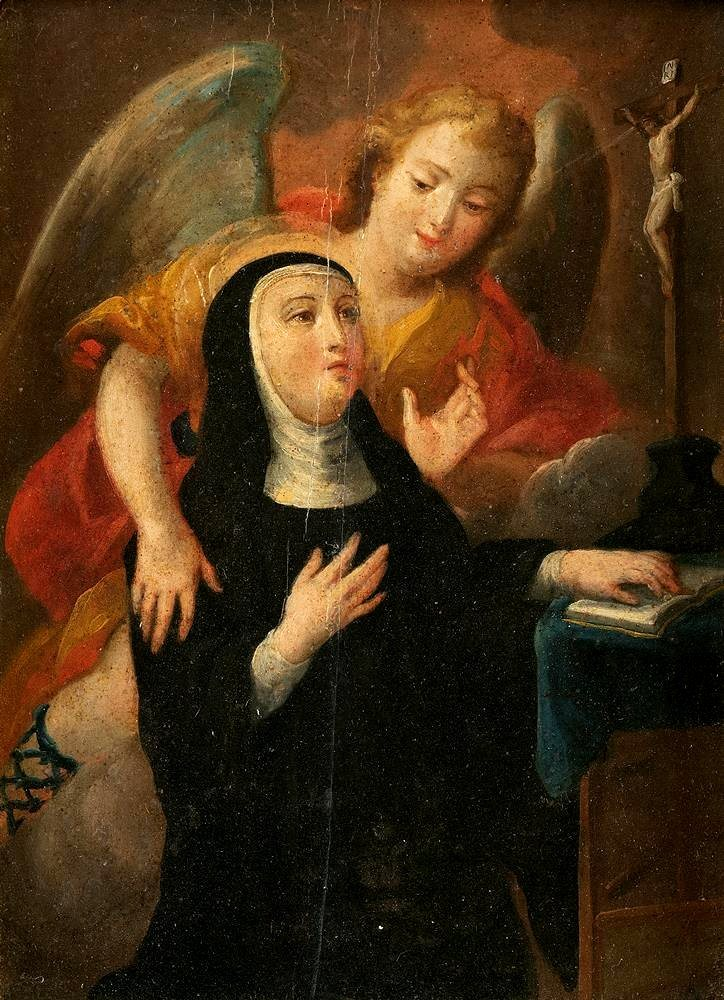</picture>
<figcaption>Juan Pedro López, <em>Saint Rita of Cascia</em>, between 1751 and 1787, oil on canvas. Carl &amp; Marilynn Thoma Foundation. Public domain, via <a href="https://commons.wikimedia.org/wiki/File:Saint_Rita_of_Cascia_by_Juan_Pedro_L%C3%B3pez.jpg">Wikimedia Commons</a>.</figcaption>
</figure>

And in New Mexico, around 1800, the *santero* **Pedro Antonio Fresquís** painted her on a small wooden panel, smaller than a sheet of paper, of the kind New Mexican families kept on their home altars: a nun with a crucifix and a skull, her rosary hanging at her side, between two trees. It is the faith of the frontier, simple and direct, and Rita is at home in it.

<figure class=photo><picture><source srcset="/static/art/rita-fresquis-600.webp 600w,/static/art/rita-fresquis.webp 1280w" sizes="(max-width:760px) 100vw,760px" type="image/webp">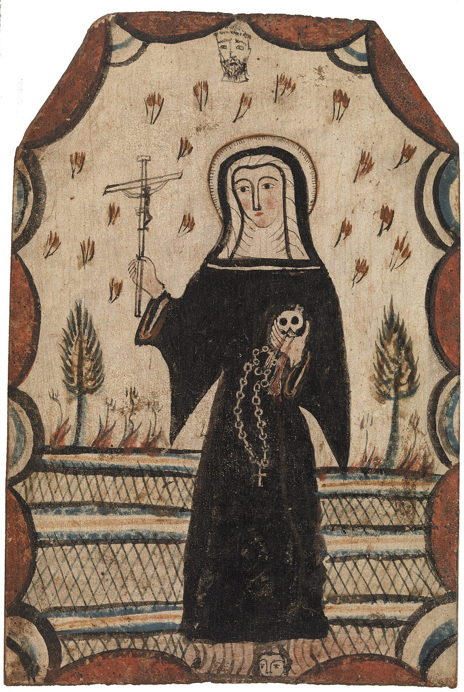</picture>
<figcaption>Pedro Antonio Fresquís, <em>Saint Rita of Cascia (Santa Rita de Cascia)</em>, New Mexico, about 1800. Barnes Foundation, Philadelphia (BF1013). Public domain, via <a href="https://commons.wikimedia.org/wiki/File:Pedro_Antonio_Fresquis_-_Saint_Rita_of_Cascia_(Santa_Rita_de_Cascia)_-_BF1013_-_Barnes_Foundation.jpg">Wikimedia Commons</a>.</figcaption>
</figure>

## Path to sainthood
Venerated from the night of her death; beatified under **Pope Urban VIII**, who allowed her Mass in 1627–28; canonised by **Pope Leo XIII** on **24 May 1900**. The miracles approved for her canonisation were the fragrance of her body, the healing of the young Elisabetta Bergamini, and the healing of Cosma Pellegrini of Conversano in 1887.

## Patronages
Impossible causes, difficult marriages, abused wives, widows, mothers, the sick and wounded; peace and forgiveness in families.

<h2 id=visit>Where to visit</h2>

Basilica of Santa Rita and her convent, Cascia (Umbria); her birthplace and the Scoglio (rock) at Roccaporena. The two are about 5 km apart, and pilgrims still walk between them.

### Cascia: the Basilica and the Monastery of St Rita

<figure class=map><a href="/static/maps/map-rita-cascia.svg">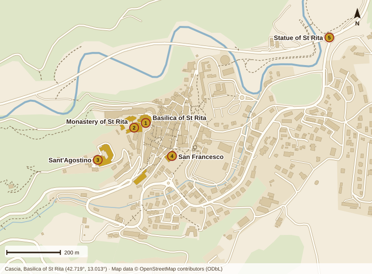</a><figcaption>Cascia. The basilica (1) and the monastery (2) stand together on the Sant'Agostino hill at the top of the old town; the church of San Francesco (4), where the fresco of the peace embrace was painted, is a short walk down. Map by The Daily Word from OpenStreetMap data. Tap to enlarge.</figcaption></figure>

The **Basilica of St Rita** stands on the Sant'Agostino hill above the town, on the site of the old church next to the monastery where Rita died. It was the dream of Blessed **Mother Maria Teresa Fasce**, the abbess who, in the 1920s, when Cascia had only a small church for its saint, set out to build a temple worthy of her pilgrims, and raised the money offering by offering, many of them very small. Pope Pius XI sent his own engineer, Mgr Spirito Maria Chiappetta, to draw the plans. Cardinal Enrico Gasparri laid the first stone on 20 June 1937; the church was consecrated on **18 May 1947**, while Italy was still recovering from the war, and Pius XII made it a basilica in 1955. Its white façade stands between two towers, and the entrance portal is framed by ten reliefs of her life by Eros Pellini, from the bees at her cradle to her passing; inside, under a painted dome, Rita lies in the chapel of her urn. The Mother who built it is buried in the lower basilica.

<figure class=photo><picture><source srcset="/static/art/rita-basilica-600.webp 600w,/static/art/rita-basilica.webp 1280w" sizes="(max-width:760px) 100vw,760px" type="image/webp">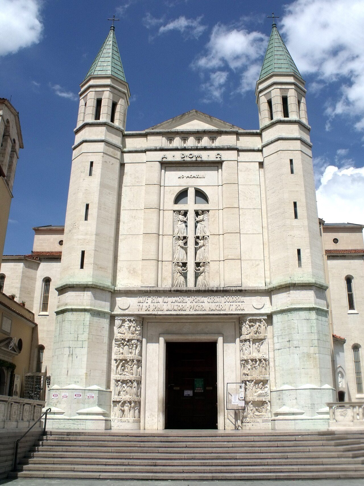</picture>
<figcaption>The Basilica of St Rita, Cascia, consecrated in 1947. Photo: <a href="https://commons.wikimedia.org/wiki/File:CasciaBasilicaSantaRita1.jpg">LigaDue</a>, <a href="https://creativecommons.org/licenses/by-sa/4.0">CC BY-SA 4.0</a>, via Wikimedia Commons.</figcaption>
</figure>

<figure class=photo><picture><source srcset="/static/art/rita-urn-600.webp 600w,/static/art/rita-urn.webp 1280w" sizes="(max-width:760px) 100vw,760px" type="image/webp">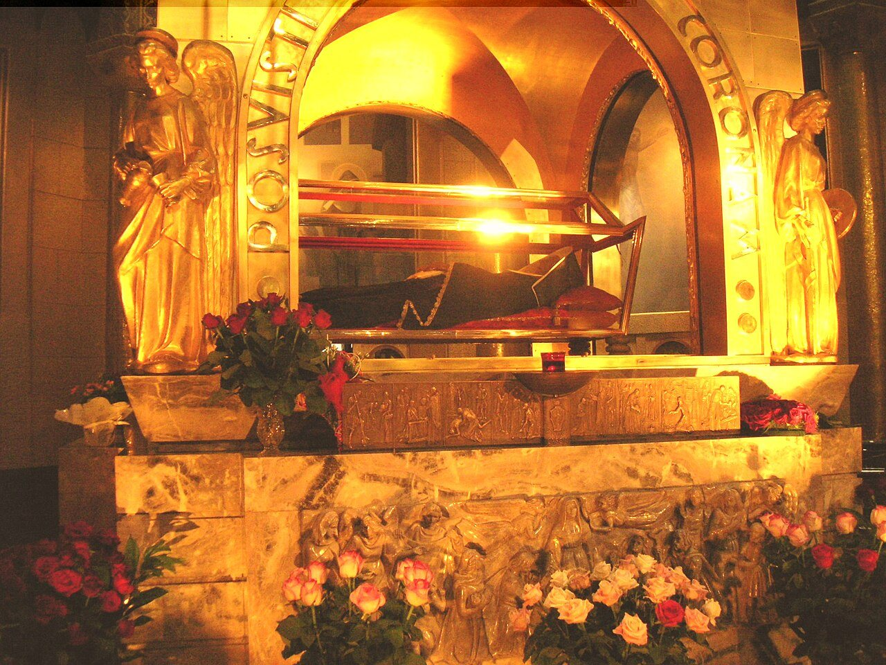</picture>
<figcaption>The chapel of St Rita in the basilica, where her body has rested since 1947 in the silver and crystal urn of 1930. Photo: <a href="https://commons.wikimedia.org/wiki/File:Basilica_di_Santa_Rita_5.JPG">Mentnafunangann</a>, <a href="https://creativecommons.org/licenses/by-sa/3.0">CC BY-SA 3.0</a>, via Wikimedia Commons.</figcaption>
</figure>

<figure class=photo><picture><source srcset="/static/art/rita-dome-600.webp 600w,/static/art/rita-dome.webp 1280w" sizes="(max-width:760px) 100vw,760px" type="image/webp">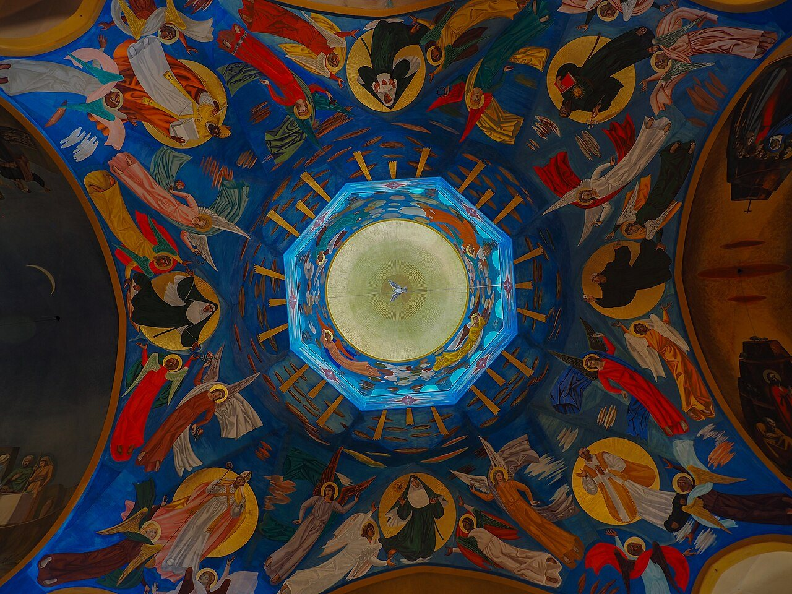</picture>
<figcaption>The painted dome of the basilica. Photo: <a href="https://commons.wikimedia.org/wiki/File:Cascia_-_Basilica_di_Santa_Rita_da_Cascia_-_i_colori_della_cupola.JPG">66colpi</a>, <a href="https://creativecommons.org/licenses/by-sa/4.0">CC BY-SA 4.0</a>, via Wikimedia Commons.</figcaption>
</figure>

Beside the basilica is the cloistered **Monastery of St Rita**, in her day the Monastery of St Mary Magdalene, whose oldest parts go back to the late 1200s. About forty Augustinian nuns live there still, in prayer and service, and parts of it can be visited: the **ancient choir** where the three saints set her down; the **cloister** with her vine, the old well, and the bees in the wall by the stairs; the **Oratory of the Crucifix** where she received the thorn; and **her cell**, where she lived and died, with the solemn casket that held her body for three centuries, her wedding ring and her rosary. On the way out is the **rose garden**, grown from the roses of her garden at Roccaporena.

<figure class=photo><picture><source srcset="/static/art/rita-cascia-roses-600.webp 600w,/static/art/rita-cascia-roses.webp 1280w" sizes="(max-width:760px) 100vw,760px" type="image/webp">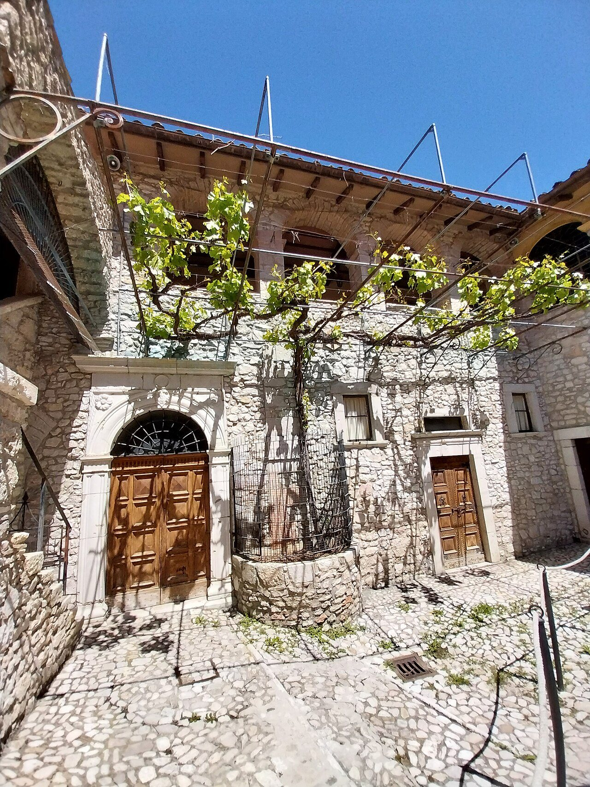</picture>
<figcaption>Roses beside the Basilica of St Rita, Cascia. Photo: <a href="https://commons.wikimedia.org/wiki/File:Rosaio_in_prossimit%C3%A0_della_Basilica_di_Santa_Rita_(Cascia)_01.jpg">Francesco Falconetti</a>, <a href="https://creativecommons.org/licenses/by-sa/4.0">CC BY-SA 4.0</a>, via Wikimedia Commons.</figcaption>
</figure>

### The Path of St Rita

Between Roccaporena and Cascia runs the **Sentiero di Santa Rita**, a footpath of about 5.5 km along the river Corno, past the site of the Mulinaccio where she lived as a wife and mother. It is the way she knew, and pilgrims walk it in her footsteps.

<figure class=map><a href="/static/maps/map-rita-valley.svg">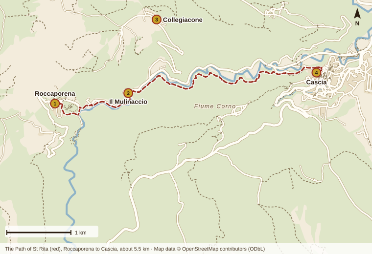</a><figcaption>The Path of St Rita, Roccaporena (1) to Cascia (4), past the Mulinaccio (2); Collegiacone (3) is on the hill above. Map by The Daily Word from OpenStreetMap data. Tap to enlarge.</figcaption></figure>

### Roccaporena: her birthplace and the Scoglio

<figure class=map><a href="/static/maps/map-rita-roccaporena.svg">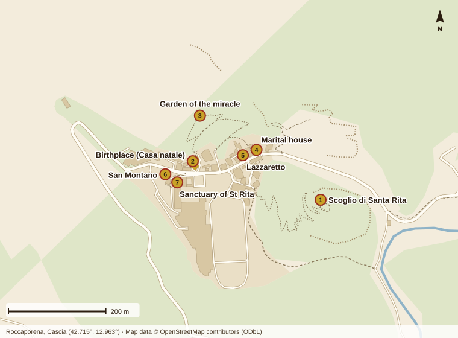</a><figcaption>Roccaporena. Everything is within a few minutes' walk; the stairway to the Scoglio (1) climbs from the east end of the village. Map by The Daily Word from OpenStreetMap data. Tap to enlarge.</figcaption></figure>

Roccaporena sits at about 700 metres at the end of a little gorge, under a great spur of rock. Until 1950 no road reached it. Almost everything in it speaks of Rita.

The **Scoglio**, the rock, rises about 120 metres above the village. Here Rita came to pray, climbing a steep track she wore with her own feet, and here, tradition says, she prayed so long and so ardently that the marks of her knees and elbows remain in the stone. From here the three saints carried her to Cascia. A little chapel was built over the top of the rock in 1919 and rebuilt in 1979 after an earthquake; a stairway of about 330 steps now climbs to it, with the Stations of the Cross along the way, and beside the chapel is a spring the pilgrims call "Rita's water." Mass is celebrated up there on Sundays in turn with the marital house.

<figure class=photo><picture><source srcset="/static/art/rita-scoglio-orto-600.webp 600w,/static/art/rita-scoglio-orto.webp 1280w" sizes="(max-width:760px) 100vw,760px" type="image/webp">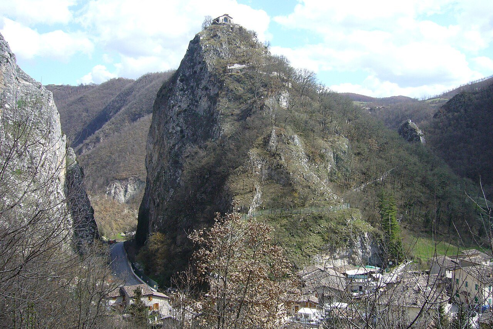</picture>
<figcaption>The Scoglio di Santa Rita, seen from the Garden of the Miracle in Roccaporena. Photo: <a href="https://commons.wikimedia.org/wiki/File:Roccaporena-Scoglio_di_Santa_Rita_vista_dall%27orto_dei_miracoli_-_panoramio.jpg">maury3001</a>, <a href="https://creativecommons.org/licenses/by/3.0">CC BY 3.0</a>, via Wikimedia Commons.</figcaption>
</figure>

<figure class=photo><picture><source srcset="/static/art/rita-scoglio-600.webp 600w,/static/art/rita-scoglio.webp 1280w" sizes="(max-width:760px) 100vw,760px" type="image/webp">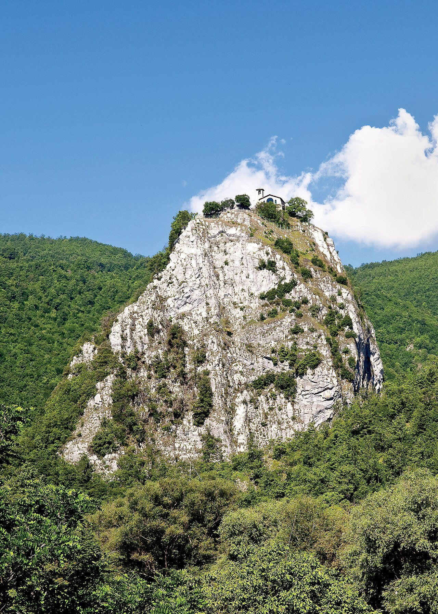</picture>
<figcaption>The Scoglio Sacro above Roccaporena. Photo: <a href="https://commons.wikimedia.org/wiki/File:Scoglio_Sacro.jpg">Passanto</a>, <a href="https://creativecommons.org/licenses/by-sa/4.0">CC BY-SA 4.0</a>, via Wikimedia Commons.</figcaption>
</figure>

<figure class=photo><picture><source srcset="/static/art/rita-scoglio-chapel-600.webp 600w,/static/art/rita-scoglio-chapel.webp 1280w" sizes="(max-width:760px) 100vw,760px" type="image/webp">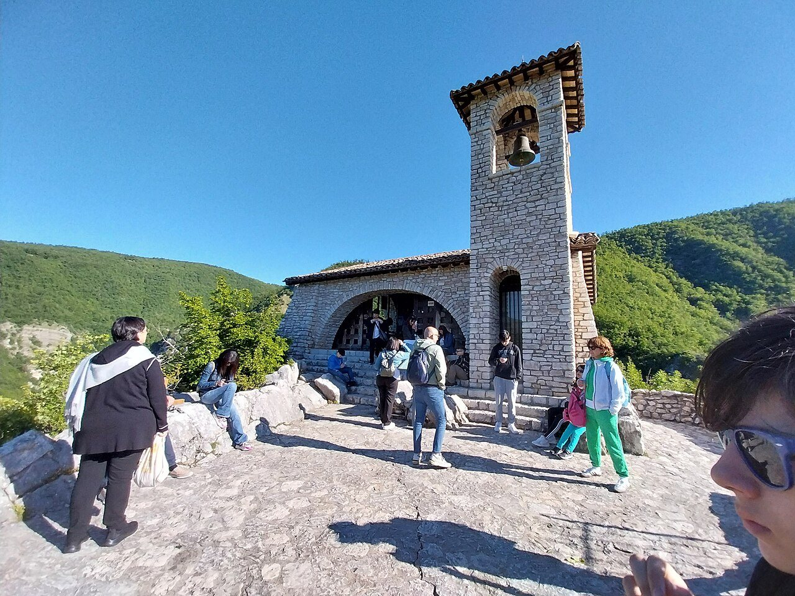</picture>
<figcaption>The chapel at the top of the path up the Scoglio. Photo: <a href="https://commons.wikimedia.org/wiki/File:Cappella_al_termine_del_sentiero_che_conduce_allo_Scoglio_Sacro_(Roccaporena)_01.jpg">Francesco Falconetti</a>, <a href="https://creativecommons.org/licenses/by-sa/4.0">CC BY-SA 4.0</a>, via Wikimedia Commons.</figcaption>
</figure>

Her **birthplace** is a modest two-storey house of the 1300s in the heart of the village. Upstairs are two small rooms; from one of them a window looks out toward the Scoglio, and tradition places her cradle there. Rita lived in this house until her marriage. Nearby is the **Garden of the Miracle**, reached by three little paths, where the rose and the figs were found in the snow; among its rose bushes a bronze group by Rodolfo Maleci (1941) shows Rita on her deathbed receiving them from her cousin.

<figure class=photo><picture><source srcset="/static/art/rita-birthplace-600.webp 600w,/static/art/rita-birthplace.webp 1280w" sizes="(max-width:760px) 100vw,760px" type="image/webp">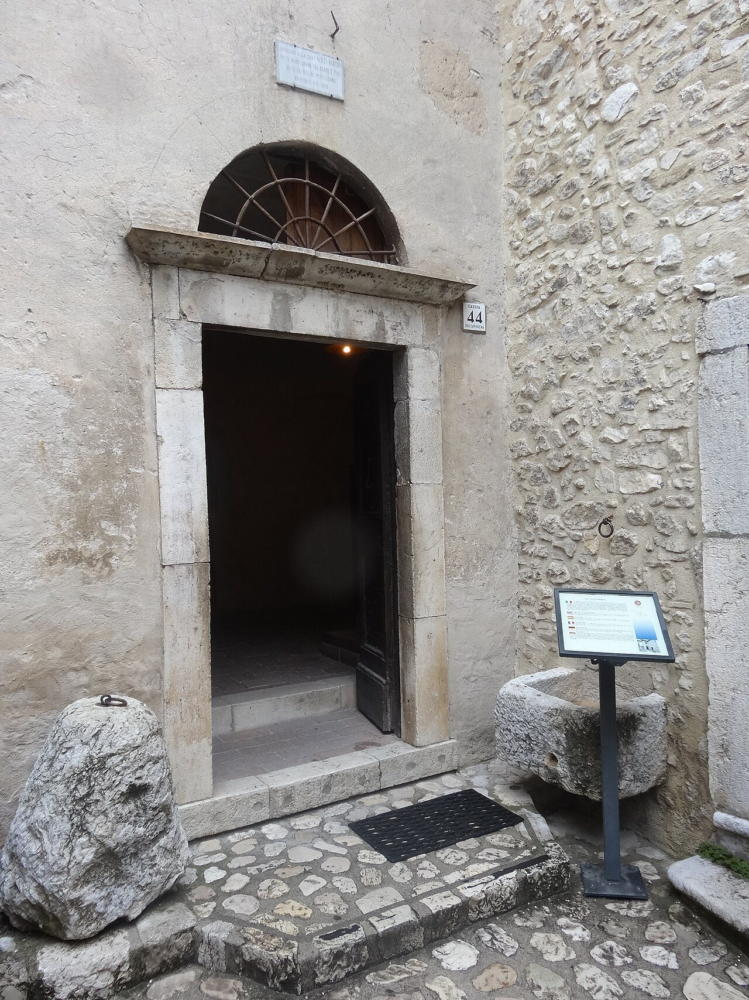</picture>
<figcaption>The birthplace of St Rita, Roccaporena. Photo: <a href="https://commons.wikimedia.org/wiki/File:2016_Rita_of_Cascia_birthplace_01.jpg">Jordiferrer</a>, <a href="https://creativecommons.org/licenses/by-sa/4.0">CC BY-SA 4.0</a>, via Wikimedia Commons.</figcaption>
</figure>

The **marital house**, at the entrance to the village, is where Rita lived as a wife and mother and as a widow, until she went to Cascia. It came through the earthquake of 1599 unharmed, and in 1629 Cardinal Fausto Poli, a son of these mountains who championed her cause with Urban VIII, had it made into a chapel; a painting of Rita receiving the thorn, attributed to Luca Giordano, hangs over its altar. Close by is the **Lazzaretto**, the old village hospital, where tradition says her sons died of the plague and where Rita cared for the sick and for travellers passing through; two of its rooms survive, with sixteenth-century frescoes.

<figure class=photo><picture><source srcset="/static/art/rita-marital-house-600.webp 600w,/static/art/rita-marital-house.webp 1280w" sizes="(max-width:760px) 100vw,760px" type="image/webp">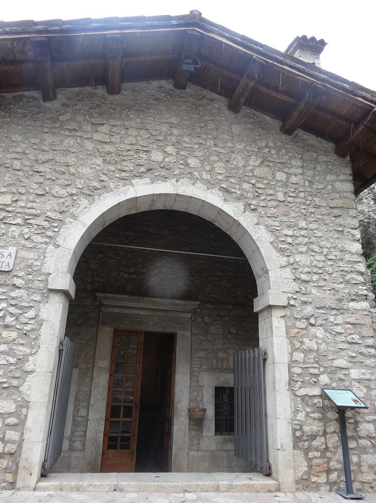</picture>
<figcaption>The marital house of St Rita, made a chapel in 1629. Photo: <a href="https://commons.wikimedia.org/wiki/File:2016_Casa_maritale_di_Rita_02.jpg">Jordiferrer</a>, <a href="https://creativecommons.org/licenses/by-sa/4.0">CC BY-SA 4.0</a>, via Wikimedia Commons.</figcaption>
</figure>

<figure class=photo><picture><source srcset="/static/art/rita-lazzaretto-600.webp 600w,/static/art/rita-lazzaretto.webp 1280w" sizes="(max-width:760px) 100vw,760px" type="image/webp">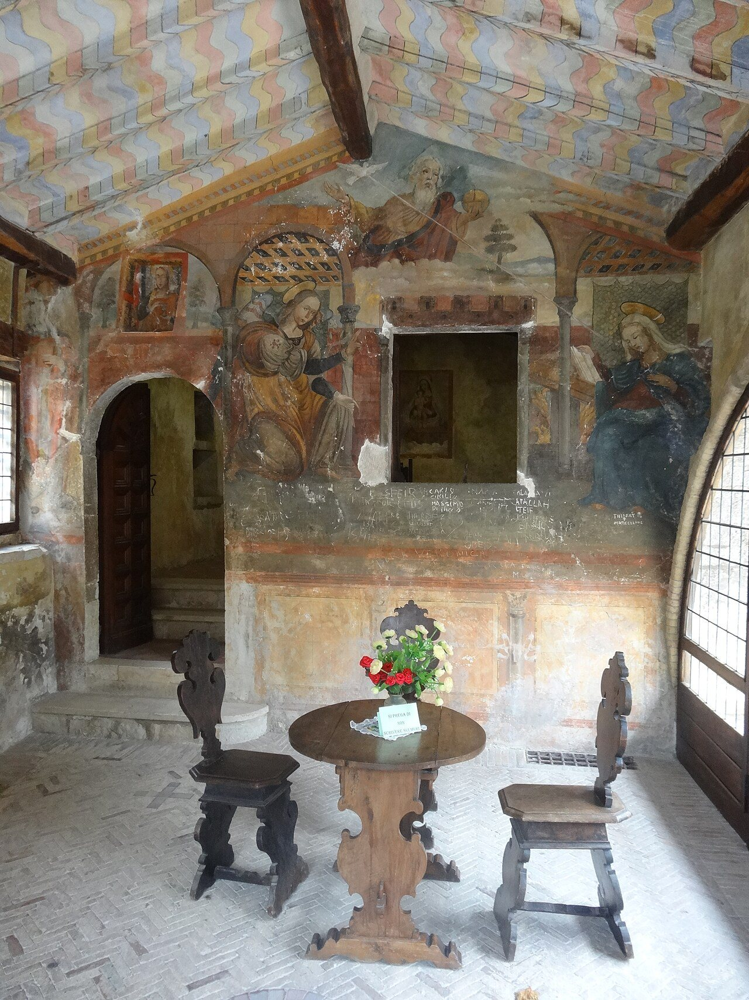</picture>
<figcaption>Inside the Lazzaretto, the old hospital of Roccaporena. Photo: <a href="https://commons.wikimedia.org/wiki/File:2016_Lazzaretto_(Roccaporena)_02.jpg">Jordiferrer</a>, <a href="https://creativecommons.org/licenses/by-sa/4.0">CC BY-SA 4.0</a>, via Wikimedia Commons.</figcaption>
</figure>

The little Romanesque church of **San Montano**, the oldest in the village, is where Rita received the sacraments, went to Mass as a girl, and was married to Paolo; her husband and her two sons are buried there. Beside it stands the **Sanctuary of St Rita**, consecrated in 1948, where her cloak, the one she wore against the hard Roccaporena winters, is kept in a silver case.

<figure class=photo><picture><source srcset="/static/art/rita-san-montano-600.webp 600w,/static/art/rita-san-montano.webp 1280w" sizes="(max-width:760px) 100vw,760px" type="image/webp">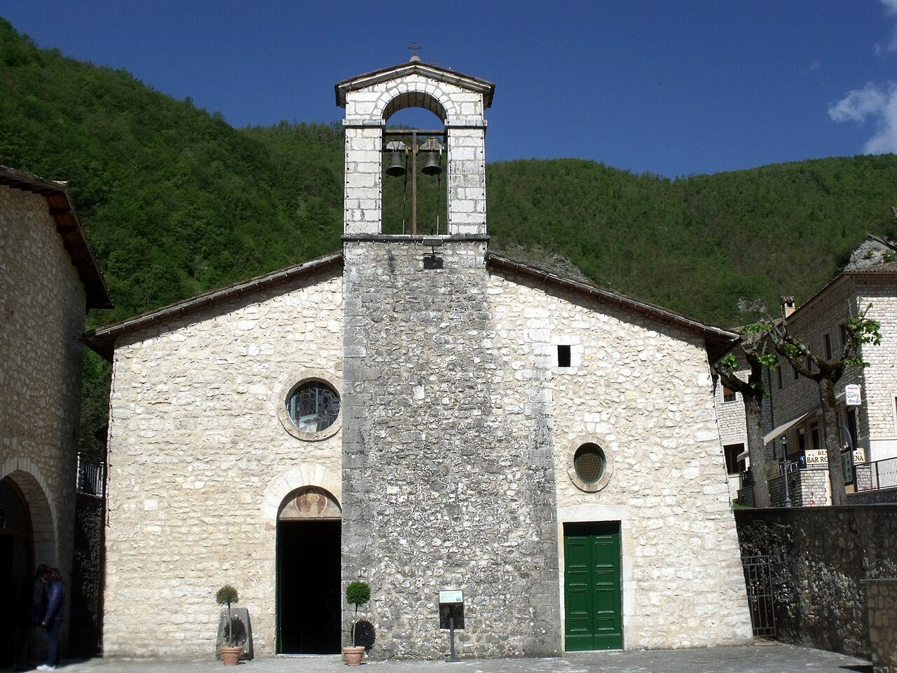</picture>
<figcaption>San Montano, Roccaporena, where Rita was married. Photo: <a href="https://commons.wikimedia.org/wiki/File:RoccaporenaSanMontanoChurchFacade.jpg">LigaDue</a>, <a href="https://creativecommons.org/licenses/by-sa/4.0">CC BY-SA 4.0</a>, via Wikimedia Commons.</figcaption>
</figure>

<figure class=photo><picture><source srcset="/static/art/rita-roccaporena-600.webp 600w,/static/art/rita-roccaporena.webp 1280w" sizes="(max-width:760px) 100vw,760px" type="image/webp">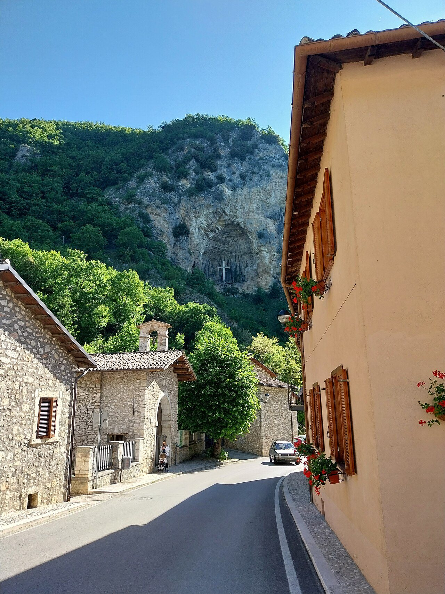</picture>
<figcaption>Roccaporena, in its gorge under the mountains. Photo: <a href="https://commons.wikimedia.org/wiki/File:Roccaporena_02.jpg">Francesco Falconetti</a>, <a href="https://creativecommons.org/licenses/by-sa/4.0">CC BY-SA 4.0</a>, via Wikimedia Commons.</figcaption>
</figure>

For opening hours, Mass times and pilgrim groups, see the official [Sanctuary of St Rita](https://santaritadacascia.org/en/pilgrimage/places-of-pilgrimage/) and the [Roccaporena](https://www.roccaporena.it/santa-rita.html) pages. In the United States, the [National Shrine of St Rita of Cascia](https://www.saintritashrine.org/saint-rita-of-cascia) is in Philadelphia.

## Trivia
- Roses are blessed on her feast, **22 May**, in Augustinian churches worldwide.
- Her body, never embalmed, lies in a glass shrine in the basilica at Cascia.
- She is one of Italy's most popular saints; Cascia receives over a million pilgrims a year.
- The procession on the Sunday before her feast was founded by the town in 1731, in thanks for her protection in the earthquake of 1730.
- King John V of Portugal, who believed he had been healed through her prayers, paid for the enlargement of her monastery in the 1700s.

## Sources
- [Vatican News: St Rita of Cascia](https://www.vaticannews.va/en/saints/05/22/st--rita-of-cascia--agostinian.html)
- [Catholic Encyclopedia: St Rita of Cascia](https://www.newadvent.org/cathen/13064a.htm)
- [Dicastery for the Causes of Saints: Rita da Cascia](https://www.causesanti.va/it/santi-e-beati/rita-da-cascia.html) (Italian)
- Sanctuary of St Rita, Cascia: [Her life](https://santaritadacascia.org/la-santa/vita/) (Italian), [The Monastery](https://santaritadacascia.org/en/the-monastery/), [Symbology](https://santaritadacascia.org/en/the-saint/symbology/), [The feast of St Rita](https://santaritadacascia.org/en/the-saint/the-feast-of-saint-rita/) and [The Basilica](https://santaritadacascia.org/en/il-santuario/basilica/)
- [Roccaporena: Santa Rita](https://www.roccaporena.it/santa-rita.html) and [Opera di Santa Rita, Roccaporena](https://roccaporena.com/santa-rita-a-roccaporena-di-cascia/) (Italian)
- [National Shrine of St Rita of Cascia, Philadelphia](https://www.saintritashrine.org/saint-rita-of-cascia)
- [Treccani, Dizionario Biografico: Rita da Cascia](https://www.treccani.it/enciclopedia/rita-da-cascia-santa_%28Dizionario-Biografico%29/) (Italian)
- [Dulwich Picture Gallery: Poussin, The Translation of Saint Rita of Cascia](https://www.dulwichpicturegallery.org.uk/explore/explore-the-collection/the-translation-of-saint-rita-of-cascia/)
- [Wikipedia: Rita of Cascia](https://en.wikipedia.org/wiki/Rita_of_Cascia), [Roccaporena](https://it.wikipedia.org/wiki/Roccaporena) (Italian) and [Basilica di Santa Rita da Cascia](https://it.wikipedia.org/wiki/Basilica_di_Santa_Rita_da_Cascia) (Italian)

Fact-checked on October 16, 2026 against Vatican documents, Vatican News and New Advent (Catholic Encyclopedia), plus local sources where noted. Expanded November 15, 2026 with the story of the feud and the peace, the wonders of her life as the Sanctuary of Cascia and the shrine at Roccaporena tell them, her art, and maps and photographs of the places, using the Sanctuary's own pages, the Dicastery for the Causes of Saints, museum catalogues and Wikimedia Commons. The maps were drawn for this page from OpenStreetMap data (© OpenStreetMap contributors, ODbL) and Natural Earth. Feast days follow the General Roman Calendar unless noted.

