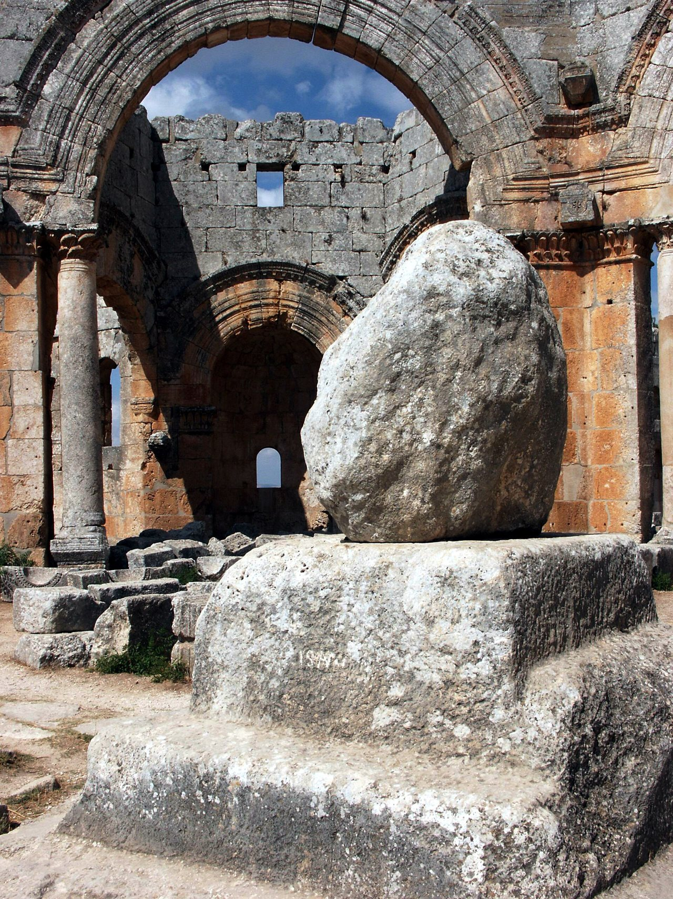

## The story
Simeon was a shepherd boy from Cilicia who became a monk at about 16. His penances were so extreme that his monastery asked him to leave. He lived as a hermit near Telanissos (Deir Semaan), east of Antioch, but crowds came to touch him and ask his prayers. To escape them he went **up**. Around 423 he built a small pillar; over the years it was raised until it was about **15–18 m** high, with a small platform and railing at the top. He lived on it for some **37 years**, until his death in 459.

## The full story

### An eyewitness
Unusually, we have reports from people who saw him: the historian **Theodoret of Cyrrhus**, who knew him, and a Syriac *Life* written by his disciples. They say he preached twice a day from the top, settled disputes, wrote letters to emperors and bishops (Theodosius II and Leo I asked his advice), and converted many Bedouin. Food was sent up by ladder.

### Qal'at Sim'an
After his death a huge cross-shaped basilica was built around the pillar, one of the great churches of the 5th century. Its ruins, at **Qal'at Sim'an** in northern Syria, are part of a UNESCO World Heritage site; the stump of the pillar is still there, worn down by pilgrims taking pieces. It was damaged in the Syrian civil war. Theodoret and the disciples' Life are why those years are so well known. From his example came the stylites, from the Greek *stylos*, a pillar, a way of life that lasted into the Middle Ages. St Daniel the Stylite followed it near Constantinople.

<figure class=photo>
<picture><source srcset="/static/art/simeon-pillar-600.webp 600w,/static/art/simeon-pillar.webp 1280w" sizes="(max-width:760px) 100vw,760px" type="image/webp"></picture>
<figcaption>What remains of his pillar at Qal'at Sim'an, near Aleppo, worn down by pilgrims. The fifth-century basilica was built around it. Photo: <a href="https://commons.wikimedia.org/wiki/File:Column_remains%2C_Saint_Simeon_Stylites_Basilica%2C_near_Aleppo%2C_Syria.jpg">James Gordon</a>, <a href="https://creativecommons.org/licenses/by/2.0">CC BY 2.0</a>, via Wikimedia Commons.</figcaption>
</figure>

## Path to sainthood
Pre-Congregation saint, venerated from his lifetime.

## Patronages
Shepherds (popular).

## Trivia
- Luis Buñuel made a film about him, *Simon of the Desert* (1965).
- A story says a monastic council sent him an order to come down; when he immediately obeyed, they told him to stay, since this proved his humility.

## Sources
- [Catholic Encyclopedia: St Simeon Stylites the Elder](https://www.newadvent.org/cathen/13795a.htm)

Written October 16, 2026 from the sources above. The Qal'at Sim'an photograph was added November 6, 2026. Feast days follow the General Roman Calendar unless noted.

