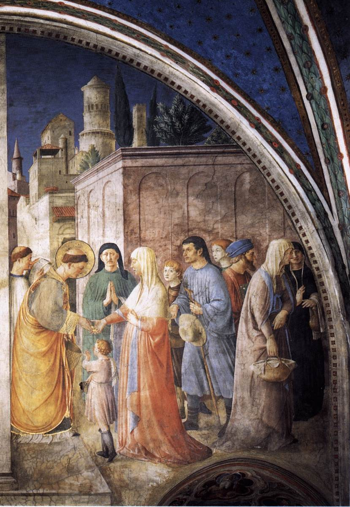
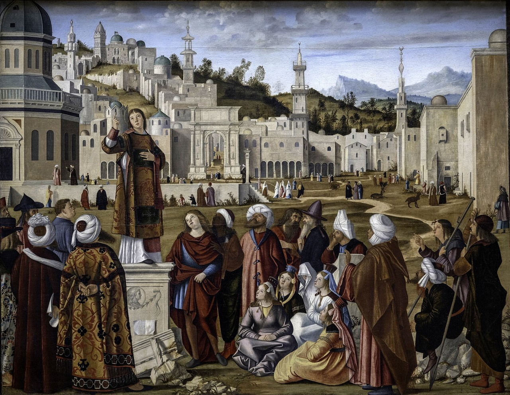
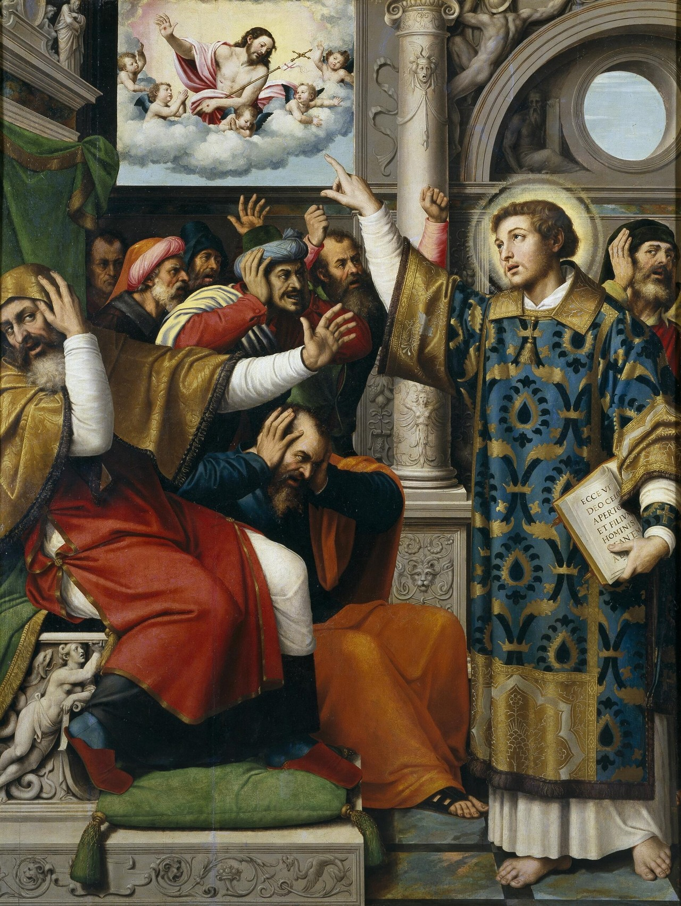
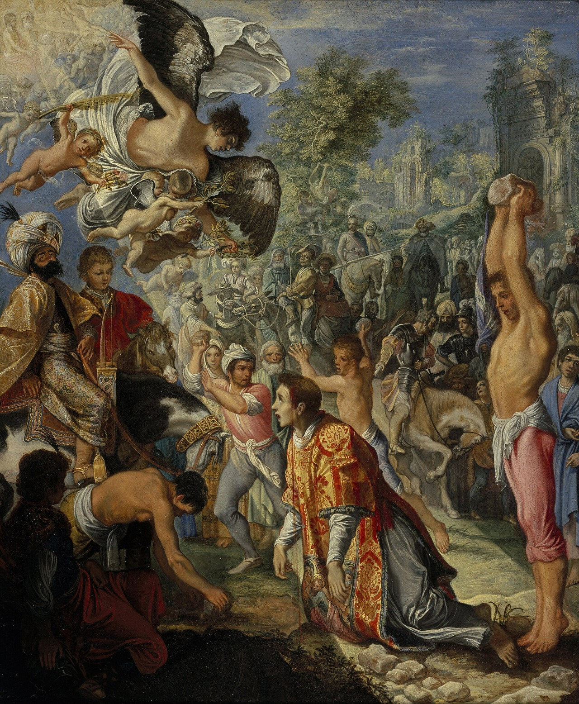

<nav class=toc aria-label="On this page">

On this page

<ol>
<li><a href="#seven">Among the Seven</a></li>
<li><a href="#trial">The trial</a></li>
<li><a href="#stoning">The stoning</a></li>
<li><a href="#art">Stephen in art</a></li>
<li><a href="#recognise">How to recognise him in art</a></li>
</ol>
</nav>

## His story
Stephen was one of the seven men chosen by the apostles to serve the Greek-speaking widows of the Jerusalem church (Acts 6:1–6), the first "deacons". Acts calls him "full of grace and power". Accused of speaking against the Temple and the Law, he gave a long speech before the Sanhedrin retelling Israel's history (Acts 7), saw "the heavens opened", and was dragged out of the city and stoned. He died praying, "Lord, do not hold this sin against them." A young man named **Saul**, later the apostle Paul, guarded the cloaks of the men who stoned him (Acts 7:58).

<h2 id=seven>Among the Seven</h2>

The church in Jerusalem was growing, and the Greek-speaking widows were being overlooked in the daily distribution of food. The twelve called the disciples together and asked them to choose seven men "of honest report, full of the Holy Ghost and wisdom" (Acts 6:3), so that the apostles might keep to prayer and the ministry of the word. The first name Luke writes down is Stephen, "a man full of faith and of the Holy Ghost" (Acts 6:5). They set the seven before the apostles, who prayed and laid their hands on them.

Stephen's work did not end at the tables.

KJV · Acts 6:8
And Stephen, full of faith and power, did great wonders and miracles among the people.

Those who came to argue with him "were not able to resist the wisdom and the spirit by which he spake" (Acts 6:10).

<h2 id=trial>The trial</h2>

They stirred up the people, the elders and the scribes, and brought him before the council, the Sanhedrin. False witnesses said that he never ceased to speak "blasphemous words against this holy place, and the law" (Acts 6:13), as if he would change the customs Moses had delivered. All who sat in the council looked stedfastly on him, and "saw his face as it had been the face of an angel" (Acts 6:15).

Then the high priest asked, "Are these things so?" (Acts 7:1). Stephen's answer is the longest speech in Acts. He retold Israel's story from Abraham to Solomon's Temple, and said that "the most High dwelleth not in temples made with hands" (Acts 7:48). He called his judges "stiffnecked," and said they had received the law by the disposition of angels and had not kept it, and had betrayed and murdered the Just One, as their fathers had killed the prophets (Acts 7:51–53).

<h2 id=stoning>The stoning</h2>

When they heard these things they were cut to the heart, and they gnashed on him with their teeth. Stephen did not look at them.

KJV · Acts 7:55–56
But he, being full of the Holy Ghost, looked up stedfastly into heaven, and saw the glory of God, and Jesus standing on the right hand of God, and said, Behold, I see the heavens opened, and the Son of man standing on the right hand of God.

Greek · SBLGNT · Acts 7:56

Ἰδοὺ θεωρῶ τοὺς οὐρανοὺς διηνοιγμένους καὶ τὸν υἱὸν τοῦ ἀνθρώπου ἐκ δεξιῶν ἑστῶτα τοῦ θεοῦ.

Idou theōrō tous ouranous diēnoigmenous kai ton huion tou anthrōpou ek dexiōn hestōta tou theou.

Latin · Vulgate · Acts 7:56
Ecce video caelos apertos, et Filium hominis stantem a dextris Dei.

They cried out with a loud voice, stopped their ears, and ran upon him with one accord. They "cast him out of the city, and stoned him: and the witnesses laid down their clothes at a young man's feet, whose name was Saul" (Acts 7:58). As the stones fell he called upon God, and said, "Lord Jesus, receive my spirit." Then he knelt down and cried with a loud voice, "Lord, lay not this sin to their charge." And when he had said this, he fell asleep (Acts 7:59–60). Devout men carried Stephen to his burial, and made great lamentation over him (Acts 8:2). The young man who kept the cloaks would meet the same Lord on the [Damascus road](/saints/paul/).

<h2 id=art>Stephen in art</h2>

The painting at the head of this page is Rembrandt's first signed work.

**Rembrandt, *The Stoning of Saint Stephen*, 1625.** He painted it in Leiden when he was nineteen, in oil on an oak panel. It is his first signed painting, and it hangs in the **Musée des Beaux-Arts de Lyon**. Stephen kneels in the light, already struck, while the crowd closes in; at the side sits the young Saul with the witnesses' garments, just as Acts 7:58 describes. A face just behind Stephen is often identified as Rembrandt's first self-portrait.

<figure class=photo><picture><source srcset="/static/art/stephen-angelico-alms-600.webp 600w,/static/art/stephen-angelico-alms.webp 1280w" sizes="(max-width:760px) 100vw,760px" type="image/webp"></picture>
<figcaption>Fra Angelico, <em>St Stephen Distributing Alms</em>, 1447–49, fresco. Niccoline Chapel, Apostolic Palace, Vatican. Public domain, via <a href="https://commons.wikimedia.org/wiki/File:Angelico,_niccolina_21.jpg">Wikimedia Commons</a>.</figcaption>
</figure>

**Fra Angelico, *St Stephen Distributing Alms*, 1447–49.** Pope Nicholas V asked the Dominican painter Fra Angelico to fresco his private chapel in the Vatican, the **Niccoline Chapel**. The walls tell the lives of two deacon-martyrs side by side, Stephen and [Lawrence](/saints/lawrence/), from their consecration to their deaths. Here Stephen, still young, in a golden dalmatic, gives alms to the poor of Jerusalem: a widow, a child reaching up, a man with a staff, a woman with a basket. It is the work for which the Seven were chosen, painted as an act of quiet charity under a vault of stars.

<figure class=photo><picture><source srcset="/static/art/stephen-carpaccio-sermon-600.webp 600w,/static/art/stephen-carpaccio-sermon.webp 1280w" sizes="(max-width:760px) 100vw,760px" type="image/webp"></picture>
<figcaption>Vittore Carpaccio, <em>The Sermon of St Stephen</em>, about 1514, oil on canvas. Musée du Louvre, Paris. Public domain, via <a href="https://commons.wikimedia.org/wiki/File:Sermon_of_Saint_Stephen_by_Carpaccio.jpg">Wikimedia Commons</a>.</figcaption>
</figure>

**Vittore Carpaccio, *The Sermon of St Stephen*, about 1514.** Between 1511 and 1520 Carpaccio painted a cycle of five canvases on Stephen's life for the **Scuola di Santo Stefano**, the wool-workers' guild, in Venice. This one, of the sermon, is in the **Louvre**. The others are in Berlin, Milan and Stuttgart; one is lost. Stephen stands on a ruined pedestal at the edge of an imagined Jerusalem, a Gospel book in one hand, the other raised, and the crowd before him is mixed: Greeks, Ottomans in turbans, and Europeans who have stopped to listen. Acts says his hearers could not resist the wisdom by which he spoke. Here you can almost hear him.

<figure class=photo><picture><source srcset="/static/art/stephen-juanes-trial-600.webp 600w,/static/art/stephen-juanes-trial.webp 1280w" sizes="(max-width:760px) 100vw,760px" type="image/webp"></picture>
<figcaption>Juan de Juanes, <em>Saint Stephen Accused of Blasphemy</em>, about 1562, oil on panel. Museo del Prado, Madrid. Public domain, via <a href="https://commons.wikimedia.org/wiki/File:San_Esteban_acusado_de_blasfemo_(Museo_del_Prado).jpg">Wikimedia Commons</a>.</figcaption>
</figure>

**Juan de Juanes, *Saint Stephen Accused of Blasphemy*, about 1562.** Vicente Juan Masip, called Juan de Juanes, painted a set of five panels of Stephen's life for the church of **San Esteban** in Valencia. They now hang in the **Prado**. This is the trial. Stephen stands in a blue dalmatic, a book in his left hand already written with the Latin of his vision — *Ecce video caelos apertos* — and his right hand points to Christ in the cloud above. The judges cover their ears and hide their faces, as Acts says they stopped their ears and ran upon him. You can see why painters loved this moment: heaven is already open, before a single stone is thrown.

<figure class=photo><picture><source srcset="/static/art/stephen-elsheimer-stoning-600.webp 600w,/static/art/stephen-elsheimer-stoning.webp 1280w" sizes="(max-width:760px) 100vw,760px" type="image/webp"></picture>
<figcaption>Adam Elsheimer, <em>The Stoning of Saint Stephen</em>, about 1603–04, oil on tinned copper. National Galleries of Scotland, Edinburgh. Public domain, via <a href="https://commons.wikimedia.org/wiki/File:Adam_Elsheimer_-_Steinigung_des_heiligen_Stephanus_(Edinburgh).jpg">Wikimedia Commons</a>.</figcaption>
</figure>

**Adam Elsheimer, *The Stoning of Saint Stephen*, about 1603–04.** Elsheimer was a German painter working in Rome, and he made this little picture on a sheet of tinned copper, barely a foot high. It is now in the **National Galleries of Scotland** in Edinburgh. Stephen kneels in his deacon's robes and looks straight into the light. An angel comes down with the martyr's palm and a crown — the play on his name, *Stephanos*, that the old writers loved — while a man at the right lifts a stone with both hands, and the crowd boils behind them. Small as it is, the whole of Acts 7 is here: the violence, the opened heaven, and the first crown. Painters have long seen Elsheimer's influence, and Caravaggio's light, in Rembrandt's Lyon panel, painted a little more than twenty years later.

<h2 id=recognise>How to recognise him in art</h2>
Stephen is almost always painted **young**, with no beard, because Acts remembers a face "as it had been the face of an angel" (Acts 6:15). He wears the **dalmatic**, the wide-sleeved tunic of a deacon, often in red, the colour of martyrs. He holds **stones**, in his hands, on a book, or resting on his head and shoulders, and the **martyr's palm**. Sometimes he carries a **censer** or a **Gospel book**, the things a deacon carries at the altar. When you see a young deacon with stones, it is the protomartyr. In scenes of his death, look for the young man holding the cloaks at the side: that is Saul, the future [St Paul](/saints/paul/).

## Path to sainthood
Venerated from the earliest days of the Church as the *protomartyr* (first martyr). No formal canonisation (pre-Congregation).

## Patronages
Deacons, stonemasons, headaches.

## Trivia
- His feast falls on **26 December**, the day after Christmas; the carol *Good King Wenceslas* is set "on the Feast of Stephen".
- According to a 5th-century account, a priest named Lucian reported finding Stephen's relics in 415 after a dream; much of this story is tradition.
- His name in Greek, *Stephanos*, means "crown", a play on words early writers loved: the first martyr received the first crown.

## Songs & music
Stephen's feast is **26 December**, the second day of Christmas, and in Britain and Ireland it is also **Boxing Day**. Sitting inside the Christmas season, the day gathered carols and folk customs of its own. See the [Feast of Saint Stephen](https://en.wikipedia.org/wiki/Feast_of_Saint_Stephen).

- [Good King Wenceslas](https://en.wikipedia.org/wiki/Good_King_Wenceslas), written by John Mason Neale in 1853, opens "on the Feast of Stephen". The king of the carol is [St Wenceslaus](/saints/wenceslaus/); Neale invented the story of the king and his page taking food out in the snow. That story is told on the Wenceslaus page, which is why the carol is only named here.
- **Wren Boys songs** in Ireland. On St Stephen's Day, especially in Munster, Wren Boys used to parade a captured wren from house to house and sing for money "to bury the wren". The custom and its songs are set out under [Wren Day](https://en.wikipedia.org/wiki/Wren_Day).
- **English Boxing Day and St Stephen's Day carols**, in the Sussex and southern folk tradition as well as elsewhere. The medieval ballad [St Stephen and Herod](https://en.wikipedia.org/wiki/St_Stephen_and_Herod) (Child 22) makes Stephen a clerk in Herod's hall who sees the star of Bethlehem and is stoned. Collectors wrote down versions of it in Sussex and other southern counties. It is folk song, not a text of the liturgy. [Boxing Day](https://en.wikipedia.org/wiki/Boxing_Day) itself takes its English name from the boxes of gifts and alms given out on Stephen's day.
- The hymn [The Son of God Goes Forth to War](https://en.wikipedia.org/wiki/The_Son_of_God_Goes_Forth_to_War), by Reginald Heber (1812), gives a verse to "the martyr first", who saw his Master in the sky and, in the middle of his pain, prayed for the men who killed him. That verse is Stephen.
- The Grateful Dead's [St. Stephen](https://en.wikipedia.org/wiki/St._Stephen_(song)) (1969, on *Aoxomoxoa*) is a modern cultural reference. It is not a hymn, and it is not part of the liturgy.

## Sources
- [Benedict XVI, General Audience "Stephen, the Protomartyr" (10 Jan 2007), vatican.va](https://www.vatican.va/content/benedict-xvi/en/audiences/2007/documents/hf_ben-xvi_aud_20070110.html)
- [Vatican News: St Stephen](https://www.vaticannews.va/en/saints/12/26/st--stephen--first-martyr.html)
- Acts 6–8
- [Wikipedia: The Stoning of Saint Stephen](https://en.wikipedia.org/wiki/The_Stoning_of_Saint_Stephen) (Rembrandt, 1625) and the [Musée des Beaux-Arts de Lyon](https://www.mba-lyon.fr/fr/fiche-oeuvre/la-lapidation-de-saint-etienne)
- [Wikipedia: Niccoline Chapel](https://en.wikipedia.org/wiki/Niccoline_Chapel) and the [Vatican Museums: Niccoline Chapel](https://www.museivaticani.va/content/museivaticani/en/collezioni/musei/cappella-niccolina.html)
- [Wikipedia: The Sermon of St. Stephen (Carpaccio)](https://en.wikipedia.org/wiki/The_Sermon_of_St._Stephen_(Carpaccio)) and the [Louvre collection](https://collections.louvre.fr/en/ark:/53355/cl010062650)
- [Wikipedia: Juan de Juanes](https://en.wikipedia.org/wiki/Juan_de_Juanes) and [Saint Stephen Accused of Blasphemy](https://commons.wikimedia.org/wiki/File:San_Esteban_acusado_de_blasfemo_(Museo_del_Prado).jpg) (Prado, via Wikimedia Commons)
- [Wikipedia: Adam Elsheimer](https://en.wikipedia.org/wiki/Adam_Elsheimer) and the [National Galleries of Scotland: The Stoning of Saint Stephen](https://www.nationalgalleries.org/art-and-artists/4874)

Fact-checked on October 15, 2026 against Vatican documents, Vatican News and New Advent (Catholic Encyclopedia). Where a story is legend rather than history, the text says so. Feast days follow the General Roman Calendar unless noted. Expanded November 12, 2026: Scripture is quoted briefly from the public-domain King James Version, with the Greek from the SBLGNT and the Latin from the Vulgate.

