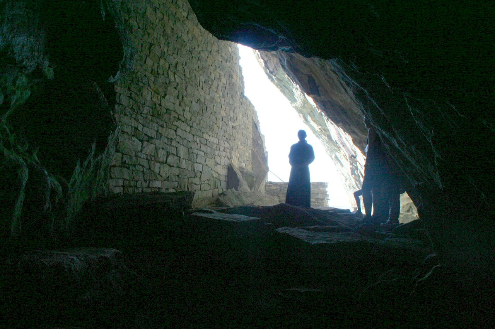

## The story
Norway's first female saint in tradition was an Irish Christian princess who chose the sea over a forced pagan marriage: Sunniva and her companions put out in ships without sails (the medieval symbol of leaving the outcome to God) and were carried to the island of Selja off Norway's west coast.

## The full story

### The cave on Selja
They lived in caves, eating fish, accused by mainland neighbours of stealing livestock. When Earl Haakon sent men against them, the Christians prayed, and the story says the cave mouth collapsed, burying and sealing them. When Olav Tryggvason's men later found fragrant, incorrupt bones on Selja (c. 996, in the saga telling), a church rose over the cave. The Latin acts of the saints of Selja, and the sagas, wrote her voyage down centuries after the 900s. Irish and Norwegian Christians did meet in those years. The shrine moved to Bergen in 1170.

### Patron of the west coast
That move made her patron of the diocese and the coast. Selja's ruined Albanus monastery and cave church remain one of Norway's pilgrim places, reached by boat as she was.

<figure class=photo>
<picture><source srcset="/static/art/sunniva-cave-600.webp 600w,/static/art/sunniva-cave.webp 1280w" sizes="(max-width:760px) 100vw,760px" type="image/webp"></picture>
<figcaption>Sunniva's cave at Selja, with the remains of St Michael's church in the opening. Photo: <a href="https://commons.wikimedia.org/wiki/File:Selje_kloster_Mikaelskirken.jpg">Ivar Vik</a>, public domain, via Wikimedia Commons.</figcaption>
</figure>

## Path to sainthood
Pre-Congregation; recognised by the early Norwegian Church; shrine at Bergen from 1170.

## Patronages
Diocese of Bergen and the western Norwegian coast, sailors (regional).

## Trivia
- Selja is considered the cradle of the Norwegian Church alongside Stiklestad and Nidaros.
- Pilgrim boats still land visitors under the cave-church on Selja each summer.

## Sources
- [Store norske leksikon: Sunniva (Norwegian national encyclopedia)](https://snl.no/Sunniva)
- [Wikipedia: Sunniva (overview with scholarly references)](https://en.wikipedia.org/wiki/Sunniva)

Written October 19, 2026 from the sources above. The Selja photograph was added November 6, 2026. Feast days follow the General Roman Calendar unless noted.

