<nav class=toc aria-label="On this page">

On this page

<ol>
<li><a href="#why">Why the Church honours him</a></li>
<li><a href="#twin">Thomas, called Didymus</a></li>
<li><a href="#lazarus">"Let us also go, that we may die with him"</a></li>
<li><a href="#way">"Lord, we know not whither thou goest"</a></li>
<li><a href="#wounds">Eight days later: "My Lord and my God"</a></li>
<li><a href="#tiberias">By the Sea of Tiberias</a></li>
<li><a href="#acts">The Acts of Thomas: the carpenter sold to a king</a></li>
<li><a href="#pearl">The Hymn of the Pearl</a></li>
<li><a href="#gondophares">A real king: Gondophares and the Takht-i-Bahi stone</a></li>
<li><a href="#kerala">Muziris, AD 52: the landing in Kerala</a></li>
<li><a href="#nasranis">The St Thomas Christians</a></li>
<li><a href="#martyrdom">The spear on the Mount, AD 72</a></li>
<li><a href="#relics">Edessa, Chios and Ortona</a></li>
<li><a href="#mylapore">The tomb at Mylapore: from Marco Polo to John Paul II</a></li>
<li><a href="#portuguese">The Portuguese era and the Synod of Diamper</a></li>
<li><a href="#today">The Thomas Christians today</a></li>
<li><a href="#feasts">Thomas Sunday, Dukhrana and his feasts</a></li>
<li><a href="#places">His places and shrines</a></li>
<li><a href="#art">Thomas in art</a></li>
</ol>
</nav>

## His story

He is remembered for a single doubt, but the Gospel of John remembers much more. When the other disciples were afraid to go back to Judea, Thomas was the one who said, "Let us also go, that we may die with him." When Jesus spoke of the way to the Father, Thomas was the one honest enough to say that he did not understand. And when the risen Lord showed him his wounds, Thomas made the greatest confession of faith in all the Gospels: **"My Lord and my God."**

The Church calls him **Thomas**, from the Aramaic for "twin," and the Gospel adds his Greek name, **Didymus**, which means the same. Syriac Christians have always known him as **Judas Thomas** and, with love, as **Mar Thoma**: "my lord Thomas."

What happened next is told by tradition rather than by Scripture, and we say so, kindly, as we go. The East remembered him as the apostle who went farther than any other. A third-century Syriac romance, the *Acts of Thomas*, sends him to India as a carpenter sold to a king, and it names a king whose coins and inscriptions have since been dug out of the ground. The Christians of Kerala, in south-western India, have kept his memory for nearly two thousand years. They say he landed at the port of Muziris in **AD 52**, founded **seven and a half churches**, and gave his life on a hill near Chennai in **AD 72**. His bones were honoured at Edessa by the fourth century, and since 1258 they have rested in a small Italian port on the Adriatic.

He is not always well known in the West. But to millions of Indian Christians he is their father in the faith. Their ancient Syriac churches, granite crosses and island churches strung along the backwaters are among the oldest living witnesses to the Gospel anywhere in Asia.

### Early 1st century · Galilee
Thomas is called among the Twelve. Matthew pairs him with Matthew the publican: "Thomas, and Matthew the publican" (Matthew 10:3).

### Before the Passion · Bethany
When Jesus decides to go back to Judea to raise Lazarus, Thomas says, "Let us also go, that we may die with him" (John 11:16).

### The Last Supper · The way
"Lord, we know not whither thou goest; and how can we know the way?" Jesus answers, "I am the way, the truth, and the life" (John 14:5–6).

### Easter week · The wounds
Eight days after Easter, Thomas sees the risen Lord and confesses, "My Lord and my God" (John 20:28).

### After Easter · The Sea of Tiberias
He is among the seven disciples who see the risen Christ on the shore of the Sea of Tiberias, at the miraculous catch of fish (John 21:2).

### AD 52 · Muziris (tradition)
By the tradition of the St Thomas Christians, he lands at Muziris, the old port near today's Kodungallur in Kerala.

### AD 72 · Mylapore (tradition)
He is pierced with a lance on a hill near Mylapore, now in Chennai, and buried by the sea.

### c. 384 · Edessa
The pilgrim Egeria prays at "the church and memorial of saint Thomas" in Edessa.

### 1258 · Ortona
Sailors from Ortona bring relics venerated as his from the Greek island of Chios to their cathedral on the Adriatic.

### c. 1293 · Marco Polo
The Venetian traveller visits the "little town" in south India where "the Body of Messer St. Thomas the Apostle lies."

### 1523 · The Portuguese
The Portuguese rebuild the church over his tomb at Mylapore and build a chapel on St Thomas Mount.

### 1599 · Diamper
The Synod of Diamper brings the St Thomas Christians under Latin rule. A painful century of division follows.

### 1896 · San Thome
The new Gothic cathedral over his tomb is consecrated. Pius XII names it a minor basilica in 1956.

### 1953 · Kodungallur
Cardinal Eugène Tisserant brings a relic of his right arm from Ortona to the shrine at his landing place.

### 1986 · John Paul II
On 5 February [St John Paul II](/saints/john-paul-ii/) prays at the tomb of St Thomas in Chennai.

<figure class=photo>
<picture><source srcset="/static/art/thomas-caravaggio-600.webp 600w,/static/art/thomas-caravaggio.webp 1280w" sizes="(max-width:760px) 100vw,760px" type="image/webp">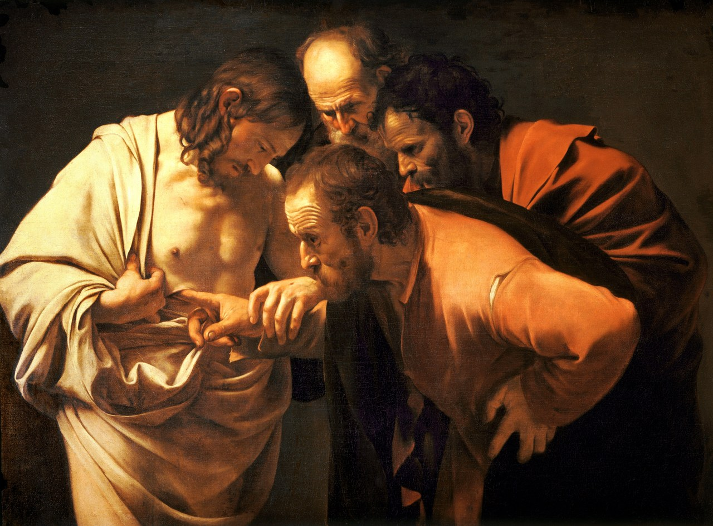</picture>
<figcaption><i>The Incredulity of Saint Thomas</i>, by <b>Caravaggio</b>, about 1601–02. Christ takes Thomas's hand in his own and guides the finger into his side, while two apostles crowd in to look. Bildergalerie, Sanssouci Palace, Potsdam. Image: <a href="https://commons.wikimedia.org/wiki/File:The_Incredulity_of_Saint_Thomas-Caravaggio_(1601-2).jpg">The Incredulity of Saint Thomas-Caravaggio (1601-2)</a>, public domain, via Wikimedia Commons.</figcaption>
</figure>

<h2 id=why>Why the Church honours him</h2>

- **He made the clearest confession of Christ in the Gospels.** "My Lord and my God" is a prayer the whole Church has made its own. Many Catholics say it quietly at the elevation of the Host.
- **He was brave.** When going back to Judea meant danger, he spoke for following Jesus even to death.
- **He was honest about what he did not understand.** His questions drew out two of the greatest sayings of Christ: "I am the way, the truth, and the life," and "blessed are they that have not seen, and yet have believed."
- **He shows that doubt can end in deeper faith.** Pope Benedict XVI said his story "comforts us in our insecurity" and "shows us that every doubt can lead to an outcome brighter than any uncertainty."
- **He is the father in faith of the Christians of India.** The St Thomas Christians of Kerala trace their church to him. They are one of the oldest Christian communities in the world.
- **He gave his life as a martyr.** Tradition says he died by a lance, far from home, for the Lord he had once refused to believe was risen.

<h2 id=twin>Thomas, called Didymus</h2>

Thomas appears in all four lists of the Twelve (Matthew 10:3; Mark 3:18; Luke 6:15; Acts 1:13). In the first three Gospels he stands next to Matthew; in Acts he follows Philip. Only St John lets us hear him speak, and he does so three times, at three turning points.

His name comes from the Aramaic and Hebrew word for a **twin**. John translates it for Greek readers three times: "Thomas, which is called **Didymus**" (John 11:16; 20:24; 21:2). Didymos is simply Greek for "twin." The Gospels never tell us whose twin he was. As Benedict XVI put it, "the reason for this nickname is unclear." Syriac Christians called him **Judas Thomas**. Some legends later made him the twin brother of the Lord himself, an idea the Church never accepted.

Down the centuries, preachers found a kind reading of the name. They said Thomas is the twin of every believer who has ever struggled to believe, and who still comes home to faith.

<h2 id=lazarus>"Let us also go, that we may die with him"</h2>

Jesus had escaped stoning in Jerusalem. Then word came from Bethany, two miles from the city, that his friend Lazarus was sick. When Jesus said he would go back, the disciples protested: "Master, the Jews of late sought to stone thee; and goest thou thither again?" (John 11:8). It was Thomas who settled it:

> Then said Thomas, which is called Didymus, unto his fellowdisciples, Let us also go, that we may die with him. (John 11:16)

There is no doubting Thomas here, only a brave and loyal one. Benedict XVI called his words "truly exemplary": they reveal "his total readiness to stand by Jesus, to the point of identifying his own destiny with that of Jesus." He added: "the most important thing is never to distance oneself from Jesus."

<h2 id=way>"Lord, we know not whither thou goest"</h2>

At the Last Supper Jesus told the apostles he was going to prepare a place for them: "And whither I go ye know, and the way ye know." Thomas would not pretend:

> Thomas saith unto him, Lord, we know not whither thou goest; and how can we know the way? Jesus saith unto him, I am the way, the truth, and the life: no man cometh unto the Father, but by me. (John 14:5–6)

So one of the most famous sentences in the Bible was first spoken in answer to an honest question. "It is primarily to Thomas that he makes this revelation," Benedict XVI observed, "but it is valid for all of us." He found in Thomas a lesson in prayer: "Let us be brave enough to say: 'I do not understand you, Lord; listen to me, help me to understand.'"

<h2 id=wounds>Eight days later: "My Lord and my God"</h2>

On the evening of the first Easter Day, the risen Christ came to the disciples behind locked doors. "But Thomas, one of the twelve, called Didymus, was not with them when Jesus came" (John 20:24). When the others told him, "We have seen the Lord," his grief spoke for him:

> Except I shall see in his hands the print of the nails, and put my finger into the print of the nails, and thrust my hand into his side, I will not believe. (John 20:25)

A week passed. Then, "after eight days again his disciples were within, and Thomas with them":

> Then came Jesus, the doors being shut, and stood in the midst, and said, Peace be unto you. Then saith he to Thomas, Reach hither thy finger, and behold my hands; and reach hither thy hand, and thrust it into my side: and be not faithless, but believing. And Thomas answered and said unto him, **My Lord and my God.** Jesus saith unto him, Thomas, because thou hast seen me, thou hast believed: **blessed are they that have not seen, and yet have believed.** (John 20:26–29)

Did he touch the wounds? The Gospel does not say. Painters have usually shown him doing so; many readers think the Lord's word was enough. Either way, Thomas wanted to know Jesus by his wounds, and Benedict XVI thought him right: the wounds are where Jesus "reveals to us how much he loved us." St Augustine wrote that Thomas "saw and touched the man, and acknowledged the God whom he neither saw nor touched."

The last beatitude in the Gospels was spoken to Thomas, but it was meant for us. Every Christian since has been among "they that have not seen, and yet have believed."

<h2 id=tiberias>By the Sea of Tiberias</h2>

The last time we meet Thomas in the Gospels, he is back in Galilee, by the lake:

> There were together Simon Peter, and Thomas called Didymus, and Nathanael of Cana in Galilee, and the sons of Zebedee, and two other of his disciples. (John 21:2)

They fished all night and caught nothing. At dawn a stranger on the shore told them to cast the net on the right side, and the net filled. Thomas was there when [St John](/saints/john-the-apostle/) cried out, "It is the Lord," and when Jesus cooked breakfast for them over a charcoal fire. Benedict XVI noticed that Thomas is named straight after [Simon Peter](/saints/peter/), "an evident sign of the considerable importance that he enjoyed" in the early Church. He was there in the Upper Room with Mary and the apostles before Pentecost (Acts 1:13–14), and then Scripture falls silent about him.

<h2 id=acts>The Acts of Thomas: the carpenter sold to a king</h2>

What we know of Thomas after Pentecost comes from tradition. The most famous telling is the ***Acts of Thomas***, a long and colourful work written in Syriac, probably at **Edessa** in the early **third century**. It is not Scripture, and the Church has never read it as history; scholars find in it ideas the Church did not accept. But it is very old, and it shows what Syriac Christians already believed about their apostle.

The story opens in Jerusalem, where the apostles cast lots for the regions of the world. "According to the lot, therefore, India fell unto Judas Thomas, which is also the twin." Thomas did not want to go: "Whither thou wouldest send me, send me, but elsewhere, for unto the Indians I will not go."

Then came a merchant named **Habban** (*Abbanes* in the Greek), sent by **King Gundaphorus** of India to buy a skilled carpenter. In the story the Lord himself met the merchant in the market and sold Thomas to him "for three litrae of silver unstamped." The deed of sale read: "I, Jesus, the son of Joseph the carpenter, acknowledge that I have sold my slave, Judas by name, unto thee Abbanes." Thomas, humbled, said only, "I will go whither thou wilt, Lord Jesus: thy will be done," and set sail.

At court Thomas told the king he could build "pillars, temples, and court-houses for kings." The king gave him money for a palace and went away. Thomas gave it all to the poor and sick, and when more came, he gave that away too. When the king returned and asked to see his palace, Thomas answered:

> Thou canst not see it now, but when thou departest this life, then thou shalt see it.

The king threw him into prison. That night the king's brother, Gad, died, and angels showed his soul a shining palace in heaven. "This is that palace," they said, "which that Christian builded for thy brother." Gad came back to life to beg for the palace. The king understood, set Thomas free and was baptised.

It is a parable as much as a legend. Treasure given to the poor is laid up in heaven, and the carpenter-apostle builds with charity rather than stone. That is why St Thomas is the patron of **architects and builders**, and why painters give him a builder's square.

In the *Acts*, Thomas then travels on to the realm of a King **Mazdai**, whose wife Tertia and son Vazan become Christians. For this he is led out of the city to a hill and pierced through with spears by four soldiers. The book ends by saying that his bones were later taken "to the West."

<h2 id=pearl>The Hymn of the Pearl</h2>

Set in the middle of the Syriac *Acts* is a poem that has nothing to do with the story around it. It is one of the most beautiful survivals of early Syriac literature: **the Hymn of the Pearl**, also called the Hymn of the Soul or of the Robe of Glory. In the book, Thomas sings it while in prison. Its full Syriac text survives in a single manuscript in the British Library, copied in 936.

It tells of a young prince of the East who is sent down to Egypt to bring back the one pearl that lies in the sea, guarded by a hissing serpent. He takes off his glorious robe to go. In Egypt he eats the food of that country, falls into a deep sleep and forgets who he is. His father sends him a letter that flies to him like an eagle, and the prince wakes and remembers. He charms the serpent, seizes the pearl and goes home. On the way he meets his robe of glory, which has grown with him, and puts it on again. The poem ends with the prince going in to his king "with my offering and my pearl."

Its author is unknown; one old guess is the Edessan poet Bardaisan. Christian readers have seen in it the soul's journey: sent into the world, forgetting, called home by the word of the Father, and clothed at last in glory.

<h2 id=gondophares>A real king: Gondophares and the Takht-i-Bahi stone</h2>

For a long time scholars took King Gundaphorus for an invented name. Then, in the nineteenth century, coins and an inscription began to tell a different story.

A king named **Gondophares**, Guduvhara in his own language, really did reign over the borderlands of today's Afghanistan and Pakistan in the first century. He was an Indo-Parthian ruler whose kingdom took in Gandhara and the Punjab. His coins carry his name in Greek and in the Kharoshthi script. As the *Catholic Encyclopedia* put it a century ago, "the identity of the name with the Gundafor of the 'Acta Thomae' is unmistakable and is hardly disputed."

The clinching evidence is a small stone now in the **Lahore Museum**, the so-called **Takht-i-Bahi inscription**. It records a pious gift "in the 26th year of the great king Guduvhara," in the year 103 of the era then in use. On the usual reckoning that year is about **AD 46**, which would put his accession in about AD 20. Exactly where the stone was found is uncertain: the scholar Sten Konow noted that it may have come from Shahbazgarhi, a few miles from the great monastery of Takht-i-Bahi. But the date fits well with an apostle sent east in the years after Pentecost.

None of this proves that Thomas met Gondophares. A storyteller could have borrowed a famous king's name. But it shows that the oldest legend of Thomas is set in a real world, with a real king, at the right time.

<figure class=photo>
<picture><source srcset="/static/art/thomas-gondophares-coin-600.webp 600w,/static/art/thomas-gondophares-coin.webp 1280w" sizes="(max-width:760px) 100vw,760px" type="image/webp">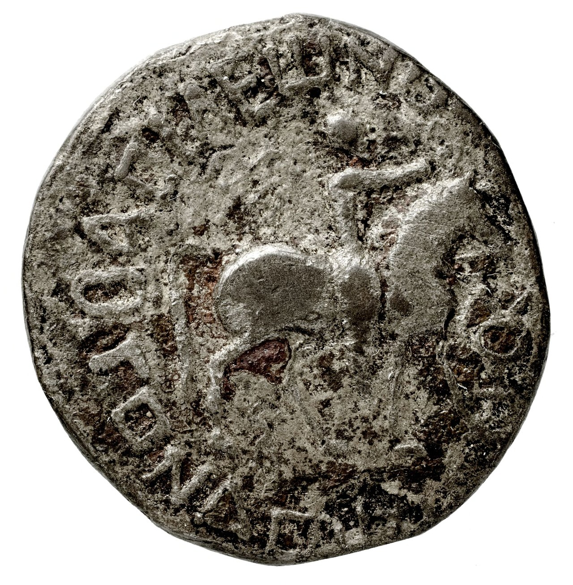</picture>
<figcaption>A billon tetradrachm of <b>Gondophares</b>, the Indo-Parthian king whose name appears in the <i>Acts of Thomas</i> as Gundaphorus. Coins like this one, with Greek legends on one side and the local Kharoshthi script on the other, first showed that the king of the legend was a historical ruler. Bibliothèque nationale de France, Paris. Image: <a href="https://commons.wikimedia.org/wiki/File:Monnaie_-_T%C3%A9tradrachme,_Billon,_Incertain,_Asie_Centrale,_Gondophar%C3%A8s_-_btv1b84896627_(1_of_2).jpg">Monnaie - Tétradrachme, Billon, Incertain, Asie Centrale, Gondopharès - btv1b84896627 (1 of 2)</a>, public domain, via Wikimedia Commons.</figcaption>
</figure>

<figure class=photo>
<picture><source srcset="/static/art/thomas-takht-inscription-600.webp 600w,/static/art/thomas-takht-inscription.webp 1280w" sizes="(max-width:760px) 100vw,760px" type="image/webp">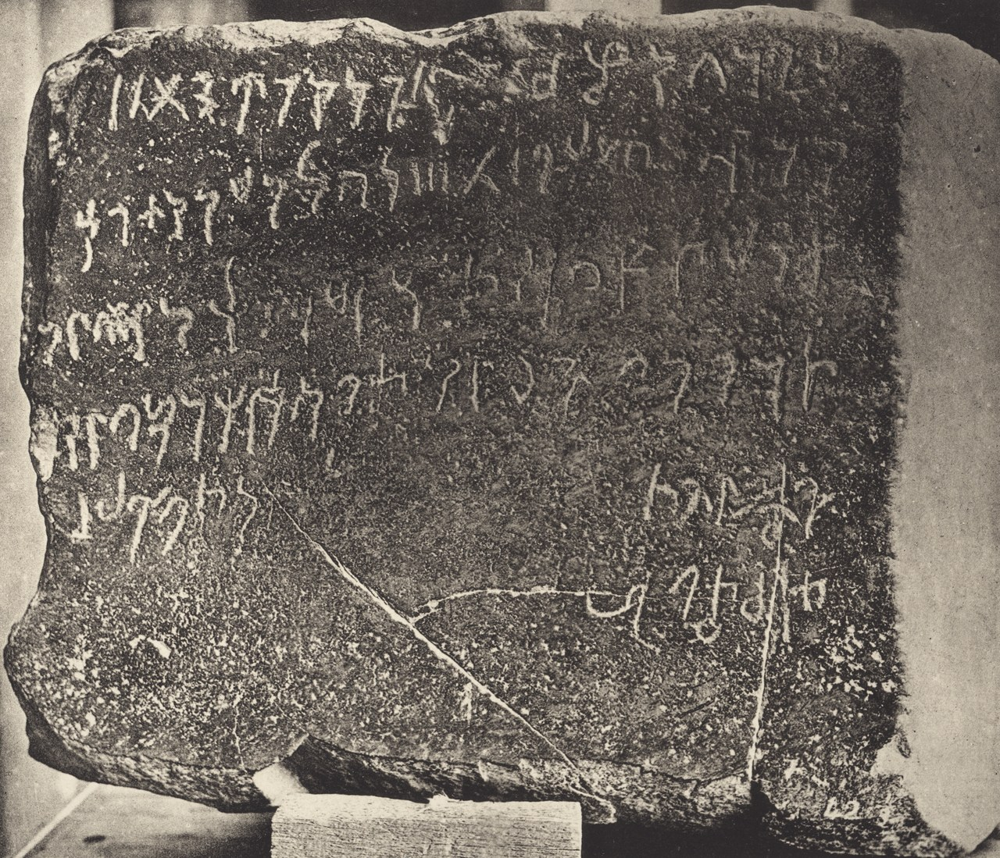</picture>
<figcaption>The <b>Takht-i-Bahi inscription</b>, photographed in 1897. It is dated in the 26th regnal year of the great king Guduvhara (Gondophares), year 103 of the era then in use, about AD 46. The stone is in the Lahore Museum. Leiden University Library, KITLV collection. Image: <a href="https://commons.wikimedia.org/wiki/File:KITLV_87989_-_Unknown_-_Inscribed_stone_on_Gondophares_in_Takht-i-Bahi_monastery_Yusufzai_in_British_India_-_1897.tif">KITLV 87989 - Unknown - Inscribed stone on Gondophares in Takht-i-Bahi monastery Yusufzai in British India - 1897.tif</a>, public domain, via Wikimedia Commons.</figcaption>
</figure>

<h2 id=kerala>Muziris, AD 52: the landing in Kerala</h2>

The Christians of south India tell a second story, and for them it is the one that matters most. They say that Thomas came to them by sea, landing in **AD 52** at **Muziris**, the great pepper port of the Malabar coast, near today's **Kodungallur** (Cranganore) in Kerala. The exact landing place is remembered as Maliankara. "AD 52," says the shrine there, "is a date implanted in the mind of all St. Thomas Christians irrespective of denominations."

The journey was possible. In the first century Roman and Egyptian ships crossed the Arabian Sea each summer on the monsoon winds, carrying gold and wine to India and bringing back pepper. Roman writers knew Muziris well, and Jewish traders had settlements along the coast. Tradition says Thomas preached first to these Jewish communities.

Kerala tradition, preserved in old songs such as the *Ramban Pattu*, tells how he travelled up and down the coast and the inland rivers, preaching and baptising. It says he founded seven communities, the **Ezhara Pallikal** or **"seven and a half churches"**:

1. **Kodungallur** (Cranganore, Maliankara), where he first landed
2. **Palayur**, near Chavakkad, where tradition places the first baptisms
3. **Kottakkavu**, at North Paravur
4. **Kokkamangalam**, near Cherthala
5. **Niranam**, near Thiruvalla
6. **Nilakkal**, the old forest trading town of Chayal
7. **Kollam** (Quilon), the southern port

and, as the "half church," **Thiruvithamcode** in today's Kanyakumari district of Tamil Nadu.

None of these churches still stands in its first-century form. Some were rebuilt many times, one was lost to the sea, and another was abandoned in the forest. But each is still a living parish or place of pilgrimage, and together they form the oldest map of Christian India.

Tradition also says he prayed on a hilltop in the forest at **Malayattoor**, where he traced a cross on the rock. Each year, crowds of pilgrims climb that hill in his memory.

<h2 id=nasranis>The St Thomas Christians</h2>

The community that grew from his preaching calls itself the **Nasranis**, the followers of the Nazarene, or simply the **Mar Thoma Nasranis**, the Christians of St Thomas. For many centuries they were a respected merchant and landholding community in Kerala. They were Indian in dress, language and custom, and Syriac in their liturgy, praying in the language of Edessa, the dialect of Aramaic closest to the speech of Jesus. Their bishops came to them from the Church of the East in Persia and Mesopotamia. At home they were led by an Indian **Archdeacon of All India**.

They kept some of the oldest written witnesses to Christianity in India:

- **The copper plates.** In about 849 the ruler of Kollam granted land and privileges to the **Tarisappalli**, the Christian church at Kollam, through a Christian merchant named **Maruvan Sapir Iso**. The grant was engraved on copper plates. Its witnesses signed in Arabic, Middle Persian and Judeo-Persian, a snapshot of the busy, mixed world of the Malabar ports.
- **The Persian crosses.** In several old churches, granite slabs carry a cross rising from a lotus, with a dove descending on it, sometimes with an inscription in Pahlavi (Middle Persian) around the edge. They are known as **Mar Thoma Sliva**, the cross of St Thomas. The oldest is the one found on St Thomas Mount at Chennai, which the *Catholic Encyclopedia* dates to the seventh century. Today the same cross, on its lotus, is the emblem of the Syro-Malabar Church.

<figure class=photo>
<picture><source srcset="/static/art/thomas-kottayam-cross-600.webp 600w,/static/art/thomas-kottayam-cross.webp 645w" sizes="(max-width:760px) 100vw,760px" type="image/webp">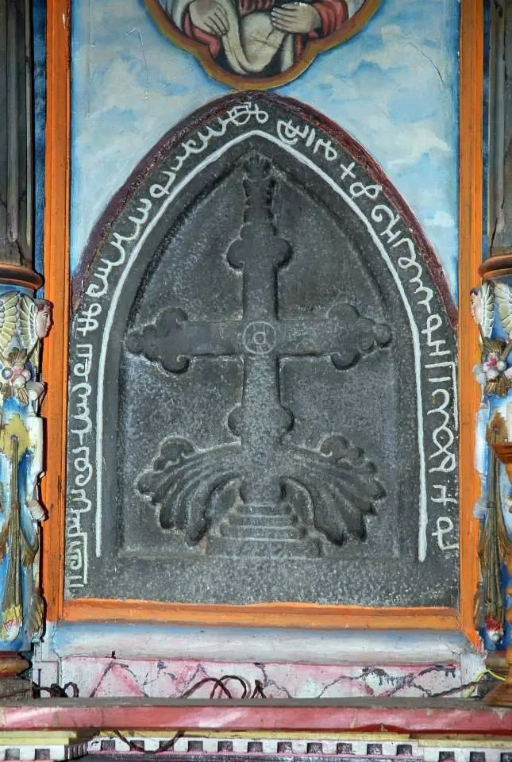</picture>
<figcaption>A <b>Persian cross</b> in St Mary's Knanaya Church (the Valiyapally) at Kottayam, Kerala, often dated to the seventh century. The flowering cross, lotus and arched inscription in Pahlavi are the classic form of the <i>Mar Thoma Sliva</i>. Image: <a href="https://commons.wikimedia.org/wiki/File:Seventh_century_Kottayam_Persian_Cross.jpg">Seventh century Kottayam Persian Cross</a>, <a href="https://creativecommons.org/publicdomain/zero/1.0/">CC0</a>, via Wikimedia Commons.</figcaption>
</figure>

<figure class=photo>
<picture><source srcset="/static/art/thomas-copper-plates-600.webp 600w,/static/art/thomas-copper-plates.webp 1280w" sizes="(max-width:760px) 100vw,760px" type="image/webp">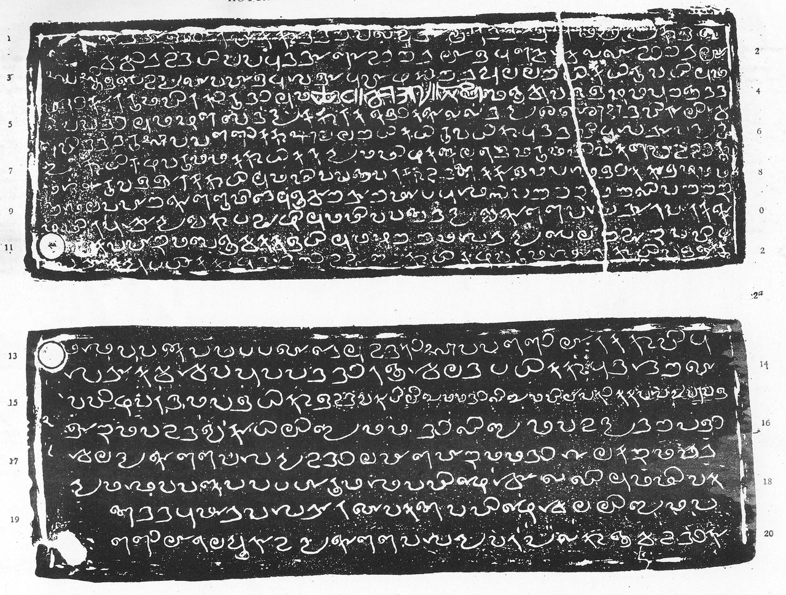</picture>
<figcaption>Two of the <b>Kollam Syrian copper plates</b> (the Tarisappalli grant), about 849. A local ruler granted land and trading rights to the Christian church at Kollam through the merchant Maruvan Sapir Iso, with witnesses who signed in Arabic, Persian and Hebrew script. Image: <a href="https://commons.wikimedia.org/wiki/File:Quilon_Syrian_copper_plates_(849_CE)_plates_1_and_4.jpg">Quilon Syrian copper plates (849 CE) plates 1 and 4</a>, public domain, via Wikimedia Commons.</figcaption>
</figure>

<h2 id=martyrdom>The spear on the Mount, AD 72</h2>

After about twenty years on the west coast, the tradition says, Thomas crossed south India to the Coromandel coast and settled near **Mylapore**, now part of Chennai. The three places of his last years are still honoured there:

- **Little Mount** (Chinnamalai), a rocky hillock by the Adyar River, where he is said to have lived and prayed in a cave;
- **St Thomas Mount**, the "Big Mount" (Parangimalai), a few miles inland, where he was killed;
- and **San Thome**, by the sea at Mylapore, where he was buried.

The story told at Chennai is that soldiers came for him at Little Mount, and he escaped through the cave to the Big Mount. There, in AD 72, he was struck with a lance as he prayed before a cross he had carved in the rock. An early Syriac calendar of the Church of Edessa remembers him in a single line:

> 3 July, St. Thomas who was pierced with a lance in India. His body is at Urhai [Edessa], having been brought there by the merchant Khabin. A great festival.

Different tellings give different details. In the *Acts* he is speared by four soldiers on a hill outside a royal city. Marco Polo heard a different version from the keepers of the tomb: a hunter shooting at peacocks near his hermitage hit him by mistake with an arrow. But every version agrees that he died a martyr, by a wound in the side, like the wound he once asked to touch.

<figure class=photo>
<picture><source srcset="/static/art/thomas-lochner-600.webp 600w,/static/art/thomas-lochner.webp 1280w" sizes="(max-width:760px) 100vw,760px" type="image/webp">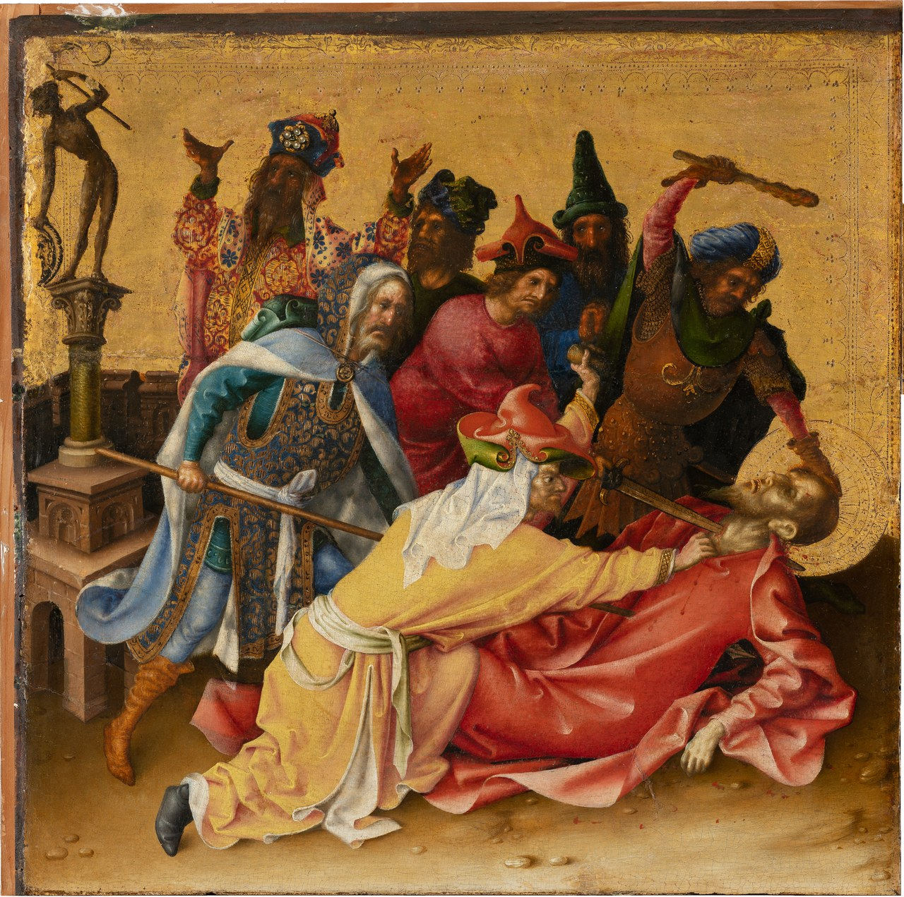</picture>
<figcaption><i>The Martyrdom of St Thomas</i>, by <b>Stefan Lochner</b>, about 1435, from his altarpiece of the martyrdoms of the apostles. Lochner, painting in Cologne, imagined India as a crowd of exotic hats and lances. Städel Museum, Frankfurt. Image: <a href="https://commons.wikimedia.org/wiki/File:Martyrdom_of_St_Thomas_(SM_827).png">Martyrdom of St Thomas (SM 827)</a>, public domain, via Wikimedia Commons.</figcaption>
</figure>

<h2 id=relics>Edessa, Chios and Ortona</h2>

The tradition says his body was buried at Mylapore, and that at least part of it was later carried west to **Edessa** (today's Şanlıurfa in south-eastern Turkey), the Syriac-speaking city where the *Acts of Thomas* were written. The Ortona shrine's own history dates the move to about **230**, following some versions of the *Acts*.

By the fourth century the cult at Edessa was famous. **St Ephrem the Syrian**, the great poet of the Syriac Church, lived there from 363 until his death in 373. He wrote that the apostle had been put to death in India and that a merchant had brought his remains to Edessa. In one of his hymns he says:

> It was his mission to espouse India to the One-Begotten. The merchant is blessed for having so great a treasure. Edessa thus became the blessed city by possessing the greatest pearl India could yield.

About 384 a pilgrim from the far west of Europe, **Egeria**, made a special journey to Edessa "for the sake of prayer at the memorial of S. Thomas the Apostle, where his body is laid entire." She found the church "very great, very beautiful and of new construction," and while she was there the community read aloud "some things concerning saint Thomas himself." Two centuries later, **St Gregory of Tours** heard from a pilgrim named Theodore that at the place in India where Thomas's body had first rested, there stood a monastery and a large, richly adorned church.

When Edessa fell to the Turks in 1144, the relics were taken to safety on the Greek island of **Chios**. On the night of 10 August **1258**, during a war in the Aegean, a sea captain from the Adriatic town of **Ortona** named **Leone** carried off the bones and the old gravestone. Leone was commanding three Ortonese galleys in the fleet of Manfred of Hohenstaufen, then ruling Sicily. On **6 September 1258** he brought them home to Ortona. The shrine's historians note that the noble surname Acciaiuoli, often attached to him, was only added centuries later. To settle any doubt, a notarial act was drawn up at Bari the next year in which Greek prisoners from Chios swore that the body was that of the apostle Thomas.

Ortona has guarded them ever since, through a Turkish raid and fire in 1566, the French in 1799, and the terrible winter battle of 1943, when the cathedral was gutted and the town's people lost more than 1,300 of their own. The bones survived under the altar; the silver bust was hidden in a wall of the bell tower. The rebuilt basilica was rededicated on 5 September 1949. In **1953**, Cardinal Eugène Tisserant took a relic of the apostle's **right arm**, the hand that had reached out to the risen Lord, from Ortona to India.

<h2 id=mylapore>The tomb at Mylapore: from Marco Polo to John Paul II</h2>

Pilgrims never stopped coming to the tomb by the sea. On his way home from China in about 1293, **Marco Polo** visited it:

> The Body of Messer St. Thomas the Apostle lies in this province of Maabar at a certain little town having no great population… Both Christians and Saracens, however, greatly frequent it in pilgrimage.

He noted that Christian pilgrims took away "the earth from the place where the Saint was killed," which was red, to heal the sick, and that Muslims too honoured the saint as a holy man.

When the Portuguese reached Mylapore in the early 1500s, they found a small, ruined shrine called the "house of Thomas," in the care of a Muslim. In **1523** they built a church over the tomb, and that same year a chapel on St Thomas Mount. **[St Francis Xavier](/saints/francis-xavier/)** stayed at Mylapore in 1545, praying at the tomb and before the statue of Our Lady of Mylapore. Pope Paul V made the church a cathedral in 1606. In **1893** Bishop Henrique Reed da Silva pulled down the old building and began the present white Gothic church, which he consecrated on **1 April 1896**. Pius XII made it a **minor basilica** in 1956. It is one of only a handful of churches in the world built over the tomb of an apostle.

On **5 February 1986**, [St John Paul II](/saints/john-paul-ii/) came to pray there, the first pope to visit the tomb of St Thomas.

<figure class=photo>
<picture><source srcset="/static/art/thomas-mylapore-print-600.webp 600w,/static/art/thomas-mylapore-print.webp 1126w" sizes="(max-width:760px) 100vw,760px" type="image/webp">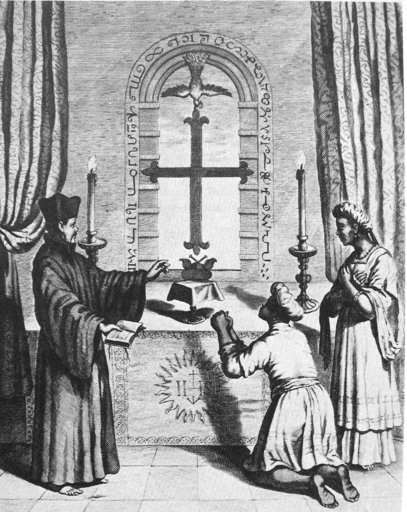</picture>
<figcaption>The <b>shrine of St Thomas at Mylapore</b>, in an eighteenth-century European print. Pilgrims kneel before the altar and cross over the tomb, long before the present basilica was built. Image: <a href="https://commons.wikimedia.org/wiki/File:ShrineOfSaintThomasAtMeliapore18thCentury.jpg">ShrineOfSaintThomasAtMeliapore18thCentury</a>, public domain, via Wikimedia Commons.</figcaption>
</figure>

<h2 id=portuguese>The Portuguese era and the Synod of Diamper</h2>

The Portuguese who sailed to India after 1498 were astonished to find an ancient Christian people already there. At first the two met as friends. But the Portuguese knew only the Latin rite, and they were suspicious of a church whose bishops came from the Church of the East.

After the death in 1597 of Mar Abraham, the last East Syriac metropolitan of India, the Portuguese Archbishop of Goa, **Aleixo de Menezes**, called a synod at **Udayamperoor**, called Diamper by the Portuguese. It met from **20 to 26 June 1599**. The **Synod of Diamper** placed the St Thomas Christians under Latin bishops, changed their liturgy and ordered many of their Syriac books to be burned.

Many Nasranis felt that their ancient heritage had been taken from them. On 3 January **1653**, thousands gathered at the church in Mattancherry, near Kochi, and swore never again to obey the Portuguese prelates. Those who could not reach the stone cross there held ropes tied to it. This was the **Coonan Cross Oath**, the "oath of the bent cross." From that moment the one community of St Thomas began to divide into several churches. The wounds of that century are remembered with sorrow on every side.

<h2 id=today>The Thomas Christians today</h2>

The heirs of St Thomas now belong to several churches. All of them call him their father.

- **The Syro-Malabar Catholic Church**, an Eastern Catholic Church in full communion with Rome, which keeps the East Syriac liturgy, the *Qurbana*. It has millions of members in India and in a wide diaspora from the Gulf to Australia and North America.
- **The Syro-Malankara Catholic Church**, which returned to communion with Rome on **20 September 1930** under Archbishop Mar Ivanios and prays in the West Syriac (Antiochene) tradition.
- **The Malankara Orthodox Syrian Church**, an Oriental Orthodox church headed by its own Catholicos, which holds Niranam and many other ancient churches.
- **The Jacobite Syrian Christian Church**, in union with the Syriac Orthodox Patriarch of Antioch, together with the reformed **Mar Thoma Syrian Church** and smaller bodies.

Their histories are tangled, and they have not always been at peace. But all of them climb the same hills, honour the same apostle, and still cross themselves with the same ancient cross.

<h2 id=feasts>Thomas Sunday, Dukhrana and his feasts</h2>

- **3 July** is his feast in the Roman Catholic Church and most churches of India. For the Syro-Malabar and the other Syriac churches it is the **Dukhrana**, Syriac for "remembrance," a great festival that the old Syriac calendar was already keeping in the fourth century.
- **21 December** was his feast in the Roman calendar from the ninth century until the reform of 1969. It is still kept by many Anglicans and Lutherans, and in the traditional Latin calendar. In many parts of Europe the day, close to the longest night of the year, was the signal for Christmas baking and cleaning.
- **6 October** is his feast in the Eastern Orthodox Church.
- **Thomas Sunday**, the Sunday after Easter, is kept by Christians East and West. The Gospel every year is John 20:19–31, the story of Thomas. In the Byzantine churches it is called Antipascha. In the Catholic Church it is now also **Divine Mercy Sunday**.
- In Kerala the shrine at Kodungallur keeps the anniversary of his landing on the Sunday after **21 November**, with a great procession of boats on the Periyar.

**His symbols** are a **lance or spear**, for his martyrdom, and a **builder's square or rule**, for the palace he built in heaven. In icons of the East he is often a young, beardless apostle. In the West he is often shown reaching towards the wounds of Christ.

**A prayer** many Christians say at Mass, at the elevation of the Host, is simply his: *My Lord and my God.* And from the Collect of his feast:

> Grant, almighty God, that we may glory in the Feast of the blessed Apostle Thomas, so that we may always be sustained by his intercession and, believing, may have life in the name of Jesus Christ, your Son, whom Thomas acknowledged as the Lord.

<h2 id=places>His places and shrines</h2>

St Thomas's places run from Galilee to the Indus, and from the coconut groves of Kerala to the granite hills of Chennai and a small port on the Adriatic. Three maps help to follow him.

<figure class=map><figcaption>His road east, by tradition. The <i>Acts of Thomas</i> take him overland into the kingdom of Gondophares, in today's Pakistan; the Christians of Kerala remember him sailing on the summer monsoon to Muziris; and his relics went from Mylapore to Edessa, Chios and Ortona. Map by The Daily Word; borders from Natural Earth (public domain); routes are approximate. Tap to enlarge.</figcaption></figure>

### San Thome Basilica, Chennai

The **National Shrine of St Thomas Cathedral Basilica**, always called San Thome, stands right by the sea in Mylapore. Its white neo-Gothic spire rises 155 feet. A second, smaller tower marks the spot over the tomb. Pilgrims go down into a chapel beneath the sanctuary, where a figure of the apostle lies beneath the altar over the place long venerated as his grave. A small museum keeps a fragment of his bone and the head of the lance believed to have killed him.

<figure class=map><figcaption>The three hills of Chennai. The Little Mount, where he lived; the Big Mount, St Thomas Mount, where he died; and San Thome, where he was buried. They lie within about ten kilometres of one another. Map by The Daily Word; coastline from Natural Earth (public domain); river and positions simplified. Tap to enlarge.</figcaption></figure>

<figure class=photo>
<picture><source srcset="/static/art/thomas-santhome-600.webp 600w,/static/art/thomas-santhome.webp 1280w" sizes="(max-width:760px) 100vw,760px" type="image/webp">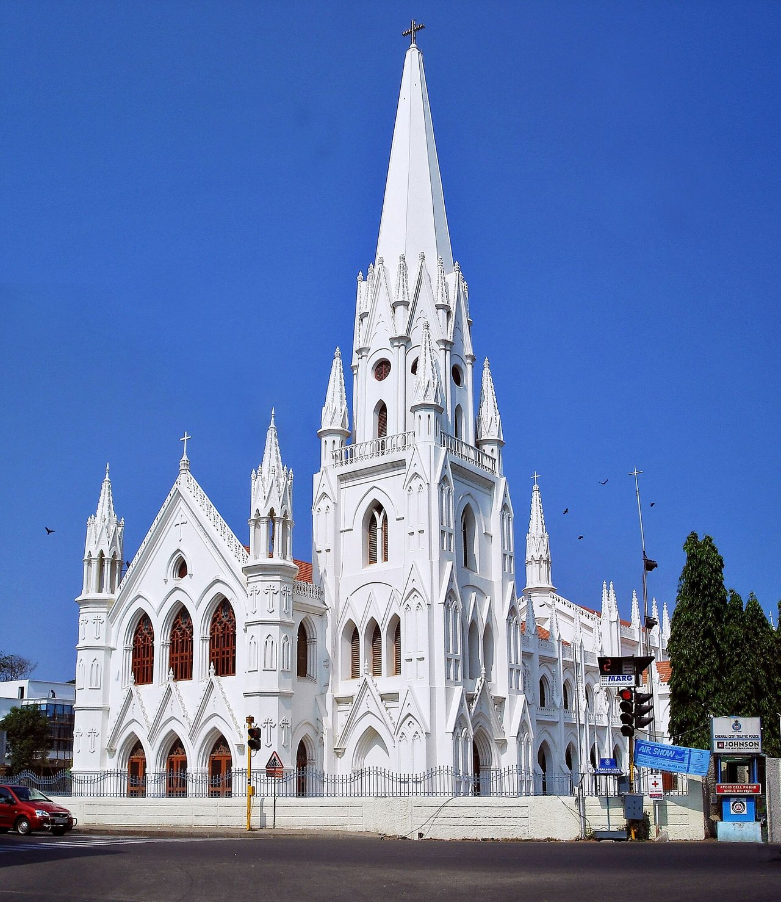</picture>
<figcaption><b>San Thome Basilica</b>, Mylapore, consecrated in 1896 over the tomb of St Thomas and made a minor basilica in 1956. Photo: <a href="https://commons.wikimedia.org/wiki/File:Santhome_Basilica.jpg">Santhome Basilica</a> by PlaneMad, <a href="https://creativecommons.org/licenses/by-sa/2.5">CC BY-SA 2.5</a>, via Wikimedia Commons.</figcaption>
</figure>

<figure class=photo>
<picture><source srcset="/static/art/thomas-santhome-nave-600.webp 600w,/static/art/thomas-santhome-nave.webp 1280w" sizes="(max-width:760px) 100vw,760px" type="image/webp">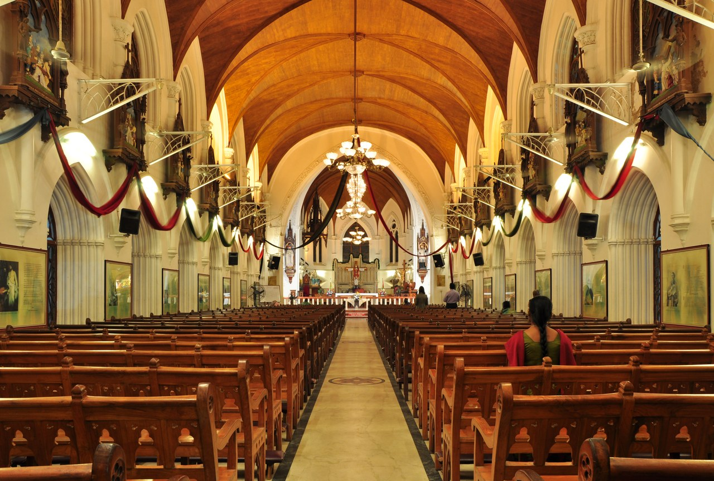</picture>
<figcaption>The <b>nave of San Thome</b>, looking towards the high altar. Photo: <a href="https://commons.wikimedia.org/wiki/File:Interior_of_San_Thome_Basilica.jpg">Interior of San Thome Basilica</a> by Joe Ravi, <a href="https://creativecommons.org/licenses/by-sa/3.0">CC BY-SA 3.0</a>, via Wikimedia Commons.</figcaption>
</figure>

<figure class=photo>
<picture><source srcset="/static/art/thomas-santhome-tomb-600.webp 600w,/static/art/thomas-santhome-tomb.webp 1280w" sizes="(max-width:760px) 100vw,760px" type="image/webp">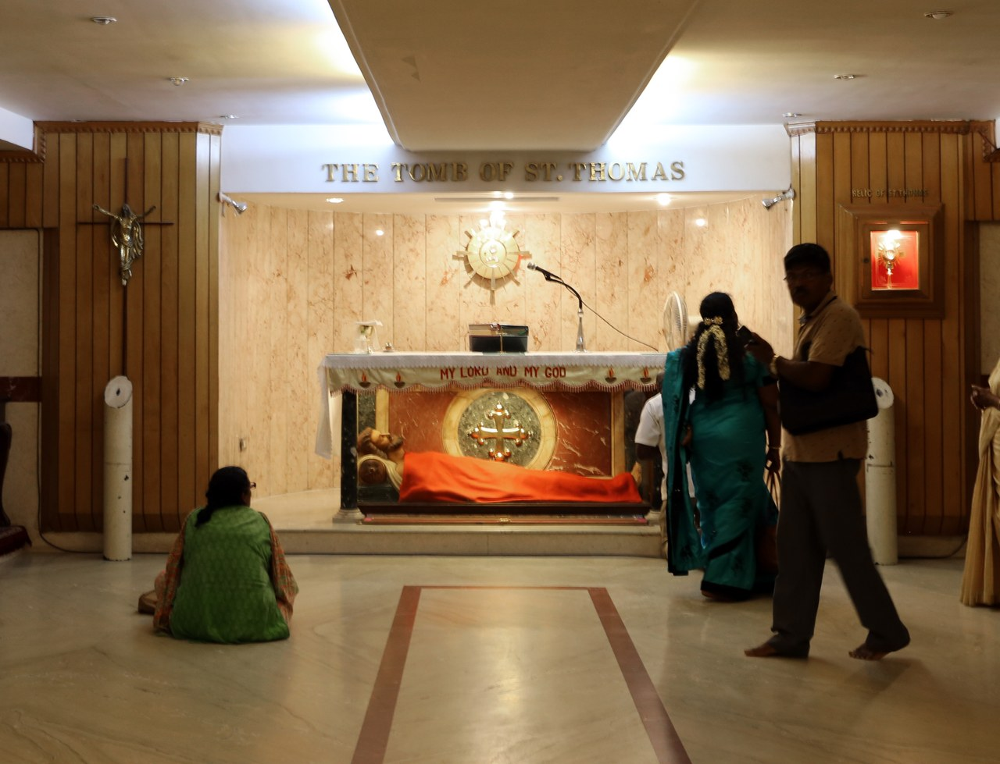</picture>
<figcaption>The <b>tomb chapel</b> beneath San Thome. A figure of the apostle lies over the place venerated as his first grave. Photo: <a href="https://commons.wikimedia.org/wiki/File:Chennai,_basilica_di_san_tommaso_apostolo,_interno,_tomba_dell%27apostolo_tommaso.jpg">Chennai, basilica di san tommaso apostolo, interno, tomba dell'apostolo tommaso</a> by Sailko, <a href="https://creativecommons.org/licenses/by/3.0">CC BY 3.0</a>, via Wikimedia Commons.</figcaption>
</figure>

### St Thomas Mount: the "Big Mount"

Tradition says Thomas was martyred on the hill the Tamils call **Parangimalai**, about ten kilometres inland, now **St Thomas Mount**. In 1523 the Portuguese **Diego Fernandes** built a shrine on the summit, dedicated to **Our Lady of Expectation**. While the church was being enlarged in **1547**, workers digging the foundations found a granite slab carved with a cross and an inscription in Pahlavi. It is honoured as the cross before which Thomas was praying when he died. The shrine's records say it was seen to "bleed" during Mass on 18 December 1558 and on that day in later years. Above the altar hangs an ancient painting of the Virgin which, the shrine says, Thomas himself brought to India. The path up the hill is lined with the Stations of the Cross, and from the top there is a view across the whole city.

<figure class=photo>
<picture><source srcset="/static/art/thomas-mount-church-600.webp 600w,/static/art/thomas-mount-church.webp 1280w" sizes="(max-width:760px) 100vw,760px" type="image/webp">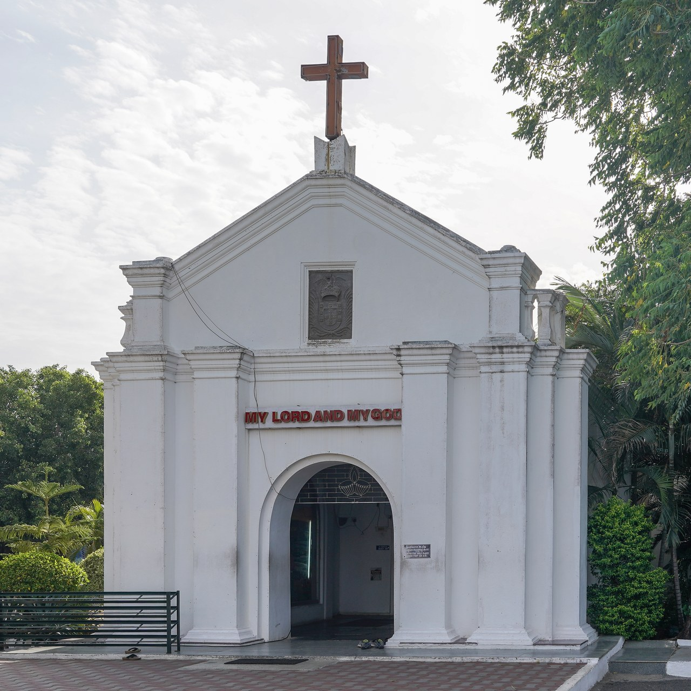</picture>
<figcaption>The church on <b>St Thomas Mount</b>, built by the Portuguese in 1523 over the traditional place of his martyrdom. Over the door: "My Lord and my God." Photo: <a href="https://commons.wikimedia.org/wiki/File:Main_Entrance_St_Thomas_Mount_Church_Chennai_Aug22_A7C_02249.jpg">Main Entrance St Thomas Mount Church Chennai Aug22 A7C 02249</a> by Timothy A. Gonsalves, <a href="https://creativecommons.org/licenses/by-sa/4.0">CC BY-SA 4.0</a>, via Wikimedia Commons.</figcaption>
</figure>

<figure class=photo>
<picture><source srcset="/static/art/thomas-mount-cross-600.webp 600w,/static/art/thomas-mount-cross.webp 292w" sizes="(max-width:760px) 100vw,760px" type="image/webp">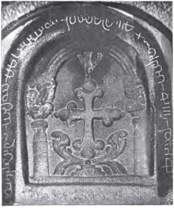</picture>
<figcaption>The <b>St Thomas cross</b> on St Thomas Mount, found in 1547 and dated by the <i>Catholic Encyclopedia</i> to the seventh century, with its border inscription in Pahlavi. It is the oldest of the Persian crosses of India. Photo: <a href="https://commons.wikimedia.org/wiki/File:St._Thomas%27_Cross_(Chennai,_St._Thomas_Mount).jpg">St. Thomas' Cross (Chennai, St. Thomas Mount)</a> by Grentidez, <a href="https://creativecommons.org/publicdomain/zero/1.0/">CC0</a>, via Wikimedia Commons.</figcaption>
</figure>

<figure class=photo>
<picture><source srcset="/static/art/thomas-mount-view-600.webp 600w,/static/art/thomas-mount-view.webp 650w" sizes="(max-width:760px) 100vw,760px" type="image/webp">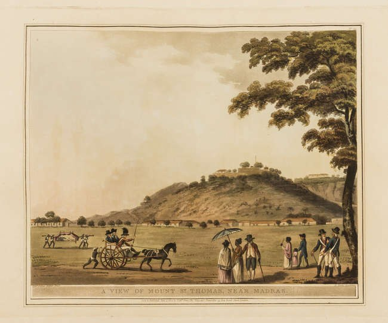</picture>
<figcaption><i>A View of Mount St. Thomas, near Madras</i>, an aquatint after Lieutenant <b>James Hunter</b>, published in London in 1805. The church on the summit was a landmark for sailors on the Coromandel coast. Image: <a href="https://commons.wikimedia.org/wiki/File:James_Hunter_-_A_view_of_Mount_St._Thomas,_near_Madras.jpg">James Hunter - A view of Mount St. Thomas, near Madras</a>, public domain, via Wikimedia Commons.</figcaption>
</figure>

### Little Mount (Chinnamalai)

On the bank of the Adyar River at Saidapet, a low rocky hillock is honoured as the place where Thomas lived and prayed. In 1551 the Portuguese built a church there to **Our Lady of Health**, with a small chapel over a natural **cave** about fourteen feet wide where tradition says he hid and prayed. Pilgrims are also shown a spring said to have burst from the rock at his prayer, a cross carved into the stone, and marks of a hand and a foot. A new round church was added for the nineteenth centenary of his martyrdom in 1972. The shrine's own history admits, gently, that the identification of these sacred places owes much to the devotion of the Portuguese, "eager to unearth apostolic origins." The prayer of pilgrims there is much older.

### The seven and a half churches of Kerala

<figure class=map><figcaption>The seven and a half churches (Ezhara Pallikal) remembered as founded by St Thomas, with three other Thomas places of Kerala. Map by The Daily Word; coastline from Natural Earth (public domain); positions approximate. Tap to enlarge.</figcaption></figure>

**Kodungallur (Cranganore).** The landing place. The ancient churches of Kodungallur have long gone, but at **Azhikode**, at the mouth of the Periyar, the **Marthoma Pontifical Shrine** was founded in 1953 to receive the relic of his right arm. Cardinal Tisserant brought it on **6 December 1953** in a procession of decorated boats, a day the shrine calls "a second landing of St. Thomas." It is kept in a shrine modelled, the shrine says, on St Peter's in Rome, looking out over the water where he is said to have stepped ashore.

<figure class=photo>
<picture><source srcset="/static/art/thomas-kodungallur-600.webp 600w,/static/art/thomas-kodungallur.webp 1280w" sizes="(max-width:760px) 100vw,760px" type="image/webp">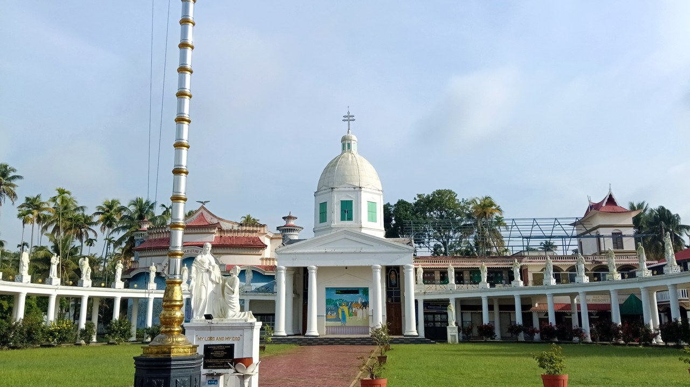</picture>
<figcaption>The <b>Marthoma Pontifical Shrine</b> at Azhikode, Kodungallur, near the place where tradition says St Thomas landed in AD 52. It keeps the relic of his right arm, brought from Ortona in 1953. Photo: <a href="https://commons.wikimedia.org/wiki/File:Mar_Thoma_Syro-Malabar_Church_at_Azhikode_in_Kodungallur_03.jpg">Mar Thoma Syro-Malabar Church at Azhikode in Kodungallur 03</a> by Tarunsamanta, <a href="https://creativecommons.org/licenses/by-sa/4.0">CC BY-SA 4.0</a>, via Wikimedia Commons.</figcaption>
</figure>

**Palayur.** In a village near Chavakkad, once a Jewish settlement, tradition says Thomas performed the first baptisms in India, at a tank now called Thaliyakulam. In the seventeenth century the Jesuit **Giacomo Fenicio** built a church around the older one; the present church is a pilgrim shrine of the Syro-Malabar Archdiocese of Thrissur.

<figure class=photo>
<picture><source srcset="/static/art/thomas-palayur-600.webp 600w,/static/art/thomas-palayur.webp 1280w" sizes="(max-width:760px) 100vw,760px" type="image/webp">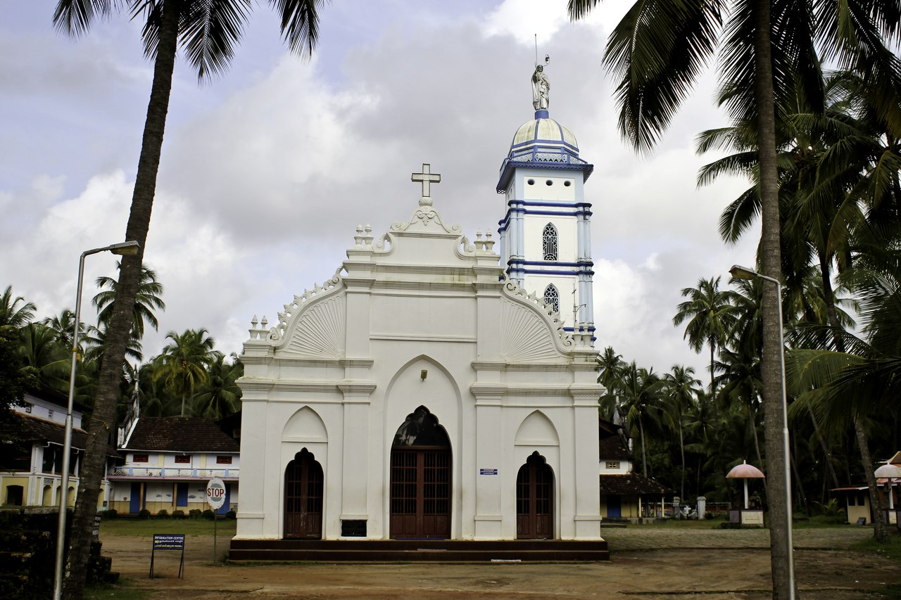</picture>
<figcaption>The <b>St Thomas Syro-Malabar Church at Palayur</b>, near Chavakkad, the place of the first baptisms in Kerala by tradition. Photo: <a href="https://commons.wikimedia.org/wiki/File:Palayoor_St._Thomas_Syro-Malabar_Church.jpg">Palayoor St. Thomas Syro-Malabar Church</a> by Princebpaul0484, <a href="https://creativecommons.org/licenses/by-sa/3.0">CC BY-SA 3.0</a>, via Wikimedia Commons.</figcaption>
</figure>

**Kottakkavu (North Paravur).** On the Periyar, the old church of Kottakkavu keeps an ancient Persian cross, the Kottakkavu Sliva, and a pond where tradition says Thomas baptised his first converts. The church was rebuilt after destruction in the wars of the late eighteenth century.

<figure class=photo>
<picture><source srcset="/static/art/thomas-kottakkavu-600.webp 600w,/static/art/thomas-kottakkavu.webp 1280w" sizes="(max-width:760px) 100vw,760px" type="image/webp">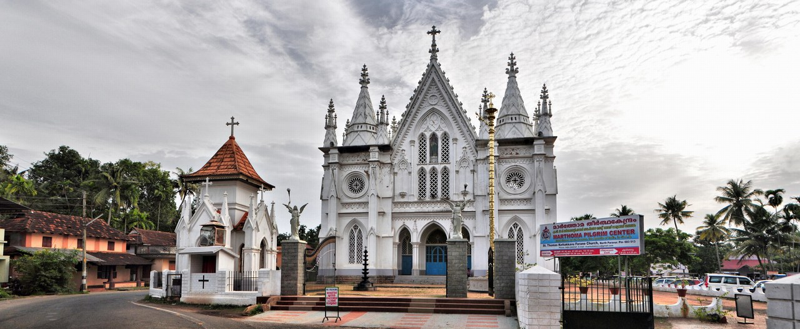</picture>
<figcaption>The <b>Kottakkavu Mar Thoma Church</b> at North Paravur, one of the seven churches of St Thomas. Photo: <a href="https://commons.wikimedia.org/wiki/File:Kottakkavu_Mar_Thoma_Pilgrim_Church_founded_by_St._Thomas.jpg">Kottakkavu Mar Thoma Pilgrim Church founded by St. Thomas</a> by Challiyan, <a href="https://creativecommons.org/licenses/by-sa/3.0">CC BY-SA 3.0</a>, via Wikimedia Commons.</figcaption>
</figure>

**Kokkamangalam.** Near Cherthala, by the backwaters, Kokkamangalam remembers a year of preaching and many baptisms. It keeps a portrait of the apostle that has been venerated there since 1897.

<figure class=photo>
<picture><source srcset="/static/art/thomas-kokkamangalam-600.webp 600w,/static/art/thomas-kokkamangalam.webp 1280w" sizes="(max-width:760px) 100vw,760px" type="image/webp">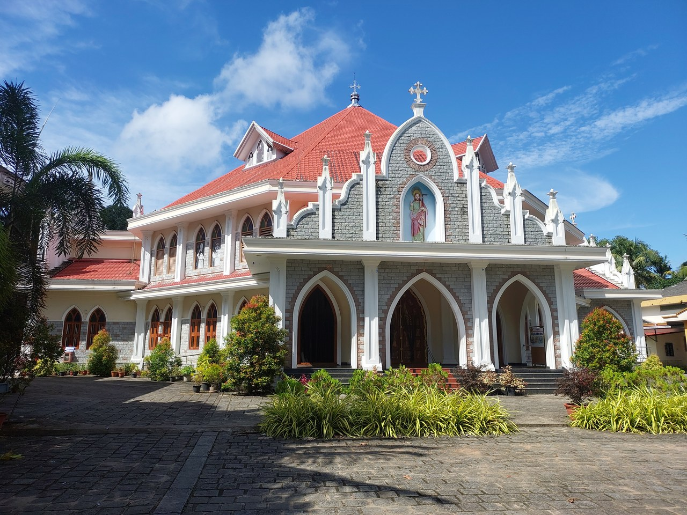</picture>
<figcaption><b>St Thomas Church, Kokkamangalam</b>, renovated in recent years, by the backwaters near Cherthala. Photo: <a href="https://commons.wikimedia.org/wiki/File:Kokkamangalam_Church_2023.jpg">Kokkamangalam Church 2023</a> by Vis M, <a href="https://creativecommons.org/licenses/by-sa/4.0">CC BY-SA 4.0</a>, via Wikimedia Commons.</figcaption>
</figure>

**Niranam.** Near Thiruvalla in the paddy lands of central Kerala, Niranam is said to be where Thomas set up a cross. Today it is the seat of one of the oldest churches of the Malankara Orthodox, **St Mary's**, famous for its wall paintings, with an old stone recording a rebuilding in 1259.

<figure class=photo>
<picture><source srcset="/static/art/thomas-niranam-600.webp 600w,/static/art/thomas-niranam.webp 1000w" sizes="(max-width:760px) 100vw,760px" type="image/webp">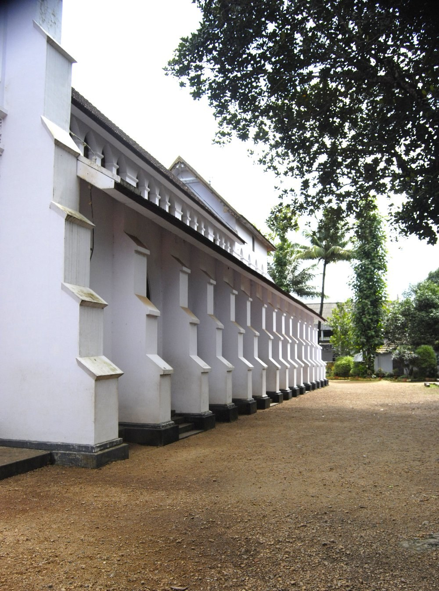</picture>
<figcaption>The south side of <b>St Mary's Church, Niranam</b>, today a church of the Malankara Orthodox Syrian Church. Photo: <a href="https://commons.wikimedia.org/wiki/File:%E0%B4%A8%E0%B4%BF%E0%B4%B0%E0%B4%A3%E0%B4%82_%E0%B4%AA%E0%B4%B3%E0%B5%8D%E0%B4%B3%E0%B4%BF_%E0%B4%A4%E0%B5%86%E0%B4%95%E0%B5%8D%E0%B4%95%E0%B5%81_%E0%B4%B5%E0%B4%B6%E0%B4%82.jpg">നിരണം പള്ളി തെക്കു വശം</a> by Arayilpdas, <a href="https://creativecommons.org/licenses/by-sa/3.0">CC BY-SA 3.0</a>, via Wikimedia Commons.</figcaption>
</figure>

**Nilakkal (Chayal).** High in the forests of the Western Ghats, on the old trade road to Tamil Nadu, Nilakkal was once a thriving town. Its Christians later scattered, and only ruins were left in the forest. In 1985 a new **St Thomas Ecumenical Church** was consecrated there. It is shared by several churches, a sign of the unity that St Thomas's children long for.

<figure class=photo>
<picture><source srcset="/static/art/thomas-nilakkal-600.webp 600w,/static/art/thomas-nilakkal.webp 1125w" sizes="(max-width:760px) 100vw,760px" type="image/webp">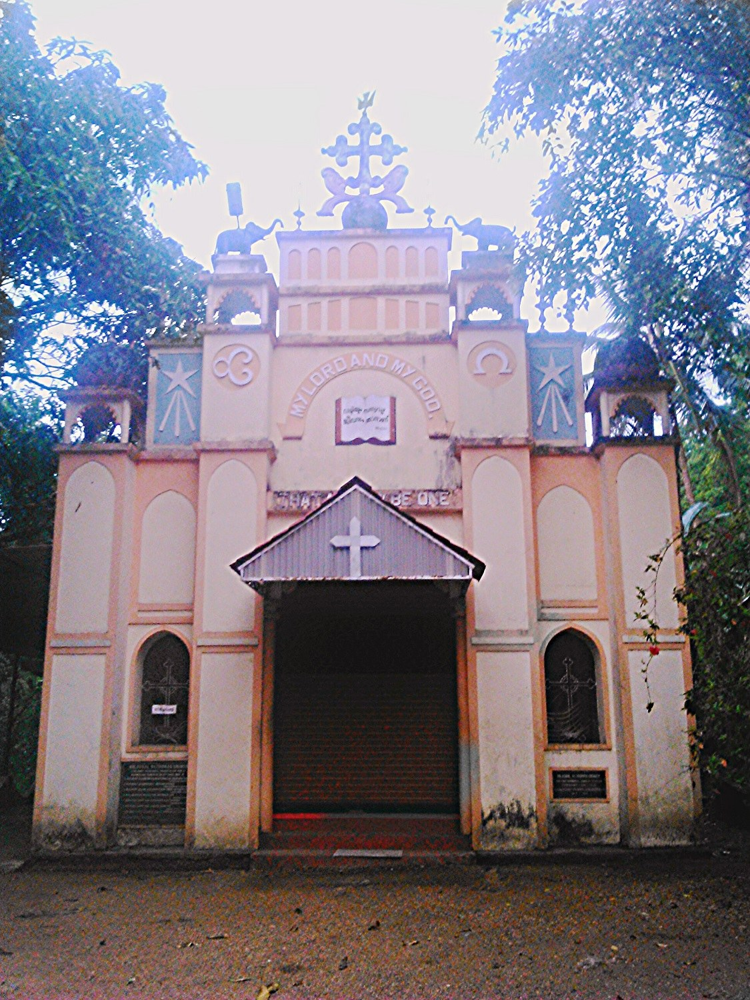</picture>
<figcaption>The <b>St Thomas Ecumenical Church, Nilakkal</b>, consecrated in 1985 and shared by several churches. Photo: <a href="https://commons.wikimedia.org/wiki/File:Nilakkal_Church_front_view.jpg">Nilakkal Church front view</a> by Abin jv, <a href="https://creativecommons.org/licenses/by-sa/4.0">CC BY-SA 4.0</a>, via Wikimedia Commons.</figcaption>
</figure>

**Kollam (Quilon).** In the southern port of Kollam, his church is said to have been lost long ago to the sea. The port's Christian community is recorded on the ninth-century copper plates.

**Thiruvithamcode, the "half church."** In Kanyakumari district, now in Tamil Nadu, the little stone church called the **Arappally**, or Thomaiyar Kovil, is counted as the half church. Its name is explained in different ways, as the "half church" and as the "royal church." Tradition dates its founding to AD 63; the present stone church is largely of the seventeenth century. Prayers are still said there every day.

<figure class=photo>
<picture><source srcset="/static/art/thomas-thiruvithamcode-600.webp 600w,/static/art/thomas-thiruvithamcode.webp 1280w" sizes="(max-width:760px) 100vw,760px" type="image/webp">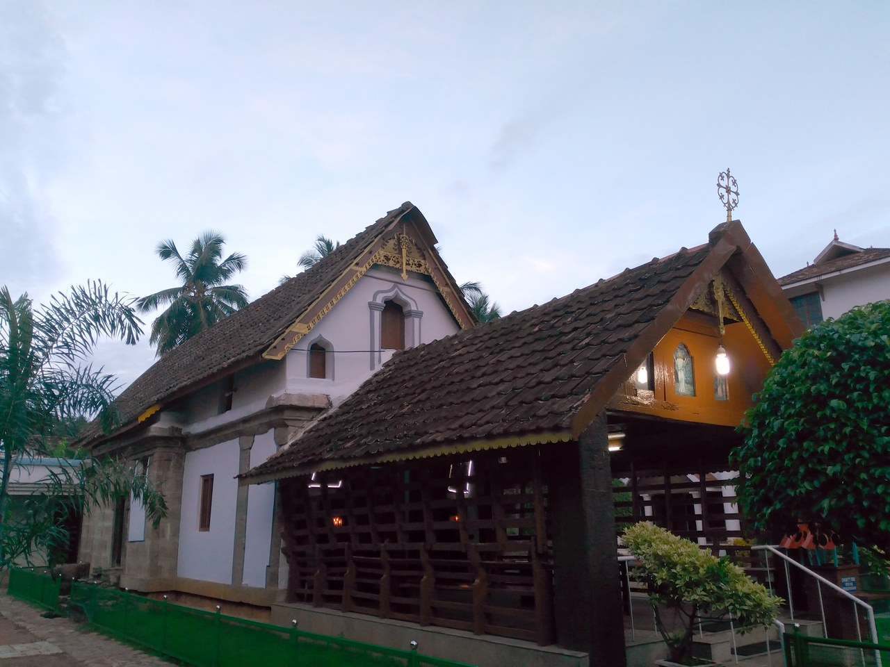</picture>
<figcaption>The <b>Arappally at Thiruvithamcode</b>, the "half church" of the St Thomas tradition, in Kanyakumari district. Photo: <a href="https://commons.wikimedia.org/wiki/File:Thiruvithamcode_Arappally3.jpg">Thiruvithamcode Arappally3</a> by Arunnirml, <a href="https://creativecommons.org/licenses/by-sa/4.0">CC BY-SA 4.0</a>, via Wikimedia Commons.</figcaption>
</figure>

### Malayattoor: the pilgrim hill

In the forest above the Periyar at **Malayattoor**, a steep hill called **Kurisumudi**, "the peak of the cross," is honoured as the place where Thomas prayed and traced a cross on the rock. A golden cross is said to have been seen there long afterwards. Every year, and above all in Lent and on the Sunday after Easter, huge crowds climb the rocky path. Many carry wooden crosses and call on "Muthappan," the beloved father, as they go.

<figure class=photo>
<picture><source srcset="/static/art/thomas-malayattoor-600.webp 600w,/static/art/thomas-malayattoor.webp 1280w" sizes="(max-width:760px) 100vw,760px" type="image/webp">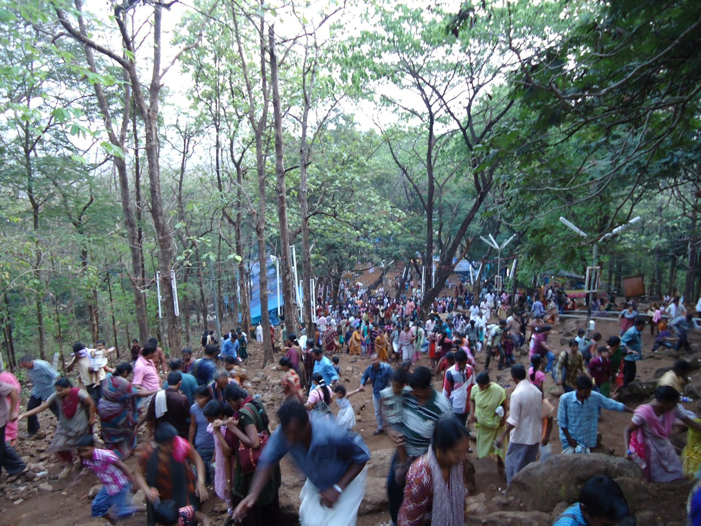</picture>
<figcaption>Pilgrims climbing <b>Kurisumudi at Malayattoor</b>, the hill where tradition says St Thomas prayed. Photo: <a href="https://commons.wikimedia.org/wiki/File:Malayalttoor_Kurishumudi_People_Climbing_hill.JPG">Malayalttoor Kurishumudi People Climbing hill</a> by Ranjithsiji, <a href="https://creativecommons.org/licenses/by-sa/3.0">CC BY-SA 3.0</a>, via Wikimedia Commons.</figcaption>
</figure>

### Ortona, Italy

The Adriatic port of **Ortona**, in Abruzzo, has kept the relics brought from Chios since 1258. The **Basilica of St Thomas the Apostle** was gutted in the fighting of December 1943 and rebuilt after the war; its dome rises again over the harbour. In the crypt, the gilded reliquary chest lies under the altar, with the old **gravestone from Chios** nearby. Its Greek inscription and half-figure of a bishop with a halo are thought by some scholars to be as old as the third century. Every first Sunday in May the town keeps the **Festa del Perdono**, the feast of forgiveness, granted by the popes for pilgrims to the apostle's tomb.

<figure class=photo>
<picture><source srcset="/static/art/thomas-ortona-600.webp 600w,/static/art/thomas-ortona.webp 1280w" sizes="(max-width:760px) 100vw,760px" type="image/webp">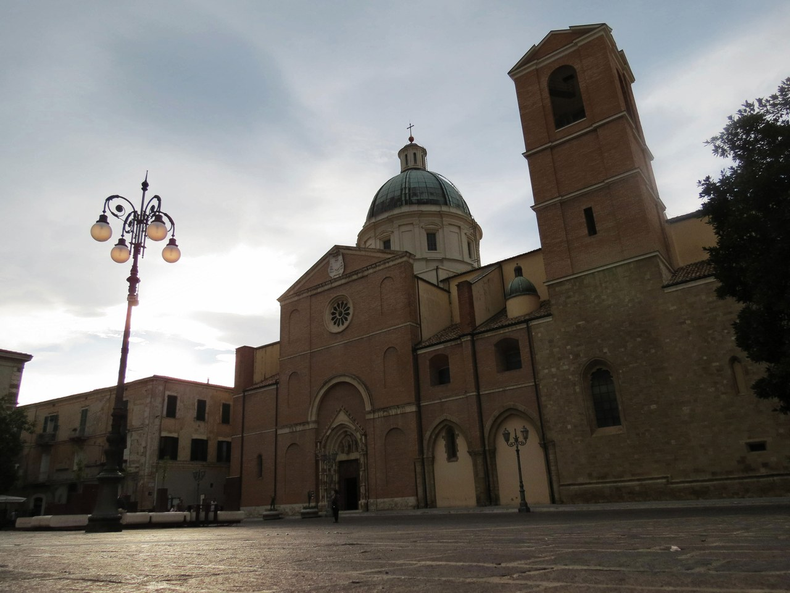</picture>
<figcaption>The <b>Basilica of St Thomas the Apostle, Ortona</b>, rebuilt after its destruction in 1943 and rededicated in 1949. Photo: <a href="https://commons.wikimedia.org/wiki/File:Cattedrale-di-San-Tommaso.jpg">Cattedrale-di-San-Tommaso</a> by Glenda Trubiano, <a href="https://creativecommons.org/licenses/by-sa/3.0">CC BY-SA 3.0</a>, via Wikimedia Commons.</figcaption>
</figure>

<figure class=photo>
<picture><source srcset="/static/art/thomas-ortona-nave-600.webp 600w,/static/art/thomas-ortona-nave.webp 945w" sizes="(max-width:760px) 100vw,760px" type="image/webp">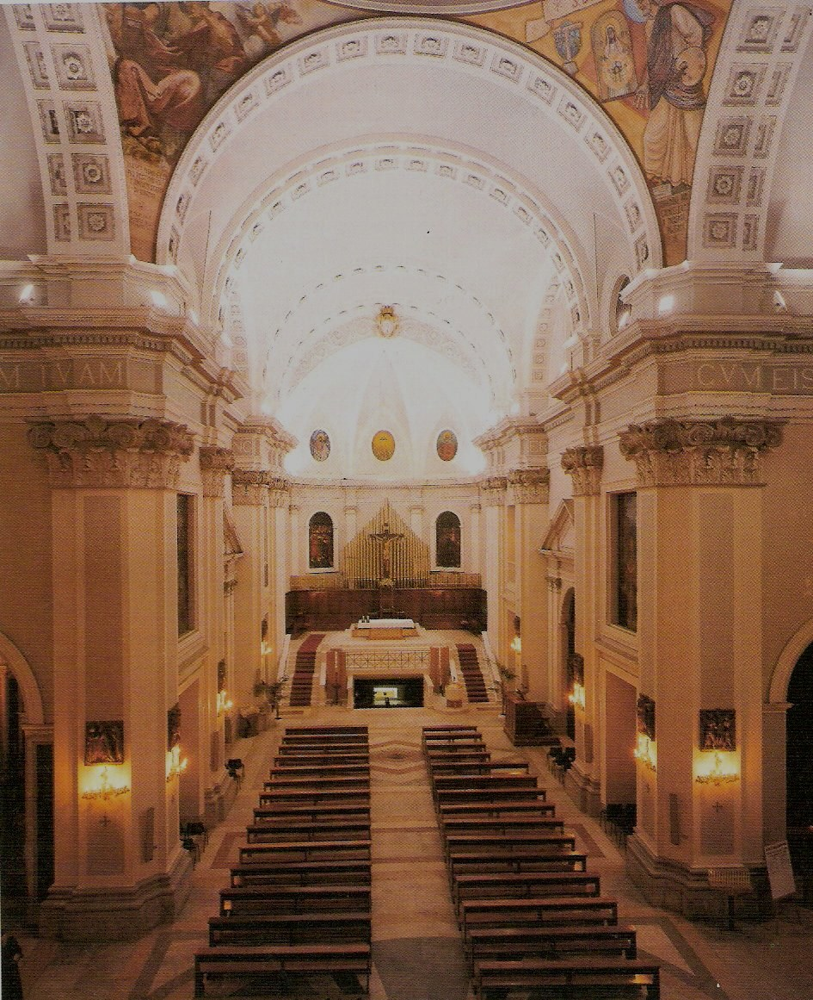</picture>
<figcaption>The <b>nave of the basilica at Ortona</b>. Photo: <a href="https://commons.wikimedia.org/wiki/File:Navata_centrale_-_Basilica_di_San_Tommaso_Apostolo.jpg">Navata centrale - Basilica di San Tommaso Apostolo</a> by Gs87, <a href="https://creativecommons.org/licenses/by-sa/3.0">CC BY-SA 3.0</a>, via Wikimedia Commons.</figcaption>
</figure>

<figure class=photo>
<picture><source srcset="/static/art/thomas-ortona-tomb-600.webp 600w,/static/art/thomas-ortona-tomb.webp 1280w" sizes="(max-width:760px) 100vw,760px" type="image/webp">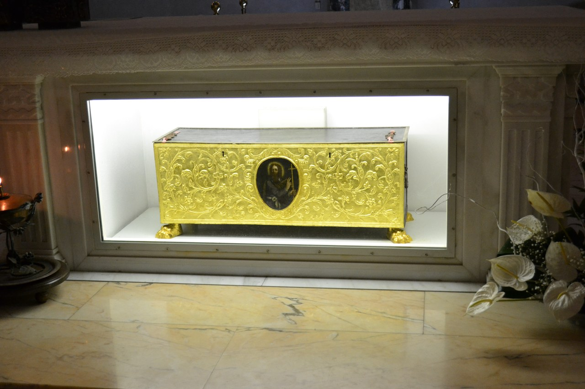</picture>
<figcaption>The <b>reliquary of St Thomas</b> in the crypt at Ortona, which holds the bones brought from Chios on 6 September 1258. Photo: <a href="https://commons.wikimedia.org/wiki/File:Tomba_dell%27apostolo_Tommaso.jpg">Tomba dell'apostolo Tommaso</a> by Lucadideo, <a href="https://creativecommons.org/licenses/by-sa/4.0">CC BY-SA 4.0</a>, via Wikimedia Commons.</figcaption>
</figure>

### Takht-i-Bahi, Pakistan

The great Buddhist monastery of **Takht-i-Bahi**, near Mardan in Khyber Pakhtunkhwa, crowns a ridge above the plain of Gandhara. It is a UNESCO World Heritage Site. The inscription of King Gondophares is named after it. Whether or not Thomas ever passed this way, it gives a picture of the land where the *Acts* set his first mission: busy, prosperous and full of faiths.

<figure class=photo>
<picture><source srcset="/static/art/thomas-takht-i-bahi-600.webp 600w,/static/art/thomas-takht-i-bahi.webp 1280w" sizes="(max-width:760px) 100vw,760px" type="image/webp">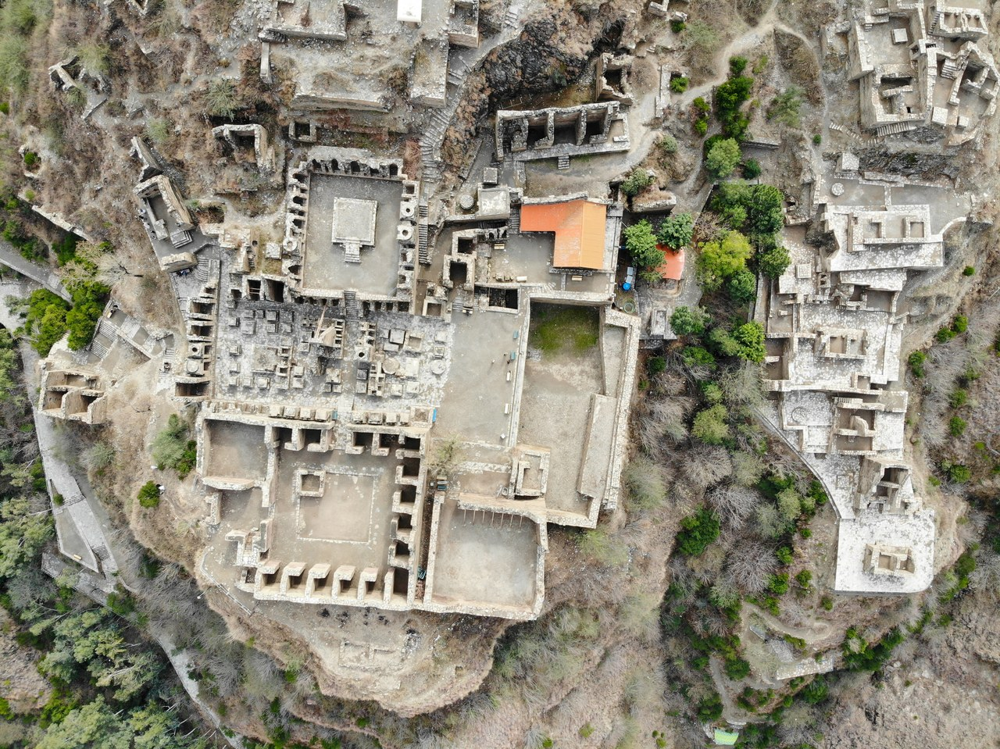</picture>
<figcaption>The ruins of the monastery at <b>Takht-i-Bahi</b>, in the old kingdom of Gandhara, now in Pakistan, from the air. Photo: <a href="https://commons.wikimedia.org/wiki/File:Takht-i-Bahi_Buddhist_Monastery.jpg">Takht-i-Bahi Buddhist Monastery</a> by Muzamil Hassain Toori, <a href="https://creativecommons.org/licenses/by-sa/4.0">CC BY-SA 4.0</a>, via Wikimedia Commons.</figcaption>
</figure>

<h2 id=art>Thomas in art</h2>

Few scenes in the Gospels have been painted more often than the eighth day after Easter, when Thomas stood before the risen Christ. Artists have used it to show how the risen body was real, and how faith answers doubt.

### The touch: Duccio, Verrocchio and Cima

<figure class=photo>
<picture><source srcset="/static/art/thomas-duccio-600.webp 600w,/static/art/thomas-duccio.webp 777w" sizes="(max-width:760px) 100vw,760px" type="image/webp">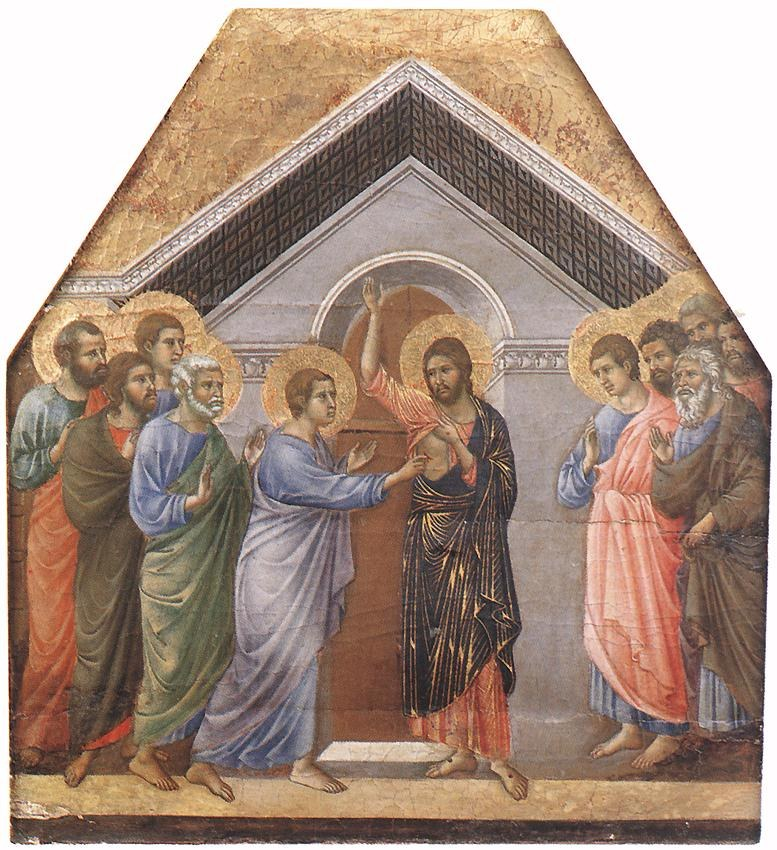</picture>
<figcaption><i>The Incredulity of Thomas</i>, by <b>Duccio di Buoninsegna</b>, 1308–11, one of the small scenes of the risen Christ from the crowning of his great <i>Maestà</i> altarpiece for Siena Cathedral. Museo dell'Opera del Duomo, Siena. Image: <a href="https://commons.wikimedia.org/wiki/File:Duccio_di_Buoninsegna_-_Doubting_Thomas_-_WGA06735.jpg">Duccio di Buoninsegna - Doubting Thomas - WGA06735</a>, public domain, via Wikimedia Commons.</figcaption>
</figure>

<figure class=photo>
<picture><source srcset="/static/art/thomas-verrocchio-600.webp 600w,/static/art/thomas-verrocchio.webp 1280w" sizes="(max-width:760px) 100vw,760px" type="image/webp">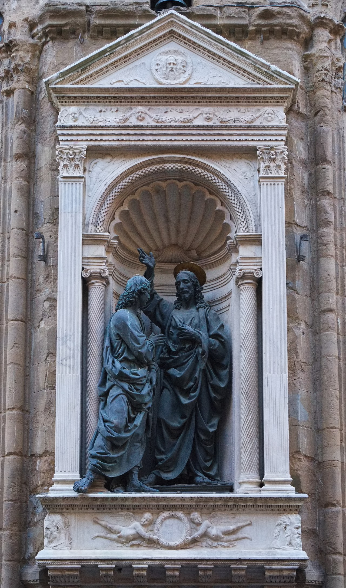</picture>
<figcaption><i>Christ and St Thomas</i>, the bronze by <b>Andrea del Verrocchio</b>, 1467–83, made for the merchants' guild at Orsanmichele, Florence. The niche shown here was made by Donatello. Thomas steps out of the niche towards us, as if from our side. The original bronze is now in the Museo di Orsanmichele; a copy stands in the niche. Photo: <a href="https://commons.wikimedia.org/wiki/File:Andrea_del_Verrocchio,_Doubting_Thomas,_1467-83,_for_the_Mercanzia,_copy_in_niche_created_by_Donatello,_Orsanmichele,_Florence.jpg">Andrea del Verrocchio, Doubting Thomas, 1467-83, for the Mercanzia, copy in niche created by Donatello, Orsanmichele, Florence</a> by Armin Kleiner, <a href="https://creativecommons.org/licenses/by-sa/4.0">CC BY-SA 4.0</a>, via Wikimedia Commons.</figcaption>
</figure>

<figure class=photo>
<picture><source srcset="/static/art/thomas-cima-600.webp 600w,/static/art/thomas-cima.webp 1280w" sizes="(max-width:760px) 100vw,760px" type="image/webp">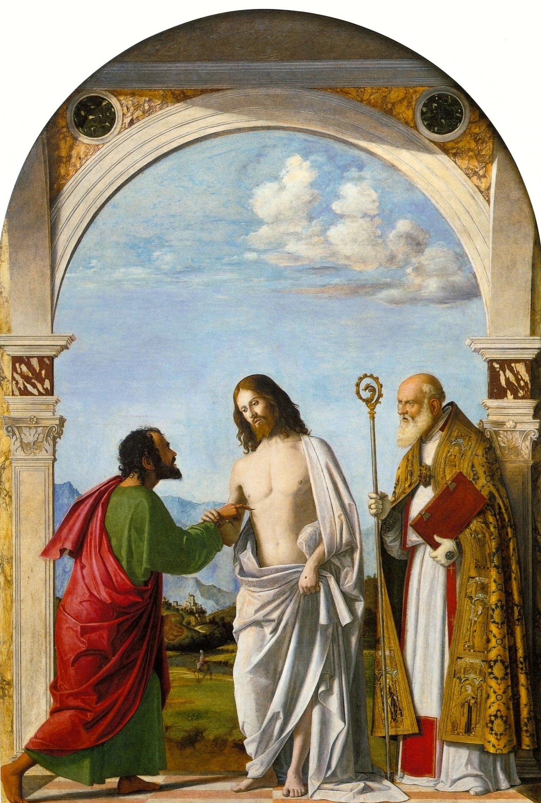</picture>
<figcaption><i>The Incredulity of St Thomas with St Magnus</i>, by <b>Cima da Conegliano</b>, 1504–05. It was painted for the Scuola dei Muratori, the masons' guild of Venice, who chose their patron Thomas the builder. Gallerie dell'Accademia, Venice. Image: <a href="https://commons.wikimedia.org/wiki/File:Cima_da_Conegliano,_Incredulity_of_Thomas_with_Bishop_Magno._ca._1505,_215x151cm,_Galleria_dell%27Accademia,_Venice.jpg">Cima da Conegliano, Incredulity of Thomas with Bishop Magno. ca. 1505, 215x151cm, Galleria dell'Accademia, Venice</a>, public domain, via Wikimedia Commons.</figcaption>
</figure>

### Caravaggio and the Baroque

<figure class=photo>
<picture><source srcset="/static/art/thomas-rubens-rockox-600.webp 600w,/static/art/thomas-rubens-rockox.webp 1280w" sizes="(max-width:760px) 100vw,760px" type="image/webp">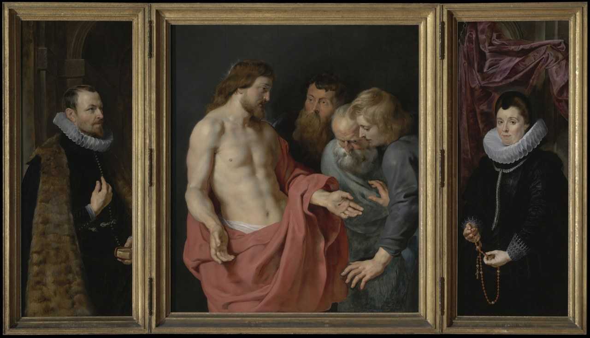</picture>
<figcaption><i>The Incredulity of St Thomas</i> (the Rockox Triptych), by <b>Peter Paul Rubens</b>, 1613–15. It was painted as the memorial of the Antwerp burgomaster Nicolaas Rockox and his wife Adriana Perez, who kneel on the wings. Royal Museum of Fine Arts (KMSKA), Antwerp. Image: <a href="https://commons.wikimedia.org/wiki/File:Peter_Paul_Rubens_-_Christ%27s_Apparition_to_the_Disciples_(the_Rockox_Triptych).jpg">Peter Paul Rubens - Christ's Apparition to the Disciples (the Rockox Triptych)</a>, public domain, via Wikimedia Commons.</figcaption>
</figure>

<figure class=photo>
<picture><source srcset="/static/art/thomas-guercino-600.webp 600w,/static/art/thomas-guercino.webp 800w" sizes="(max-width:760px) 100vw,760px" type="image/webp">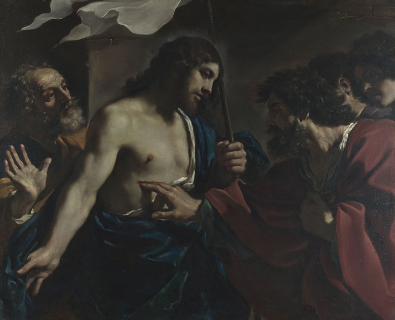</picture>
<figcaption><i>The Incredulity of Saint Thomas</i>, by <b>Guercino</b>, 1621. National Gallery, London. Image: <a href="https://commons.wikimedia.org/wiki/File:Guercino_-_The_Incredulity_of_Saint_Thomas,_1621.jpg">Guercino - The Incredulity of Saint Thomas, 1621</a>, public domain, via Wikimedia Commons.</figcaption>
</figure>

<figure class=photo>
<picture><source srcset="/static/art/thomas-rembrandt-600.webp 600w,/static/art/thomas-rembrandt.webp 1280w" sizes="(max-width:760px) 100vw,760px" type="image/webp">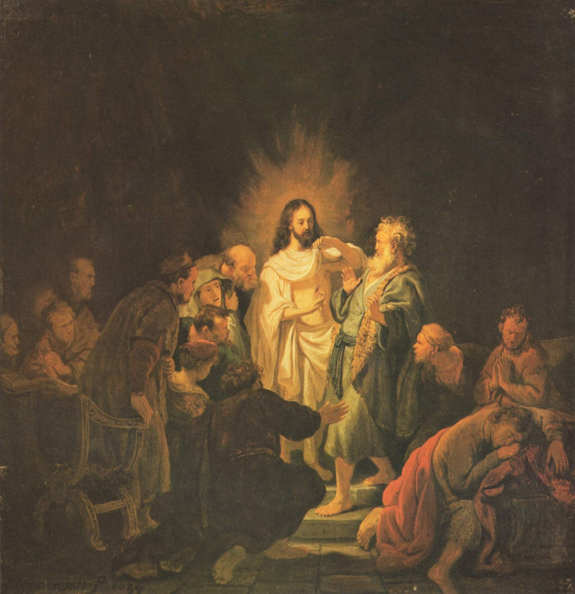</picture>
<figcaption><i>The Incredulity of St Thomas</i>, by <b>Rembrandt</b>, 1634. Here Thomas does not touch at all: he shrinks back, overwhelmed, as Christ offers him the wound. Pushkin State Museum of Fine Arts, Moscow. Image: <a href="https://commons.wikimedia.org/wiki/File:Rembrandt_Harmensz._van_Rijn_040.jpg">Rembrandt Harmensz. van Rijn 040</a>, public domain, via Wikimedia Commons.</figcaption>
</figure>

### The apostle alone: La Tour and Velázquez

<figure class=photo>
<picture><source srcset="/static/art/thomas-la-tour-600.webp 600w,/static/art/thomas-la-tour.webp 1280w" sizes="(max-width:760px) 100vw,760px" type="image/webp">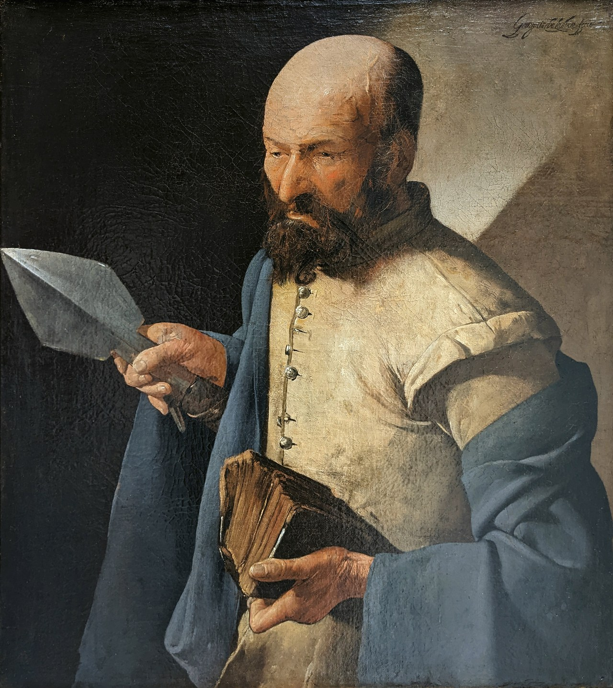</picture>
<figcaption><i>Saint Thomas</i>, known as "St Thomas with a Pike," by <b>Georges de La Tour</b>, about 1634–38. The lance of his martyrdom becomes a workman's tool in the hands of a stubborn old man. The Louvre bought it in 1988 with the help of a public subscription. Musée du Louvre, Paris. Image: <a href="https://commons.wikimedia.org/wiki/File:Saint_Thomas_%C3%A0_la_pique_-_Georges_de_La_Tour_-_Mus%C3%A9e_du_Louvre_Peintures_RF_1988_15.jpg">Saint Thomas à la pique - Georges de La Tour - Musée du Louvre Peintures RF 1988 15</a>, public domain, via Wikimedia Commons.</figcaption>
</figure>

<figure class=photo>
<picture><source srcset="/static/art/thomas-velazquez-600.webp 600w,/static/art/thomas-velazquez.webp 847w" sizes="(max-width:760px) 100vw,760px" type="image/webp">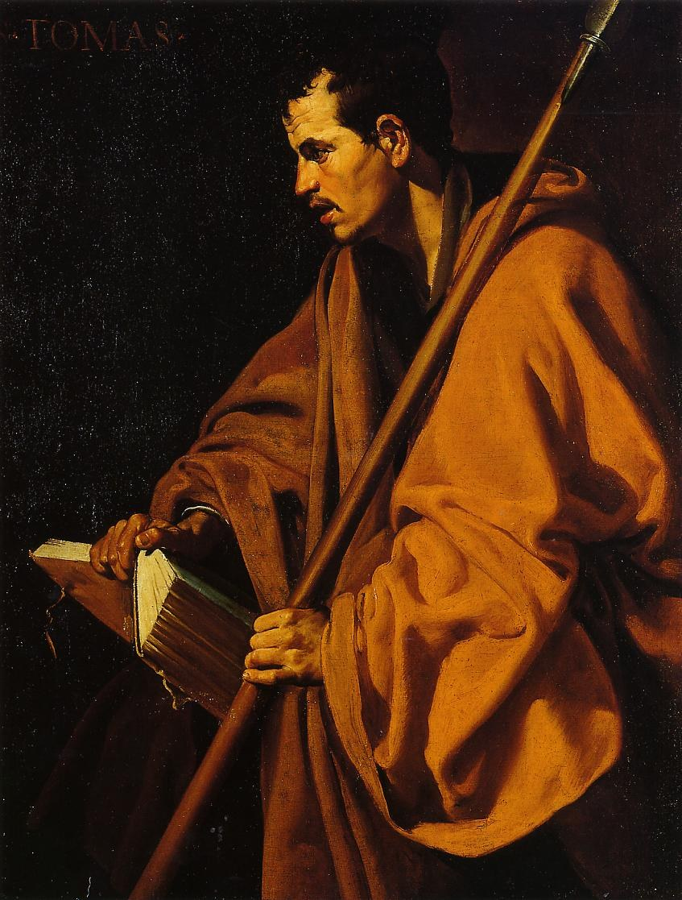</picture>
<figcaption><i>Saint Thomas</i>, by <b>Diego Velázquez</b>, about 1619–20, painted in Seville when the artist was only about twenty, probably as part of a series of apostles. Musée des Beaux-Arts, Orléans. Image: <a href="https://commons.wikimedia.org/wiki/File:Santo_Tom%C3%A1s,_by_Diego_Vel%C3%A1zquez.jpg">Santo Tomás, by Diego Velázquez</a>, public domain, via Wikimedia Commons.</figcaption>
</figure>

### Icons of the East

<figure class=photo>
<picture><source srcset="/static/art/thomas-moscow-icon-600.webp 600w,/static/art/thomas-moscow-icon.webp 1280w" sizes="(max-width:760px) 100vw,760px" type="image/webp">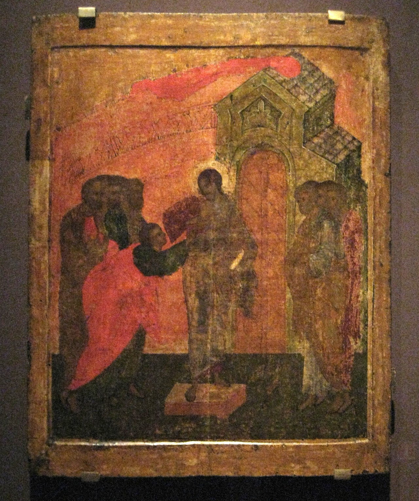</picture>
<figcaption><i>The Doubt (Assurance) of Thomas</i>, a Moscow icon of the mid-sixteenth century from the festal row of the iconostasis of the Cathedral of the Annunciation in the Kremlin. In icons of Thomas Sunday the closed door is usually shown: Christ came "the doors being shut." Photo: <a href="https://commons.wikimedia.org/wiki/File:Icon_of_Doubting_Saint_Thomas_(16th_c.,_Annunciation_Cathedral_in_Moscow).jpg">Icon of Doubting Saint Thomas (16th c., Annunciation Cathedral in Moscow)</a> by shakko, <a href="https://creativecommons.org/licenses/by-sa/3.0">CC BY-SA 3.0</a>, via Wikimedia Commons.</figcaption>
</figure>

### Art of the St Thomas Christians

The old churches of Kerala were painted inside with murals that blend Syriac Christian themes with the bold colours and coiled designs of Kerala's temple painting. Some of the finest survive at Angamaly, Paliekkara and Kottayam. With the Persian crosses and the carved granite crosses that stand before the churches, they are the art of St Thomas's own children.

<figure class=photo>
<picture><source srcset="/static/art/thomas-kerala-mural-600.webp 600w,/static/art/thomas-kerala-mural.webp 1280w" sizes="(max-width:760px) 100vw,760px" type="image/webp">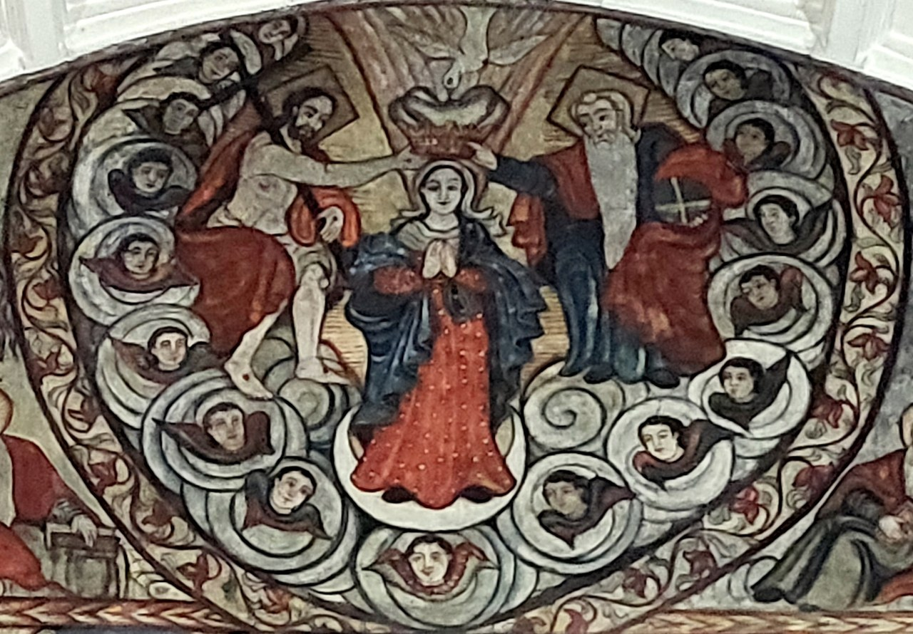</picture>
<figcaption><i>The Coronation of the Virgin</i>, a mural in <b>St George's Orthodox Church, Paliekkara</b>, near Thiruvalla, Kerala. Christian themes are painted in the bold, swirling style of the old Kerala murals. Image: <a href="https://commons.wikimedia.org/wiki/File:Christian_Murals_of_Paliekkara_1.jpg">Christian Murals of Paliekkara 1</a>, public domain, via Wikimedia Commons.</figcaption>
</figure>

## Path to sainthood
An apostle, venerated from the earliest days of the Church, long before formal canonisation existed. His name is in the Roman Canon of the Mass, among the apostles. His feast on **3 July** is on the General Roman Calendar, as it has been since 1969, when it moved from 21 December. The Eastern Orthodox keep **6 October**, and the St Thomas Christians keep the Dukhrana on **3 July**.

## Patronages
**India** and its Christians; also Sri Lanka and Pakistan; **architects, builders, masons, stonecutters and surveyors** (for the palace he built for the king); theologians; and all who struggle with **doubt**.

## Trivia
- "Doubting Thomas" entered the English language from his story, but he never doubted again. The Eastern churches prefer to call the feast the "Assurance" of Thomas.
- The Gospel of John 20:19–31 is read every year on the Second Sunday of Easter, so Thomas has a Sunday each year.
- Muslims also honoured his tomb. Marco Polo wrote that "the Saracens also do hold the Saint in great reverence," calling him by an Arabic word for an apostle.
- In the *Acts of Thomas*, Christ himself writes and signs the deed selling Thomas as a slave.
- In the Middle Ages, the Anglo-Saxon Chronicle records that King Alfred the Great sent envoys with alms to St Thomas in India in 883.
- Indian Christians and Ortona both keep his memory each year; Ortona's feast of 6 September recalls the day the relics came ashore in 1258.
- Other saints named Thomas on this site: [St Thomas Aquinas](/saints/thomas-aquinas/), [St Thomas Becket](/saints/thomas-becket/) and [St Thomas More](/saints/thomas-more/). The apostle who sat next to him in the Gospel lists was [St Matthew](/saints/matthew/); his fellow missionary to the East, by tradition, was [St Bartholomew](/saints/bartholomew/).

## Sources
- Matthew 10:3; Mark 3:18; Luke 6:15; John 11:7–16; 14:1–7; 20:19–29; 21:1–14; Acts 1:13–14 (King James Version)
- [Vatican News: St. Thomas, Apostle](https://www.vaticannews.va/en/saints/07/03/st--thomas--apostle.html)
- [Pope Benedict XVI, General Audience of 27 September 2006: Thomas, "the twin"](https://www.vatican.va/content/benedict-xvi/en/audiences/2006/documents/hf_ben-xvi_aud_20060927.html)
- [Catholic Encyclopedia: St Thomas the Apostle](https://www.newadvent.org/cathen/14658b.htm)
- [Catholic Encyclopedia: St Thomas Christians](https://www.newadvent.org/cathen/14678a.htm)
- [*The Acts of Thomas*, tr. M. R. James (1924)](http://gnosis.org/library/actthom.htm)
- [*The Hymn of the Pearl*, tr. G. R. S. Mead and W. Wright](http://gnosis.org/library/hymnpearl.htm)
- [Encyclopaedia Iranica: Gondophares (A. D. H. Bivar)](https://www.iranicaonline.org/articles/gondophares/)
- [Sten Konow, "The so-called Takht-i-Bahi inscription of the year 103," *Epigraphia Indica* 18](https://www.jainqq.org/pagetext/Epigraphia_Indica_Vol_18/032572/324)
- [Pakistan Department of Archaeology and Museums: Takht-i-Bahi](https://doam.gov.pk/sites/4624)
- [Egeria, *Diary of a Pilgrimage* 17–19, tr. McClure and Feltoe (1919)](https://ldysinger.com/@themes/icons/03_abgar-legend.htm)
- [Marco Polo, *The Travels*, tr. Yule, book III, chapter 18](https://www.fulltextarchive.com/book/The-Travels-of-Marco-Polo-Volume-2/10/)
- [Opera della Basilica di San Tommaso Apostolo, Ortona: Martirio e traslazioni](https://www.santommasoapostolo.eu/index.php/11-martirio-e-traslazioni/)
- [Basilica di San Tommaso Apostolo, Ortona: Storia](https://www.tommasoapostolo.it/cattedrale/storia)
- [Basilica di San Tommaso Apostolo, Ortona: Il Giubileo del Perdono](https://www.tommasoapostolo.it/cattedrale/giubileo)
- [30Giorni: San Tommaso](https://www.30giorni.it/articoli_supplemento_id_17027_l1.htm)
- [San Thome Cathedral Basilica: About](https://www.santhomechurch.org/about.html)
- [Archdiocese of Madras-Mylapore: Santhome Cathedral Basilica](https://anbinmadal.org/chennai/p001.html)
- [Incredible India: San Thome Basilica](https://www.incredibleindia.gov.in/en/tamil-nadu/chennai/san-thome-basilica)
- [St Thomas Mount National Shrine: Chronology](https://stthomasmountbasilica.com/chronology/)
- [Little Mount Shrine: History](https://littlemountshrine.com/shrine-history/)
- [Marthoma Pontifical Shrine, Azhikode: St Thomas Shrine](https://marthomapontificalshrine.com/st.thomasshrine)
- [Kerala Tourism: The seven and a half churches (Ezhara Pallikal)](https://www.keralatourism.org/christianity/seven-half-churches/7)
- [Syro-Malankara Catholic Church: Portuguese influence and the Coonan Cross Oath, 1597–1653](https://www.syromalankara.church/kb/the_st_thomas_christian_heritage_and_the_journey_to_reunion/portuguese_influence_establishment_of_latin_rite_and_coonan_cross_oath_1597_-_1653)
- [Syro-Malankara Catholic Church: History](https://malankaracatholicchurch.in/Church/History_SMCC)
- [The Catholic Weekly: Out of India, the Dukhrana of St Thomas](https://catholicweekly.com.au/out-of-india-the-dukhrana-of-st-thomas/)
- [Orthodox Church in America: Lives of the Saints, 6 October](https://www.oca.org/saints/lives/2026/10/06)
- [Catholic Culture: Feast of St. Thomas, Apostle](https://www.catholicculture.org/culture/liturgicalyear/calendar/day.cfm?date=2026-07-03)
- [National Gallery, London: Guercino, *The Incredulity of Saint Thomas*](https://www.nationalgallery.org.uk/paintings/guercino-the-incredulity-of-saint-thomas)
- [Musée du Louvre: Georges de La Tour, *Saint Thomas*](https://collections.louvre.fr/ark:/53355/cl010061745)
- [Gallerie dell'Accademia, Venice: Cima da Conegliano](https://www.gallerieaccademia.it/esps-opera-aut/giambattista-cima-da-conegliano/)
- [Städel Museum: Stefan Lochner, *Martyrdom of St Thomas*](https://sammlung.staedelmuseum.de/de/werk/martyrium-des-hl-thomas)

Fact-checked on October 22, 2026 against Vatican News, New Advent and Scripture. Expanded November 25, 2026 with the story of his life from the Gospel of John; the reflections of Pope Benedict XVI; the <i>Acts of Thomas</i> and the Hymn of the Pearl, labelled as legend; the evidence of the coins and the Takht-i-Bahi inscription of King Gondophares; the early witnesses of St Ephrem, the Syriac calendar, Egeria, Gregory of Tours and Marco Polo; the traditions of the St Thomas Christians of Kerala and Chennai from their shrines' own histories; the history of his relics at Edessa, Chios and Ortona from the Ortona basilica's records; the places connected with him; and his portrayal in art, using museum records and Wikimedia Commons. Scripture quotations follow the King James Version. The three maps were drawn for this page from Natural Earth data (public domain). Feast days follow the General Roman Calendar unless noted.

