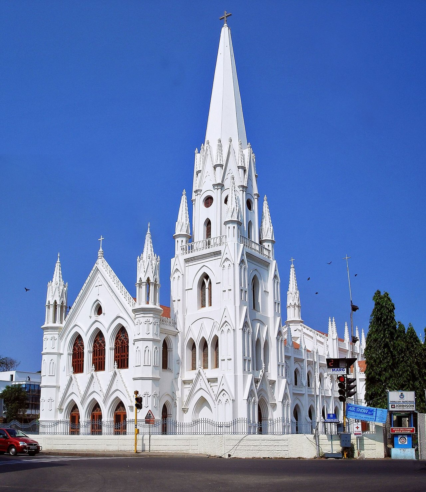

## His story
Thomas, called **Didymus** ("the Twin"), is one of the Twelve. In John's Gospel he is brave ("Let us also go, that we may die with him", 11:16), honest ("Lord, we know not whither thou goest", 14:5), and famous for doubting the Resurrection until he could touch the wounds. When the Risen Christ appeared eight days later, Thomas made the highest confession of faith in the Gospels: **"My Lord and my God"** (John 20:28).

The 3rd-century *Acts of Thomas*, and the living tradition of India's **St Thomas Christians**, say he preached in Kerala from AD 52 and was martyred by a spear near **Mylapore** (Chennai) in 72. Ephrem the Syrian, in the 4th century, speaks of his relics at Edessa.

## Patronages
India, architects and builders (in the *Acts* he is a carpenter sent to build a palace for a king), the doubtful.

## Where to visit
San Thome Basilica, Chennai (his tomb); St Thomas Mount, Chennai; Ortona Cathedral, Italy, which holds relics since 1258.

<figure class=photo>
<picture><source srcset="/static/art/thomas-santhome-600.webp 600w,/static/art/thomas-santhome.webp 1280w" sizes="(max-width:760px) 100vw,760px" type="image/webp"></picture>
<figcaption>San Thome Basilica in Mylapore, Chennai, the nineteenth-century church over the tomb long venerated as his. Photo: <a href="https://commons.wikimedia.org/wiki/File:Santhome_Basilica.jpg">PlaneMad</a>, <a href="https://creativecommons.org/licenses/by-sa/2.5">CC BY-SA 2.5</a>, via Wikimedia Commons.</figcaption>
</figure>

## Trivia
- His feast moved from 21 December to 3 July in the 1969 Roman calendar; Lutherans and Anglicans still keep 21 December, the longest night, "the darkest day for the doubter".
- The Gospel of John 20:19-31 is read every year on the Second Sunday of Easter, so Thomas has a Sunday each year.

## Sources
- [Catholic Encyclopedia: St Thomas the Apostle](https://www.newadvent.org/cathen/14658b.htm)
- [Vatican News: St Thomas, Apostle](https://www.vaticannews.va/en/saints/07/03/st--thomas--apostle.html)
- John 11, 14, 20, 21

Fact-checked on October 22, 2026 against Vatican News, New Advent and Scripture. The Chennai photograph was added November 6, 2026.

