<nav class=toc aria-label="On this page">

On this page

<ol>
<li><a href="#why">Why the Church honours him</a></li>
<li><a href="#roccasecca">A count's son at Roccasecca and Monte Cassino</a></li>
<li><a href="#naples">Naples: Aristotle and the begging friars</a></li>
<li><a href="#tower">Kidnapped: a prisoner in his family's castle</a></li>
<li><a href="#girdle">The firebrand and the angels' girdle</a></li>
<li><a href="#ox">"The dumb ox" and St Albert the Great</a></li>
<li><a href="#paris">Master in Paris</a></li>
<li><a href="#orvieto">Orvieto and the feast of Corpus Christi</a></li>
<li><a href="#hymns">The Eucharistic hymns: Pange Lingua, Tantum Ergo, Adoro Te</a></li>
<li><a href="#summa">The Summa: theology for beginners</a></li>
<li><a href="#crucifix">"You have written well of me, Thomas"</a></li>
<li><a href="#straw">Naples, December 1273: "all I have written is straw"</a></li>
<li><a href="#fossanova">His death at Fossanova</a></li>
<li><a href="#toulouse">The long road to Toulouse</a></li>
<li><a href="#legacy">The Angelic Doctor and patron of schools</a></li>
<li><a href="#places">His places and churches</a></li>
<li><a href="#art">Thomas in art</a></li>
</ol>
</nav>

## His story

He was big and slow-moving and very quiet, and his fellow students called him "the dumb ox." Yet the boy who said so little became the greatest teacher the Church has ever had. St Thomas Aquinas wrote millions of words about God, and every one of them was written, as he said himself, out of love for Christ. Then, near the end of his life, he laid down his pen and said that all he had written seemed to him like straw beside what God had shown him.

His family were nobles who expected him to become a great abbot. Instead he became a poor begging friar, and when his brothers locked him up in their castle to change his mind, he spent his captivity reading the Bible. He went on to teach in Paris, Cologne, Rome and Naples. He gave the Church the *Summa Theologiae*, still studied in every seminary, and he wrote the hymns that Catholics sing before the Blessed Sacrament to this day: the *Pange Lingua*, the *Tantum Ergo* and the *Adoro Te*.

The Dominicans took as their motto a phrase from his writings: *contemplata aliis tradere*, "to hand on to others the things we have contemplated." That was his whole life. He prayed first, and then he taught. Pope Benedict XVI recalled that the Church calls him the *Doctor communis*, the "common" or universal teacher.

### c. 1225 · Roccasecca
Thomas is born in his father's castle at Roccasecca, between Rome and Naples. His father is Landulf, Count of Aquino, and his mother is Theodora.

### c. 1230 · Monte Cassino
At about five years old he is given to the great Benedictine abbey of Monte Cassino as an oblate, to be brought up by the monks.

### 1239 · Naples
The Emperor Frederick II drives the monks out of Monte Cassino, and Thomas goes to study at the new University of Naples. There he meets the philosophy of Aristotle and the friars of St Dominic.

### 1244 · Naples and Roccasecca
He becomes a Dominican friar. On the road north his brothers seize him and hold him prisoner at home for about a year.

### 1245–1248 · Paris
Free again, he studies in Paris under St Albert the Great.

### 1248–1252 · Cologne
He follows Albert to Cologne. His classmates call him "the dumb ox," and Albert says his bellowing will one day be heard throughout the world.

### 1252–1259 · Paris
He lectures in Paris and becomes a master of theology in 1256.

### 1261–1265 · Orvieto
At the papal court of Urban IV he writes the prayers and hymns for the new feast of Corpus Christi.

### 1265–1268 · Rome
At the friary of Santa Sabina he begins the *Summa Theologiae*.

### 1269–1272 · Paris
He teaches in Paris a second time, in the busiest years of his life.

### 1272 · Naples
He founds a Dominican house of studies at San Domenico Maggiore.

### 6 December 1273 · Naples
After an experience at Mass he stops writing. "All that I have written seems like straw to me."

### 7 March 1274 · Fossanova
On his way to the Council of Lyon he falls ill and dies at the Cistercian abbey of Fossanova.

### 18 July 1323 · Avignon
Pope John XXII declares him a saint.

### 28 January 1369 · Toulouse
His relics are brought to the Dominican church of the Jacobins in Toulouse, where they still rest. His feast is kept on this day.

### 1567 · Rome
Pope St Pius V names him a Doctor of the Church.

### 1879–1880 · Rome
Pope Leo XIII's encyclical *Aeterni Patris* calls Catholics back to his teaching. The next year Leo names him patron of all Catholic schools.

<figure class=photo>
<picture><source srcset="/static/art/aquinas-gozzoli-600.webp 600w,/static/art/aquinas-gozzoli.webp 1000w" sizes="(max-width:760px) 100vw,760px" type="image/webp">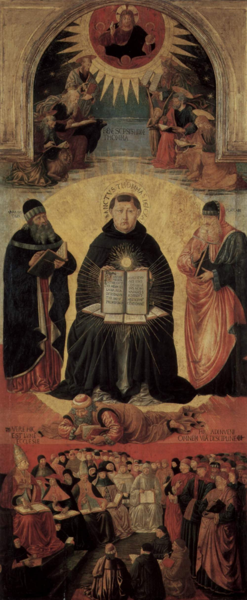</picture>
<figcaption><i>The Triumph of St Thomas Aquinas</i>, by <b>Benozzo Gozzoli</b>, about 1470–75. Thomas sits in glory with the open Scriptures, between the ancient philosophers Aristotle and Plato. At his feet lies the Muslim philosopher Averroës, whose reading of Aristotle Thomas answered. Above, Christ blesses his work; below, a pope and his council listen. Painted for Pisa Cathedral, now in the Louvre, Paris. Image: <a href="https://commons.wikimedia.org/wiki/File:Benozzo_Gozzoli_004.jpg">Benozzo Gozzoli 004</a>, public domain, via Wikimedia Commons.</figcaption>
</figure>

<h2 id=why>Why the Church honours him</h2>

- **He is the Church's great teacher.** He is a Doctor of the Church, named by Pope Pius V in 1567, and called the **Angelic Doctor** and the **Common Doctor**. Pope Benedict XVI noted that after St Augustine he is quoted in the *Catechism of the Catholic Church* more than any other writer, "at least 61 times."
- **He showed that faith and reason are friends.** He taught that the truth we know by reason and the truth God reveals cannot contradict each other, because both come from God. Pope John Paul II called him "a master of thought and a model of the right way to do theology."
- **He gave the Church the Summa Theologiae.** His great summary of the faith, written "for beginners," has shaped Catholic teaching for more than seven hundred years.
- **He wrote the hymns of the Blessed Sacrament.** The *Pange Lingua*, the *Tantum Ergo*, the *O Salutaris*, the *Panis Angelicus* and the *Adoro Te* are sung at Benediction and on Corpus Christi throughout the world.
- **He was a saint, not only a scholar.** He was humble, prayerful and pure. He refused to be made an archbishop. He prayed before he studied, and he asked Christ for no reward but Christ himself.
- **He is the patron of students and schools.** In 1880 Pope Leo XIII made him patron of all Catholic universities, academies, colleges and schools.

<h2 id=roccasecca>A count's son at Roccasecca and Monte Cassino</h2>

Thomas was born in about 1225 in the castle of **Roccasecca**, on a rocky hill above the valley that runs from Rome to Naples. His father, **Landulf**, was Count of Aquino, and his mother, **Theodora**, came from a noble family of Naples. The Aquino family were related to the emperors, and they had sons who were soldiers in the emperor's service. Thomas was the youngest of nine children.

An old story, told by his early biographers, says that before he was born a holy hermit came to Theodora and told her: "He will enter the Order of Friars Preachers, and so great will be his learning and sanctity that in his day no one will be found to equal him." If she heard it, she did not welcome it.

<figure class=photo>
<picture><source srcset="/static/art/aquinas-rocca-castle-600.webp 600w,/static/art/aquinas-rocca-castle.webp 1280w" sizes="(max-width:760px) 100vw,760px" type="image/webp">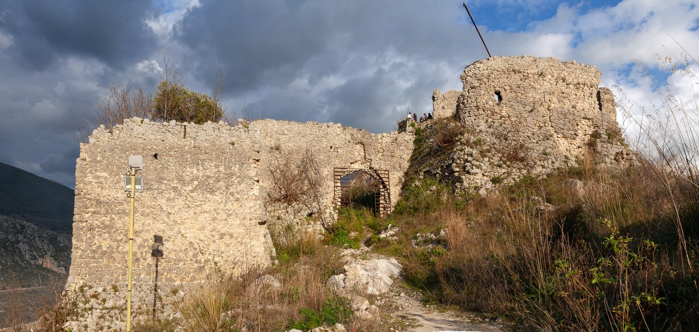</picture>
<figcaption>The ruins of the castle of the Counts of Aquino above <b>Roccasecca</b>, where Thomas was born and where his family held him prisoner. Today only the walls and the stump of a tower remain. Photo: <a href="https://commons.wikimedia.org/wiki/File:The_castle_of_the_Counts_of_Aquino_in_Roccasecca.jpg">The castle of the Counts of Aquino in Roccasecca</a> by Sven-Olav Paavel, <a href="https://creativecommons.org/licenses/by/4.0">CC BY 4.0</a>, via Wikimedia Commons.</figcaption>
</figure>

When he was about five, his parents gave him as an *oblate* to the Benedictine abbey of **Monte Cassino**, the great monastery founded by [St Benedict](/saints/benedict/) on a mountain only a few miles from home. His uncle Sinibald was abbot there, and the family hoped Thomas would one day take his place and bring honour and lands to the house of Aquino. The monks taught him to read and pray, and the story is told that the little boy kept asking his teachers one question: "What is God?" He spent the rest of his life answering it.

<figure class=photo>
<picture><source srcset="/static/art/aquinas-mc-courtyard-600.webp 600w,/static/art/aquinas-mc-courtyard.webp 1280w" sizes="(max-width:760px) 100vw,760px" type="image/webp">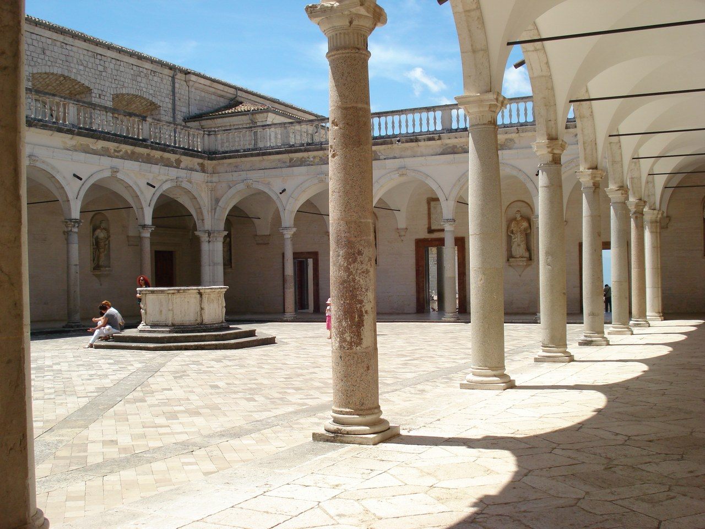</picture>
<figcaption>One of the cloisters of <b>Monte Cassino</b>. The abbey Thomas knew was destroyed and rebuilt several times, most recently after the bombing of 1944, but monks still pray here as they did when he was a boy. Photo: <a href="https://commons.wikimedia.org/wiki/File:Monte_Cassino_Abbey_(one_of_the_courtyards).JPG">Monte Cassino Abbey (one of the courtyards)</a> by Adrian104, public domain, via Wikimedia Commons.</figcaption>
</figure>

<h2 id=naples>Naples: Aristotle and the begging friars</h2>

In 1239 the Emperor Frederick II, at war with the Pope, sent soldiers to Monte Cassino and drove out most of the monks. Thomas, now about fourteen, was sent to study at the **University of Naples**, which Frederick had founded. There he first read **Aristotle**, the Greek philosopher whose books were just reaching the West, and there he met the **Dominicans**, the Order of Preachers that [St Dominic](/saints/dominic/) had founded less than thirty years before.

The friars owned nothing. They begged for their bread, preached in the streets and studied hard so that they could teach the truth. Thomas loved them at once. In 1244, at about nineteen, he asked to join them and received the white habit and black cloak of a Dominican friar.

His family was furious. A count's son did not become a beggar.

<figure class=photo>
<picture><source srcset="/static/art/aquinas-justus-600.webp 600w,/static/art/aquinas-justus.webp 997w" sizes="(max-width:760px) 100vw,760px" type="image/webp">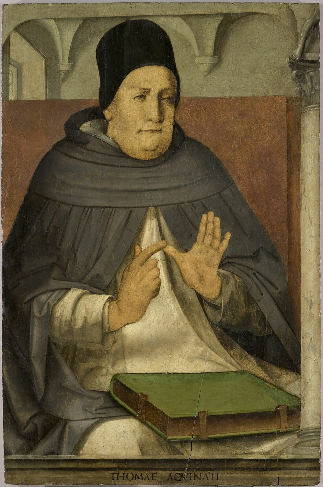</picture>
<figcaption><i>St Thomas Aquinas</i>, by <b>Justus of Ghent</b> and perhaps <b>Pedro Berruguete</b>, about 1474–76. It was one of a series of famous teachers painted for the study of Duke Federico da Montefeltro in his palace at Urbino. Louvre, Paris. Image: <a href="https://commons.wikimedia.org/wiki/File:Gand,_Juste_de_-_Berruguete,_Pedro_-_Saint_Thomas_d%27Aquin,_MI_651_;_Campana_387.jpg">Gand, Juste de - Berruguete, Pedro - Saint Thomas d'Aquin, MI 651 ; Campana 387</a>, public domain, via Wikimedia Commons.</figcaption>
</figure>

<h2 id=tower>Kidnapped: a prisoner in his family's castle</h2>

The Dominicans knew there would be trouble, so they sent their new novice north towards Rome and Paris. But at his mother's request, his brothers, who were soldiers in the emperor's army, rode after him. They caught him on the road near **Aquapendente**, north of Rome, tried to tear off his habit, and carried him home by force.

They shut him up in the family's fortresses, first at **Monte San Giovanni Campano** and then at **Roccasecca**. He was kept there for about a year; some old accounts say nearly two. His parents, brothers and sisters all tried to change his mind. He would not change it.

He did not waste the time. He prayed, and with the help of one of his sisters he got books: the **Holy Scriptures**, Aristotle's *Metaphysics* and the *Sentences* of Peter Lombard, the standard textbook of theology. It is said that he learned much of the Bible by heart, and that he even won his sister over to the religious life. When at last he was let go, his family let him down from the castle in a **basket**, so the old story goes, into the arms of the waiting friars. They found that he had made "as much progress as if he had been in a house of studies."

<figure class=photo>
<picture><source srcset="/static/art/aquinas-rocca-woodcut-600.webp 600w,/static/art/aquinas-rocca-woodcut.webp 1280w" sizes="(max-width:760px) 100vw,760px" type="image/webp">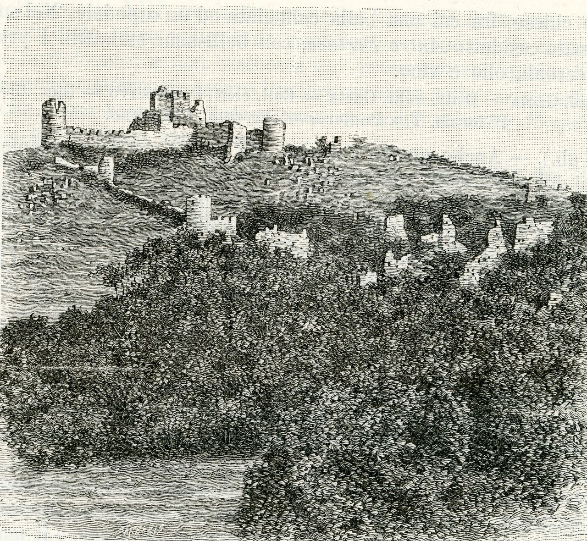</picture>
<figcaption><b>Roccasecca</b> in an engraving of 1898: the castle on the hilltop where Thomas was held, "where St Thomas was born," as the original caption says. Image: <a href="https://commons.wikimedia.org/wiki/File:Roccasecca_veduta_est_del_castello_dei_conti_d%E2%80%99Aquino,_ove_nacque_S._Tommaso.jpg">Roccasecca veduta est del castello dei conti d’Aquino, ove nacque S. Tommaso</a>, public domain, via Wikimedia Commons.</figcaption>
</figure>

<h2 id=girdle>The firebrand and the angels' girdle</h2>

The most famous story from these months is told in the records of his canonisation and by his first biographers. We give it as the Church has long told it, as a tradition.

His brothers, it is said, sent a beautiful young woman into his room to tempt him. Thomas leapt up, seized a burning log from the fire and drove her out of the door. Then he traced a cross on the wall with the charred wood, knelt down and begged God for a pure heart and body for the rest of his life. He fell asleep, and two angels came to him in a dream. They tied a white cord around his waist and said: **"We gird thee with the girdle of perpetual virginity."** From that day, he told his friend Reginald many years later, he was never troubled by temptations of the flesh again.

The cord became a sign of the **Angelic Warfare**, a confraternity for purity that is still kept by the Dominicans today. Its members wear a cord or medal and pray for the gift of chastity through St Thomas's prayers.

<figure class=photo>
<picture><source srcset="/static/art/aquinas-velazquez-600.webp 600w,/static/art/aquinas-velazquez.webp 935w" sizes="(max-width:760px) 100vw,760px" type="image/webp">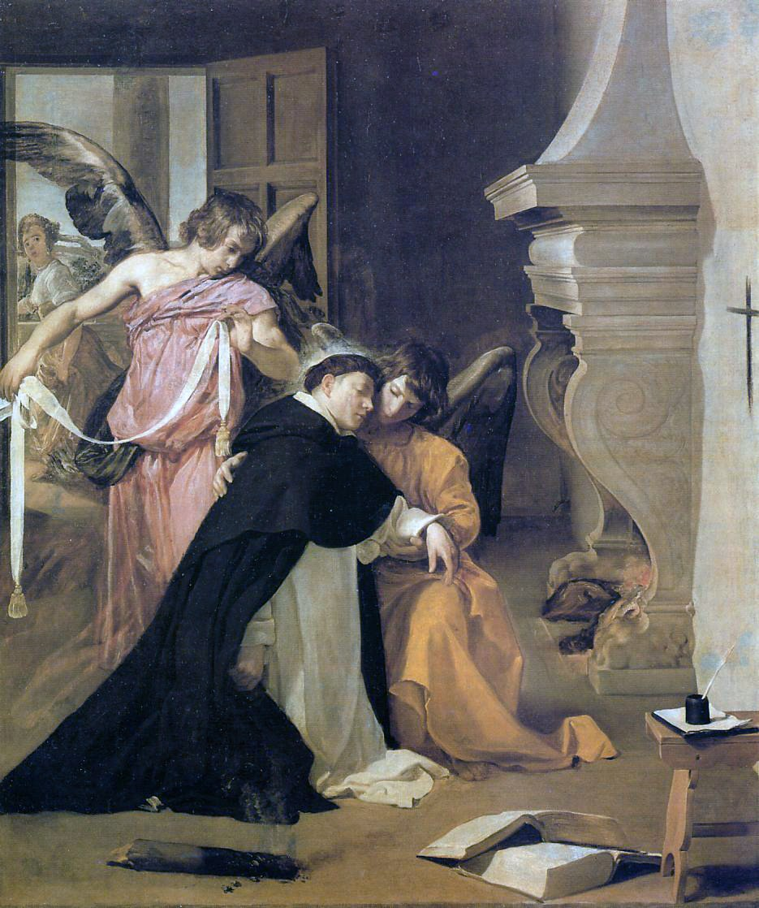</picture>
<figcaption><i>The Temptation of St Thomas Aquinas</i>, by <b>Diego Velázquez</b>, 1632. The burning brand lies on the floor, the woman flees through the door, and the angels hold the exhausted young friar and bring him the white girdle. Museum of Sacred Art, Orihuela Cathedral, Spain. Image: <a href="https://commons.wikimedia.org/wiki/File:Velazquez-Oriola.jpg">Velazquez-Oriola</a>, public domain, via Wikimedia Commons.</figcaption>
</figure>

<h2 id=ox>"The dumb ox" and St Albert the Great</h2>

Free at last, Thomas went to **Paris** in 1245 and studied at the Dominican house of Saint-Jacques under the most famous teacher of the order, **Albert of Cologne**, later called St Albert the Great. In 1248 Albert went to start a new house of studies in **Cologne**, and he took Thomas with him.

Thomas was a big man, quiet and shy, and he sat in class without saying a word. The other students decided he was slow, and they gave him a nickname: *bos mutus*, "the dumb ox." One kind student even offered to help him with his lessons.

Then one day Albert asked Thomas to defend a difficult question in front of the class, and the dumb ox answered so brilliantly that the room fell silent. Albert is said to have told them:

> "We call this young man a dumb ox, but his bellowing in doctrine will one day resound throughout the world."

He was right. It was in Cologne, too, that Thomas was ordained a priest.

<figure class=photo>
<picture><source srcset="/static/art/aquinas-albert-600.webp 600w,/static/art/aquinas-albert.webp 622w" sizes="(max-width:760px) 100vw,760px" type="image/webp">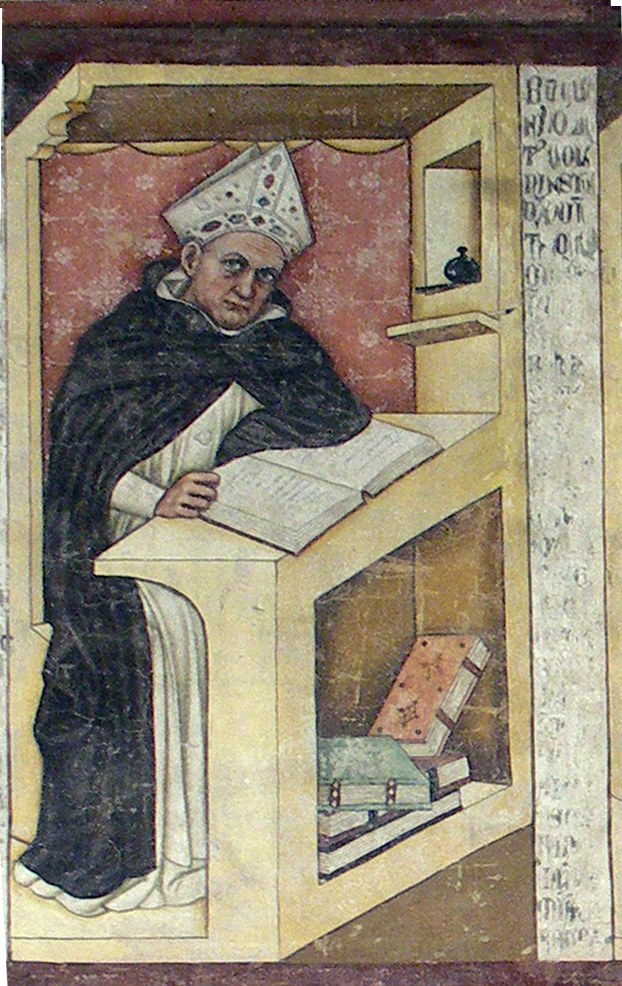</picture>
<figcaption><b>St Albert the Great</b>, Thomas's teacher, painted by <b>Tommaso da Modena</b> in 1352 in the chapter house of the Dominican friary of San Nicolò, Treviso, among forty famous Dominicans at their desks. Image: <a href="https://commons.wikimedia.org/wiki/File:07_Alberto_Magno.jpg">07 Alberto Magno</a>, public domain, via Wikimedia Commons.</figcaption>
</figure>

<h2 id=paris>Master in Paris</h2>

In 1252 Thomas went back to Paris to lecture. These were hard years for the friars. Some masters of the university wanted to drive the new begging orders out, and Thomas wrote in their defence. In 1256, after the intervention of the Pope and of the French king [St Louis IX](/saints/louis-ix/), he was made a **master of theology**, the highest degree in the university, at about thirty-one.

He taught by asking questions. For every subject he set out the arguments against his own view first, fairly and fully, then gave the teaching of Scripture and the Fathers, then his own answer, and then a reply to every objection. He was gentle with opponents. He hardly ever raised his voice, but he was never afraid to think.

Later, in his second time in Paris (1269–1272), he worked at an astonishing speed, writing commentaries on the Gospels, on St Paul and on Aristotle, and dictating to several secretaries at once. His great helper was his friend and confessor, Friar **Reginald of Piperno**, who stayed with him until he died.

<figure class=photo>
<picture><source srcset="/static/art/aquinas-paris-robida-600.webp 600w,/static/art/aquinas-paris-robida.webp 1280w" sizes="(max-width:760px) 100vw,760px" type="image/webp">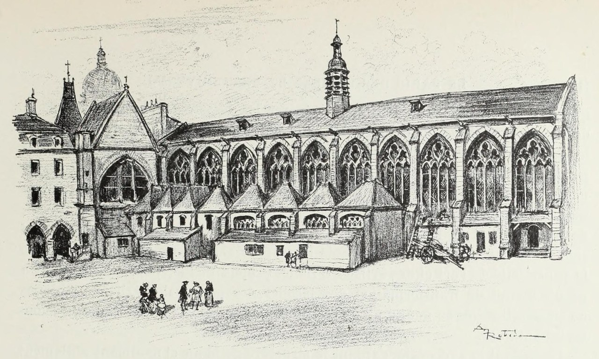</picture>
<figcaption>The church of the Dominican friary of <b>Saint-Jacques</b> in Paris, drawn by <b>Albert Robida</b> in 1895 as it would have looked in the Middle Ages. Thomas studied and taught here. Because of the street name, the friars of Paris were called "Jacobins," and the name stuck to Dominicans all over France. Image: <a href="https://commons.wikimedia.org/wiki/File:Albert_Robida_-_Jacobins_Curch_at_rue_Saint-Jacques,_Paris.jpg">Albert Robida - Jacobins Curch at rue Saint-Jacques, Paris</a>, public domain, via Wikimedia Commons.</figcaption>
</figure>

<figure class=photo>
<picture><source srcset="/static/art/aquinas-paris-plan-600.webp 600w,/static/art/aquinas-paris-plan.webp 1280w" sizes="(max-width:760px) 100vw,760px" type="image/webp">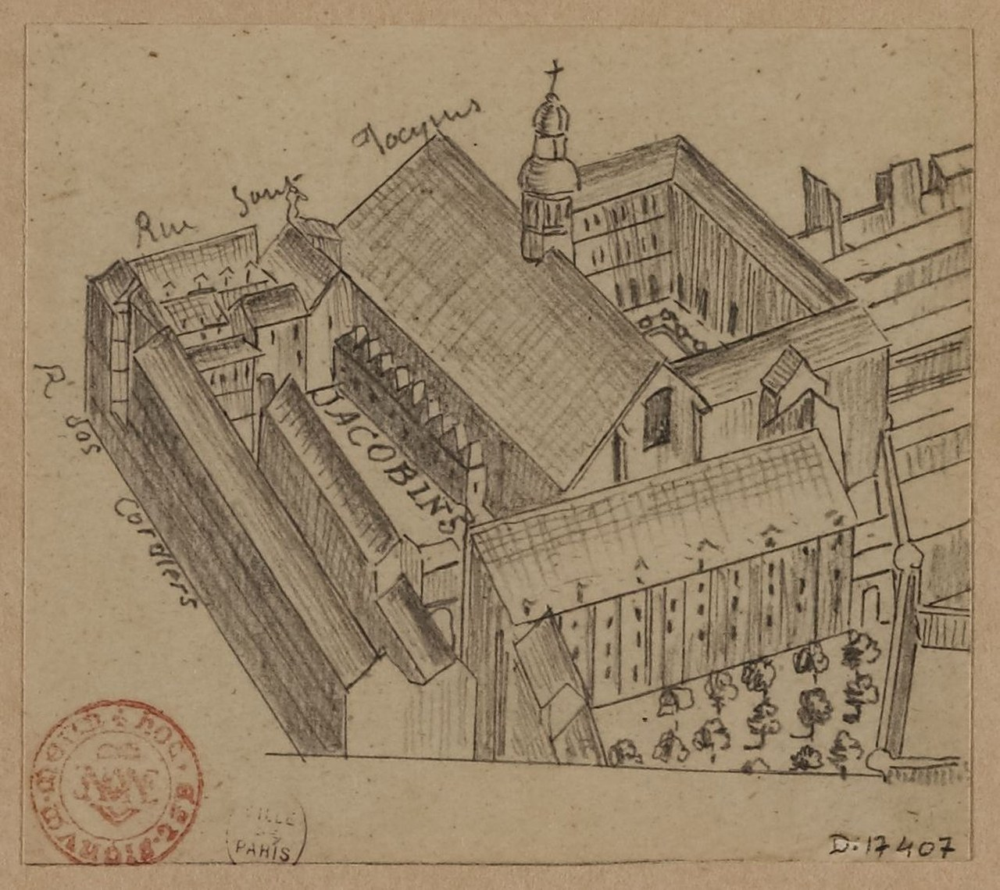</picture>
<figcaption>A bird's-eye view of the <b>convent of the Jacobins</b>, rue Saint-Jacques, Paris. The convent was pulled down after the French Revolution. Drawing in the Musée Carnavalet, Paris. Image: <a href="https://commons.wikimedia.org/wiki/File:Vue_cavali%C3%A8re_du_couvent_des_Jacobins,_rue_Saint-Jacques._D.17407.jpg">Vue cavalière du couvent des Jacobins, rue Saint-Jacques. D.17407</a>, <a href="https://creativecommons.org/publicdomain/zero/1.0/">CC0</a>, via Wikimedia Commons.</figcaption>
</figure>

<h2 id=orvieto>Orvieto and the feast of Corpus Christi</h2>

In 1259 Thomas returned to Italy, and from **1261 to 1265** he lived at **Orvieto**, where Pope **Urban IV** held his court. The Pope loved his learning. There Thomas finished his great work for missionaries, the *Summa contra Gentiles*, and wrote the *Catena Aurea*, the "Golden Chain," a commentary on the four Gospels woven from the words of the Fathers of the Church.

Urban IV had long wanted the whole Church to keep a feast in honour of the Body of Christ in the Eucharist. In 1264 he issued the bull *Transiturus*, establishing the feast of **Corpus Christi**, and he asked Thomas to write the Mass and the prayers of the Divine Office for it.

A famous story is linked with the feast. In 1263, it is told, a priest from Bohemia who doubted that Christ is truly present in the Eucharist was saying Mass at **Bolsena**, a few miles from Orvieto, when blood flowed from the Host onto the linen cloth on the altar, the corporal. The cloth was carried to the Pope at Orvieto, and it is still kept in Orvieto Cathedral. Pope Benedict XVI recalled the miracle of Bolsena when he spoke of Thomas's work for the feast. Historians note that the earliest written accounts of the miracle come from well after 1263, so we tell it as the tradition of Orvieto and Bolsena. You can walk past Bolsena on our [Via Francigena page](/pilgrimage/via-francigena/bolsena-to-rome/).

<figure class=photo>
<picture><source srcset="/static/art/aquinas-raphael-bolsena-600.webp 600w,/static/art/aquinas-raphael-bolsena.webp 1280w" sizes="(max-width:760px) 100vw,760px" type="image/webp">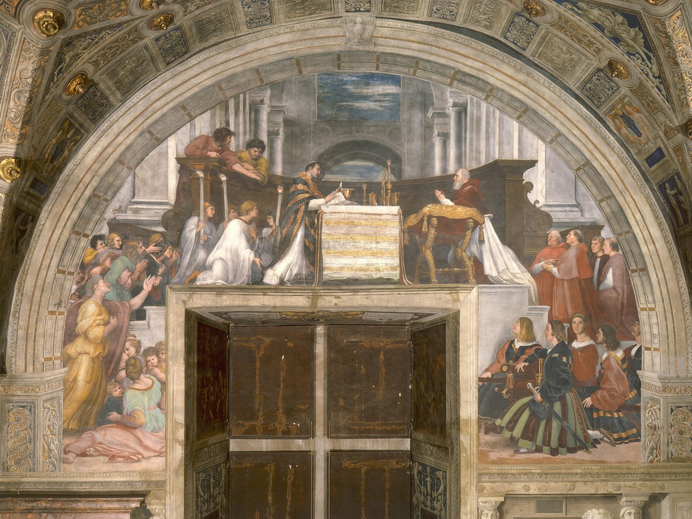</picture>
<figcaption><i>The Mass at Bolsena</i>, by <b>Raphael</b>, 1512, in the Vatican Stanze. The doubting priest sees the Host bleed. Raphael placed his patron Pope Julius II, kneeling, as a witness to the miracle. Image: <a href="https://commons.wikimedia.org/wiki/File:Raphael_-_The_Mass_at_Bolsena.jpg">Raphael - The Mass at Bolsena</a>, public domain, via Wikimedia Commons.</figcaption>
</figure>

<figure class=photo>
<picture><source srcset="/static/art/aquinas-orvieto-corporal-600.webp 600w,/static/art/aquinas-orvieto-corporal.webp 1280w" sizes="(max-width:760px) 100vw,760px" type="image/webp">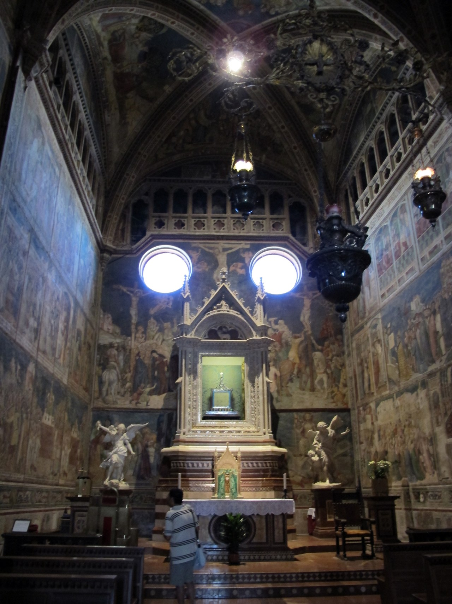</picture>
<figcaption>The <b>Chapel of the Corporal</b> in Orvieto Cathedral, where the linen cloth from the miracle of Bolsena is kept in a golden reliquary. The cathedral was begun in 1290 to house it. Photo: <a href="https://commons.wikimedia.org/wiki/File:Duomo_di_orvieto,_cappella_del_corporale_01.JPG">Duomo di orvieto, cappella del corporale 01</a> by Sailko, <a href="https://creativecommons.org/licenses/by-sa/3.0">CC BY-SA 3.0</a>, via Wikimedia Commons.</figcaption>
</figure>

<h2 id=hymns>The Eucharistic hymns: Pange Lingua, Tantum Ergo, Adoro Te</h2>

The prayers Thomas wrote for Corpus Christi are among the most beautiful in the Church's treasury. They are full of theology, every line exact, and yet they sing. Catholics who have never opened the *Summa* know them by heart.

- **Pange Lingua**, "Sing, my tongue, the Saviour's glory," is sung at Vespers of Corpus Christi and on Holy Thursday, when the Blessed Sacrament is carried to the altar of repose.
- Its last two verses are the **Tantum Ergo**, sung at every Benediction of the Blessed Sacrament. In Edward Caswall's translation:

> "Down in adoration falling,
> Lo! the sacred Host we hail;
> Lo! o'er ancient forms departing,
> Newer rites of grace prevail;
> Faith for all defects supplying,
> Where the feeble senses fail."

- **Verbum Supernum** ends with the **O Salutaris Hostia**, "O saving Victim," also sung at Benediction.
- **Sacris Solemniis** ends with the **Panis Angelicus**, "the Bread of Angels," famous in César Franck's setting.
- **Lauda Sion** is the long sequence sung before the Gospel at the Mass of Corpus Christi.

The **Adoro Te Devote** was not written for the feast. It was a private prayer of Thomas's own, which the Church later took into its books of prayer. For a time scholars doubted that he wrote it, but most now accept it as his. Gerard Manley Hopkins translated its opening lines:

> "Godhead here in hiding, whom I do adore,
> Masked by these bare shadows, shape and nothing more,
> See, Lord, at thy service low lies here a heart
> Lost, all lost in wonder at the God thou art."

The early biographers say that Thomas loved the Eucharist so much that, when he was troubled by a hard question, he would go to the altar and lean his head against the tabernacle, as Pope Benedict put it, "as if to feel the throbbing of Jesus' divine and human heart."

<figure class=photo>
<picture><source srcset="/static/art/aquinas-sassetta-600.webp 600w,/static/art/aquinas-sassetta.webp 1280w" sizes="(max-width:760px) 100vw,760px" type="image/webp">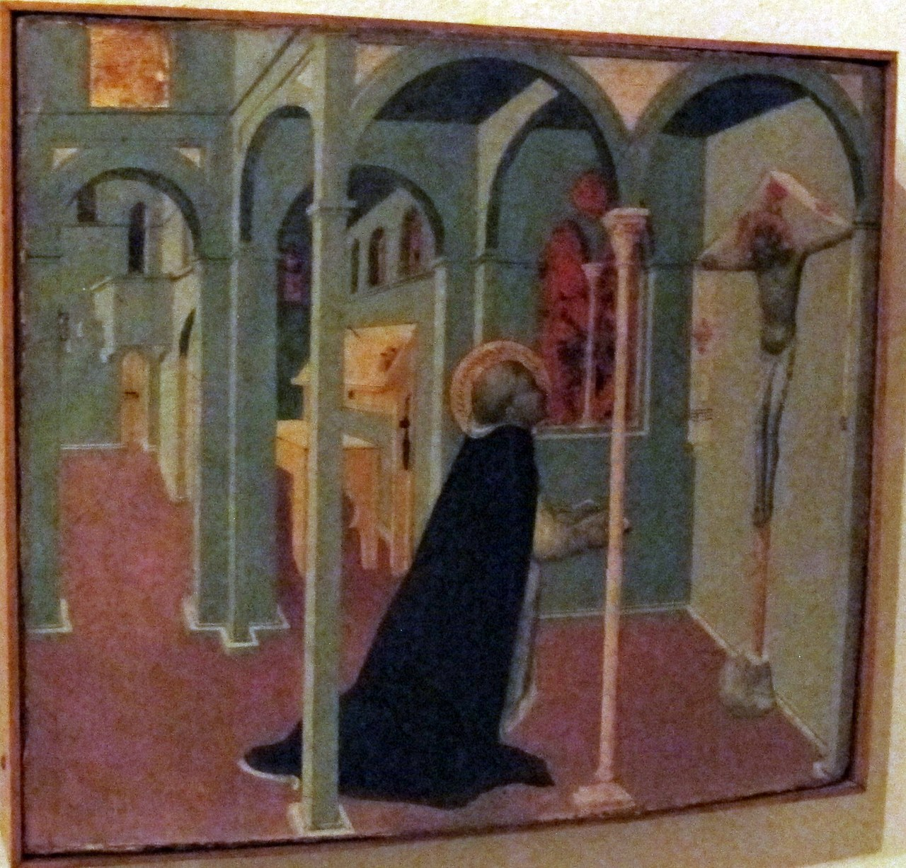</picture>
<figcaption><i>St Thomas Aquinas at Prayer before the Crucifix</i>, by <b>Sassetta</b>, 1423–26. It was painted as part of an altarpiece for the feast of Corpus Christi commissioned by the wool merchants' guild of Siena. Pinacoteca Vaticana. Photo: <a href="https://commons.wikimedia.org/wiki/File:Sassetta,_visione_di_san_tommaso_d%27aquino.JPG">Sassetta, visione di san tommaso d'aquino</a> by Sailko, <a href="https://creativecommons.org/licenses/by-sa/3.0">CC BY-SA 3.0</a>, via Wikimedia Commons.</figcaption>
</figure>

<figure class=photo>
<picture><source srcset="/static/art/aquinas-villaamil-600.webp 600w,/static/art/aquinas-villaamil.webp 1280w" sizes="(max-width:760px) 100vw,760px" type="image/webp">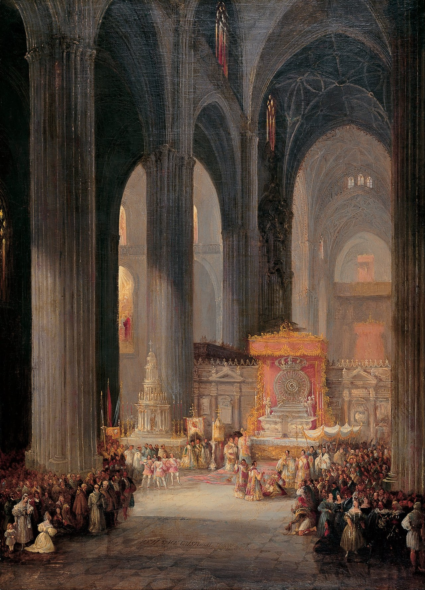</picture>
<figcaption><i>The Corpus Christi Procession inside Seville Cathedral</i>, by <b>Genaro Pérez Villaamil</b>, 1835. Every year, on the feast Thomas wrote for, the Blessed Sacrament is carried through the streets of the world. Image: <a href="https://commons.wikimedia.org/wiki/File:Genaro_P%C3%A9rez_Villaamil_-_The_Corpus_Christi_Procession_inside_Seville_Catedral_-_Google_Art_Project.jpg">Genaro Pérez Villaamil - The Corpus Christi Procession inside Seville Catedral - Google Art Project</a>, public domain, via Wikimedia Commons.</figcaption>
</figure>

<figure class=photo>
<picture><source srcset="/static/art/aquinas-bruckner-600.webp 600w,/static/art/aquinas-bruckner.webp 832w" sizes="(max-width:760px) 100vw,760px" type="image/webp">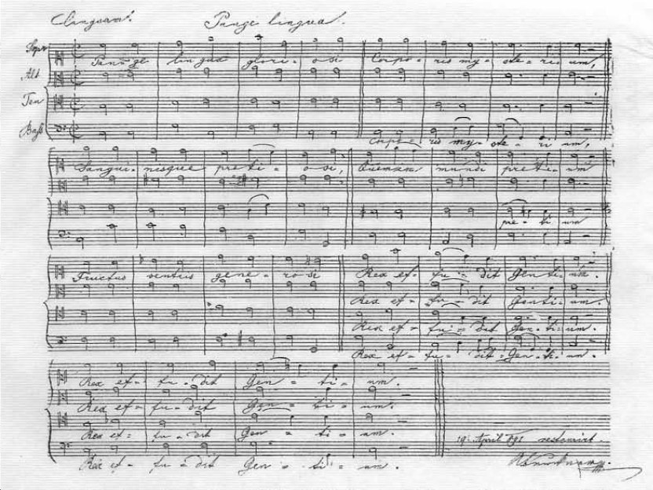</picture>
<figcaption>The <b>Pange lingua</b> set to music by <b>Anton Bruckner</b>, a page in the composer's own hand from 1891. Composers from the Middle Ages to our own day have set Thomas's hymns. Image: <a href="https://commons.wikimedia.org/wiki/File:Bruckner%27s_Pange_lingua_(1891).jpg">Bruckner's Pange lingua (1891)</a>, public domain, via Wikimedia Commons.</figcaption>
</figure>

<h2 id=summa>The Summa: theology for beginners</h2>

In **1265** Thomas was sent to Rome to open a house of studies for young friars at the convent of **Santa Sabina** on the Aventine Hill. There, thinking of students who were just starting out, he began his masterpiece, the **Summa Theologiae**, the "summary of theology."

In the prologue he says that a teacher of Catholic truth must teach not only the advanced but also **beginners**, and that he wants to set things out "briefly and clearly." The work grew to more than five hundred questions, divided into some 2,600 short articles. It begins with God, goes on to man and how we return to God by grace and virtue, and ends with Christ, "who, as man, is our way to God," and the sacraments. Every article follows the same pattern: a question, the objections, the voice of Scripture or the Fathers ("on the contrary..."), his answer ("I answer that..."), and replies to the objections.

Thomas worked on the *Summa* for the rest of his life, in Rome, in Paris and in Naples. He never finished it. It stops in the middle of the third part, at question 90, on the sacrament of penance.

<figure class=photo>
<picture><source srcset="/static/art/aquinas-summa-600.webp 600w,/static/art/aquinas-summa.webp 1280w" sizes="(max-width:760px) 100vw,760px" type="image/webp">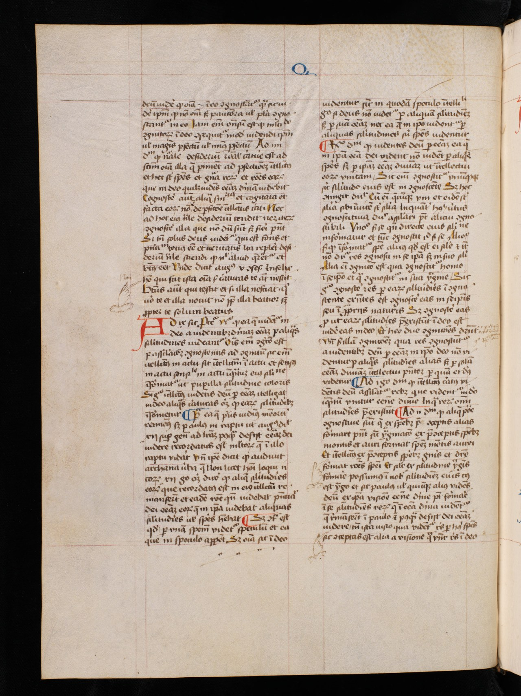</picture>
<figcaption>A page from a fifteenth-century manuscript of the <b>Summa Theologiae</b>, first part. Before printing, every copy of the <i>Summa</i> was written out by hand. University Library, Basel. Image: <a href="https://commons.wikimedia.org/wiki/File:Basel,_Universit%C3%A4tsbibliothek,_A_I_14,_f._25v_%E2%80%93_Thomas_Aquinas,_Summa_theologiae_(prima_pars.JPG">Basel, Universitätsbibliothek, A I 14, f. 25v – Thomas Aquinas, Summa theologiae (prima pars</a>, public domain, via Wikimedia Commons.</figcaption>
</figure>

<figure class=photo>
<picture><source srcset="/static/art/aquinas-giovanni-di-paolo-600.webp 600w,/static/art/aquinas-giovanni-di-paolo.webp 1280w" sizes="(max-width:760px) 100vw,760px" type="image/webp">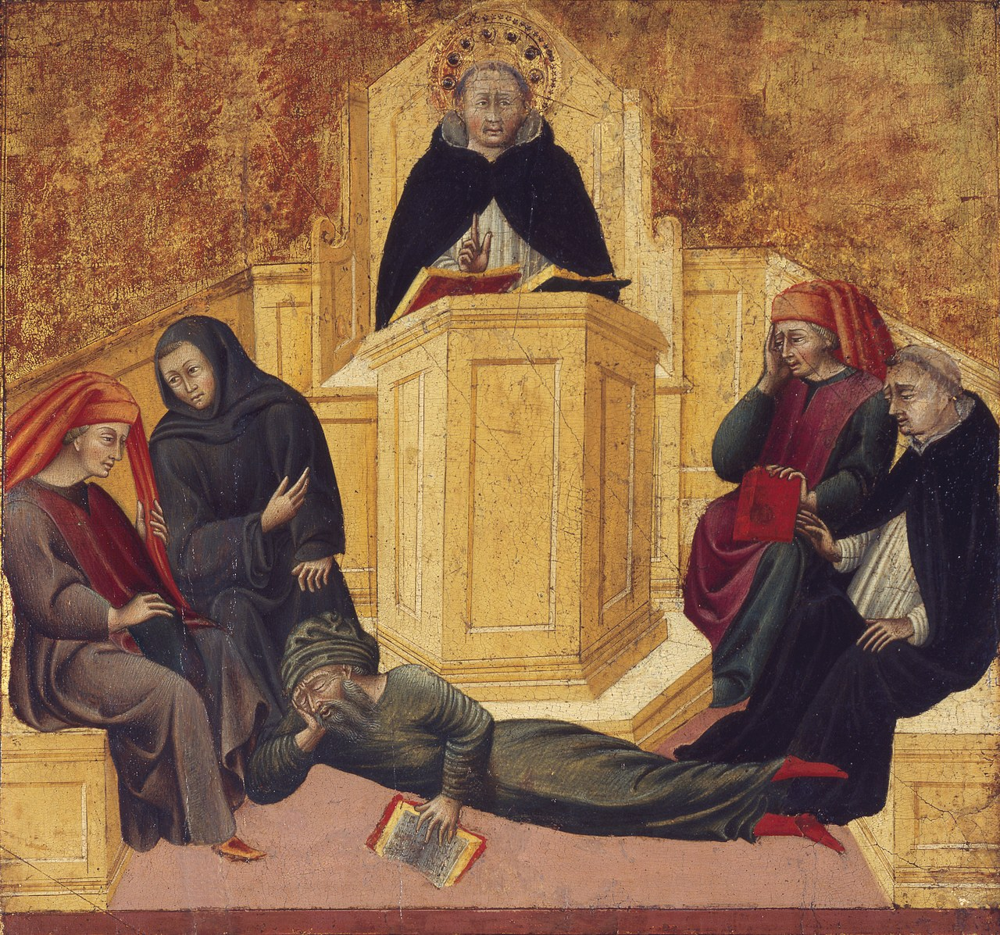</picture>
<figcaption><i>St Thomas Aquinas Confounding Averroës</i>, by <b>Giovanni di Paolo</b>, about 1445–50. The friars and scholars listen as Thomas teaches; the defeated philosopher lies on the floor. Saint Louis Art Museum. Image: <a href="https://commons.wikimedia.org/wiki/File:Giovanni_di_Paolo_-_St._Thomas_Aquinas_Confounding_Averro%C3%ABs_-_56-1941_-_Saint_Louis_Art_Museum.jpg">Giovanni di Paolo - St. Thomas Aquinas Confounding Averroës - 56-1941 - Saint Louis Art Museum</a>, public domain, via Wikimedia Commons.</figcaption>
</figure>

<h2 id=crucifix>"You have written well of me, Thomas"</h2>

In 1272 Thomas was sent back to **Naples**, the city of his youth, to open a house of studies at the friary of **San Domenico Maggiore**. He was writing the third part of the *Summa*, about Christ and the sacraments.

One night, the story goes, the sacristan of the friary, Friar **Domenic of Caserta**, crept into the chapel of St Nicholas after Matins and found Thomas praying, in tears, before a painted crucifix. Thomas seemed to be lifted above the floor. Then Domenic heard a voice come from the cross:

> "Thomas, you have written well of me. What reward will you have?"

And Thomas answered:

> "Nothing but yourself, Lord."

In Latin it is just five words: *Non aliam nisi te, Domine*. The story was told by the witnesses at his canonisation, and similar stories were told of him at Orvieto and in Paris. Pope Benedict XVI said that his answer is "what we too, friends and disciples of Jesus, always want to tell him." The crucifix, a thirteenth-century painting, is still treasured at San Domenico Maggiore.

<figure class=photo>
<picture><source srcset="/static/art/aquinas-santi-di-tito-600.webp 600w,/static/art/aquinas-santi-di-tito.webp 900w" sizes="(max-width:760px) 100vw,760px" type="image/webp">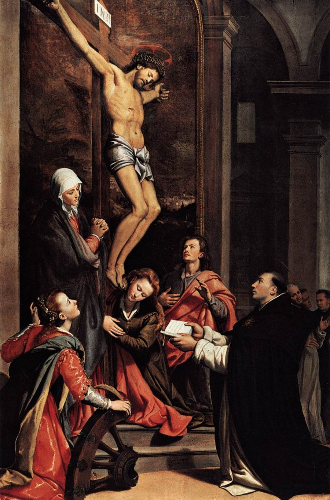</picture>
<figcaption><i>The Vision of St Thomas Aquinas</i>, by <b>Santi di Tito</b>, 1593. Christ speaks to Thomas from the cross while his books lie open on the steps. Church of San Marco, Florence. Image: <a href="https://commons.wikimedia.org/wiki/File:Santi_di_Tito_-_Vision_of_St_Thomas_Aquinas_-_WGA22722.jpg">Santi di Tito - Vision of St Thomas Aquinas - WGA22722</a>, public domain, via Wikimedia Commons.</figcaption>
</figure>

<figure class=photo>
<picture><source srcset="/static/art/aquinas-sdm-crucifix-600.webp 600w,/static/art/aquinas-sdm-crucifix.webp 1280w" sizes="(max-width:760px) 100vw,760px" type="image/webp">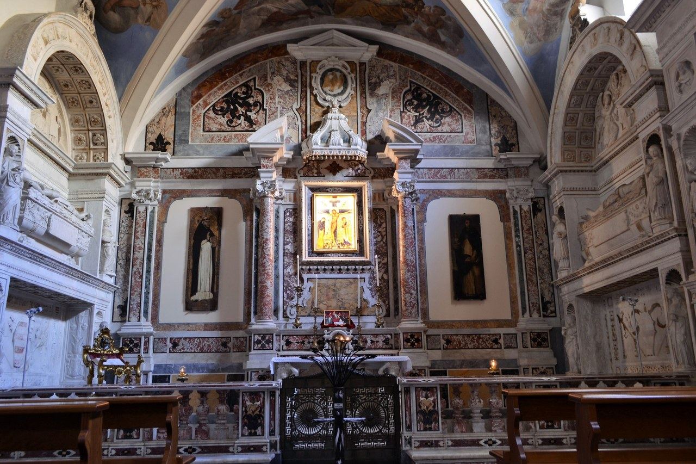</picture>
<figcaption>The <b>Cappellone del Crocifisso</b> at San Domenico Maggiore, Naples, the chapel of the crucifix that, by tradition, spoke to St Thomas. The cross shown here is a photographic copy; the original is kept safe in the friary. Photo: <a href="https://commons.wikimedia.org/wiki/File:Fronte_del_Cappellone_Crocifisso.jpg">Fronte del Cappellone Crocifisso</a> by Giuseppe Guida, <a href="https://creativecommons.org/licenses/by-sa/2.0">CC BY-SA 2.0</a>, via Wikimedia Commons.</figcaption>
</figure>

<h2 id=straw>Naples, December 1273: "all I have written is straw"</h2>

On **6 December 1273**, the feast of St Nicholas, Thomas was saying Mass in the chapel at San Domenico when something happened to him. He did not say what it was. But after that Mass he never wrote or dictated again. He put away his pen and his ink, and the *Summa* was left unfinished.

Reginald begged him to go on. At last Thomas gave him his answer:

> "Reginald, I cannot, because all that I have written seems like straw to me."

The Catholic Encyclopedia gives his words as: "Such secrets have been revealed to me that all I have written now appears to be of little value." He did not mean that his work was false. He meant that he had glimpsed God himself, and that even the greatest book about God is like dry straw beside the living fire. Pope Benedict XVI called it "a mysterious episode" which shows that "all we manage to think and say about the faith is infinitely exceeded by God's greatness and beauty."

<figure class=photo>
<picture><source srcset="/static/art/aquinas-sdm-interior-600.webp 600w,/static/art/aquinas-sdm-interior.webp 1280w" sizes="(max-width:760px) 100vw,760px" type="image/webp">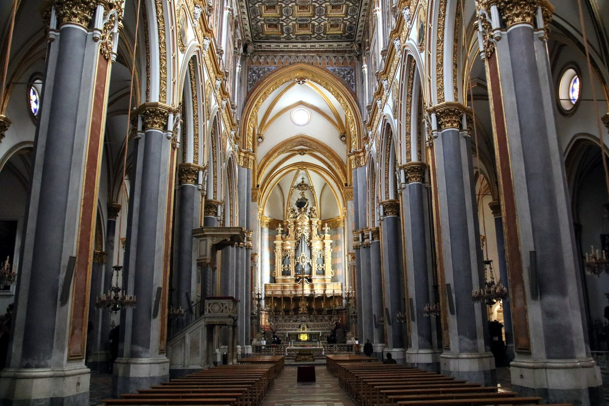</picture>
<figcaption>The nave of <b>San Domenico Maggiore</b>, Naples. Thomas lived, taught and prayed in this friary in his last years. Photo: <a href="https://commons.wikimedia.org/wiki/File:Basilica_di_San_Domenico_Maggiore_(Napoli),_interno_01.jpg">Basilica di San Domenico Maggiore (Napoli), interno 01</a> by Mongolo1984, <a href="https://creativecommons.org/licenses/by-sa/4.0">CC BY-SA 4.0</a>, via Wikimedia Commons.</figcaption>
</figure>

<h2 id=fossanova>His death at Fossanova</h2>

Early in 1274 Pope Gregory X called Thomas to the **Second Council of Lyon**, which was to meet that May to work for the reunion of the Greek and Latin Churches. Though weak, he obeyed and set out north with Reginald. On the road he struck his head on the branch of a fallen tree and fell ill.

He stopped at the castle of his niece at Maenza, and when he grew worse he asked to be taken to the nearby Cistercian abbey of **Fossanova**. "If the Lord wishes to take me away," he said, "it is better that I be found in a religious house." The monks nursed him tenderly, and carried wood for his fire with their own hands. "Whence comes this honour," Thomas said, "that servants of God should carry wood for my fire!" When they asked him to teach them, he explained the Song of Songs, the love song of the soul for God.

When the monks brought him Holy Communion for the last time, he made his profession of faith in the Real Presence and said:

> "I receive Thee, the price of my redemption, for Whose love I have watched, studied, and laboured. Thee have I preached; Thee have I taught. Never have I said anything against Thee: if anything was not well said, that is to be attributed to my ignorance."

He died early in the morning of **7 March 1274**, about forty-nine years old.

<figure class=photo>
<picture><source srcset="/static/art/aquinas-fossanova-nave-600.webp 600w,/static/art/aquinas-fossanova-nave.webp 1280w" sizes="(max-width:760px) 100vw,760px" type="image/webp">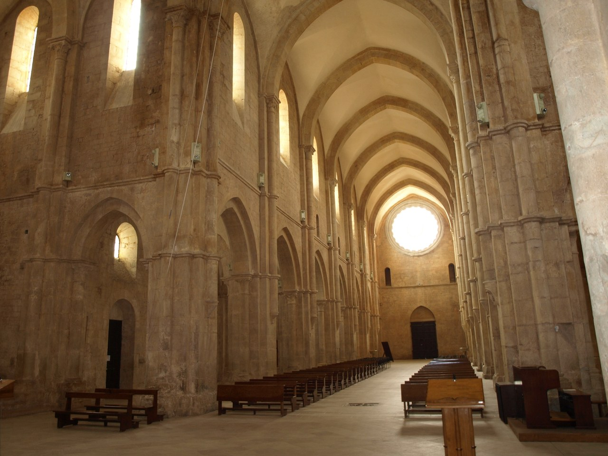</picture>
<figcaption>The nave of the abbey church of <b>Fossanova</b>, plain and bright in the Cistercian way. The monks sang the Office for the dead here for Thomas in March 1274. Photo: <a href="https://commons.wikimedia.org/wiki/File:Abbazia_di_Fossanova-interno_Abbazia_-_panoramio.jpg">Abbazia di Fossanova-interno Abbazia - panoramio</a> by Itto Ogami, <a href="https://creativecommons.org/licenses/by/3.0">CC BY 3.0</a>, via Wikimedia Commons.</figcaption>
</figure>

<h2 id=toulouse>The long road to Toulouse</h2>

After his death, the Dominicans, the monks of Fossanova and even his own family all wanted his body. For nearly a century it stayed at Fossanova. Pope **John XXII** declared him a saint at Avignon on **18 July 1323**, and he is reported to have said that Thomas had worked as many miracles as he had written articles in the *Summa*.

In **1368** Pope **Urban V** decided that the relics should go to **Toulouse**, the city where St Dominic had founded the order in 1215. On **28 January 1369** they were carried in triumph into the great brick church of the Jacobins, the Dominicans of Toulouse. That is why his feast is now kept on 28 January. (Until 1969 it was kept on 7 March, the day of his death.)

During the French Revolution the friars were driven out and the relics were taken for safety to the basilica of Saint-Sernin. In **1974**, the seven hundredth anniversary of his death, they came home to the Jacobins, where they rest today in a reliquary beneath the altar. That same year, on 14 September, Pope **St Paul VI** went to Fossanova and to Aquino to honour him.

<figure class=photo>
<picture><source srcset="/static/art/aquinas-jacobins-altar-600.webp 600w,/static/art/aquinas-jacobins-altar.webp 1280w" sizes="(max-width:760px) 100vw,760px" type="image/webp">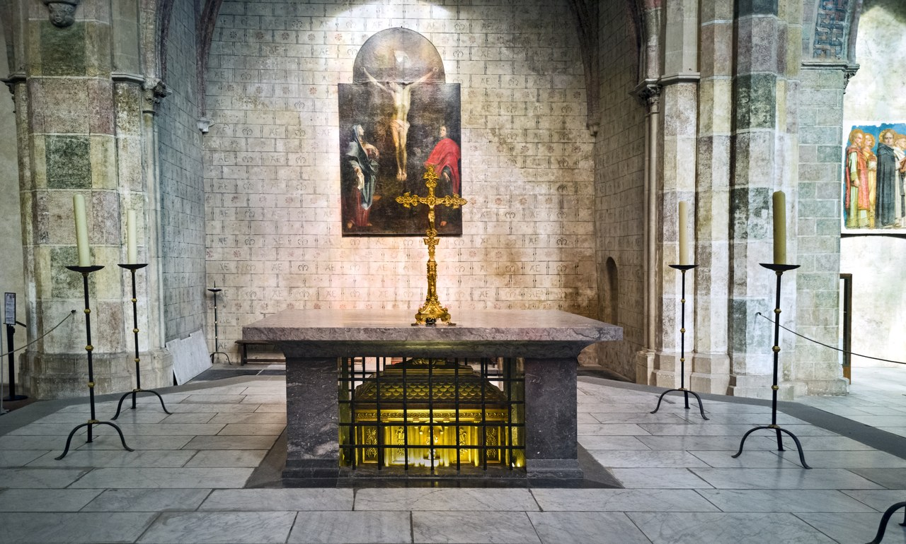</picture>
<figcaption>The <b>altar of St Thomas Aquinas</b> in the church of the Jacobins, Toulouse. His relics lie in the golden reliquary beneath it. Photo: <a href="https://commons.wikimedia.org/wiki/File:Couvent_des_Jacobins_de_Toulouse_-_Autel_de_St_Thomas_d%27Aquin.jpg">Couvent des Jacobins de Toulouse - Autel de St Thomas d'Aquin</a> by Didier Descouens, <a href="https://creativecommons.org/licenses/by-sa/4.0">CC BY-SA 4.0</a>, via Wikimedia Commons.</figcaption>
</figure>

<h2 id=legacy>The Angelic Doctor and patron of schools</h2>

In **1567** Pope St Pius V named Thomas a **Doctor of the Church**, the first to be given the title after the four great Latin Doctors. He has been called the **Angelic Doctor** for the purity of his life and the height of his thought. At the Council of Trent his *Summa*, the story goes, was laid on the altar beside the Bible.

In **1879** Pope **Leo XIII**, in the encyclical *Aeterni Patris*, called him "the prince and master of all Scholastic doctors" and asked all Catholic schools to teach his philosophy. On **4 August 1880** Leo named him **patron of all Catholic universities, academies, colleges and schools**. In 1998 Pope St John Paul II, in *Fides et Ratio*, held him up as a model for anyone who wants to think about the faith.

Thomas himself would have been embarrassed. He once wrote that it is better to give light than only to shine, and better to hand on to others what we have contemplated than only to contemplate. That is the gift he still gives every student who opens his books.

<figure class=photo>
<picture><source srcset="/static/art/aquinas-zurbaran-600.webp 600w,/static/art/aquinas-zurbaran.webp 1000w" sizes="(max-width:760px) 100vw,760px" type="image/webp">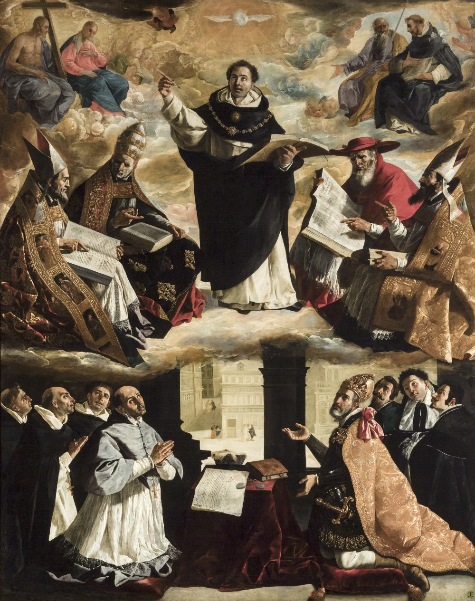</picture>
<figcaption><i>The Apotheosis of St Thomas Aquinas</i>, by <b>Francisco de Zurbarán</b>, 1631, painted for the Dominican College of St Thomas in Seville. Thomas is lifted up between Ambrose, Gregory, Jerome and Augustine, with the light of the Holy Spirit on his pen. Museo de Bellas Artes, Seville. Image: <a href="https://commons.wikimedia.org/wiki/File:Francisco_de_Zurbar%C3%A1n_001.jpg">Francisco de Zurbarán 001</a>, public domain, via Wikimedia Commons.</figcaption>
</figure>

<h2 id=places>His places and churches</h2>

St Thomas spent almost all his life in two places: the roads of central and southern Italy, and the university city of Paris. The map follows his journeys, with an inset of the Italy he knew best, from Orvieto to Naples.

<figure class=map><figcaption>The journeys of St Thomas Aquinas, from Roccasecca and Naples to Paris and Cologne, his last journey to Fossanova, and the carrying of his relics to Toulouse, with an inset of his Italy. Map by The Daily Word; coastlines from Natural Earth (public domain); routes are approximate. Tap to enlarge.</figcaption></figure>

### Les Jacobins, Toulouse: where he rests

The church of the **Jacobins** is the mother church of the Dominican order, built in pink brick from 1230 by the friars of the city where St Dominic founded his order. It is one of the masterpieces of southern French Gothic. In the choir a single slender column sends twenty-two ribs fanning out across the vault, and the people of Toulouse call it **the Palm Tree**. The seven-storey bell tower was added between 1275 and 1315. Since 1974 the relics of St Thomas have rested again beneath the altar. The church is now a museum, but pilgrims still come to pray at his tomb.

<figure class=photo>
<picture><source srcset="/static/art/aquinas-jacobins-600.webp 600w,/static/art/aquinas-jacobins.webp 1280w" sizes="(max-width:760px) 100vw,760px" type="image/webp">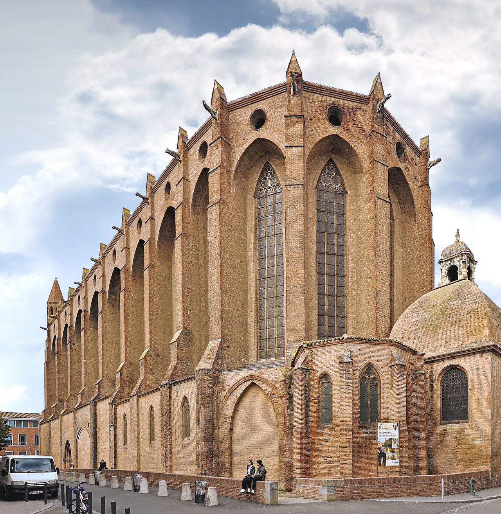</picture>
<figcaption>The church of the <b>Jacobins</b>, Toulouse, built of the pink brick that gives Toulouse its name, "la ville rose." Photo: <a href="https://commons.wikimedia.org/wiki/File:Couvent_des_Jacobins_de_Toulouse.jpg">Couvent des Jacobins de Toulouse</a> by Didier Descouens, <a href="https://creativecommons.org/licenses/by-sa/4.0">CC BY-SA 4.0</a>, via Wikimedia Commons.</figcaption>
</figure>

<figure class=photo>
<picture><source srcset="/static/art/aquinas-jacobins-palm-600.webp 600w,/static/art/aquinas-jacobins-palm.webp 1280w" sizes="(max-width:760px) 100vw,760px" type="image/webp">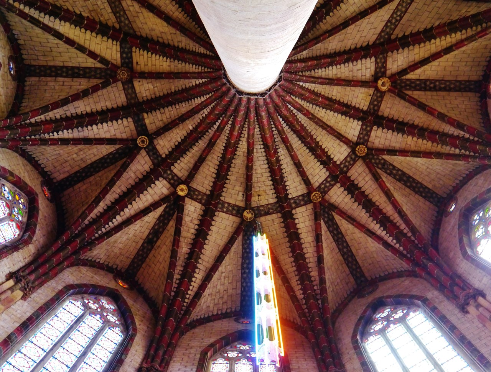</picture>
<figcaption><b>The Palm Tree</b> of the Jacobins: twenty-two ribs spring from one column in the choir. Photo: <a href="https://commons.wikimedia.org/wiki/File:Toulouse_Couvent_des_Jacobins_%C3%89glise_Int%C3%A9rieure_Vo%C3%BBte_Palme_4.jpg">Toulouse Couvent des Jacobins Église Intérieure Voûte Palme 4</a> by Zairon, <a href="https://creativecommons.org/licenses/by-sa/4.0">CC BY-SA 4.0</a>, via Wikimedia Commons.</figcaption>
</figure>

<figure class=photo>
<picture><source srcset="/static/art/aquinas-jacobins-tomb-600.webp 600w,/static/art/aquinas-jacobins-tomb.webp 1280w" sizes="(max-width:760px) 100vw,760px" type="image/webp">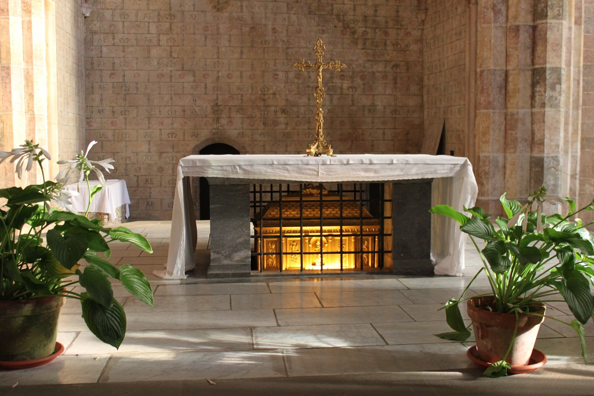</picture>
<figcaption>The tomb of St Thomas Aquinas at the Jacobins. His relics came here in 1369, left during the Revolution, and returned in 1974. Photo: <a href="https://commons.wikimedia.org/wiki/File:Le_tombeau_abritant_les_reliques_de_Saint_Thomas_d%27Aquin_-_panoramio.jpg">Le tombeau abritant les reliques de Saint Thomas d'Aquin - panoramio</a> by Pistolero, <a href="https://creativecommons.org/licenses/by/3.0">CC BY 3.0</a>, via Wikimedia Commons.</figcaption>
</figure>

<figure class=photo>
<picture><source srcset="/static/art/aquinas-jacobins-cloister-600.webp 600w,/static/art/aquinas-jacobins-cloister.webp 1280w" sizes="(max-width:760px) 100vw,760px" type="image/webp">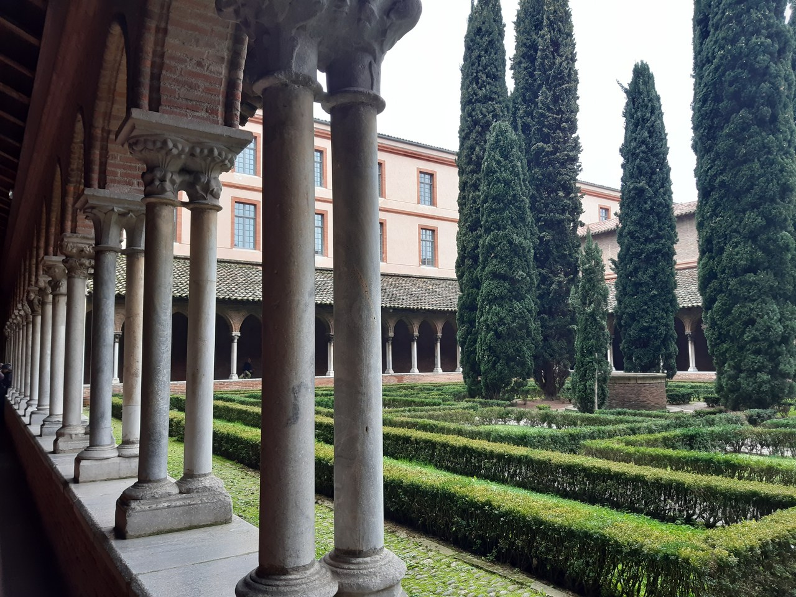</picture>
<figcaption>The cloister of the Jacobins, Toulouse. Photo: <a href="https://commons.wikimedia.org/wiki/File:Clo%C3%AEtre_du_couvent_des_jacobins_de_Toulouse.jpg">Cloître du couvent des jacobins de Toulouse</a> by Paladin errant, <a href="https://creativecommons.org/publicdomain/zero/1.0/">CC0</a>, via Wikimedia Commons.</figcaption>
</figure>

### Fossanova Abbey: where he died

The Cistercian abbey of **Fossanova** stands in the countryside near Priverno, about 100 kilometres (62 miles) south-east of Rome. Its church, consecrated in 1208, is one of the finest early Gothic buildings in Italy, built in the plain, bright style the Cistercian monks brought from Burgundy. Pilgrims are still shown the room in the guest house where St Thomas died.

<figure class=photo>
<picture><source srcset="/static/art/aquinas-fossanova-600.webp 600w,/static/art/aquinas-fossanova.webp 1280w" sizes="(max-width:760px) 100vw,760px" type="image/webp">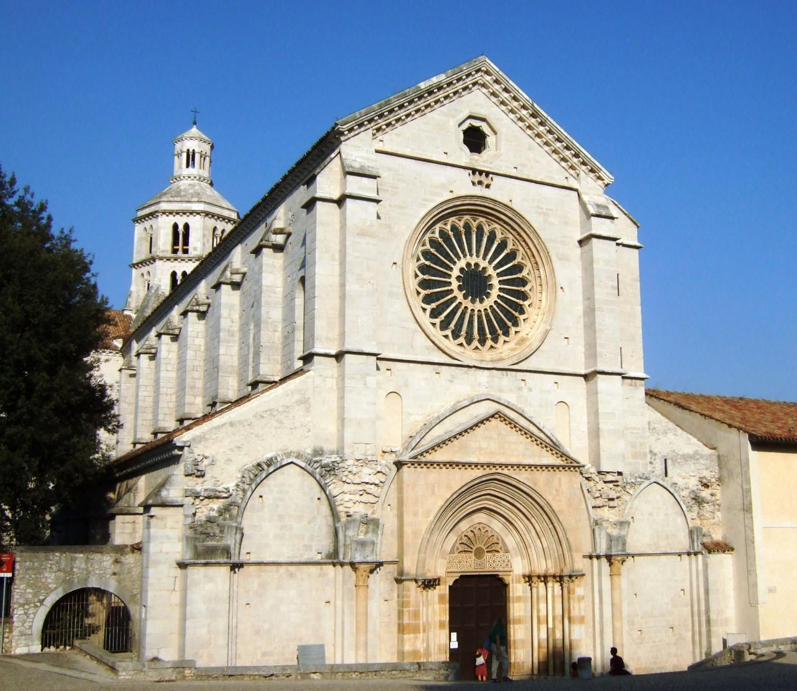</picture>
<figcaption>The abbey church of <b>Fossanova</b>, with its great rose window. Photo: <a href="https://commons.wikimedia.org/wiki/File:Abbazia_di_Fossanova_(2008).jpg">Abbazia di Fossanova (2008)</a> by Pequod76, public domain, via Wikimedia Commons.</figcaption>
</figure>

<figure class=photo>
<picture><source srcset="/static/art/aquinas-fossanova-cloister-600.webp 600w,/static/art/aquinas-fossanova-cloister.webp 1280w" sizes="(max-width:760px) 100vw,760px" type="image/webp">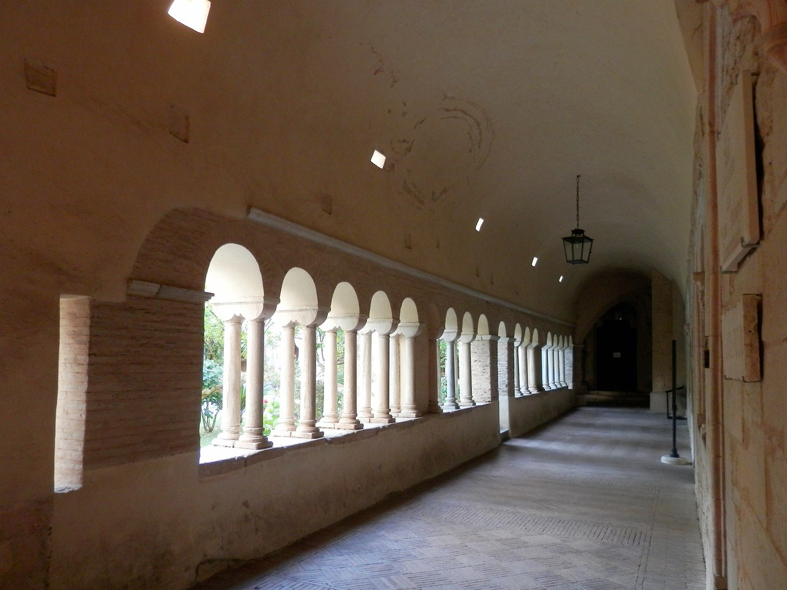</picture>
<figcaption>A walk of the cloister at Fossanova. Photo: <a href="https://commons.wikimedia.org/wiki/File:Fossanova_Abbey_fc06.jpg">Fossanova Abbey fc06</a> by Fczarnowski, <a href="https://creativecommons.org/licenses/by-sa/3.0">CC BY-SA 3.0</a>, via Wikimedia Commons.</figcaption>
</figure>

<figure class=photo>
<picture><source srcset="/static/art/aquinas-fossanova-tower-600.webp 600w,/static/art/aquinas-fossanova-tower.webp 1280w" sizes="(max-width:760px) 100vw,760px" type="image/webp">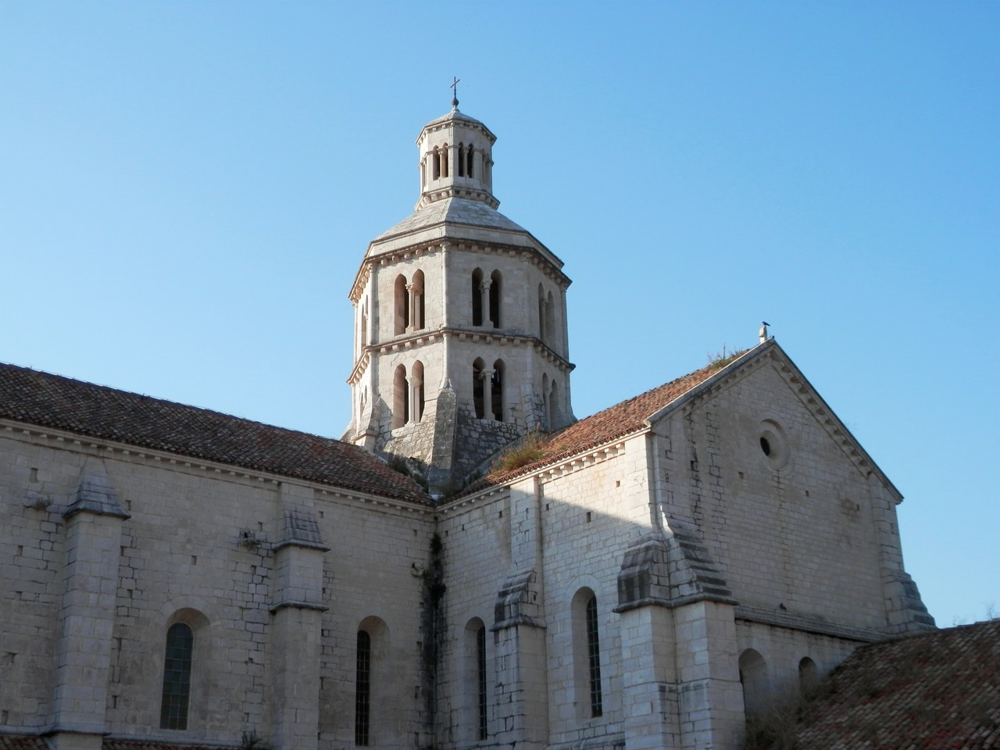</picture>
<figcaption>The bell tower of the abbey church of Fossanova, from the side. Photo: <a href="https://commons.wikimedia.org/wiki/File:Fossanova_Abbey_fc01.jpg">Fossanova Abbey fc01</a> by Fczarnowski, <a href="https://creativecommons.org/licenses/by-sa/3.0">CC BY-SA 3.0</a>, via Wikimedia Commons.</figcaption>
</figure>

### San Domenico Maggiore, Naples

The great Gothic church of the Dominicans of Naples, begun by Charles II of Anjou in the 1280s, grew out of the friary where Thomas joined the order in 1244 and where he came back to teach in 1272. The friary was an early seat of the University of Naples. His cell is still shown to visitors, and in the **Cappellone del Crocifisso** is honoured the crucifix that, by tradition, spoke to him.

<figure class=photo>
<picture><source srcset="/static/art/aquinas-sdm-600.webp 600w,/static/art/aquinas-sdm.webp 1280w" sizes="(max-width:760px) 100vw,760px" type="image/webp">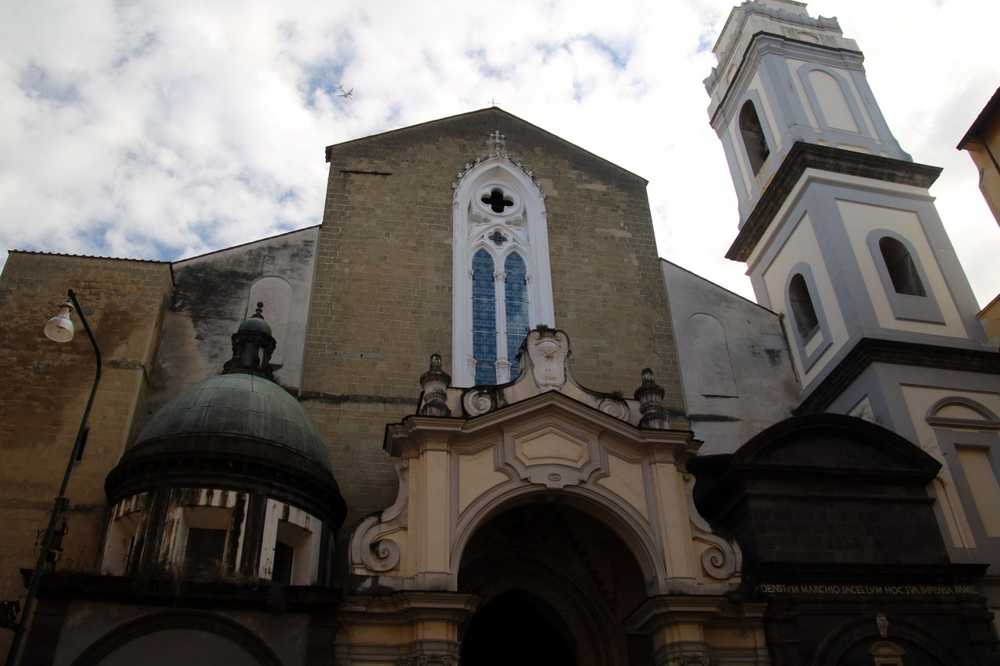</picture>
<figcaption><b>San Domenico Maggiore</b>, Naples, seen from the piazza. Photo: <a href="https://commons.wikimedia.org/wiki/File:Basilica_di_San_Domenico_Maggiore_(Napoli),_facciata_01.jpg">Basilica di San Domenico Maggiore (Napoli), facciata 01</a> by Mongolo1984, <a href="https://creativecommons.org/licenses/by-sa/4.0">CC BY-SA 4.0</a>, via Wikimedia Commons.</figcaption>
</figure>

<figure class=photo>
<picture><source srcset="/static/art/aquinas-sdm-cappellone-600.webp 600w,/static/art/aquinas-sdm-cappellone.webp 1280w" sizes="(max-width:760px) 100vw,760px" type="image/webp">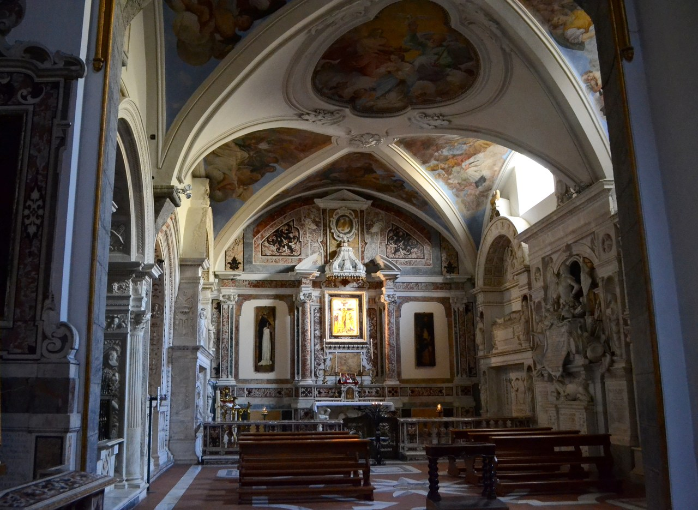</picture>
<figcaption>The <b>Cappellone del Crocifisso</b> in San Domenico Maggiore. Photo: <a href="https://commons.wikimedia.org/wiki/File:Cappellone_del_Crocefisso_napoli.jpg">Cappellone del Crocefisso napoli</a> by Giuseppe Guida, <a href="https://creativecommons.org/licenses/by-sa/2.0">CC BY-SA 2.0</a>, via Wikimedia Commons.</figcaption>
</figure>

### Roccasecca and Monte San Giovanni Campano

Above the town of **Roccasecca** stand the ruins of the castle where Thomas was born, first built by an abbot of Monte Cassino in 994. Near it is a little church dedicated to him. In the castle of **Monte San Giovanni Campano**, about 15 kilometres to the north-west, local tradition shows the room where his brothers held him prisoner; it now holds a sixteenth-century triptych. Pope Paul VI came to Roccasecca and Aquino in 1974.

<figure class=photo>
<picture><source srcset="/static/art/aquinas-rocca-church-600.webp 600w,/static/art/aquinas-rocca-church.webp 1280w" sizes="(max-width:760px) 100vw,760px" type="image/webp">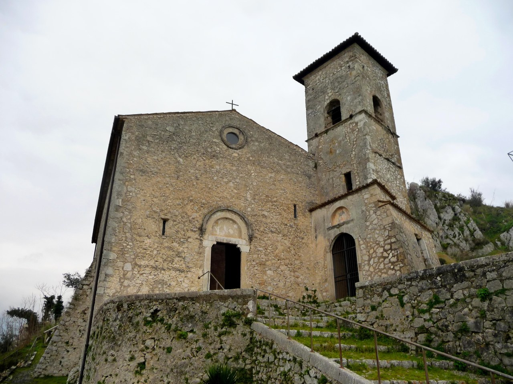</picture>
<figcaption>The little <b>church of St Thomas Aquinas</b>, a few hundred metres from the castle at Roccasecca where he was born. Photo: <a href="https://commons.wikimedia.org/wiki/File:La_chiesa_di_S.Tommaso_d%27Aquino_a_poche_centinaia_di_metri_dal_castello_ove_il_Santo_nacque_-_panoramio.jpg">La chiesa di S.Tommaso d'Aquino a poche centinaia di metri dal castello ove il Santo nacque - panoramio</a> by pietro scerrato, <a href="https://creativecommons.org/licenses/by/3.0">CC BY 3.0</a>, via Wikimedia Commons.</figcaption>
</figure>

### Monte Cassino

The abbey founded by [St Benedict](/saints/benedict/) in about 529 crowns its mountain above the town of Cassino. Thomas lived here as a boy from about 1230 to 1239. The abbey was destroyed in the Second World War and rebuilt "where it was and as it was."

<figure class=photo>
<picture><source srcset="/static/art/aquinas-montecassino-600.webp 600w,/static/art/aquinas-montecassino.webp 1280w" sizes="(max-width:760px) 100vw,760px" type="image/webp">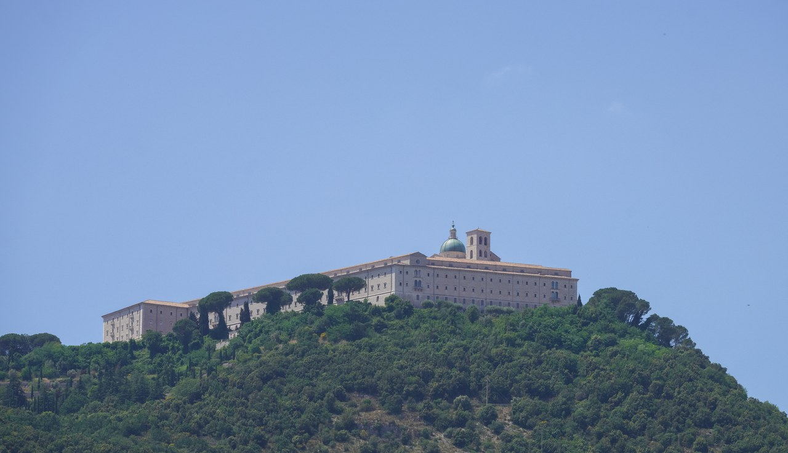</picture>
<figcaption>The abbey of <b>Monte Cassino</b> on its mountaintop, seen from the valley. Photo: <a href="https://commons.wikimedia.org/wiki/File:Monte_Cassino_Abbey.jpg">Monte Cassino Abbey</a> by ThePhotografer, <a href="https://creativecommons.org/licenses/by-sa/4.0">CC BY-SA 4.0</a>, via Wikimedia Commons.</figcaption>
</figure>

### Cologne

Thomas studied in Cologne with St Albert from 1248 to 1252. In the summer of 1248, the year he arrived, the foundation stone of the great Gothic cathedral was laid. St Albert the Great, who died in Cologne in 1280, lies in a Roman sarcophagus in the crypt of the Dominican church of St Andreas.

<figure class=photo>
<picture><source srcset="/static/art/aquinas-cologne-600.webp 600w,/static/art/aquinas-cologne.webp 1280w" sizes="(max-width:760px) 100vw,760px" type="image/webp">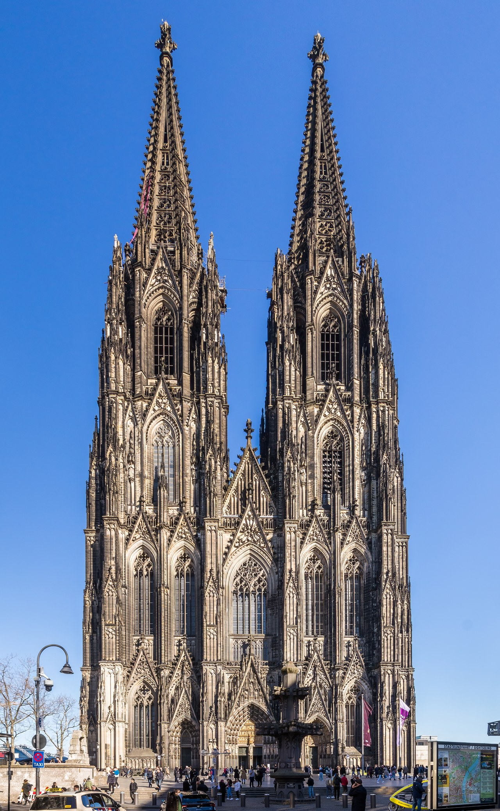</picture>
<figcaption><b>Cologne Cathedral</b>, begun in the year Thomas arrived in the city and not finished until 1880. Photo: <a href="https://commons.wikimedia.org/wiki/File:K%C3%B6lner_Dom_-_Westfassade_2022_ohne_Ger%C3%BCst-0968.jpg">Kölner Dom - Westfassade 2022 ohne Gerüst-0968</a> by Raimond Spekking, <a href="https://creativecommons.org/licenses/by-sa/4.0">CC BY-SA 4.0</a>, via Wikimedia Commons.</figcaption>
</figure>

<figure class=photo>
<picture><source srcset="/static/art/aquinas-albert-tomb-600.webp 600w,/static/art/aquinas-albert-tomb.webp 1280w" sizes="(max-width:760px) 100vw,760px" type="image/webp">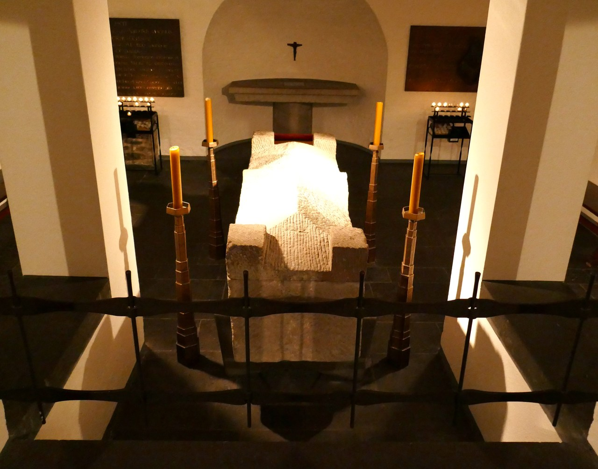</picture>
<figcaption>The sarcophagus of <b>St Albert the Great</b>, Thomas's teacher, in the crypt of St Andreas, Cologne. Photo: <a href="https://commons.wikimedia.org/wiki/File:St._Andreas_Krypta,_K%C3%B6ln_-_Sarkophag_Albertus_Magnus_(01).jpg">St. Andreas Krypta, Köln - Sarkophag Albertus Magnus (01)</a> by 1971markus, <a href="https://creativecommons.org/licenses/by-sa/4.0">CC BY-SA 4.0</a>, via Wikimedia Commons.</figcaption>
</figure>

### Orvieto

Thomas lived at **Orvieto**, high on its rock in Umbria, from 1261 to 1265, while the papal court was there. Its cathedral, begun in 1290 to house the Corporal of Bolsena, has one of the most splendid façades in Italy.

<figure class=photo>
<picture><source srcset="/static/art/aquinas-orvieto-600.webp 600w,/static/art/aquinas-orvieto.webp 1280w" sizes="(max-width:760px) 100vw,760px" type="image/webp">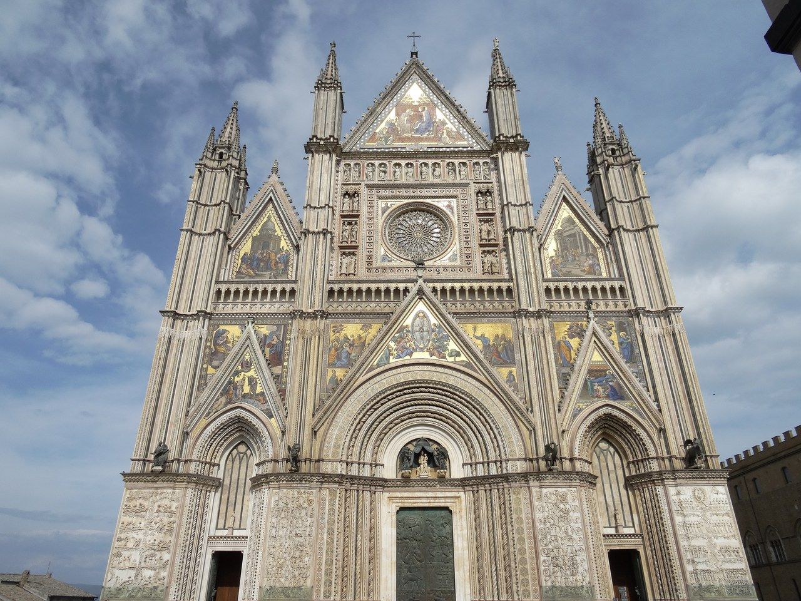</picture>
<figcaption>The façade of <b>Orvieto Cathedral</b>, where the Corporal of Bolsena is kept. Photo: <a href="https://commons.wikimedia.org/wiki/File:Facciata_del_Duomo_di_Orvieto.JPG">Facciata del Duomo di Orvieto</a> by Livioandronico2013, <a href="https://creativecommons.org/licenses/by-sa/3.0">CC BY-SA 3.0</a>, via Wikimedia Commons.</figcaption>
</figure>

### Rome: Santa Sabina and Santa Maria sopra Minerva

Thomas began the *Summa* in the friary of **Santa Sabina** on the Aventine, where St Dominic himself had lived and where the friars still show the old refectory where Thomas ate. A few years later the Dominicans' studium moved to **Santa Maria sopra Minerva**, near the Pantheon, which grew into the College of St Thomas, the ancestor of today's Pontifical University of St Thomas Aquinas, the "Angelicum." In the Minerva the **Carafa Chapel**, painted by Filippino Lippi between 1488 and 1493, is dedicated to the Virgin Mary and to St Thomas. [St Catherine of Siena](/saints/catherine-of-siena/) and the painter Fra Angelico are buried in the same church. For more of the city, see our [Rome pilgrimage guide](/pilgrimage/rome/).

<figure class=photo>
<picture><source srcset="/static/art/aquinas-minerva-600.webp 600w,/static/art/aquinas-minerva.webp 1280w" sizes="(max-width:760px) 100vw,760px" type="image/webp">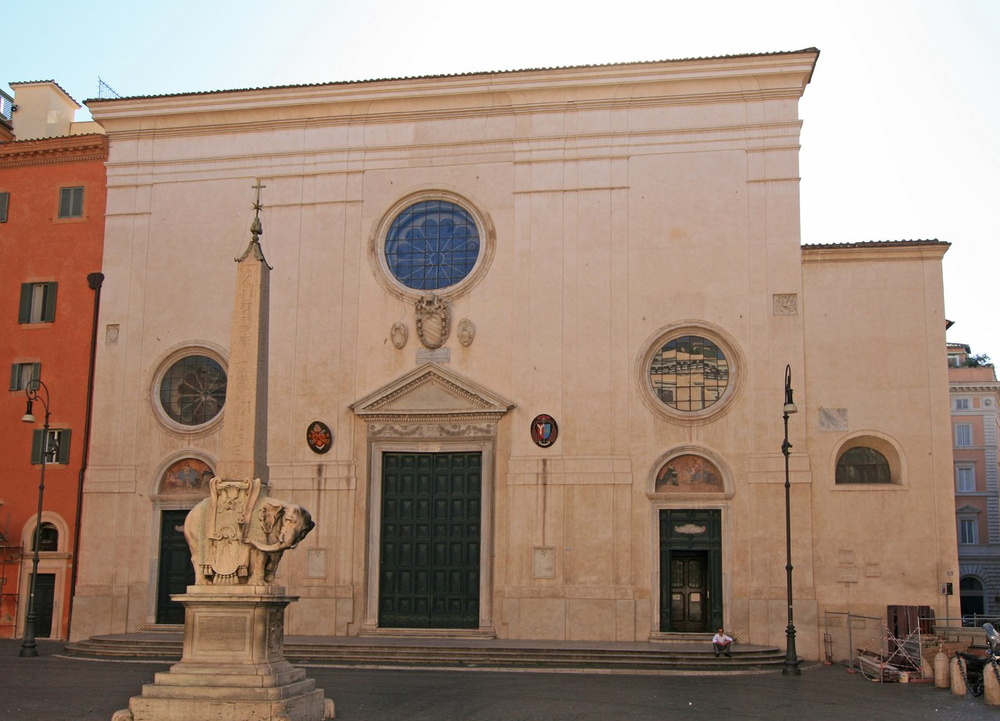</picture>
<figcaption><b>Santa Maria sopra Minerva</b>, Rome, with Bernini's elephant carrying an Egyptian obelisk in front. Photo: <a href="https://commons.wikimedia.org/wiki/File:Santa_Maria_Sopra_Minerva_Rome.jpg">Santa Maria Sopra Minerva Rome</a> by Jensens, public domain, via Wikimedia Commons.</figcaption>
</figure>

<figure class=photo>
<picture><source srcset="/static/art/aquinas-carafa-600.webp 600w,/static/art/aquinas-carafa.webp 1280w" sizes="(max-width:760px) 100vw,760px" type="image/webp">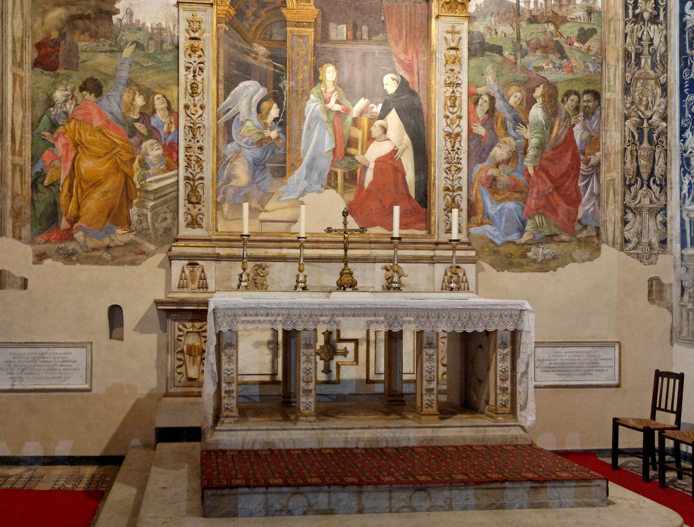</picture>
<figcaption>The <b>Carafa Chapel</b> in Santa Maria sopra Minerva. Above the altar, St Thomas presents Cardinal Oliviero Carafa to the Virgin at the moment of the Annunciation. Photo: <a href="https://commons.wikimedia.org/wiki/File:Carafa_Chapel_Santa_Maria_Sopra_Minerva.jpg">Carafa Chapel Santa Maria Sopra Minerva</a> by Jastrow, public domain, via Wikimedia Commons.</figcaption>
</figure>

<h2 id=art>Thomas in art</h2>

Painters gave St Thomas a few signs so that everyone would know him: the black and white habit of a Dominican, a **book**, a **sun** shining on his chest for the light of his teaching, a **dove** at his ear for the Holy Spirit who inspired him, and sometimes a **lily** for his purity or a **chalice** for his Eucharistic hymns. They painted him most of all in one great scene, the "Triumph of St Thomas," enthroned among the teachers of the Church with the errors he answered lying at his feet.

### The triumph of St Thomas

<figure class=photo>
<picture><source srcset="/static/art/aquinas-memmi-600.webp 600w,/static/art/aquinas-memmi.webp 626w" sizes="(max-width:760px) 100vw,760px" type="image/webp">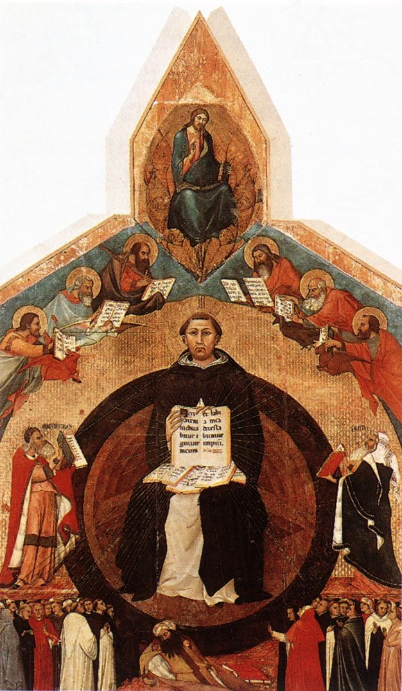</picture>
<figcaption><i>The Triumph of St Thomas Aquinas</i>, attributed to <b>Lippo Memmi</b> (some scholars say Francesco Traini), about 1340. Light comes down to Thomas from Christ, Moses, St Paul and the Evangelists, and he passes it on through his books to the friars below. Church of Santa Caterina, Pisa. Image: <a href="https://commons.wikimedia.org/wiki/File:Lippo_Memmi_-_Triumph_of_St_Thomas_Aquinas_-_WGA15020.jpg">Lippo Memmi - Triumph of St Thomas Aquinas - WGA15020</a>, public domain, via Wikimedia Commons.</figcaption>
</figure>

<figure class=photo>
<picture><source srcset="/static/art/aquinas-bonaiuto-600.webp 600w,/static/art/aquinas-bonaiuto.webp 1280w" sizes="(max-width:760px) 100vw,760px" type="image/webp">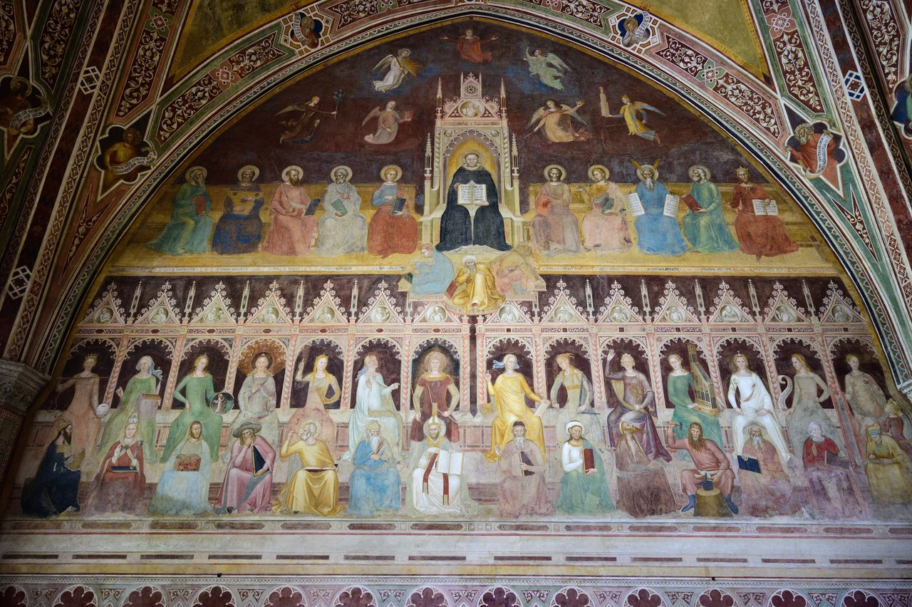</picture>
<figcaption><i>The Triumph of St Thomas Aquinas</i>, by <b>Andrea di Bonaiuto</b>, 1365–67, in the Spanish Chapel of Santa Maria Novella, Florence. Thomas is enthroned among the prophets and saints, with the virtues above him and, below, the sacred and liberal sciences. Photo: <a href="https://commons.wikimedia.org/wiki/File:Triumf_of_Thomas_Aquinas,_fresco_224157.jpg">Triumf of Thomas Aquinas, fresco 224157</a> by Zde, <a href="https://creativecommons.org/licenses/by-sa/4.0">CC BY-SA 4.0</a>, via Wikimedia Commons.</figcaption>
</figure>

<figure class=photo>
<picture><source srcset="/static/art/aquinas-lippi-600.webp 600w,/static/art/aquinas-lippi.webp 1280w" sizes="(max-width:760px) 100vw,760px" type="image/webp">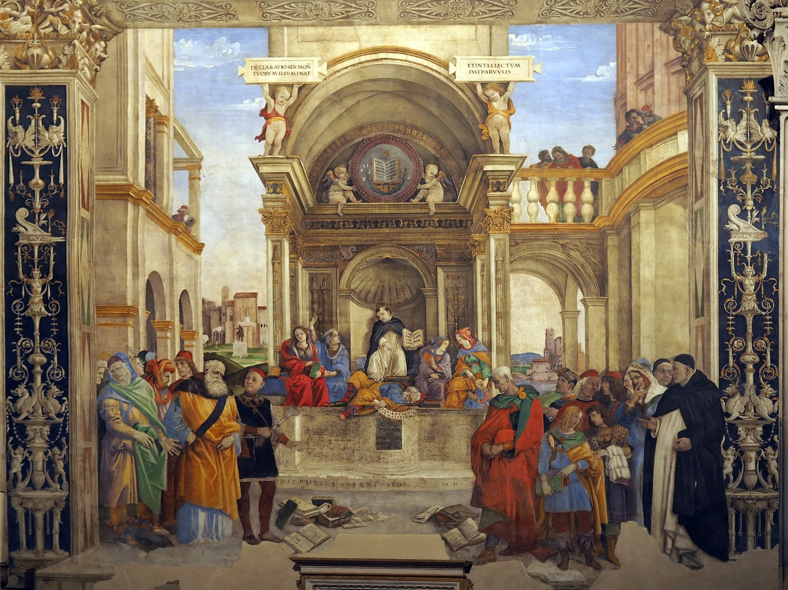</picture>
<figcaption><i>The Triumph of St Thomas Aquinas</i>, by <b>Filippino Lippi</b>, 1488–93, in the Carafa Chapel of Santa Maria sopra Minerva, Rome. The book in his hand reads, from St Paul, <i>Sapientiam sapientum perdam</i>: "I will destroy the wisdom of the wise." Photo: <a href="https://commons.wikimedia.org/wiki/File:Carafa_Kapelle;_Triumph_des_Hl_Thomas.JPG">Carafa Kapelle; Triumph des Hl Thomas</a> by Peter1936F, <a href="https://creativecommons.org/licenses/by-sa/4.0">CC BY-SA 4.0</a>, via Wikimedia Commons.</figcaption>
</figure>

### Portraits of a teacher

<figure class=photo>
<picture><source srcset="/static/art/aquinas-botticelli-600.webp 600w,/static/art/aquinas-botticelli.webp 1152w" sizes="(max-width:760px) 100vw,760px" type="image/webp">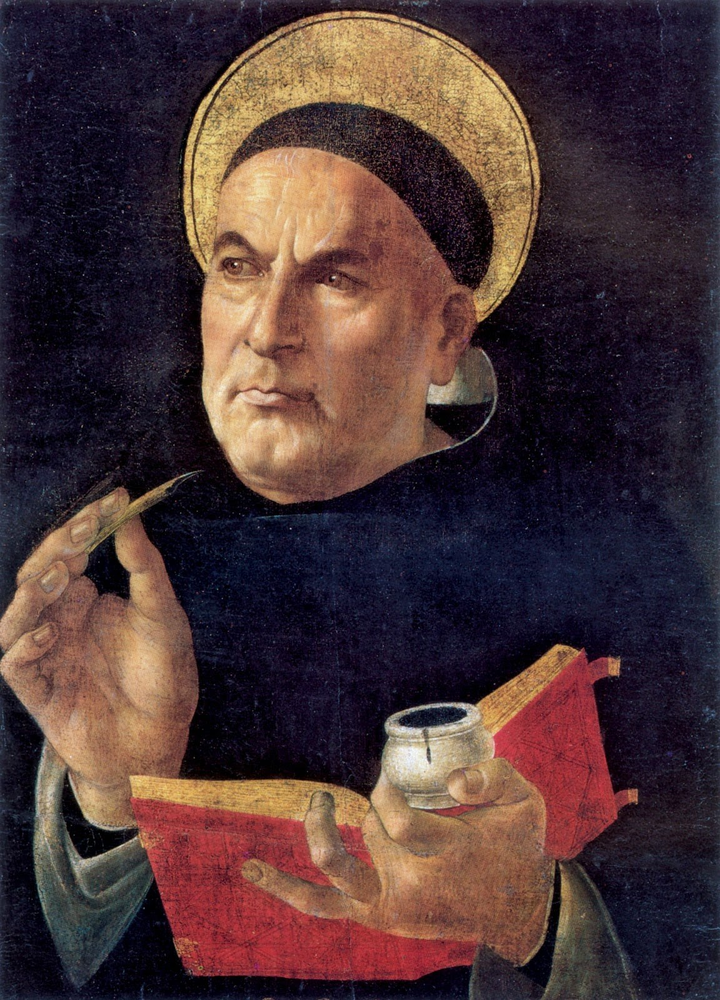</picture>
<figcaption><i>St Thomas Aquinas</i>, attributed to <b>Sandro Botticelli</b>, about 1480–85. Abegg-Stiftung, Riggisberg, Switzerland. Image: <a href="https://commons.wikimedia.org/wiki/File:Thomas_Aquinas_by_Sandro_Botticelli.jpg">Thomas Aquinas by Sandro Botticelli</a>, public domain, via Wikimedia Commons.</figcaption>
</figure>

<figure class=photo>
<picture><source srcset="/static/art/aquinas-fra-bartolomeo-600.webp 600w,/static/art/aquinas-fra-bartolomeo.webp 1280w" sizes="(max-width:760px) 100vw,760px" type="image/webp">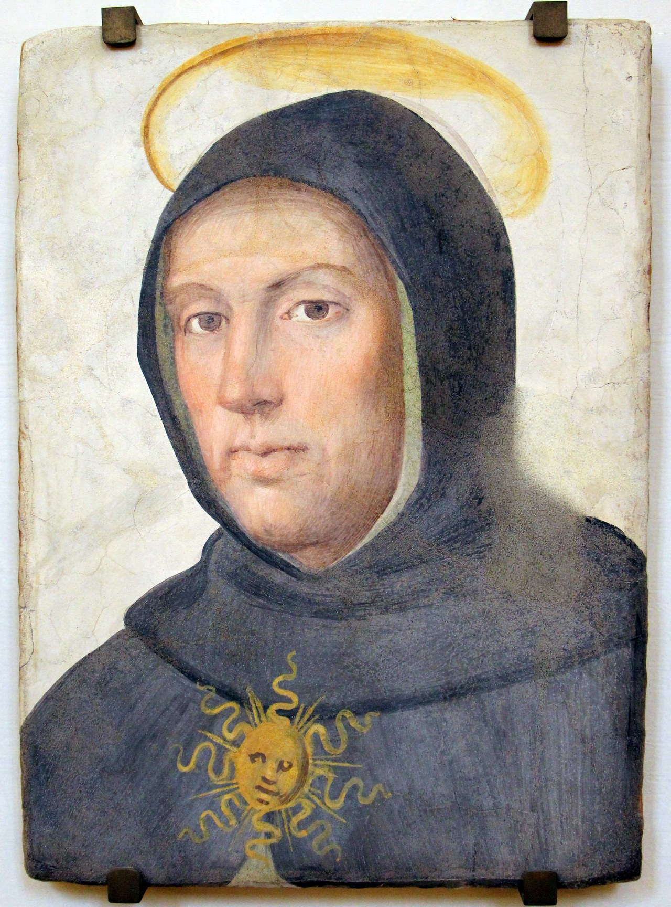</picture>
<figcaption><i>St Thomas Aquinas</i>, by <b>Fra Bartolomeo</b>, about 1509, a fresco from a Dominican guest house at Pian del Mugnone near Fiesole, with the sun of his teaching on his breast. Museo di San Marco, Florence. Photo: <a href="https://commons.wikimedia.org/wiki/File:Fra_bartolomeo,_s._tommaso_d%27aquino,_1509_ca,_da_ospizio_della_maddalena_a_pian_del_mugnone_(fiesole).jpg">Fra bartolomeo, s. tommaso d'aquino, 1509 ca, da ospizio della maddalena a pian del mugnone (fiesole)</a> by Francesco Bini, <a href="https://creativecommons.org/licenses/by-sa/4.0">CC BY-SA 4.0</a>, via Wikimedia Commons.</figcaption>
</figure>

<figure class=photo>
<picture><source srcset="/static/art/aquinas-lotto-600.webp 600w,/static/art/aquinas-lotto.webp 731w" sizes="(max-width:760px) 100vw,760px" type="image/webp">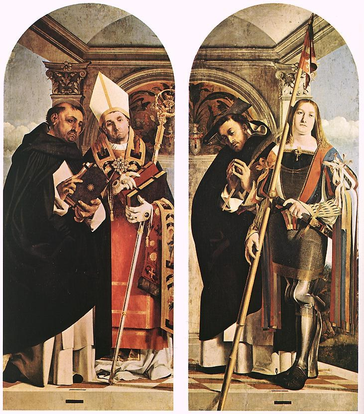</picture>
<figcaption><b>St Thomas Aquinas and St Flavian</b> (left), with St Peter Martyr and St Vitus, by <b>Lorenzo Lotto</b>, 1506–08, panels from the Recanati Polyptych. Pinacoteca Civica, Recanati. Image: <a href="https://commons.wikimedia.org/wiki/File:Lorenzo_Lotto_-_Sts_Thomas_Aquinas_and_Flavian,_Sts_Peter_the_Martyr_and_Vitus_-_WGA13660.jpg">Lorenzo Lotto - Sts Thomas Aquinas and Flavian, Sts Peter the Martyr and Vitus - WGA13660</a>, public domain, via Wikimedia Commons.</figcaption>
</figure>

### Fra Angelico's friar

The Dominican painter **Fra Angelico** painted his brother in religion again and again, and often he put Thomas beside St Dominic as one of the two great saints of the order.

<figure class=photo>
<picture><source srcset="/static/art/aquinas-angelico-hermitage-600.webp 600w,/static/art/aquinas-angelico-hermitage.webp 1280w" sizes="(max-width:760px) 100vw,760px" type="image/webp">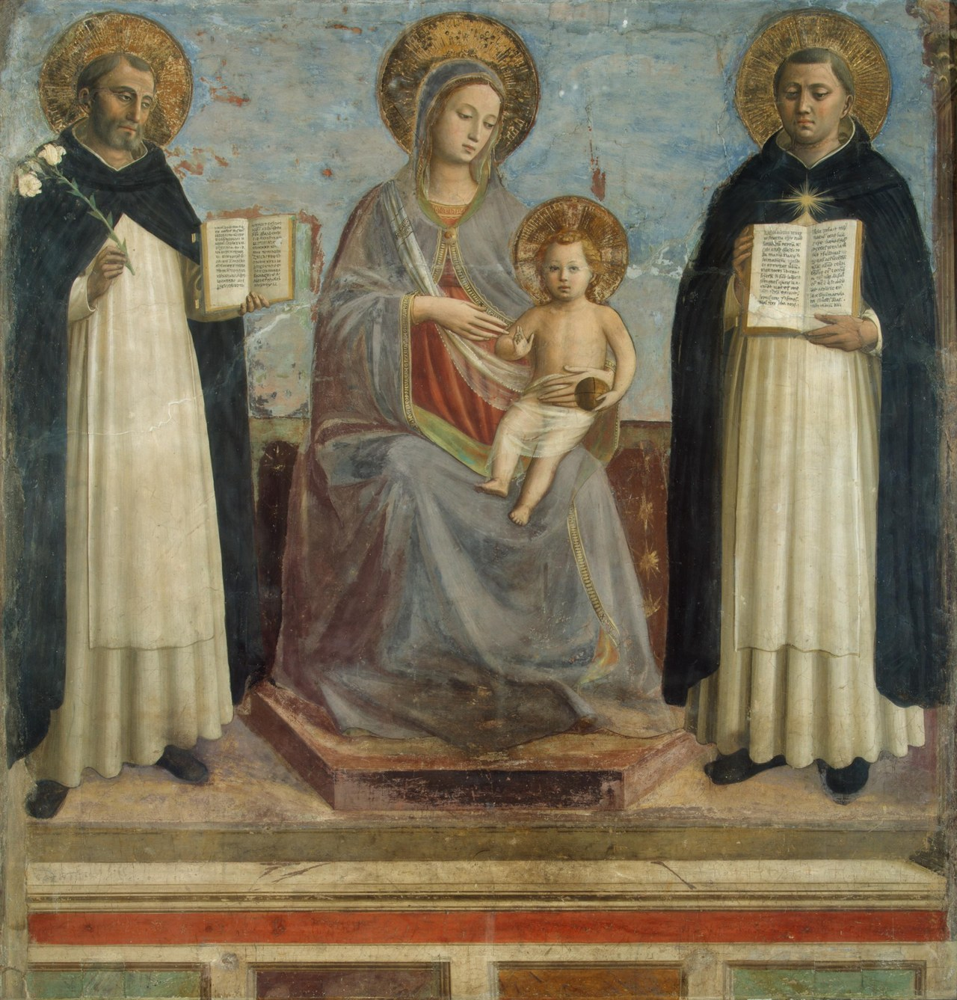</picture>
<figcaption><i>The Virgin and Child with St Dominic and St Thomas Aquinas</i>, by <b>Fra Angelico</b>, about 1430, a fresco from the friary of San Domenico at Fiesole. State Hermitage Museum, St Petersburg. Image: <a href="https://commons.wikimedia.org/wiki/File:Angelico_-_The_Virgin_and_Child_with_Sts_Dominic_and_Thomas_Aquinas,_1430,_%D0%93%D0%AD-253.jpg">Angelico - The Virgin and Child with Sts Dominic and Thomas Aquinas, 1430, ГЭ-253</a>, public domain, via Wikimedia Commons.</figcaption>
</figure>

<figure class=photo>
<picture><source srcset="/static/art/aquinas-angelico-cell-600.webp 600w,/static/art/aquinas-angelico-cell.webp 1008w" sizes="(max-width:760px) 100vw,760px" type="image/webp">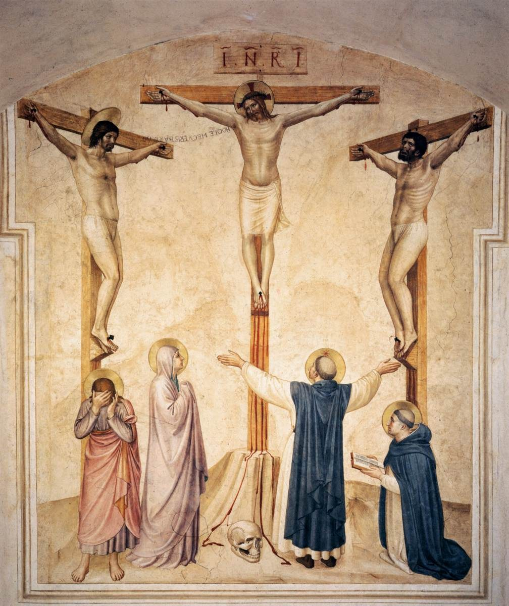</picture>
<figcaption><i>The Crucifixion with St Dominic and St Thomas Aquinas</i>, by <b>Fra Angelico</b>, 1441–42, painted on the wall of a friar's cell at San Marco, Florence, to help him pray. Image: <a href="https://commons.wikimedia.org/wiki/File:Fra_Angelico_-_Crucifixion_with_Mourners_and_Sts_Dominic_and_Thomas_Aquinas_(Cell_37)_-_WGA00551.jpg">Fra Angelico - Crucifixion with Mourners and Sts Dominic and Thomas Aquinas (Cell 37) - WGA00551</a>, public domain, via Wikimedia Commons.</figcaption>
</figure>

<figure class=photo>
<picture><source srcset="/static/art/aquinas-angelico-cini-600.webp 600w,/static/art/aquinas-angelico-cini.webp 482w" sizes="(max-width:760px) 100vw,760px" type="image/webp">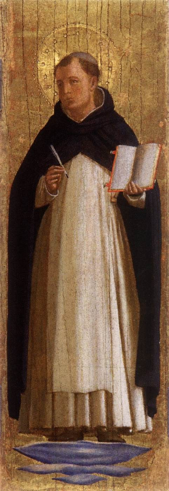</picture>
<figcaption><i>St Thomas Aquinas</i>, a small panel by <b>Fra Angelico</b>, about 1438–40. Collezione Vittorio Cini, Venice. Image: <a href="https://commons.wikimedia.org/wiki/File:Angelico,_san_tommaso_d%27aquino_alla_fondazione_cini.jpg">Angelico, san tommaso d'aquino alla fondazione cini</a>, public domain, via Wikimedia Commons.</figcaption>
</figure>

### The doctor of the Church

<figure class=photo>
<picture><source srcset="/static/art/aquinas-raphael-disputa-600.webp 600w,/static/art/aquinas-raphael-disputa.webp 1280w" sizes="(max-width:760px) 100vw,760px" type="image/webp">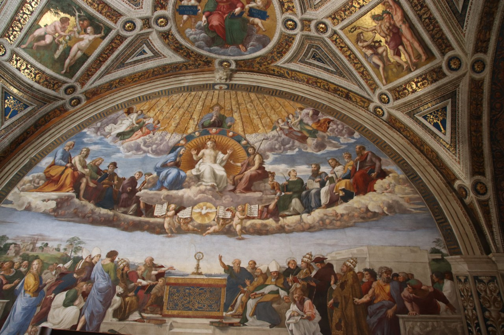</picture>
<figcaption><i>The Disputation of the Holy Sacrament</i>, by <b>Raphael</b>, 1509–10, in the Stanza della Segnatura in the Vatican. Around the altar and the Eucharist stand the great teachers of the Church; St Thomas is traditionally identified among the theologians beside the altar on the right. Photo: <a href="https://commons.wikimedia.org/wiki/File:%22Disputation_of_the_Holy_Sacrament%22_by_Raphael,_Raphael_Rooms,_Vatican_Museum_(48466326127).jpg">"Disputation of the Holy Sacrament" by Raphael, Raphael Rooms, Vatican Museum (48466326127)</a> by Gary Todd, public domain, via Wikimedia Commons.</figcaption>
</figure>

## Path to sainthood
Pope **John XXII** canonised Thomas at Avignon on **18 July 1323**, less than fifty years after his death. Pope **St Pius V** declared him a **Doctor of the Church** in **1567**. His feast on **28 January**, the day his relics came to Toulouse in 1369, is an obligatory memorial in the General Roman Calendar; before the calendar reform of 1969 it was kept on 7 March, the day of his death.

## Patronages
**Students**, **Catholic schools**, **universities**, **colleges** and **academies** (named by Pope Leo XIII in 1880); **theologians**, **philosophers**, scholars and teachers; and purity, through the Angelic Warfare confraternity. He is also the patron of Aquino, the town of his family.

## Trivia
- His name means "Thomas of Aquino," the little town near his birthplace from which his family took its title.
- Friars of his day travelled on foot, and his journeys between Naples, Rome, Paris and Cologne added up to thousands of miles.
- The Dominican motto *contemplata aliis tradere*, "to hand on to others the fruits of contemplation," comes from his *Summa* (II-II, question 188, article 6).
- The *Panis Angelicus*, which César Franck set to music in 1872, is the last two verses of his hymn *Sacris Solemniis*.
- The theological school that follows his teaching is called **Thomism**, and Rome's Dominican university, the Angelicum, is named after his title, the Angelic Doctor.
- In 2024 his skull, kept by the Dominicans in Toulouse, was carried on a pilgrimage across the United States for the 750th anniversary of his death.
- Other Doctors of the Church on this site: [St Augustine](/saints/augustine/), whom he quoted more than any other Father, [St Jerome](/saints/jerome/), [St Ambrose](/saints/ambrose/), [St Gregory the Great](/saints/gregory-the-great/), [St Catherine of Siena](/saints/catherine-of-siena/) and [St Teresa of Ávila](/saints/teresa-of-avila/). Read also of [St Dominic](/saints/dominic/), whose order he joined, [St Benedict](/saints/benedict/), whose monks raised him, and [St Louis IX](/saints/louis-ix/), the king who admired him.

## Sources
- [Pope Benedict XVI, General Audience of 2 June 2010: St Thomas Aquinas (1)](https://www.vatican.va/content/benedict-xvi/en/audiences/2010/documents/hf_ben-xvi_aud_20100602.html)
- [Pope Benedict XVI, General Audience of 16 June 2010: St Thomas Aquinas (2)](https://www.vatican.va/content/benedict-xvi/en/audiences/2010/documents/hf_ben-xvi_aud_20100616.html)
- [Pope Benedict XVI, General Audience of 23 June 2010: St Thomas Aquinas (3)](https://www.vatican.va/content/benedict-xvi/en/audiences/2010/documents/hf_ben-xvi_aud_20100623.html)
- [Pope Leo XIII, encyclical *Aeterni Patris* (4 August 1879)](https://www.vatican.va/content/leo-xiii/en/encyclicals/documents/hf_l-xiii_enc_04081879_aeterni-patris.html)
- [Pope St John Paul II, encyclical *Fides et Ratio* (14 September 1998)](https://www.vatican.va/content/john-paul-ii/en/encyclicals/documents/hf_jp-ii_enc_14091998_fides-et-ratio.html)
- [Catholic Encyclopedia: St Thomas Aquinas](https://www.newadvent.org/cathen/14663b.htm)
- [Catholic Encyclopedia: Feast of Corpus Christi](https://www.newadvent.org/cathen/04390b.htm)
- [Catholic Encyclopedia: Pange Lingua Gloriosi](https://www.newadvent.org/cathen/11441b.htm)
- [St Thomas Aquinas, *Summa Theologiae*, prologue and contents (New Advent)](https://www.newadvent.org/summa/)
- [St Thomas Aquinas, *Summa Theologiae* II-II, question 188 (New Advent)](https://www.newadvent.org/summa/3188.htm)
- [Britannica: St Thomas Aquinas](https://www.britannica.com/biography/Saint-Thomas-Aquinas)
- [Wikipedia: Thomas Aquinas](https://en.wikipedia.org/wiki/Thomas_Aquinas)
- [Wikipedia: Reginald of Piperno](https://en.wikipedia.org/wiki/Reginald_of_Piperno)
- [Wikipedia: Albertus Magnus](https://en.wikipedia.org/wiki/Albertus_Magnus)
- [Wikipedia: Feast of Corpus Christi](https://en.wikipedia.org/wiki/Feast_of_Corpus_Christi)
- [Wikipedia: Pange lingua gloriosi corporis mysterium](https://en.wikipedia.org/wiki/Pange_lingua_gloriosi_corporis_mysterium)
- [Wikipedia: Adoro te devote](https://en.wikipedia.org/wiki/Adoro_te_devote)
- [Wikipedia: Lauda Sion](https://en.wikipedia.org/wiki/Lauda_Sion)
- [Wikipedia: Church of the Jacobins, Toulouse](https://en.wikipedia.org/wiki/Church_of_the_Jacobins)
- [Wikipedia: Fossanova Abbey](https://en.wikipedia.org/wiki/Fossanova_Abbey)
- [Wikipedia: San Domenico Maggiore](https://en.wikipedia.org/wiki/San_Domenico_Maggiore)
- [Wikipedia: Roccasecca](https://en.wikipedia.org/wiki/Roccasecca)
- [Wikipedia: Monte San Giovanni Campano](https://en.wikipedia.org/wiki/Monte_San_Giovanni_Campano)
- [Wikipedia: Monte Cassino](https://en.wikipedia.org/wiki/Monte_Cassino)
- [Wikipedia: Santa Sabina](https://en.wikipedia.org/wiki/Santa_Sabina)
- [Wikipedia: Santa Maria sopra Minerva](https://en.wikipedia.org/wiki/Santa_Maria_sopra_Minerva)
- [Wikipedia: Carafa Chapel](https://en.wikipedia.org/wiki/Carafa_Chapel)
- [Wikipedia: Orvieto Cathedral](https://en.wikipedia.org/wiki/Orvieto_Cathedral)
- [Wikipedia: The Mass at Bolsena (Raphael)](https://en.wikipedia.org/wiki/The_Mass_at_Bolsena)
- [Wikipedia: Temptation of St. Thomas (Velázquez)](https://en.wikipedia.org/wiki/Temptation_of_St._Thomas_(Vel%C3%A1zquez))
- [Wikipedia: Santa Maria Novella (the Spanish Chapel)](https://en.wikipedia.org/wiki/Santa_Maria_Novella)
- [Wikipedia: Disputation of the Holy Sacrament (Raphael)](https://en.wikipedia.org/wiki/Disputation_of_the_Holy_Sacrament)

First written from the Benedict XVI audiences and the Catholic Encyclopedia. Expanded and fact-checked November 25, 2026 with the story of his life from the three audiences of Pope Benedict XVI on St Thomas (June 2010), the Catholic Encyclopedia (which draws on the early lives by William of Tocco and Peter Calo and the records of his canonisation) and Britannica; Leo XIII's <i>Aeterni Patris</i> and John Paul II's <i>Fides et Ratio</i>; his own <i>Summa Theologiae</i> and the Corpus Christi hymns, with the hymn translations of Edward Caswall and Gerard Manley Hopkins; the stories of the firebrand and the angels' girdle, the basket, the speaking crucifix and the miracle of Bolsena, labelled as tradition; the history of his relics from the church of the Jacobins in Toulouse; the churches and places connected with him; and his portrayal in art, using museum records and Wikimedia Commons. The map was drawn for this page from Natural Earth data (public domain). Feast days follow the General Roman Calendar unless noted.

