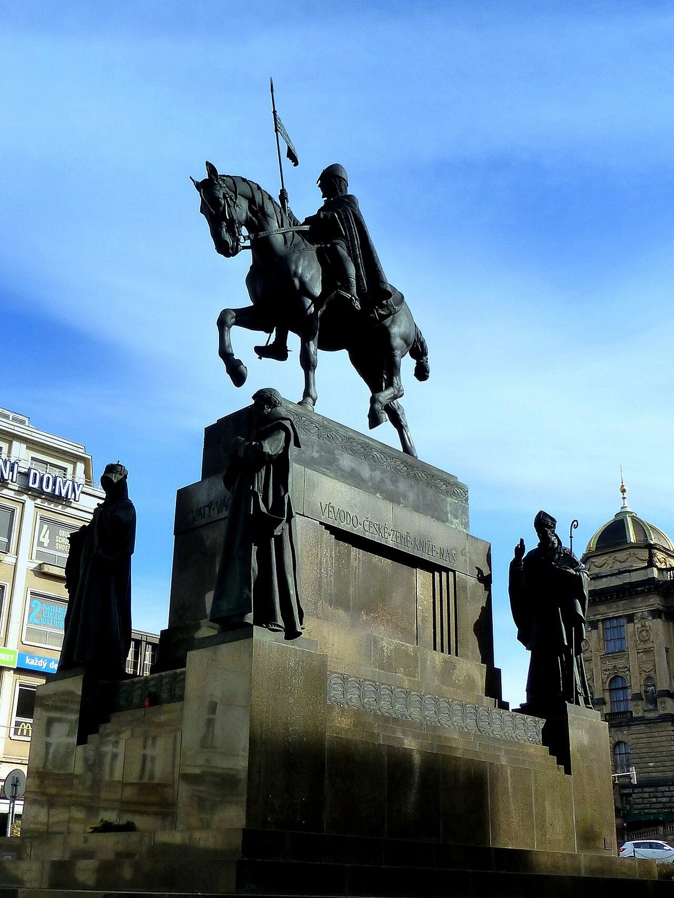

## The story
Wenceslaus (Václav) was Duke of Bohemia in the early 10th century. He was brought up a Christian by his grandmother, **St Ludmila**, who was murdered in 921, probably on the orders of his pagan-leaning mother. As duke he favoured the Church, made peace with the German king Henry the Fowler, and was remembered for charity to the poor. On **28 September 935** (or 929) he was murdered on his way to Mass at **Stará Boleslav** by followers of his brother **Boleslaus**, who took the throne. He ruled as duke. A later report says the emperor Otto I granted him the royal title after his death.

## The full story

### Patron of a nation
He was venerated as a martyr almost at once. His relics were taken to St Vitus's Cathedral in Prague, where the jewelled **St Wenceslas Chapel** holds his tomb, and he became the patron saint of the Czech lands. The equestrian statue in **Wenceslas Square** in Prague is where Czechs gathered in 1918, 1968 and 1989. Bohemia also tells that he sleeps with an army of knights under Mount Blaník and will ride out when the land is in its darkest hour.

<figure class=photo>
<picture><source srcset="/static/art/wenceslaus-square-600.webp 600w,/static/art/wenceslaus-square.webp 1280w" sizes="(max-width:760px) 100vw,760px" type="image/webp"></picture>
<figcaption>Josef Václav Myslbek's monument of St Wenceslaus in Wenceslas Square, with saints of Bohemia at the base. Photo: <a href="https://commons.wikimedia.org/wiki/File:Prag_-_Denkmal_des_Heiligen_Wenzel_-_Pomn%C3%ADk_svat%C3%A9ho_V%C3%A1clava_-_panoramio.jpg">Edgar El</a>, <a href="https://creativecommons.org/licenses/by/3.0">CC BY 3.0</a>, via Wikimedia Commons.</figcaption>
</figure>

### The carol
The English carol "Good King Wenceslas" was written by **John Mason Neale** in 1853, set to a 13th-century spring tune. It tells how the king and his page go out on St Stephen's Day (26 December) to bring food and firewood to a poor man, and how the page walks in his master's footsteps, warmed by the saint's holiness. The story is Neale's, inspired by Wenceslaus's reputation for charity. The murder and the early cult are already in Latin and Old Church Slavonic lives from the 10th century.

## Path to sainthood
Pre-Congregation saint, venerated as a martyr from the 10th century.

## Patronages
The Czech Republic, Bohemia, brewers.

## Trivia
- 28 September is a public holiday in the Czech Republic, Czech Statehood Day.
- The St Wenceslas crown of the Bohemian kings is kept in his chapel and is shown only rarely.

## Sources
- [Catholic Encyclopedia: St Wenceslaus](https://www.newadvent.org/cathen/15587b.htm)

Written October 16, 2026 from the sources above, with the square photograph added November 6, 2026. Feast days follow the General Roman Calendar unless noted.

